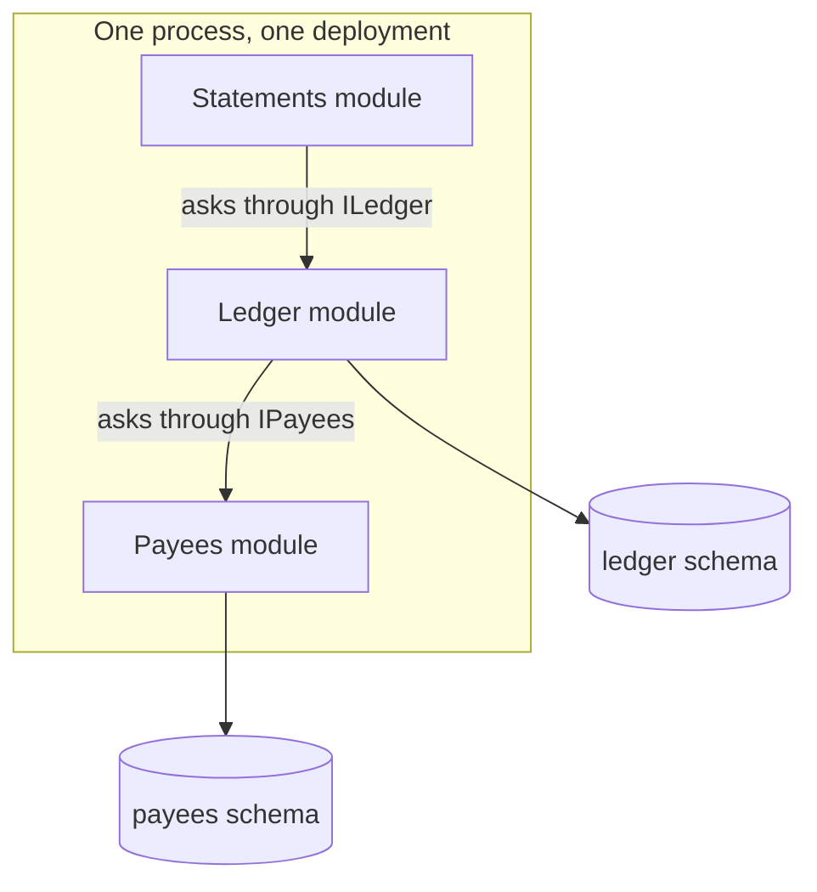

# 1. Split it, or not yet?

## Where we are

The transfer API now does a lot: accounts, transfers, the fraud gate, payments to other banks, statements, notifications. Three teams work in it. The statements team needed a category on every transaction, so they added a required column to the transactions table and a property to the shared `Transaction` class. Their tests passed. In production, every transfer failed for forty minutes, because the transfer code didn't set the new column.

Nobody had done anything unusual. In the lab's API, five of its twelve endpoint files read or write the transactions table directly, through the same class, so a change to either is a change for all five. Since the incident, every release needs all three teams to sign it off, and releases have slowed to one a fortnight. Someone proposes splitting the API into microservices.

## Stop and think

::: think Would microservices have prevented this incident?

Not by themselves. The cause was two teams sharing a table and a class. If a statements service still read and wrote the same transactions table, the same change would break transfers, now across a network boundary where it's harder to see. What prevents it is giving the transactions one owner, and making everyone else go through an interface the owner controls. That can be done inside one codebase. Microservices *enforce* a boundary at runtime; they don't decide where it goes, and they don't create it.

:::

::: think What do transfers and statements lose if they become separate services?

- A function call becomes a network call, which can be slow or fail (all of B4).
- One database transaction becomes several, with no rollback across them (stage 5).
- A join across their data becomes a call or a copy (stage 3).
- One deployment becomes two, which must stay compatible with each other's versions.
- One process to debug becomes several, so a request needs tracing across them (B8).
- More pipelines, more monitoring, more things on call.

:::

::: think So when *is* a separate service worth it?

When the coupling that hurts is the kind only separate deployment removes:

- **Teams block each other's releases**, even with clean code boundaries, because they ship together.
- **Different needs at runtime**: statements run a heavy batch at month end, while transfers need low latency all day; one shouldn't be able to slow the other.
- **Fault isolation**: a memory leak in statements shouldn't restart transfers.
- **A boundary for security or compliance**: card data, for example, carries obligations that are easier to meet in one small service than across a whole codebase.

If none of these apply yet, fix the boundaries inside the codebase first. You'll need them either way.

:::

## The mental model

### Four kinds of coupling

"Coupled" covers four different things, and each has a different fix:

| Coupling | In the transfer API | What removes it | Possible in one codebase? |
|---|---|---|---|
| **Code** | Transfers and statements share the `Transaction` class | Modules that talk through contracts | Yes |
| **Data** | Five endpoint files read and write the transactions table | One owner per table; others ask the owner | Yes |
| **Deployment** | Every team's change ships in the same release | Separate deployables | No |
| **Runtime** | A slow statements query holds connections transfers need (B4 stage 4) | Separate processes; bulkheads help in one | Partly |

Microservices are the step that removes the last two. They don't remove the first two: they make them more expensive. Split a codebase whose code and data are tangled, and you get a *distributed monolith*: services that must still change and deploy together, now with network calls between them.

So the order is: code and data boundaries first, inside one deployable. Then split along those boundaries if deployment or runtime coupling still hurts.

### The modular monolith

A modular monolith is one deployable, divided into modules that each own their code and their data:



The arrows are calls through contracts. Statements have no tables yet; stage 3 gives them some.

- **Each module has a contract**: the only types other modules may use. Everything else is private to the module.
- **Each module owns its tables**, in its own schema. No module reads another's tables; it asks through the contract.
- **The host switches modules on**, and knows nothing about their insides.

The lab's version of the bank, in `samples/src/Bank.Modular`, has three modules. The ledger's contract is everything another module can know about accounts and entries:

<<< @/../samples/src/Bank.Modular.Contracts/Ledger.cs#ledger-contract

The host only switches the modules on:

<<< @/../samples/src/Bank.Modular/Program.cs#modules

And when the ledger needs to know who a payee is, it asks the payees module through its contract, without knowing how payees are stored:

<<< @/../samples/src/Bank.Modular.Ledger/LedgerModule.cs#pay

### Make the boundaries enforceable

Boundaries that rely on everyone remembering them erode under the first deadline. Make the build enforce them:

- **The compiler**, for code. Each module is its own project, every type is internal except the one that switches the module on, and modules reference only the contracts project. Reaching into another module doesn't compile.
- **Tests**, for what the compiler can't see: a module mapping another's tables, or a type made public "just for now".

<<< @/../samples/tests/Bank.Modular.Tests/ModuleBoundaryTests.cs#boundary-tests

In Java the same separation comes from modules or packages with restricted visibility; in any language, architecture-testing libraries (ArchUnit for Java, ArchUnitNET or NetArchTest for .NET) can express rules like these when the code is in one project.

## The escalation ladder

### 1. Conventions

A folder per module, and an agreement not to reach across.

**Fixes:** where code goes, for new code.
**Costs:** nothing.
**Breaks:** under the first deadline. Nothing stops a reach across, and nobody notices until a change breaks it.
**Don't use it when:** more than one team works in the code.

### 2. Modules with contracts and architecture tests

Modules in one project, with rules checked by tests on every build: which namespaces may use which, and which tables each may map.

**Fixes:** reaches across, caught in the build rather than in production.
**Costs:** writing the rules, and fixing the existing violations, which in a large codebase can take months.
**Breaks:** nothing at runtime; tests can be skipped or weakened, so review changes to them.

### 3. A project per module, internal by default, a schema per module

What the lab does: the compiler stops code reaching across, the tests stop data reaching across.

**Fixes:** code and data coupling, enforced.
**Costs:** more projects, explicit contracts, and some duplication where modules used to share a class.
**Breaks:** nothing, but deployment and runtime coupling remain: one release, one process, one connection pool.
**Don't use it when:** the codebase is small and owned by one team; folders are enough.

### 4. Separate services

Each module becomes its own deployable, with its own database.

**Fixes:** deployment and runtime coupling: teams release on their own schedule, and one service's failure or load stays its own.
**Costs:** network calls, eventual consistency, sagas, versioned APIs, tracing, and the operational work of running several services: the rest of this journey.
**Breaks:** anything that relied on a shared transaction or a join.
**Don't use it when:** the boundaries aren't settled yet (moving a boundary between services is far harder than between modules), or there's no automated deployment and monitoring to run many services with.

## Trade-offs at a glance

| Option | Fixes | Costs | Breaks | Reach for it when |
|---|---|---|---|---|
| Conventions | Placement of new code | Nothing | Erodes silently | One team, small codebase |
| Modules and architecture tests | Reaches across, caught in the build | Rules, fixing old violations | Nothing | A shared codebase you can't restructure yet |
| Project per module, schema per module | Code and data coupling, enforced | More projects, contracts | Nothing at runtime | Several teams in one codebase |
| Separate services | Deployment and runtime coupling | Distribution's costs | Shared transactions and joins | Teams still block each other, or runtime needs differ |

## Traps

- **Splitting to fix messy code.** A tangled codebase split into services is a tangled system with network calls in the middle.
- **Services that share a database.** Separate deployment, but the same data coupling that caused the incident.
- **A shared "common" library with domain classes.** Every service that references it couples to every change in it. Share small, stable things, like the money type, not entities.
- **Making something public "for now"** to let another module use it. It becomes part of the contract the day someone depends on it.
- **Very small services.** If two services always change together, they're one service with a network call in the middle.

::::: trap
A developer on the statements team adds this to their module. It compiles, it's fast, and the review passed because it only reads. What's wrong?

```csharp
internal sealed class StatementsDb(DbContextOptions<StatementsDb> options) : DbContext(options)
{
    public DbSet<LedgerEntryRow> Entries => Set<LedgerEntryRow>();

    protected override void OnModelCreating(ModelBuilder model) =>
        model.Entity<LedgerEntryRow>().ToTable("entries", "ledger");
}
```

::: details Answer
It's the incident again, one step removed. Statements now depend on the ledger's table: its name, its columns and what they mean. The ledger can't rename a column, split the table or partition it without breaking statements, and nothing in the ledger's code says statements rely on it. Reading is enough to couple.

The compiler can't see it, because the coupling is in the database, not the code. The lab's boundary test does: `Each_module_maps_only_tables_in_its_own_schema` fails on the `ledger` schema. The fix is to ask the ledger through its contract, or keep a copy from the ledger's feed, which is stage 3.
:::
:::::

## In the interview

::::: interview
**Usually asked as:** "Monolith or microservices?" Or: "Would you split this system into microservices?"

**Short answer:** "It depends which coupling hurts. Code and data coupling, like shared classes and shared tables, can be fixed inside one codebase with modules that own their code and data, and splitting doesn't fix them; it makes them distributed. What only separate services fix is deployment and runtime coupling: teams blocking each other's releases, or parts with different scaling or isolation needs. So I'd start with a modular monolith with enforced boundaries, and split out a module when one of those reasons applies, along a boundary that has already proved stable."

::: details Follow-up: what's a distributed monolith?
A system split into services that still can't change or deploy independently: they share a database, or share domain classes, or call each other in long chains so one release needs another. It has the costs of distribution and none of the independence. The usual cause is splitting before the boundaries were right.
:::

::: details Follow-up: how do you keep module boundaries from eroding?
Make the build enforce them. Separate projects or packages with everything private except a contract, so the compiler refuses a reach across; a schema per module; and architecture tests for what the compiler can't see, such as one module mapping another's tables. Treat changes to those rules as design changes, and review them.
:::

::: details Follow-up: which part would you split out first?
The part with the clearest reason and the cleanest boundary: one that changes on its own schedule, has different runtime needs, or carries a security boundary, and that few other parts call synchronously. Something on the edge, such as notifications or statements, is usually easier than something central like the ledger, and teaches the team how to run a second service before anything critical depends on it.
:::
:::::

## Try it

From the `samples` folder, with Postgres running (`docker compose up -d`).

1. **Start the modular monolith.** It creates its modules' schemas in the lab database (`ledger`, `payees`), with 1,000 accounts and three payees each:

   ```sh
   dotnet run --project src/Bank.Modular
   ```

2. **Pay a payee.** Find one of account 1's payees, and pay them:

   ```sh
   curl -s localhost:5100/accounts/1/payees
   curl -s -X POST localhost:5100/transfers -H "Content-Type: application/json" \
     -d '{"fromAccountId": 1, "payeeId": "<a payeeId from above>", "amount": 25.50}'
   curl -s localhost:5100/accounts/1/statements/$(date +%Y)/$(date +%-m)
   ```

   The transfer goes through three modules: the ledger asks payees who the payee is, then moves the money; statements ask the ledger for the entries.

3. **Try to reach across a boundary.** In `src/Bank.Modular.Statements`, use the payees module's `PayeeStore` directly. It doesn't compile: `CS0234: The type or namespace name 'Payees' does not exist in the namespace 'Bank.Modular'`. Add a project reference to the payees module, and it still doesn't: `CS0122: 'PayeeStore' is inaccessible due to its protection level`. Make it public, and the boundary tests fail instead:

   ```sh
   dotnet test --project tests/Bank.Modular.Tests --filter-class "Bank.Modular.Tests.ModuleBoundaryTests"
   ```

   Undo the changes afterwards.

4. **Map the coupling in the original API.** List which files in `src/Bank.Api` use the transactions table, and sketch the modules you'd draw:

   ```sh
   grep -rlE '\.Transactions\b|(FROM|INTO|JOIN|UPDATE) transactions' src/Bank.Api --include='*.cs'
   ```

## What breaks next

The team agrees: modules first, then split where it's needed. But the first plan for the split arrives as a list of tables: an Account service for the accounts table, a Transaction service for the transactions table. It looks tidy. Then the first transfer through it makes six calls between two services, and two of them can fail halfway.

Next: [2. Where the boundaries go](./02-where-the-boundaries-go).
