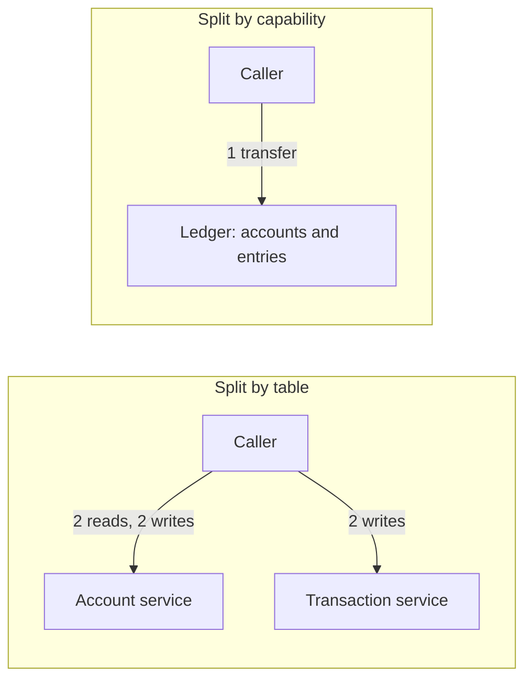

# 2. Where the boundaries go

## Where we are

The team agreed to fix the boundaries first. The first proposal arrived as a list of tables: an Account service that owns the accounts table, and a Transaction service that owns the entries. Each offers a tidy API: read an account, set its balance, record an entry. A transfer is now composed by its caller: read both accounts, set both balances, record both entries. Six calls to two services, where there used to be one.

In the lab, with 16 callers sending transfers for 20 seconds, the one-call version managed 291 to 373 transfers a second across three runs; the six-call version managed 196 to 237, and its median latency was about 60% higher. That was the smaller problem. After each six-call run, between 83 and 100 accounts' balances no longer matched their own entries, and the bank's total had moved, by anything from R2 to R361: up in one run, down in two. Nothing had failed. Money had simply been created, or destroyed.

## Stop and think

::: think Six calls are slower than one. What's the worse problem?

The rule that matters most: money is never created or destroyed, and every balance equals its entries. That rule spans both tables, but now no single service can enforce it. Nothing wraps the six calls in one transaction, so:

- **Concurrent transfers lose updates.** Two transfers into the same account both read a balance of R100, then each sets it to R100 plus its own amount; one credit disappears. Two debits from the same account do the same, and money appears. That's B3 stage 1's check-then-act race, now across a network.
- **A caller that stops halfway leaves money half-moved.** Debited from one account, never credited to the other. In the lab, with 1% of callers crashing after the debit, as a deployment or an out-of-memory kill would, one 20-second run lost R1,927.

:::

::: think Could the Account service fix this on its own?

Partly. It could replace "set the balance" with "debit R50 if the balance allows", or require the version it expects (B3 stage 2). That fixes lost updates. But notice where it's heading: the Account service is learning to move money. The debit, the credit and the two entries still have to happen together, across two services, so every transfer, the bank's most common operation, would need a saga (stage 5). The accounts and their entries belong inside one boundary: a ledger.

:::

::: think How could you have found the right boundary before splitting?

- **Invariants:** what must be true together, in one transaction? Balances and entries. Those stay together.
- **Language:** where does a word change meaning? "Account" means a balance and its entries to the ledger, a person's identity and checks to onboarding, and a linked card to the cards team.
- **Change:** which files change together? The repository's history knows.
- **People:** which team owns which decisions? Boundaries that cut across a team's work get crossed.

:::

## The mental model

### Draw boundaries around capabilities, not tables

A split by table produces *entity services*: an Account service, a Transaction service, a Customer service. They look clean, because each owns one noun. But business operations are verbs, and almost every verb touches several nouns, so every operation becomes a conversation between services, and every rule that spans nouns has no owner.

A split by *capability* draws the boundary around what the business does: keep the books, manage payees, produce statements, issue cards. Most operations then happen inside one boundary, in one transaction.



Two quick tests of a boundary:

- **Is the most common operation inside one service?** If a transfer needs two services, the boundary cuts through the middle of it.
- **Does anything need to be all-or-nothing across the boundary?** If yes, often, the boundary is wrong. Occasional cross-boundary consistency is what sagas are for; constant need is a sign the two sides are one thing.

In the lab, the ledger module owns accounts and entries together, and a transfer is one call and one transaction (stage 1's `POST /transfers`). The entity split is a lab switch that exposes the same tables one operation at a time, as two entity services would:

<<< @/../samples/src/Bank.Modular.Ledger/EntityEndpoints.cs#entity-split

### Bounded contexts

The same word means different things in different parts of a business, and trying to build one model that satisfies everyone produces a model nobody can change. Domain-driven design's answer is the *bounded context*: a boundary inside which each word has one meaning and one model.

| Word | Ledger | Onboarding | Cards | Statements |
|---|---|---|---|---|
| **Account** | A balance and its entries | A customer's application, identity checks, open or closed | What a card draws from | A period: opening balance, lines, closing balance |
| **Customer** | Not needed: just an account id | A person, with verified identity | A cardholder | A name and address to print |
| **Transaction** | A pair of entries that net to zero | Not needed | An authorisation, then a settlement | A line on the page |

Each context keeps its own model, and contexts refer to each other's things by id. Where contexts meet, someone decides whose language wins:

- **Customer and supplier:** the upstream context (the ledger) provides what the downstream one (statements) needs, and listens to its requests.
- **Conformist:** the downstream context takes the upstream model as it is, as you would a regulator's file format.
- **Anti-corruption layer:** the downstream context translates the upstream model into its own at the boundary, so a legacy core-banking system's model doesn't leak into new code.
- **Published language:** both sides use a shared standard, such as ISO 20022 for payment messages.
- **Shared kernel:** a small piece both sides own together, such as B3's money type. Keep it small; every change to it is a change to both.

Bounded contexts are a good *first draft* of service boundaries. They aren't the same thing: one context can run as several services, or several small contexts as one.

### Find the seams with evidence

Opinions about boundaries are cheap. Evidence is in the repository: files that change in the same commits belong together. The lab's load tool reads a path's git history and lists the pairs of files that most often change together:

<<< @/../samples/tools/Bank.Load/ModularLabs.cs#co-change

Run on the original API, it says that every change to the `Account` class also changed the shared `BankDb` context, and that five of `BankDb`'s seven changes also changed the transfer endpoints: one shared model at the centre of everything, which is stage 1's incident in numbers. For larger codebases, tools such as [code-maat](https://github.com/adamtornhill/code-maat) do this analysis properly.

## The escalation ladder

### 1. One service per table

An Account service, a Transaction service, a Customer service.

**Fixes:** nothing about coupling. It's easy to draw, because the schema already exists.
**Costs:** many calls per operation: six per transfer in the lab, and well under the throughput of one.
**Breaks:** every rule that spans tables. In the lab, lost updates created money from nothing, and crashed callers lost it.
**Don't use it when:** almost ever, for a core domain. It can suit pure reference data that nothing else changes.

### 2. One module per capability, with its invariants inside

Group what must be consistent together, and what changes together, behind one contract: the ledger keeps accounts and entries; payees, statements and cards are their own modules.

**Fixes:** the common operation happens in one place, in one transaction.
**Costs:** judgement, and sometimes moving code you thought was settled.
**Breaks:** nothing, as long as operations across capabilities are rare and can tolerate being eventually consistent.

### 3. A model per context, linked by ids

Within each capability, model only what that context needs: the ledger's account has a balance, not an address; statements hold a name to print, not identity documents.

**Fixes:** the shared "god object" that every team must agree on before changing.
**Costs:** some duplication of data, which needs keeping up to date (stage 3).
**Breaks:** the illusion of one source of truth for everything; instead, one owner for each fact.

### 4. An anti-corruption layer where you meet models you don't control

Translate a legacy system's or an external partner's model into your own at the boundary, in one place.

**Fixes:** a foreign model spreading through your code.
**Costs:** a translation layer to build, test and keep up to date.
**Breaks:** nothing, but it hides awkwardness rather than removing it; the translation must be complete, or gaps leak through.

## Trade-offs at a glance

| Boundary | Fixes | Costs | Breaks | Reach for it when |
|---|---|---|---|---|
| Per table | Nothing | Chatty calls | Invariants across tables | Reference data only |
| Per capability | Common operations in one place | Judgement | Little | The default |
| Model per context | God objects | Duplicated data | One model for all | Words mean different things to different teams |
| Anti-corruption layer | Foreign models leaking in | A translation layer | Nothing | Legacy systems, external partners |

## Traps

- **Entity services.** Clean on a diagram, chatty and inconsistent in production.
- **Splitting by layer**: a UI service, a business-logic service, a data service. Every feature changes all three.
- **One shared Customer model** that every service imports. That's stage 1's shared `Transaction` class again.
- **Sharding mistaken for a boundary.** Splitting the ledger by account range is a scaling decision (B1 stage 7), not a service boundary; both halves still do the same thing.
- **Boundaries drawn from the org chart alone.** Teams follow boundaries as much as boundaries follow teams; if the boundary is wrong, reorganising later is expensive.
- **Finalising boundaries before the first split.** Move them while they're module boundaries, where it's a refactoring rather than a migration.

::::: trap
The transfer team's code, composing the Account and Transaction services. It passes its tests, which send one transfer at a time. What goes wrong in production?

```csharp
public async Task TransferAsync(int fromId, int toId, decimal amount, CancellationToken ct)
{
    var from = await accounts.GetAsync(fromId, ct);
    var to = await accounts.GetAsync(toId, ct);
    if (from.Balance < amount) throw new InsufficientFundsException();

    await accounts.SetBalanceAsync(fromId, from.Balance - amount, ct);
    await accounts.SetBalanceAsync(toId, to.Balance + amount, ct);

    var transferId = Guid.CreateVersion7();
    await transactions.RecordAsync(transferId, fromId, -amount, ct);
    await transactions.RecordAsync(transferId, toId, amount, ct);
}
```

::: details Answer
- **Lost updates.** Two transfers touching the same account read the same balance, and the second write overwrites the first. Money is created or destroyed; in the lab, up to 100 accounts disagreed with their entries after 20 seconds.
- **Partial failure.** If the process stops after the first `SetBalanceAsync`, the money has left one account and arrived nowhere, and nothing will notice. In the lab, a 1% crash rate lost up to R1,927 in a 20-second run.
- **Retries make it worse.** If a timeout makes the caller retry `RecordAsync`, the entry is recorded twice (B3 stage 3).
- **It's chatty**: six round trips for the bank's most common operation, each one able to fail or be slow (B4).

The code isn't the problem; the boundary is. Move the operation to where the data is: a ledger that owns accounts and entries, and offers "transfer" as one operation in one transaction.
:::
:::::

## In the interview

::::: interview
**Usually asked as:** "How would you break a banking system into services?" Or: "How do you decide service boundaries?"

**Short answer:** "Around business capabilities, not tables: a ledger that owns accounts and their entries, then payees, statements, cards, onboarding. The test is whether the most common operations happen inside one service, in one transaction. Anything that must be all-or-nothing, like a balance and its entries, stays inside one boundary. I'd use bounded contexts as a first draft, since that's where words change meaning, check them against what actually changes together in the code and who owns what, and settle them as modules before making any of them a network boundary."

::: details Follow-up: what's a bounded context?
A boundary inside which each term has one meaning and one model. "Account" to the ledger is a balance and its entries; to onboarding it's a customer's application and identity checks. Each context keeps its own model, refers to others' things by id, and translates where they meet. It's a good first draft of service boundaries, though not always one-to-one with services.
:::

::: details Follow-up: how do you know a boundary is wrong?
The most common operations need several services; services call each other in chains or many times per request; you keep needing distributed transactions or sagas for routine work; and changes regularly have to be released in several services together. Each says the boundary cuts through something that is really one thing.
:::

::: details Follow-up: what's an anti-corruption layer?
A translation layer between your model and one you don't control, such as a legacy core-banking system or a partner's API. It converts their concepts into yours at the boundary, so their naming, quirks and structure don't spread through your code, and a change on their side is absorbed in one place.
:::
:::::

## Try it

From the `samples` folder, with Postgres running.

1. **Start the modular monolith with the entity split switched on:**

   ```sh
   dotnet run --project src/Bank.Modular -- --Lab:EntityServices=true
   ```

2. **Send transfers both ways**, and compare throughput, calls per transfer and the books afterwards:

   ```sh
   dotnet run --project tools/Bank.Load -- --split capability --seconds 20
   dotnet run --project tools/Bank.Load -- --split entity --seconds 20
   dotnet run --project tools/Bank.Load -- --split entity --seconds 20 --crash-rate 0.01
   ```

   Each run prints the books before and after; `curl localhost:5100/ledger/check` shows them at any time. Our runs:

   | Split | Transfers a second | Median | Calls each | Accounts disagreeing after 20 s | Total changed by |
   |---|---|---|---|---|---|
   | By capability | 291–373 | 38–44 ms | 1 | 0 | R0 |
   | By table | 196–237 | 62–68 ms | 6 | 83–100 | R2–361, up or down |
   | By table, 1% of callers crash after the debit | 134–266 | 55–96 ms | 6 | 89–157 | R1,099–1,927 lost |

   Three runs of each; throughput varied with what else the laptop was doing, but the books never balanced after a by-table run.

   To start the books again, stop the app, drop the ledger's schema, and start it again; the module recreates and reseeds it. Drop the statements' schema too, because its copy of the ledger (stage 3) remembers positions in the old one:

   ```sh
   docker compose exec postgres psql -U bank -d bank -c "DROP SCHEMA ledger CASCADE; DROP SCHEMA statements CASCADE"
   ```

3. **Find what changes together** in the original API, then in the whole of `src`:

   ```sh
   dotnet run --project tools/Bank.Load -- --co-change src/Bank.Api
   dotnet run --project tools/Bank.Load -- --co-change src --min 4
   ```

4. **Draw the contexts for cards.** The bank is adding debit cards. List what "card", "account" and "transaction" mean to the cards team, what the cards context needs from the ledger, and what it must never touch.

## What breaks next

The boundaries settle around capabilities: ledger, payees, statements, notifications. Notifications was split out first, as an easy service on the edge. To address its emails, it needs each account holder's name, which the ledger owns. Reading the ledger's accounts table was quickest: "we only read it". Then the ledger team renamed a column, and notifications broke in production.

Next: [3. Who owns the data](./03-who-owns-the-data).
