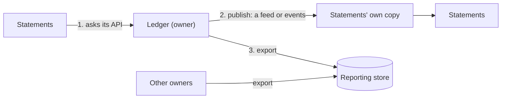

# 3. Who owns the data

## Where we are

Notifications was the first service split out. To address its emails, it needs each account holder's name, which belongs to the ledger, so it was given a connection string to the ledger's database and a query against the accounts table. It only read. Then the ledger team renamed `holder_name` to `display_name`, to hold the name customers prefer, and released. The ledger's own tests passed; nothing in its codebase mentioned notifications. Notifications failed on every email for three hours before anyone looked.

The lab has the same shape on a smaller scale: the statements module needs the ledger's entries, which it doesn't own. Stage 1's boundary test stops it mapping the ledger's tables. So how should it read them?

## Stop and think

::: think Notifications only read the table. Why is that still a problem?

Because the table became an interface without its owner knowing. Every column's name, type and meaning is now something notifications depends on, so the ledger can't rename, split, partition or move its data without breaking a service it can't see. Reading also couples load and availability: notifications' queries run on the ledger's database, and when that database is busy or down, both suffer. "Read-only" limits who can corrupt the data, not who depends on its shape.

:::

::: think Statements can ask the ledger for entries each time, or keep a copy of them. What does each cost?

- **Asking** is always current, and simple. But statements now work only while the ledger is up and fast: in the lab, with the ledger stopped, every statement request failed. And building a thousand statements means a thousand calls.
- **A copy**, kept up to date from the ledger's feed, keeps working when the ledger is down: in the lab, statements still answered in 4 ms. But it's behind by however long the copy takes to catch up, half a second on average when it checks every second. It also has to be built, stored, and applied correctly: no entry missed, none copied twice.

:::

::: think How stale is too stale?

It depends on the decision made with the data. A monthly statement can be a second behind, or a minute, as long as it says when it was complete to. A decision that can lose money cannot use a copy: whether an account can afford a payment must be decided by the ledger, at the moment of payment. The rule of thumb: decisions go to the owner; display and reporting can use copies, and should say how fresh they are.

:::

## The mental model

### One owner for each fact

Every piece of data has exactly one owner: the only part of the system that writes it and decides what it means. The ledger owns balances and entries; payees own payees; onboarding owns a customer's name and identity. Everyone else reads what the owner chooses to publish, never its tables.

A separate database per service is the strongest form of this. A schema per module, with nothing reading across, as in the lab, is the step before it: the same ownership, still on one database server.

### Three ways to read what you don't own



1. **Ask the owner** when you need the answer: fresh, but only while the owner is available.
2. **Keep your own copy**, updated from what the owner publishes: available, and fast to query alongside your own data, but behind by the time it takes to catch up.
3. **A reporting store** that copies from many owners, for questions that span the whole business. It's for analysis, never for decisions.

In the lab, statements do either of the first two, chosen by a setting:

<<< @/../samples/src/Bank.Modular.Statements/StatementsModule.cs#build

### Getting a copy right

A copy is only as good as the way it's kept. The lab's statements follow the ledger's feed, a list of every entry in the order it was posted, and remember how far they got:

<<< @/../samples/src/Bank.Modular.Statements/StatementsCopy.cs#follow-feed

Four things make that safe:

- **The copy and the position are saved together**, in one transaction. A crash between the two would either skip entries or copy them twice. The copied rows are also keyed by the ledger's position, so even a bug can't duplicate one.
- **A new copy starts from the beginning.** Reading the feed from position zero is the backfill; the same code then keeps up. For a large history, start from a snapshot and the position it was taken at.
- **The feed never skips an entry that is still being committed.** Positions are handed out when a transfer inserts its entries, not when it commits, so entry 10 can be visible while entry 9 is still on its way. A reader that took 10 and moved past 9 would never see 9. The ledger's feed stops at a gap until it's filled, or old enough to be a position a rolled-back transfer never used:

  <<< @/../samples/src/Bank.Modular.Ledger/Transfers.cs#feed

- **The feed is a contract.** Its fields are now something other modules depend on, like an API. Add fields; don't rename or repurpose them; version it when you must change it.

A feed that readers pull from, as here, is simple to replay and to backfill. Events pushed through a broker (B2) arrive sooner, without polling; the same rules apply to them, and the outbox (B2 stage 4) is how the owner publishes them without a dual write.

### A copy is stale: measure it, and say so

In the lab, statements asked the ledger, or kept a copy, while transfers arrived at ten a second. For each transfer, the load tool timed how long it took to appear on the payer's statement:

| Statements | Median | 99th percentile |
|---|---|---|
| Ask the ledger | 3 ms | 50 ms |
| Copy, checking the feed every second | 537 ms | 1,029 ms |
| Copy, checking every 200 ms | 119 ms | 236 ms |

Then, with the ledger in a process of its own, the ledger was stopped:

| Statements | With the ledger stopped |
|---|---|
| Ask the ledger | 20 of 20 requests refused with 503 |
| Copy | 20 of 20 answered, in 4 ms on average, as of the moment the ledger stopped |

Each statement says when it was complete to, in `asOf`. When the copy is current, that's within a second; when the ledger is down, it stays at the last time the copy caught up, and anyone reading the statement can see so.

## The escalation ladder

### 1. Read the owner's tables

**Fixes:** nothing; it's the problem.
**Costs:** nothing, until the owner changes something.
**Breaks:** the owner's freedom to change its own data, and the reader's availability whenever the owner's database is busy or down.
**Don't use it when:** the owner is another team, or another service. Which is always, after a split.

### 2. A view the owner publishes

The owner maintains a database view, such as `ledger_public.accounts_v1`, as a contract, and keeps it stable while its tables change.

**Fixes:** renames and restructuring breaking readers.
**Costs:** the owner keeps the view working.
**Breaks:** nothing new, but it still ties both to one database: the same load, the same outages, and no path to a separate database.
**Don't use it when:** the services will have their own databases. It's a stepping stone inside one database, not a destination.

### 3. Ask the owner's API

**Fixes:** data coupling: the owner can change everything behind its API.
**Costs:** a call per question: latency, and many calls when you need many answers.
**Breaks:** availability. In the lab, every statement failed while the ledger was down.
**Don't use it when:** you need the data in bulk, for joins, or while the owner may be away. Do use it for decisions, which need current data.

### 4. Keep a copy from the owner's feed or events

**Fixes:** availability and speed: in the lab, statements answered in 4 ms with the ledger down.
**Costs:** staleness (a median of half a second in the lab, at one check a second), storage, a backfill, and careful applying.
**Breaks:** read-your-writes: a customer who has just paid may not see it on the statement for a moment (B1 stage 6 has the techniques).
**Don't use it when:** the data drives a decision that must be current, such as whether a payment can be afforded.

### 5. A reporting store

Copies from every owner, through events or change data capture, into a warehouse or lake built for analysis.

**Fixes:** questions across the whole business, without loading any service.
**Costs:** a data pipeline, mapping each owner's data into a shared model, and a lag of minutes to hours.
**Breaks:** nothing, as long as it's used for analysis. It must never become an input to a service's decisions, or it becomes a shared database again.

## Trade-offs at a glance

| Option | Fixes | Costs | Breaks | Reach for it when |
|---|---|---|---|---|
| Read the owner's tables | Nothing | Nothing yet | The owner's freedom; availability | Never across teams |
| A published view | Renames | Owner maintains a view | Still one database | A stepping stone in one database |
| Ask the API | Data coupling | Calls, latency | Availability | Decisions; small amounts of data |
| A copy from the feed | Availability, speed, local joins | Staleness, backfill, storage | Read-your-writes | Display, statements, search |
| A reporting store | Cross-business questions | A pipeline, lag | Nothing, if used only for analysis | Analytics and regulatory reports |

## Traps

- **"Read-only" access to another service's tables.** It's coupling with no contract.
- **Deciding from a copy.** An available balance from a copy is how accounts get overdrawn.
- **Copies that don't say how fresh they are.** Show `asOf`, or at least alert when the copy falls behind.
- **Saving the position separately from the data**, or holding it in memory. A crash skips entries or repeats them.
- **Reading a feed by "id greater than the last one"** without allowing for rows still being committed.
- **Save, then publish.** A service that writes to its database and then publishes an event separately loses the event if it crashes in between: B2 stage 4's dual write, fixed with an outbox.
- **Renaming a field in an event.** Consumers you don't know about break, just as notifications did.

::::: trap
The statements team's first copy of the ledger's entries. It ran for weeks without complaint. What's wrong with it?

```csharp
protected override async Task ExecuteAsync(CancellationToken stoppingToken)
{
    long position = 0;
    while (!stoppingToken.IsCancellationRequested)
    {
        var entries = await ledgerDb.Entries
            .Where(e => e.Position > position)
            .OrderBy(e => e.Position)
            .Take(500)
            .ToListAsync(stoppingToken);

        foreach (var entry in entries)
            await copy.AddLineAsync(entry, stoppingToken);

        position = entries.LastOrDefault()?.Position ?? position;
        await Task.Delay(TimeSpan.FromSeconds(1), stoppingToken);
    }
}
```

::: details Answer
- **It reads the ledger's table**, so it's the notifications incident waiting to happen. Read the ledger's feed through its contract instead.
- **The position lives in memory.** After a restart it starts again from zero, and every line is copied again, or fails on a duplicate key and stops. Store the position with the copy.
- **Lines and position aren't saved together.** A crash part-way through a page leaves some lines copied, and then copies them again. Save the page and the new position in one transaction.
- **It skips entries that commit out of order.** If entry 10 commits before entry 9, it reads 10, moves its position past 9, and never sees 9. Nothing fails; a statement is quietly missing a line. Only take an unbroken run of positions, as the ledger's feed does.
- **It catches up at 500 entries a second at most**, sleeping between full pages. After an outage, it falls further behind. Read the next page straight away when a page is full.
:::
:::::

## In the interview

::::: interview
**Usually asked as:** "With a database per service, how do you query across services?" Or: "How do services share data?"

**Short answer:** "Each piece of data has one owner, and nobody else reads its tables. Others either ask the owner's API, which is current but couples them to its availability, or keep their own copy from the owner's events or feed, which is available and fast but stale by the time it takes to catch up. I use the API for decisions, like whether a payment can be afforded, and copies for display, statements and search, and the copy says how fresh it is. Questions across the whole business go to a reporting store fed from every owner, used only for analysis."

::: details Follow-up: how does a new service get the history it needs?
A backfill: read the owner's feed from the beginning, or take a snapshot with the position it was taken at, load it, and then follow the feed from that position. The same code should do both, so there's one way to build the copy, and it can be rebuilt from scratch if it's ever wrong.
:::

::: details Follow-up: outbox or change data capture?
Both get changes out of the owner's database reliably. The outbox writes an explicit event in the same transaction as the change, so the owner designs the contract. Change data capture reads the database's log, so it needs no application changes, but what it publishes is the owner's table structure, which couples consumers to the schema unless the owner transforms it into proper events first.
:::

::: details Follow-up: a customer pays, then opens their statement, and the payment isn't there. What do you do?
That's read-your-writes against a copy. Options: show the payment from the response the customer already has; route that customer's reads to the owner for a short time after a write; or have the client wait until the copy's position passes the write's position (a consistency token, as with read replicas in B1 stage 6). And show "as of" times, so a short delay isn't mistaken for a lost payment.
:::
:::::

## Try it

From the `samples` folder, with Postgres running.

1. **Ask, or copy.** Start the modular monolith with statements asking the ledger, and time how long transfers take to reach the statement:

   ```sh
   dotnet run --project src/Bank.Modular -- --Lab:Statements=Call
   dotnet run --project tools/Bank.Load -- --staleness --count 200 --rate 10
   ```

   Restart it with `--Lab:Statements=Copy`, then add `--Statements:FeedIntervalMs=200`, and compare. `curl localhost:5100/statements/copy` shows how far the copy has got.

2. **Stop the owner.** Run the ledger and payees in one process, and statements in another, which reaches the ledger over HTTP through the same contract:

   ```sh
   dotnet run --project src/Bank.Modular -- --Modules:Run=Ledger,Payees
   dotnet run --project src/Bank.Modular -- --urls http://localhost:5101 --Modules:Run=Statements \
     --Modules:LedgerUrl=http://localhost:5100 --Lab:Statements=Call
   ```

   Ask for a statement on port 5101, stop the ledger's process, and ask again. Then do the same with `--Lab:Statements=Copy`, and look at `asOf`:

   ```sh
   curl -s localhost:5101/accounts/7/statements/$(date +%Y)/$(date +%-m)
   ```

3. **Watch the feed wait for a slow commit.** `ModularTests.The_feed_waits_for_an_entry_that_is_still_being_committed` holds one transfer's transaction open while a later one commits, and checks the feed returns neither until both are done:

   <<< @/../samples/tests/Bank.Modular.Tests/ModularTests.cs#feed-gap-test

4. **Design notifications' copy.** Notifications needs each account holder's name and email. Decide which events it needs, from which owner, how stale they may be, and what happens to an email already queued when a customer changes their name.

## What breaks next

Statements no longer depend on the ledger being up. Transfers are another matter: they can't be answered from a copy. Paying a payee now means the ledger calling payees, a limits service and a fraud service in turn, each now deployed on its own. Each one is available 99.9% of the time. Transfers, which need all of them, are noticeably less available than that, and slower than any one of them.

Next: [4. Sync or async between services](./04-sync-or-async).
