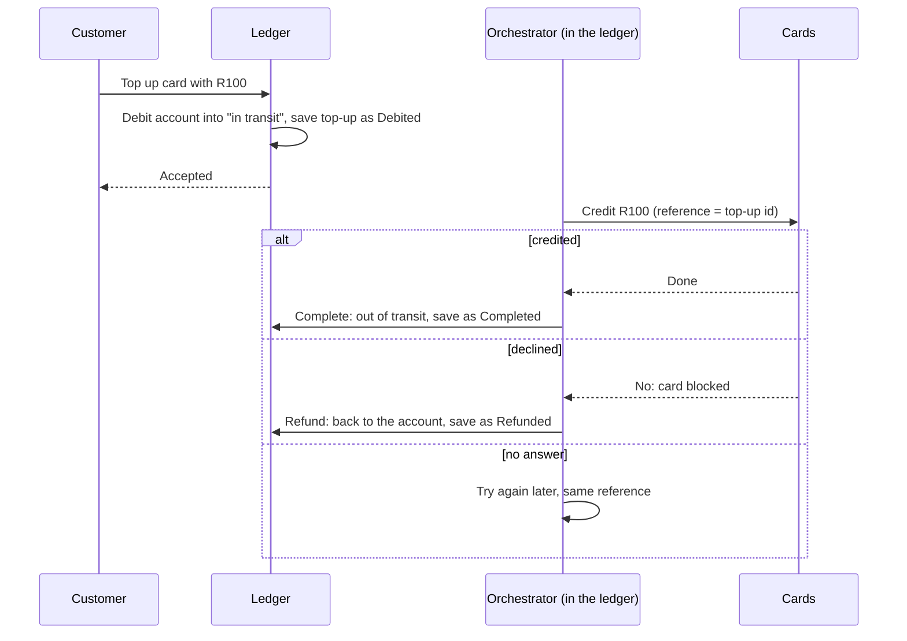

# 5. A transaction across services

## Where we are

The bank launched prepaid cards, run by a cards service with its own database. Topping up a card takes money from the customer's account, in the ledger, and puts it on the card, in the cards service. The first version did the obvious thing: debit the account, then ask the cards service to credit the card. One evening the cards service failed straight after a debit. The card was never credited, and nothing undid the debit.

In the lab, 500 top-ups went through that version, against a cards service that fails 5% of calls before crediting anything and loses 5% of its replies after crediting, with 2% of cards blocked and 2% of top-ups interrupted by a crash. 68 of the 500 ended wrong: 45 customers' money was taken and put on no card (R4,275), and 23 cards were credited while the ledger still showed the money in transit and the customer had been told it failed. The ledger's own books balanced throughout. Only reconciling it against the cards service showed anything was wrong.

## Stop and think

::: think Why not one transaction across both databases?

That's two-phase commit: a coordinator asks every participant to *prepare* (promise it can commit, holding its locks), then tells them all to commit. It works, at a price. Every participant must support the same protocol, which services behind HTTP APIs don't. Locks are held across network round trips. And if the coordinator fails between the two phases, participants are stuck holding locks, unable to commit or abort, until it comes back. Between independently deployed services it's rarely available and rarely wanted. The usual answer is a *saga*: a sequence of local transactions, each committed on its own, with a compensating step to undo each one if a later step can't happen.

:::

::: think The cards service didn't answer. Should the ledger refund the customer?

Not yet. No answer isn't a no: the card may have been credited and the reply lost. Refund then, and the customer has the money twice. In the lab, the version that refunded on any failure did exactly that to 16 top-ups out of 500, creating R1,670 from nothing. The safe moves are to ask again with the same reference, which a well-behaved participant applies only once, or to ask what happened to that reference; and to compensate only on a definite refusal.

:::

::: think Where does the saga remember how far it got?

Somewhere that survives a crash, written in the same local transaction as the step itself: the debit and the record "this top-up is debited, card not yet credited" commit together, or not at all. A plan held only in memory, such as a list of things to undo if something fails, is gone when the process dies, and with it the knowledge that a debit needs completing or undoing. In the lab, every crash in the in-memory version left money stuck in transit; the saga with saved state finished all of them.

:::

## The mental model

### A saga: local steps, and a compensation for each

A card top-up has three steps, each a local transaction in one service, and one compensation:

| Step | Service | What it does | Compensation if a later step can't happen |
|---|---|---|---|
| 1. Debit | Ledger | Moves R100 from the account into "card top-ups in transit", and records the top-up | Refund: move it back to the account |
| 2. Credit | Cards | Puts R100 on the card, once per reference | None needed: nothing after it can fail for good |
| 3. Complete | Ledger | Moves the R100 out of transit, and marks the top-up completed | None |



Three ideas make that work:

- **Compensations are business actions, not undo.** A refund is a new entry the customer can see on their statement, not a deleted debit. The history shows both (B3 stage 5).
- **The pivot.** Before the card is credited, the saga can still go backwards: refund. Once it's credited, it can only go forwards: complete, retrying until it does. Order steps so that the ones most likely to fail come before the pivot.
- **No isolation.** Between steps, the world can see the saga half-done: the money has left the account but isn't on the card. Make that state explicit, as the ledger's "in transit" account does, rather than pretending it doesn't exist (B3 stage 6's pending states).

<SagaStepper />

### Orchestration or choreography

Someone has to move the saga along.

- **Orchestration:** one component, here in the ledger, tells each participant what to do and records where the saga has got to. The flow is in one place, readable and testable, and stuck sagas are easy to find. The risk is an orchestrator that accumulates business logic belonging to its participants.
- **Choreography:** no coordinator. Each service reacts to the others' events: the ledger publishes "top-up debited", the cards service credits the card and publishes "card credited" or "credit declined", and the ledger completes or refunds. Nothing central to fail or to own, but the flow exists only as a set of reactions spread across services, which is hard to see, trace and change.

Choreography suits short flows between teams that already publish events. Past two or three steps, or when someone must answer "where is this top-up?", an orchestrator earns its keep.

### What makes a saga safe

The lab's top-up saga does five things:

1. **Each step is saved with its state, in one local transaction.** The debit and the top-up's record commit together; the completion and the refund each move the money only if the top-up is still in progress, so a step that runs twice moves nothing the second time:

   <<< @/../samples/src/Bank.Modular.Ledger/CardTopUps.cs#steps

2. **Participants are idempotent.** The top-up's id is the cards service's reference, and it applies each reference once, so asking again after a lost reply credits nothing more.
3. **No answer means ask again; only a definite no means compensate.**
4. **An orchestrator carries every saga forward, and survives crashes.** Its state is the top-up's row, so a restart, or a second instance, picks up where the last one left off:

   <<< @/../samples/src/Bank.Modular.Ledger/CardTopUps.cs#saga-orchestrator

5. **Reconcile anyway.** Sagas reduce mismatches; they don't prove there are none. The lab's load tool checks every top-up against the cards service's own record (B3 stage 7):

   <<< @/../samples/tools/Bank.Load/ModularLabs.cs#reconcile-top-ups

### In the lab

500 top-ups each, at 25 a second, with the cards service failing 5% of calls before crediting and losing 5% of its replies after crediting, 2% of cards blocked, and 2% of top-ups interrupted by a simulated crash:

| How the top-up is run | Right | Taken, on no card | Credited, but still in transit | Credited and refunded |
|---|---|---|---|---|
| Naive: no compensation | 432 | 45 (R4,275) | 23 (R2,412) | 0 |
| Compensation from memory | 481 | 3 (R258) | 0 | 16 (R1,670) |
| Saga with saved state | 500 | 0 | 0 | 0 |
| Saga, with the cards service down for 5 seconds as well | 500 | 0 | 0 | 0 |

The in-memory version refunded correctly when the card was declined or the cards service answered with an error. What it couldn't handle were the cases where it didn't know: a crash, which forgot the plan, and a lost reply, which it took for a failure.

## The escalation ladder

### 1. Compensate from memory

Try the steps in order, and if one throws, run the undo steps in reverse.

**Fixes:** clean, immediate failures, such as a declined card.
**Costs:** a few lines of code.
**Breaks:** crashes, which lose the plan, and lost replies, which it takes for failures. In the lab, 19 of 500 top-ups ended wrong.
**Don't use it when:** the steps move money, or anything else you can't afford to lose track of.

### 2. A saga with saved state and an orchestrator

Save each step's outcome with the step, make participants idempotent, retry on no answer, compensate on a definite no, and run an orchestrator that resumes unfinished sagas.

**Fixes:** crashes, outages and lost replies. In the lab, 500 of 500 right, through a 5-second outage.
**Costs:** a state machine, an orchestrator to run and monitor, and pending states the customer can see.
**Breaks:** the immediate answer: the customer gets "on its way", not "done".

### 3. A choreographed saga

The same saga, moved along by events instead of an orchestrator.

**Fixes:** a central coordinator that every team must change.
**Costs:** the flow is implicit, so tracing, testing and finding stuck sagas need deliberate tooling (correlation ids, a view built from the events).
**Breaks:** nothing more than orchestration, but changes to the flow touch several services.
**Don't use it when:** the flow has many steps or branches, or the business needs to see each instance's progress.

### 4. Two-phase commit

A coordinator and participants that prepare, then commit.

**Fixes:** atomicity, with no visible intermediate state.
**Costs:** participants that support it, locks held across the network, and blocking if the coordinator fails mid-way.
**Breaks:** availability: every participant must be up for anything to commit.
**Don't use it when:** the participants are services you don't share a transaction manager with, which is almost always.

### 5. Move the boundary so no saga is needed

If two services keep needing transactions with each other, ask whether they're one capability (stage 2). Card balances could be accounts in the ledger, with the cards service handling only cards, authorisations and the card scheme.

**Fixes:** everything above, by removing the distributed transaction.
**Costs:** rethinking a boundary, and moving data between services.
**Breaks:** the separation that motivated the split, if it was real.

## Trade-offs at a glance

| Option | Fixes | Costs | Breaks | Reach for it when |
|---|---|---|---|---|
| Compensate from memory | Clean failures | Little | Crashes, lost replies | Nothing that matters |
| Saga with saved state, orchestrated | Crashes, outages, lost replies | A state machine, an orchestrator | The immediate answer | The default for money |
| Choreographed saga | A central coordinator | Implicit flow, harder tracing | Easy changes to the flow | Short flows between event-driven teams |
| Two-phase commit | Atomicity | Locks, blocking, shared protocol | Availability | Participants under one transaction manager |
| Move the boundary | The need for a saga | Redesign | The split's separation | The two sides always change together |

## Traps

- **Compensating on a timeout.** No answer isn't a no.
- **Saga state in memory.** A crash forgets what needs finishing or undoing.
- **Compensations that delete.** Undo with a new, visible action; keep the history.
- **Compensations that can fail and are then forgotten.** A compensation must be retried until it succeeds, and alert someone if it can't.
- **Steps that aren't idempotent.** Retries and resumed sagas will repeat them.
- **No idempotency key on the request that starts the saga.** If the customer's "accepted" is lost and they tap again, that's a second top-up (B3 stage 3).
- **Treating a non-critical step as critical.** If a failed notification undoes a completed top-up, the notification is in the wrong place: it belongs after the saga, as an event.

::::: trap
A card top-up saga from a design document. It uses a stack of compensations, run in reverse if anything fails. What can go wrong?

```csharp
public async Task<TopUpResult> TopUpAsync(TopUpCommand command)
{
    var compensations = new Stack<Func<Task>>();
    try
    {
        var debit = await _ledger.DebitAsync(command.AccountId, command.Amount);
        compensations.Push(() => _ledger.DeleteEntryAsync(debit.EntryId));

        await _cards.CreditAsync(command.CardId, command.Amount);
        compensations.Push(() => _cards.DebitAsync(command.CardId, command.Amount));

        await _notifications.SendAsync(command.AccountId, "Your card has been topped up.");
        return TopUpResult.Success();
    }
    catch (Exception ex)
    {
        while (compensations.Count > 0)
        {
            try { await compensations.Pop()(); }
            catch (Exception compensationError) { _logger.LogError(compensationError, "Compensation failed"); }
        }
        return TopUpResult.Failed(ex.Message);
    }
}
```

::: details Answer
- **The plan lives in memory.** If the process dies after the debit, nothing remembers to credit the card or refund the customer.
- **Any exception compensates, including a timeout.** If `CreditAsync` times out after the card was credited, the debit is undone too: the customer has the money twice. Ask again with the same reference instead, and compensate only on a definite refusal.
- **There are no references,** so neither call can be safely retried: a retried credit would credit twice.
- **A failed notification undoes a successful top-up.** The money moved; the email didn't. Notifications belong after the saga, as an event (B2).
- **The compensation deletes the debit,** rewriting the ledger's history. Refund with a new entry instead (B3 stage 5).
- **A failed compensation is logged and dropped.** The customer's money is then neither on the card nor back in the account, and the only trace is a log line. Compensations must be retried until they succeed, with an alert if they can't.
:::
:::::

## In the interview

::::: interview
**Usually asked as:** "How do you keep data consistent across microservices?" Or: "What's a saga?"

**Short answer:** "Usually with a saga: a sequence of local transactions, one per service, each with a compensating action that undoes its business effect if a later step can't complete. To make it safe, each step's outcome is saved in the same local transaction as the step, so a crash doesn't lose track; participants are idempotent, keyed by the saga's id; a timeout means retry, not compensate; and an orchestrator, or a chain of events, carries every saga to completion or compensation. Between steps the system is visibly in between, so I model that state explicitly, and I still reconcile the services' records."

::: details Follow-up: orchestration or choreography?
Orchestration puts the flow in one component that tells each participant what to do and records progress: easy to read, test and monitor, at the risk of a coordinator that knows too much. Choreography lets each service react to the others' events: no coordinator, but the flow is spread across services and hard to trace. I'd choreograph a short flow between teams already exchanging events, and orchestrate anything longer, or anything where someone will ask where a particular instance has got to.
:::

::: details Follow-up: why not two-phase commit?
It needs every participant to support the same protocol and a shared coordinator, holds locks across network calls, and blocks participants if the coordinator fails between prepare and commit. Between independently deployed services, behind HTTP APIs or brokers, it's usually unavailable, and where it is, it couples their availability: all must be up for any to commit.
:::

::: details Follow-up: what if a compensation fails?
Retry it, because it must eventually succeed: a refund can't be optional. So compensations must be idempotent and retryable, and run by something durable, such as the orchestrator, not by a catch block. If one still can't succeed, for example because the account has been closed, the saga moves to a state a person must resolve, and someone is alerted. Design the steps so that's rare: put the steps most likely to fail before the pivot.
:::
:::::

## Try it

From the `samples` folder, with Postgres running.

1. **Start the fake services**, with a cards service that fails and loses replies:

   ```sh
   dotnet run --project tools/Bank.FakeServices
   curl -X POST localhost:5090/cards/settings -H "Content-Type: application/json" \
     -d '{"failureRate": 0.05, "lostReplyRate": 0.05, "replyDelayMs": 3000}'
   ```

2. **Run the naive version**, with 2% of top-ups interrupted by a simulated crash, and send 500 top-ups. The load tool reconciles every one against the cards service afterwards:

   ```sh
   dotnet run --project src/Bank.Modular -- --Lab:TopUps=Naive --Lab:CrashRate=0.02
   dotnet run --project tools/Bank.Load -- --top-ups 500 --rate 25
   ```

3. **Restart with `--Lab:TopUps=InMemory`, then `--Lab:TopUps=Saga`**, and run the load again each time. For the saga, also take the cards service down part-way: `curl -X POST "localhost:5090/cards/blip?seconds=5"`.

   When you start the saga version after the others, its orchestrator finds the earlier runs' top-ups still recorded as debited, and finishes them: one advantage of having saved the state, even in the naive version. To start each run clean, stop the app and drop the ledger's and statements' schemas:

   ```sh
   docker compose exec postgres psql -U bank -d bank -c "DROP SCHEMA ledger CASCADE; DROP SCHEMA statements CASCADE"
   ```

4. **Kill it for real.** With the saga running and top-ups arriving, stop the app with Ctrl+C part-way, start it again, and check that `curl localhost:5100/accounts/-1` (the money in transit) returns to R0 once the orchestrator has caught up.

5. **Design the reverse.** A customer moves money from their card back to their account. List the steps, the compensation for each, and the pivot. What should happen if the card has already been spent down when the ledger credits the account?

## What breaks next

The services are settling down: ledger, payees, statements, cards, notifications. The mobile app talks to all of them. Its home screen calls six services for the balance, recent transactions, payees, cards and messages; every service checks the customer's token for itself, in its own slightly different way; and on a mobile connection, six round trips take most of a second before anything appears.

Next: [6. One front door](./06-one-front-door).
