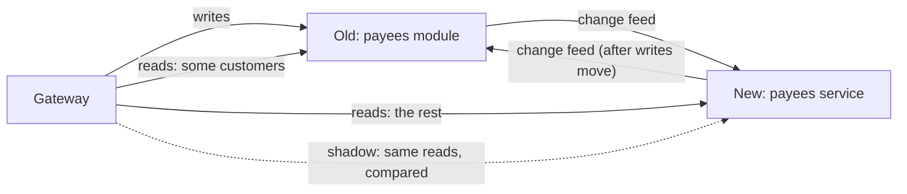

# 7. Moving a capability without stopping

## Where we are

The payees team has rewritten payees as a service of its own, with its own database. Their plan for the move: on Saturday night, copy every payee from the monolith into the new service, point the gateway at the new service, and switch the old module off on Sunday.

In the lab, that plan ran while customers kept using their payees at 20 requests a second. Copying 3,102 payees took six seconds; ten seconds after the copy started, reads and writes switched to the new service. Afterwards, 131 payees that customers had added were missing, 21 they had removed were back, and 42 customers trying to remove a payee were told it didn't exist. And there was no way back: the old module, no longer receiving writes, was missing 262 payees by the end of the minute.

## Stop and think

::: think What goes wrong with "copy, then switch"?

- **Writes during the copy are lost.** Anything added or removed between the moment the copy starts and the moment the switch happens exists only on the old side: added payees vanish, removed ones come back. Freezing writes for the copy avoids that, at the cost of downtime as long as the copy, which grows with the data.
- **Every customer meets the new service at once.** Any bug in it, however small, reaches everyone at the same moment.
- **There's no way back.** Once writes go to the new service, the old one falls behind; switching back loses everything written since.

:::

::: think How can the new service be tested against real traffic before anyone depends on it?

Send it the same reads the old one gets, compare the answers, and keep serving the old one's. That's a *shadow* read, or a parallel run. In the lab it found a difference within seconds: the rewrite listed payees in the order they were added, and the old module listed them by name, which the app relied on. Before a single customer had seen the new service, 34 of the first 98 comparisons had failed.

:::

::: think Reads or writes: which is harder to move, and why?

Writes. Reads can move gradually, customer by customer, as long as both stores have the data. Writes need one owner at a time: if both stores accept changes to the same payee, they can disagree with no way to say which is right. So writes move all at once, after the new owner has caught up, with a pause of a moment while that happens; and the old store keeps following the new one, so writes can move back.

:::

## The mental model

### The strangler fig

A strangler fig grows around a host tree until the host can be removed. The migration pattern named after it replaces an old system the same way:

1. **Put a seam in front of the capability**, where requests can be sent to either implementation: here, the gateway's routes (stage 6). Internal callers need one too; in the lab, other modules reach payees through the `IPayees` contract (stage 1).
2. **Build the new implementation behind it**, and give it the data: a backfill of everything so far, then every change as it happens.
3. **Compare** its answers with the old one's, on real traffic.
4. **Move reads**, a share of customers at a time.
5. **Move writes**, and have the old store follow the new one.
6. **Retire the old implementation** once there's no reason to go back.

Every step is small, and every step can be reversed.



### Moving the data: a change feed, not a copy

Four ways to get data from the old store into the new one while it's still changing:

- **Copy, then switch:** the trigger. Loses the window between the two.
- **Dual writes:** the old code writes to both stores. If the second write fails, the stores disagree and nobody knows (B2 stage 4).
- **Change data capture:** read the old database's log. No application change, but what you get is the old table structure.
- **A change feed from the old code:** every change also written to a change log, in the same transaction, and published in order. The new store follows it.

The lab uses the last. Every add and remove in the payees module is also written to its change log, in the same transaction, and payees that existed before the log were written into it by the migration that created it. The new service follows the feed from the start, which is the backfill, and keeps following it, which keeps it current:

<<< @/../samples/src/Bank.Modular.Payees/PayeeChanges.cs#follow-changes

Applied changes aren't logged again, so the two stores can follow each other without echoing: that's what makes moving writes reversible. The feed stops at a gap in positions for up to a second, as the ledger's does (stage 3); in the lab, a payee added twice leaves such a gap, because its failed transaction used up a position.

### Compare before you trust

The gateway sends each shadowed read to both stores and compares the answers, without the customer waiting for it. A payee added or removed between the two reads, or not copied yet, isn't a real difference, so a mismatch is checked again before it counts:

<<< @/../samples/src/Bank.Gateway/PayeesMigration.cs#shadow

What it found, in the rewrite:

<<< @/../samples/src/Bank.Payees/Payees.cs#list-order

### Move reads gradually, writes at once

Reads move by a percentage of customers, and each customer always reads from the same store, so nobody sees their payees flicker between the two. Writes go to one store at a time, and a write that arrives while they're moving is asked to wait a moment:

<<< @/../samples/src/Bank.Gateway/PayeesMigration.cs#route-payees

To move writes, the gateway pauses them, lets the ones in flight finish, waits until the new owner has applied everything the old one wrote, then switches:

<<< @/../samples/src/Bank.Gateway/PayeesMigration.cs#move-writes

### In the lab

Each run is a minute or more of customers listing, adding and removing payees at 20 requests a second, through the gateway. Afterwards, the load tool checks every payee it added or removed, in both stores:

| Run | Writes paused | Lost | Removed, but back | Old store afterwards |
|---|---|---|---|---|
| Copy, then switch | none | 131 | 21 | 262 payees behind: no way back |
| Strangler, as rewritten | 186 ms | 0 | 0 | Following the new service |
| Strangler, with the list order fixed, then writes moved back | 16 ms there, 118 ms back | 0 | 0 | In charge again, nothing missing |

In the strangler runs, the new service's backfill (about 3,000 payees, plus the changes arriving meanwhile) caught up in 7 to 9 seconds. Shadow reads started then, and reads moved to 10%, 50% and 100% of customers, ten seconds apart, before writes moved. With the rewrite's list order, 455 of 626 shadowed reads differed; with it fixed, none of 741 did. Write pauses vary: in an earlier run, one took 1.1 seconds, because a failed add had left a gap the feed waited out.

## The escalation ladder

### 1. Copy, then switch

**Fixes:** nothing, beyond moving the data once.
**Costs:** one weekend.
**Breaks:** writes during the copy (131 payees lost in the lab, 21 back from the dead), everyone at once on an untested service, and any way back.
**Don't use it when:** the data changes while you copy, which is always for a live system.

### 2. Freeze writes, copy, switch

A maintenance window: nobody can change payees while the copy runs.

**Fixes:** lost writes.
**Costs:** downtime as long as the copy, which grows with the data.
**Breaks:** availability during the window, and still everyone at once with no way back unless you copy back too.
**Don't use it when:** the copy takes longer than customers will accept, or you can't afford to discover bugs in front of everyone.

### 3. Dual writes from the old code

The old code writes each change to both stores.

**Fixes:** the copy window, mostly.
**Costs:** changes to the old code, and every write now waits for both (stage 4).
**Breaks:** consistency, whenever one write succeeds and the other doesn't, or two concurrent writes arrive in a different order.
**Don't use it when:** the stores must agree, which is the point of a migration.

### 4. A change feed, shadow reads, and a gradual move

The lab's version: a seam; a change log written with each change and backfilled; the new store following it; shadow comparisons; reads moved by share of customers; writes moved with a brief pause, and the old store following back.

**Fixes:** everything above. In the lab: nothing lost, a difference found before any customer saw it, and writes moved there and back with pauses under 200 ms.
**Costs:** a change log in the old code, followers on both sides, and weeks rather than a weekend.
**Breaks:** nothing, if each step is watched before the next.

### 5. Retire the old implementation

Once reads and writes have been on the new service long enough that nobody would move them back, stop the reverse follow, remove the old module and its routes, and archive its data.

**Fixes:** two systems to run, and the temptation to keep using the old one.
**Costs:** the end of the way back.
**Breaks:** anything still reading the old store, so find those first: internal callers, reports, other teams' jobs.

## Trade-offs at a glance

| Option | Fixes | Costs | Breaks | Reach for it when |
|---|---|---|---|---|
| Copy, then switch | Nothing | A weekend | Writes in the window, rollback | Data that doesn't change |
| Freeze, copy, switch | Lost writes | Downtime | Availability, rollback | Small data, an accepted window |
| Dual writes | The window, mostly | Old-code changes, latency | Consistency on partial failure | Rarely |
| Change feed and gradual move | All of the above | Time, followers, a change log | Little | Live systems, real data |
| Retire | Two systems | The way back | Whatever still uses the old store | After the new one has proved itself |

## Traps

- **Forgetting internal callers.** The gateway moves customers' requests; the ledger's calls to payees, reports and batch jobs need their own seam, or must keep reading a store that still follows.
- **Generating new ids in the new store.** Everything that refers to a payee by id breaks. Keep the old ids.
- **Comparing before the backfill has finished.** Until it has, the new store is missing data, and every comparison says so. Wait until it has caught up with the feed.
- **Comparing without allowing for lag.** A copy a moment behind isn't wrong; check again before counting a mismatch, or the real differences drown.
- **Two owners at once.** Writes accepted by both stores during the move can't be reconciled automatically.
- **Retiring too early, or never.** Set the conditions for retirement before you start, and then do it.

::::: trap
The payees team's first approach to keeping the new service in sync, added to the old module during the migration. What's wrong with it?

```csharp
public async Task<Payee?> AddAsync(int customerAccountId, AddPayeeRequest request, CancellationToken ct)
{
    var row = new PayeeRow
    {
        PayeeId = Guid.CreateVersion7(), CustomerAccountId = customerAccountId, PayeeAccountId = request.PayeeAccountId,
        Name = request.Name.Trim(), Reference = request.Reference?.Trim() ?? "", AddedAt = time.GetUtcNow(),
    };
    db.Payees.Add(row);
    await db.SaveChangesAsync(ct);

    // Keep the new service in sync while we migrate.
    await newService.PostAsJsonAsync($"/accounts/{customerAccountId}/payees", request, ct);
    return row.ToContract();
}
```

::: details Answer
- **A dual write.** If the second call fails or the process stops between the two, the stores disagree, and nothing records that they do (B2 stage 4).
- **Different ids.** The new service generates its own id for the payee, so the same payee has two ids, and anything that refers to it, such as a transfer or the shadow comparison, can't match them.
- **Only adds.** Removing a payee isn't mirrored, so removed payees live on in the new service.
- **The customer now waits for both,** and an outage in the new service fails adds in the old one (stage 4).
- **Nothing exists before the migration started.** Payees added before this code shipped are never copied.

Write each change to a change log in the same transaction, backfill it with what exists, and let the new service follow it, keeping the old ids.
:::
:::::

## In the interview

::::: interview
**Usually asked as:** "How would you move a capability out of a monolith with no downtime?" Or: "What's the strangler fig pattern?"

**Short answer:** "Incrementally, with a way back at each step. Put a seam in front of the capability, usually a gateway route plus an interface for internal callers. Give the new service the data through a change feed: every change written to a log in the same transaction as the change, backfilled with existing data, which the new service follows. Shadow-read to compare its answers with the old ones on real traffic, then move reads gradually by customer. Move writes all at once, after the new store has caught up, with a short pause, and have the old store follow the new one so you can switch back. Retire the old code once nobody would switch back."

::: details Follow-up: dual writes, change data capture or an outbox?
Dual writes from application code drift apart on any partial failure, so I avoid them. Change data capture needs no code change but publishes the old table structure, and couples the new service to it. An outbox-style change log is written by the old code in the same transaction as each change, so it's complete and in order, and its shape is designed for consumers. During a migration I'd pick the change log, or CDC transformed into proper events if the old code can't be changed.
:::

::: details Follow-up: how do you know the new service is right?
Compare it, three ways: shadow reads on live traffic, comparing answers and checking mismatches again to rule out lag; reconciliation of the two stores, counts and checksums per customer, run continuously; and the business's own measures, such as error rates and support calls, per share of customers moved. Only move further when all three are quiet.
:::

::: details Follow-up: writes have moved, and there's a bug. What now?
Move writes back the same way: pause, let the old store catch up with the new one's feed, switch, resume. That only works if the old store kept following, which is why the reverse follow stays on until retirement. In the lab, writes moved back with a 118 ms pause and nothing lost.
:::
:::::

## Try it

From the `samples` folder, with Postgres running. To start from clean payee stores, drop the module's schema and the service's database first:

```sh
docker compose exec postgres psql -U bank -d bank -c "DROP SCHEMA IF EXISTS payees CASCADE"
docker compose exec postgres psql -U bank -d bank -c "DROP DATABASE IF EXISTS payees_service"
```

1. **Start the old module, the new service and the gateway.** The module follows the new service, and the new service follows the module:

   ```sh
   POOL="--ConnectionStrings:Modular=Host=localhost;Port=5433;Database=bank;Username=bank;Password=bank;Maximum Pool Size=30"
   dotnet run --project src/Bank.Modular -- --urls http://localhost:5101 --Modules:Run=Payees \
     --Payees:FollowUrl=http://localhost:5103 "$POOL"
   dotnet run --project src/Bank.Payees -- --Payees:FollowUrl=http://localhost:5101
   dotnet run --project src/Bank.Gateway
   ```

2. **Start customers using payees**, for 75 seconds, and drive the migration while they do:

   ```sh
   dotnet run --project tools/Bank.Load -- --payee-churn --seconds 75 --rate 20
   ```

   Wait until the new service has caught up, when its position in `curl localhost:5103/payees/following` reaches `curl localhost:5101/payee-changes/head`, then:

   ```sh
   G=localhost:5110
   curl -X POST $G/lab/payees-migration -H "Content-Type: application/json" -d '{"shadow": true}'
   curl $G/lab/payees-migration                    # compared, mismatched, and samples
   curl -X POST $G/lab/payees-migration -H "Content-Type: application/json" -d '{"readPercent": 10}'
   curl -X POST $G/lab/payees-migration -H "Content-Type: application/json" -d '{"readPercent": 100}'
   curl -X POST "$G/lab/payees-migration/writes?to=service"
   curl -X POST "$G/lab/payees-migration/writes?to=main"     # and back
   ```

   The shadow samples show the list-order difference. Restart the service with `--Payees:ListOrder=Name`, and run it again.

3. **Try the weekend plan.** Start from clean stores, run the new service without `--Payees:FollowUrl` and the module without its follow, start the churn, then copy and switch:

   ```sh
   curl -X POST "localhost:5103/admin/import?from=http://localhost:5101"
   curl -X POST $G/lab/payees-migration -H "Content-Type: application/json" -d '{"readPercent": 100}'
   curl -X POST "$G/lab/payees-migration/writes?to=service&wait=false"
   ```

4. **Plan the ledger's move.** The ledger reads a payee on every transfer, directly from the module, not through the gateway. Decide how its reads move, and what a transfer to a payee added a second ago should see.

## What breaks next

This is the end of the journey. You started with one codebase where a statements change broke transfers, and finished with capabilities that each own their code and data, talk through contracts, survive each other's failures, keep money right across services, sit behind one front door, and can move without stopping.

Now put it all together: [the capstone](./capstone).
