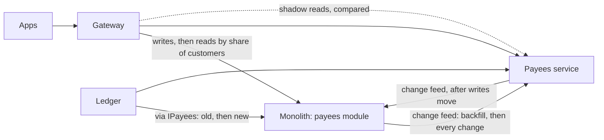

# Capstone: move payees out of the monolith

> "Our payees live in the core banking monolith. We want them in their own service, with their own database. Design the move: no downtime, and no lost or duplicated payees."

Try answering out loud before reading on, in the time you'd have in a real interview. Then compare.

The trap in this question is to answer with a target architecture: a box called "Payees service", a database next to it, an arrow from the gateway. The interviewer is asking how you get there, from a running system, without anyone noticing. That's a sequence of steps, each one reversible, and the hard parts are the data that keeps changing while you move it, and the callers you didn't know about.

## 1. Clarify

::: think What would you ask before proposing anything?

- **Why move it?** Independent releases, a new data model, scaling, a compliance boundary? The reason decides how far to go: a module boundary may be enough (stage 1).
- **Who uses payees?** The mobile and web apps, through the gateway; the ledger, on every transfer; anything else, such as fraud scoring, statements, reports or batch jobs? Every caller needs a seam (stage 7).
- **How much data, and how fast does it change?** That decides how long a backfill takes and how much changes during it.
- **Is the model changing?** A rewrite needs a translation between old and new, in both directions while you can still go back.
- **What can pause, and for how long?** Can payee changes wait a second while writes move?
- **What has to stay true?** Payee ids that transfers and statements refer to; a customer must be able to pay a payee they added a moment ago.

:::

::: think The interviewer says: "Five million customers, about twenty million payees. Customers add or remove around fifty thousand a day, up to fifty a second at peak. Every transfer looks up its payee, a few hundred a second at peak. A second's pause in payee changes is fine; anything longer isn't. The new service adds a verification status to each payee." What does that tell you?

The data is modest, but too big to copy in a quiet moment without a write freeze, so changes must flow while it copies. The change rate is low, so a change feed is easy to keep up with, and a write pause of well under a second is realistic. The ledger's lookups on every transfer make it the most important internal caller, and the one with the least tolerance for staleness. And the new field means translation: the old system has no verification status, so the new service must default it, and if writes move back, the old side can't hold it.

:::

## 2. Estimate

Round hard, and say your assumptions out loud.

**Backfill.** Twenty million payees at, say, 200 bytes each:

> 20,000,000 × 200 bytes ≈ 4 GB

Applied in batches at, say, 10,000 a second, that's about 2,000 seconds: half an hour. Measure it on a copy of production first. In the lab, copying row by row managed about 500 a second, which at this scale would take half a day.

**Changes during the backfill.** At peak, 50 a second:

> 50 × 2,000 seconds = 100,000 changes

The follower must apply those too, which it does by reading the same change feed the backfill came from. Once caught up, it only has to keep pace with 50 a second.

**Ledger lookups.** A few hundred a second, each needing an answer in milliseconds. A network call to the new service on every transfer adds latency and a dependency (stage 4); a local copy in the ledger removes both, if it can handle a payee added a second ago.

The numbers that decide the design: the backfill takes long enough that writes can't be frozen for it, and the change rate is low enough that a short pause to move writes is cheap.

## 3. Design

1. **A seam for every caller** ([stage 6](./06-one-front-door), [stage 1](./01-split-it-or-not-yet)). The apps reach payees through the gateway, whose routes decide where requests go. The ledger reaches them through its payees contract, whose implementation can switch from the module to a client of the new service. List the other callers first, from the database's own records of who queries the payees tables, not from memory.
2. **A change log in the old code** ([stage 3](./03-who-owns-the-data), B2 stage 4). Every add and remove is written to a change log in the same transaction, and published as a feed, in order. A migration writes every existing payee into the log as "added", so a follower reading from the start gets everything.
3. **The new service follows the feed** ([stage 7](./07-strangler-fig)). Reading from the start is the backfill; carrying on is staying current. It keeps the old payee ids, saves its position with each batch, applies changes idempotently, and translates: payees from the old side start as "unverified".
4. **Reconcile continuously** (B3 stage 7). Per customer, compare counts and a checksum of payee ids in both stores, and alert on any difference that persists past the feed's lag.
5. **Shadow reads** ([stage 7](./07-strangler-fig)). The gateway sends a share of reads to both stores and compares them, checking a mismatch again before counting it. Fix every real difference before moving on: in the lab, the rewrite listed payees in a different order than the app expected.
6. **Move reads, customer by customer** ([stage 7](./07-strangler-fig)). 1%, 10%, 50%, 100%, each customer always reading from the same store, watching errors, latency and support calls at each step.
7. **Move the ledger's reads** ([stage 3](./03-who-owns-the-data), [stage 4](./04-sync-or-async)). Give the ledger a local copy of the payee-to-account mapping, built from the new service's feed, and fall back to asking the service when a payee isn't in the copy yet, so a payee added a second ago can still be paid.
8. **Move writes** ([stage 7](./07-strangler-fig)). Pause payee changes, let the ones in flight finish, wait until the new service has applied everything in the old log, switch, resume. In the lab, that pause was usually under 200 ms. The old module now follows the new service's feed.
9. **Retire** ([stage 7](./07-strangler-fig)). After an agreed period without needing to go back, stop the reverse feed, remove the module and its tables, and archive the data.

## 4. Deep dive

::: details "Why not just write to both databases during the migration?"
Because the two writes can't be made atomic. When one succeeds and the other fails, or the process stops between them, the stores disagree and nothing records it. Concurrent writes can also arrive in different orders. A change log written in the same transaction as each change can't miss one, and its order is the order of the changes.
:::

::: details "How do you know nothing was lost?"
Three ways, all running continuously: shadow reads on live traffic; reconciliation of the stores per customer, with counts and checksums; and the follower's own position against the feed's head, so lag is visible. In the lab, the load tool checked every payee it added or removed, in both stores, and found nothing missing in the gradual runs, against 131 payees lost in the copy-then-switch run.
:::

::: details "The new service has a bug, found after writes moved. What now?"
Move writes back: pause, let the module catch up with the new service's feed, switch, resume. That's why the module keeps following until retirement. One caveat: anything only the new model holds, such as verification status, can't go back with them, so decide in advance what's acceptable to lose on a rollback, or keep the new fields somewhere the old side can carry them.
:::

::: details "A customer adds a payee and pays them immediately. What happens?"
The add goes to whichever store owns writes, and the transfer's lookup may go to a copy that hasn't seen it yet. Either route the lookup to the owner when the copy doesn't have the payee, or have the client pass the position its add returned, and wait for the copy to reach it (read-your-writes, as in B1 stage 6). Never fail the transfer just because a copy is a moment behind.
:::

::: details "How long should all this take?"
Weeks, not a weekend: a few days for each move of reads, longer at the start and in busy periods, with the conditions for each step agreed in advance. The steps themselves are quick; the waiting is how you find what's wrong while only some customers can see it.
:::

::: details "Isn't this a lot of machinery for one capability?"
Some of it is reusable: the seam, the change log pattern, the follower and the shadow comparisons will be used for the next capability. And the alternative's cost is concrete: in the lab, a one-minute version of the weekend plan lost 131 payees and had no way back. If the capability's data doesn't change while you move it, the simpler plan is fine.
:::

## The answer in two minutes

> "First, who uses payees and how: the apps through the gateway, the ledger on every transfer, and whatever else the database says queries those tables. Twenty million payees take too long to copy with writes frozen, but they change slowly, which makes a change feed easy.
>
> So: a seam for every caller, the gateway's routes and the ledger's payees interface. A change log in the old module, written in the same transaction as each change and backfilled with every existing payee. The new service follows it, keeping the old ids and translating to its new model. Reconcile the two continuously, and shadow-read to compare answers on real traffic, fixing differences before anyone sees them.
>
> Then move reads by share of customers, each customer sticky to one store. Give the ledger a local copy of payees, falling back to the owner for ones it hasn't seen yet. Move writes with a sub-second pause, after the new service has caught up, and have the old module follow it back, so every step can be reversed. Retire the old module when nobody would switch back."

## What to review

If any part of your answer felt shaky, go back to its stage:

| If you were unsure about | Review |
|---|---|
| Whether to split at all, module boundaries | [1. Split it, or not yet?](./01-split-it-or-not-yet) |
| Where the boundary goes | [2. Where the boundaries go](./02-where-the-boundaries-go) |
| Change feeds, copies, staleness | [3. Who owns the data](./03-who-owns-the-data) |
| Sync calls from the ledger, chains | [4. Sync or async between services](./04-sync-or-async) |
| Steps across stores, compensation | [5. A transaction across services](./05-sagas) |
| Routing, the seam at the edge | [6. One front door](./06-one-front-door) |
| Backfill, shadow reads, moving reads and writes | [7. Moving a capability without stopping](./07-strangler-fig) |
