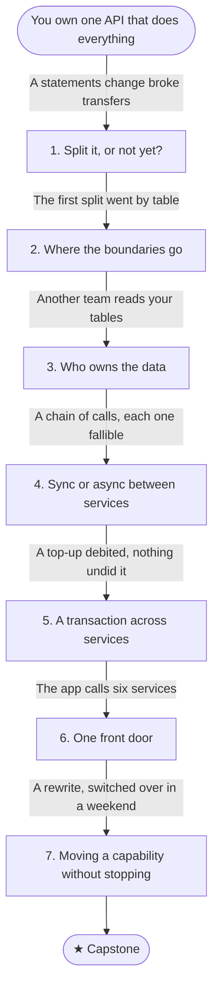

# B5: One service becomes many

You own a transfer API for a banking product that is correct (B3) and survives its dependencies failing (B4). It has grown: accounts, transfers, payees, statements, fraud checks and notifications all live in one codebase and one database, and several teams now work in it. Changes collide, releases wait for everyone, and someone proposes splitting it into microservices.

This journey is about when to split, where the lines go, and what each split costs: data you no longer share, calls that can fail, transactions that become sagas. It argues at every step for the least distribution that solves the problem, and ends with moving one capability out of a running system without stopping it.

## Stage map

Each stage's fix creates the problem that triggers the next one.

| # | Stage | Triggered by |
|---|---|---|
| 1 | [Split it, or not yet?](./01-split-it-or-not-yet): Coupling, the modular monolith | Three teams share one codebase, and a change to statements broke transfers |
| 2 | [Where the boundaries go](./02-where-the-boundaries-go): Bounded contexts, splitting by capability | The first split went by table, and every transfer now calls two services three times |
| 3 | [Who owns the data](./03-who-owns-the-data): One owner, copies, staleness | Notifications read the accounts table directly, and a column rename broke them |
| 4 | [Sync or async between services](./04-sync-or-async): Temporal coupling, chains of calls | A transfer calls four services in turn, and each one's failures add up |
| 5 | [A transaction across services](./05-sagas): Sagas and compensations | A card top-up debited the ledger, the cards service failed, and nothing undid it |
| 6 | [One front door](./06-one-front-door): API gateways, backends for frontends | The mobile app calls six services, and one screen takes six round trips |
| 7 | [Moving a capability without stopping](./07-strangler-fig): The strangler fig | The plan is to rewrite payments and switch over in one weekend |
| ★ | [Capstone: move payees out of the monolith](./capstone) | — |

## Before you start

This journey builds on [B2](../work-outside-the-request/) (queues, events, the outbox), [B3](../the-money-must-add-up/) (transactions, idempotency, pending states) and [B4](../things-fail/) (timeouts, retries, breakers, rate limits). Its labs use a modular version of the bank in `samples/src/Bank.Modular`, with the same Postgres as the earlier journeys.

## By the end you'll be able to

- Say what splitting a system buys and costs, and argue for a modular monolith when it's enough.
- Draw service boundaries around business capabilities, and spot an entity-service split.
- Give each piece of data one owner, and choose how others read it.
- Decide between synchronous calls and events, and work out what a chain of calls does to availability and latency.
- Design a saga, with compensations and state that survive a crash.
- Put a gateway in front of many services without turning it into a new monolith.
- Move a capability out of a running system, step by step, with a way back at each step.
