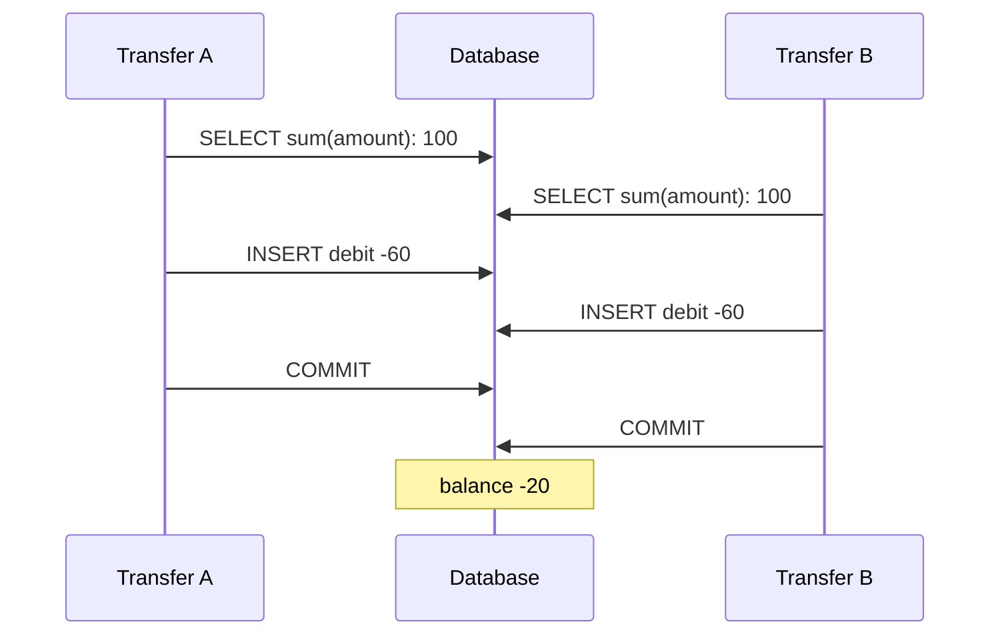

# 1. Check, then act

## Where we are

After B2, transfers are fast and their events are never lost. But nothing stops a customer sending money they don't have. So the transfer endpoint now adds up the account's transactions, rejects the transfer if the balance won't cover it, and otherwise records the debit and credit, all inside one database transaction. Code review approves it, and the tests pass.

A week later, support reports an overdrawn account. The customer had 100, paid 60 in rent from the app, and at the same moment a scheduled payment of 60 went out. Both succeeded.

## Stop and think

::: think The check and the insert are in one transaction. How can two transfers both pass a check that only one should?

A transaction makes its own changes all-or-nothing. By default, it doesn't stop two transactions from running *at the same time* and seeing the same data. Under PostgreSQL's default isolation level, read committed, each statement sees whatever was committed when it started. Both transfers read the balance before either has committed, both see 100, both decide 60 is fine, and both insert their debit. Nothing conflicts: they insert different rows. Both commit, and the balance is -20.

In the lab, sending ten transfers of 60 at an account holding 100, all at once, overdrew it in 50 rounds out of 50. Even two at once overdrew it every time.

:::

::: think Would a stricter isolation level fix it? Which one?

Not repeatable read. Under PostgreSQL's repeatable read, each transaction works from a snapshot taken at its first statement, so both still see 100. And because they write different rows, the database sees no conflict. This is *write skew*: two transactions read the same data, each makes a change that's fine on its own, and together they break a rule. In the lab, repeatable read still overdrew the account in 50 rounds out of 50.

Serializable does fix it. PostgreSQL tracks what each transaction read and wrote, notices that the two transfers can't be put in any order that would give this result, and aborts one of them with a *serialization failure*. In the lab, no account was ever overdrawn.

:::

::: think Under serializable, 448 of 500 transfers failed with "try again". Is that a bug?

No. It's how serializable isolation works: when the database can't be sure a transaction is safe, it refuses rather than guesses. The application has to run the whole transaction again, from `BEGIN`. With retries, every transfer in the lab got a definite answer: 50 succeeded, one per round, and the other 450 were rejected for insufficient funds. Without retries, customers get errors for transfers that would have been fine or, more usefully, correctly refused.

:::

## The mental model

### What isolation means

ACID's I is *isolation*: how much concurrent transactions can see of each other. Full isolation means the result is as if transactions ran one at a time, in some order (*serializable*). Weaker levels allow specific anomalies in exchange for less waiting and fewer aborts.

| Anomaly | What happens | Banking example |
|---|---|---|
| Dirty read | Reading another transaction's uncommitted change | Seeing a deposit that's later rolled back |
| Non-repeatable read | Reading the same row twice and getting different values | A statement total that changes halfway through building it |
| Phantom | Re-running a query and getting different rows | A count of today's transactions that grows during a report |
| Lost update | Two transactions read a value, both write a new one, and one write overwrites the other | Two updates to a stored balance; one disappears (stage 2) |
| Write skew | Two transactions read the same data, then write different rows; each is fine alone, both together break a rule | This stage's overdraft |

And what each PostgreSQL level allows:

| Level | Dirty read | Non-repeatable read, phantom | Lost update | Write skew |
|---|---|---|---|---|
| Read committed (the default) | No | Yes | Yes | Yes |
| Repeatable read (snapshot isolation) | No | No | No: the second writer fails | Yes |
| Serializable | No | No | No | No: one transaction fails |

Other databases name the same levels but implement them differently. MySQL's InnoDB defaults to repeatable read, with different rules from PostgreSQL's, and SQL Server's read committed can use locks or row versions depending on a database setting. Read your database's documentation, such as PostgreSQL's [transaction isolation](https://www.postgresql.org/docs/current/transaction-iso.html) chapter, rather than relying on the names.

### Check-then-act



Any code that reads something, decides, and then writes based on that decision has a gap between the read and the write. Another transaction can change what was read inside that gap. Closing the gap takes one of three things: an isolation level that detects it, a lock that keeps others out of it, or a single statement that checks and writes at once. This stage covers the first; stage 2 covers the other two.

### Step through it

Choose a scenario and an isolation level, then step T1 and T2 in any order, or run the worst-case interleaving. Try "Check, then insert" under each isolation level, then "Run one after the other" to see that the same code is correct when nothing overlaps.

<InterleavingSimulator />

## The escalation ladder

### 1. Raise the isolation level to repeatable read

**Fixes:** lost updates to the same row, and reads that change halfway through a transaction.
**Costs:** the second of two transactions updating the same row fails, and must be retried.
**Breaks:** nothing new, but it doesn't fix this bug. The transfers write different rows, so there's no conflict to detect. In the lab, still overdrawn in 50 rounds out of 50.

### 2. Serializable, without retries

**Fixes:** every anomaly, including write skew, without having to reason about which queries conflict.
**Costs:** the database aborts transactions it can't prove are safe. In the lab, 448 of 500 transfers failed with a serialization failure.
**Breaks:** the customer experience: an error for a transfer that would have been fine, or should have been refused for a clear reason.

### 3. Serializable, with retries

Run the whole transaction again when it fails with a serialization failure (SQLSTATE `40001`) or a deadlock (`40P01`). Nothing it did was committed, so starting again is safe:

<<< @/../samples/src/Bank.Api/Endpoints/TransferEndpoints.cs#retry-loop

EF Core can wrap the database's error more than once, so the check looks through the whole chain:

<<< @/../samples/src/Bank.Api/Endpoints/Funds.cs#retryable

**Fixes:** the overdraft, with a clear answer for every transfer. In the lab: 0 overdrawn accounts, 50 transfers accepted and 450 refused for insufficient funds.
**Costs:** repeated work and extra latency when transactions collide, and a little overhead for tracking reads.
**Breaks:** throughput under heavy contention on the same data. Every retry can collide again, and the work is wasted each time. Every transaction that touches the data must run at serializable, too, or the guarantee has holes.

### 4. Make the conflict visible

The transfers conflicted logically, but not physically: they wrote different rows. If every transfer from an account also writes one row that belongs to that account, such as the account row itself, the conflict becomes physical. Then repeatable read catches it, and so do row locks. This is called *materialising the conflict*.

The lab shows it by accident: in Outbox mode, B2 stage 5's per-account sequence number updates the account row in every transfer, and repeatable read then prevented every overdraft. Stage 2 builds on this deliberately.

**Fixes:** write skew, at weaker isolation levels.
**Costs:** a row that every transfer from the account must lock or update.
**Breaks:** concurrency on that account: transfers from it now queue. Stage 2 deals with that.

## Trade-offs at a glance

| Approach | Prevents the overdraft | Costs | Watch out for |
|---|---|---|---|
| Read committed, check then insert | No | — | The default, and the bug |
| Repeatable read | No | Retries on same-row conflicts | Write skew passes straight through |
| Serializable, no retries | Yes | Many failed requests | Errors shown to customers |
| Serializable with retries | Yes | Retries, latency under contention | Every transaction involved must be serializable |
| Materialise the conflict | Yes, with a lock or repeatable read | Contention on one row | Hot accounts (stage 2) |

## Traps

- **Assuming a transaction makes the code inside it run alone.** It doesn't, at the default level.
- **Assuming repeatable read means serializable.** In PostgreSQL it's snapshot isolation, which allows write skew.
- **Retrying the failed statement instead of the whole transaction.** The decision was based on data read earlier in the same transaction, and that read is what's out of date.
- **Setting the isolation level where it has no effect.** See below.
- **Holding a serializable transaction open across a network call.** The longer a transaction runs, the more likely it is to conflict.

::::: trap
This comes from an older set of notes, labelled "critical banking operations". On PostgreSQL, what isolation level do those operations run at?

```sql
SET TRANSACTION ISOLATION LEVEL SERIALIZABLE;
BEGIN;
-- Critical banking operations here
COMMIT;
```

::: details Answer
Read committed, the default. `SET TRANSACTION` applies to the *current* transaction, and before `BEGIN` there isn't one, so PostgreSQL prints a warning ("SET TRANSACTION can only be used in transaction blocks") and ignores it. Warnings rarely reach an application's logs, so nobody notices.

Set the level as part of starting the transaction, `BEGIN ISOLATION LEVEL SERIALIZABLE;`, or with `SET TRANSACTION` immediately after `BEGIN`. In EF Core, pass it to `BeginTransactionAsync(IsolationLevel.Serializable)`. Then check: `SHOW transaction_isolation;` inside the transaction.
:::
:::::

::::: trap
A developer adds retries for serialization failures. Under load, transfers still fail, and the logs show "current transaction is aborted". What's wrong?

```csharp
public static async Task TransferAsync(BankDb db, int from, int to, decimal amount, CancellationToken ct)
{
    await using var tx = await db.Database.BeginTransactionAsync(IsolationLevel.Serializable, ct);

    var balance = await db.Transactions.Where(t => t.AccountId == from).SumAsync(t => t.Amount, ct);
    if (balance < amount)
    {
        throw new InvalidOperationException("Insufficient funds.");
    }

    var now = DateTimeOffset.UtcNow;
    db.Transactions.Add(new Transaction { AccountId = from, CounterpartyAccountId = to, Amount = -amount, Description = "Transfer", CreatedAt = now });
    db.Transactions.Add(new Transaction { AccountId = to, CounterpartyAccountId = from, Amount = amount, Description = "Incoming transfer", CreatedAt = now });

    for (var attempt = 1; ; attempt++)
    {
        try
        {
            await db.SaveChangesAsync(ct);
            await tx.CommitAsync(ct);
            return;
        }
        catch (DbUpdateException) when (attempt < 3)
        {
            await Task.Delay(50 * attempt, ct); // back off, then try again
        }
    }
}
```

::: details Answer
It retries the wrong thing.

- **It retries inside the failed transaction.** After a serialization failure, PostgreSQL has aborted the transaction, and every later statement in it fails with "current transaction is aborted" until it's rolled back. The retry can't succeed.
- **It keeps the stale decision.** Even in a fresh transaction, saving the same rows would skip the balance check, which was based on data that's now out of date. The retry must start again from `BEGIN`, re-read and re-check.
- **It catches too much and too little.** Every `DbUpdateException` is retried, including ones that will never succeed, such as a foreign key violation. And a serialization failure at `CommitAsync` isn't a `DbUpdateException` at all, so it isn't retried.

Put the loop around the whole transaction, retry only serialization failures and deadlocks, and clear EF Core's change tracker between attempts, as the lab's retry loop does.
:::
:::::

## In the interview

::::: interview
**Usually asked as:** "Two withdrawals hit the same account at once. How do you stop it going negative?" Or: "What isolation level does your database use, and what can go wrong at that level?"

**Short answer:** "The bug is check-then-act: both transactions read the balance before either writes, and at the default isolation level, read committed in Postgres, nothing stops that. Repeatable read doesn't help either when each transaction inserts its own row: that's write skew. I'd close the gap in one of three ways: serializable isolation with a retry loop around the whole transaction; locking the account row before checking; or a single conditional statement that checks and updates the balance at once. For a balance, I'd usually choose the conditional update or a row lock, because they're predictable under contention, and keep serializable for logic that's hard to express as one row."

::: details Follow-up: what's the difference between a lost update and write skew?
A lost update is two transactions writing the *same* row, where the second overwrites the first. Snapshot isolation (repeatable read in PostgreSQL) prevents it by failing the second writer. Write skew is two transactions writing *different* rows based on the same read, together breaking a rule neither breaks alone. Snapshot isolation doesn't detect it, because there's no write-write conflict; serializable does.
:::

::: details Follow-up: why not run everything at serializable?
It can be a reasonable default, but it has costs. Every transaction must be retryable, from the start, so side effects inside it (calls to other systems) are a problem. Under heavy contention on the same data, transactions abort repeatedly and throughput drops. And it adds some overhead for tracking reads. Many teams use read committed by default and solve known races explicitly with locks or conditional updates.
:::

::: details Follow-up: what does "repeatable read" mean?
It depends on the database. In the SQL standard, it forbids non-repeatable reads but allows phantoms. In PostgreSQL, it's snapshot isolation: no phantoms, lost updates fail, write skew is allowed. In MySQL's InnoDB, it's the default, with snapshot reads plus locking for some writes and locking reads. Always check the specific database's documentation.
:::

::: details Follow-up: a transaction failed with a serialization failure. What do you do?
Roll back and run the entire transaction again from the beginning, re-reading everything, a limited number of times with a short backoff. Only retry errors that are meant to be retried, such as SQLSTATE 40001 and 40P01. If retries are exhausted, return a clear error that the client can retry later.
:::
:::::

## Try it

With the lab running (`docker compose up -d` in `samples/`, seeded), from the `samples` folder. This stage uses B2's Event mode, which publishes to RabbitMQ and needs no workers.

If you haven't done B1, create the index that B1 stage 3 ends with, so the balance check doesn't scan the whole table (about half a minute):

```sh
docker compose exec postgres psql -U bank -d bank -c "CREATE INDEX CONCURRENTLY IF NOT EXISTS ix_transactions_account_id_created_at_id ON transactions (account_id, created_at DESC, id DESC)"
```

1. **Start the API with the balance check** at the default isolation level:

   ```sh
   dotnet run --project src/Bank.Api -- --Lab:Transfers=Event --Lab:Funds=CheckSum
   ```

2. **Race it.** Each round opens an account, deposits 100, and sends ten transfers of 60 from it at once:

   ```sh
   dotnet run --project tools/Bank.Load -- --race 10
   ```

3. **Repeat** with `--Lab:Isolation=RepeatableRead`, then `--Lab:Isolation=Serializable`, then `--Lab:Isolation=Serializable --Lab:Retries=10`, restarting the API each time. Try `--race 2` too.

Our results, for 50 rounds of ten transfers:

| API settings | Accepted (201) | Refused (422) | "Try again" (409) | Rounds overdrawn |
|---|---|---|---|---|
| No check | 500 | 0 | 0 | 50 of 50 |
| Check, read committed | 496 | 4 | 0 | 50 of 50 |
| Check, repeatable read | 498 | 2 | 0 | 50 of 50 |
| Check, serializable | 50 | 2 | 448 | 0 |
| Check, serializable, 10 retries | 50 | 450 | 0 | 0 |

With just two transfers at once, the check at read committed still overdrew the account in every round. Run the repeatable read test again with `--Lab:Transfers=Outbox` instead of `Event`, and every overdraft disappears: B2's per-account sequence number updates the account row in each transfer, which materialises the conflict.

## What breaks next

Serializable with retries fixed the overdrafts, but the team doesn't like its unpredictability: how many retries is enough, and how slow does a busy account get? They switch to something they understand: lock the account row, then check, then write.

Then month-end payroll arrives. One employer's account pays 2,000 salaries at once, every transfer waits for the same lock, and the logs start showing deadlocks.

Next: [2. Locks or versions](./02-locks-or-versions).
