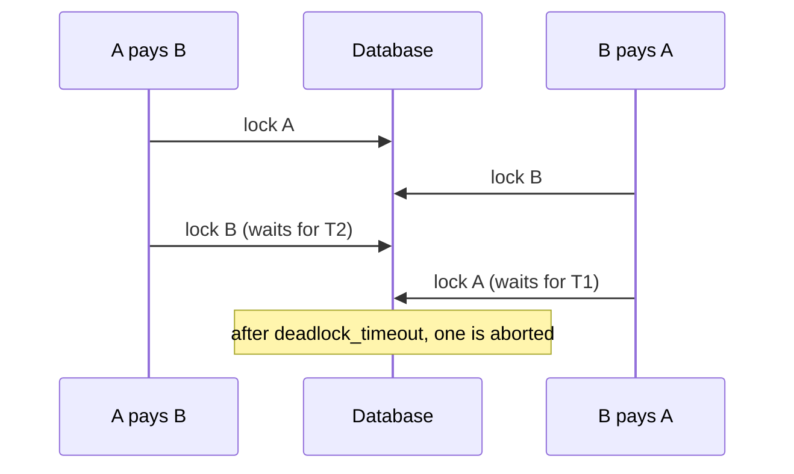

# 2. Locks or versions

## Where we are

Serializable with retries stopped the overdrafts in stage 1, but the team wants something more predictable. They give each account a stored balance, lock the account's row, check the balance, and update it. The overdrafts stay fixed.

Then month-end arrives. One employer pays 2,000 salaries at once, and transfers from its account crawl: most finish quickly, but some take 14 seconds. And when two customers pay each other at the same moment, the logs show "deadlock detected", and both transfers fail.

## Stop and think

::: think Ordinary transfers run at about 200 a second. Payroll from the one employer account runs at 70. Why?

Every salary is a transfer from the same account, and every one of them needs that account's row lock. Only one transaction can hold it at a time, so transfers from that account run one after another, however many servers and connections you have. The account's throughput is one divided by how long each transaction holds the lock, and that includes everything the transaction does after taking it: inserting rows, extra round trips, the commit.

A row that many transactions must lock is a *hot row*, and it's a bottleneck no amount of hardware fixes.

:::

::: think A pays B while B pays A, and both transfers fail with "deadlock detected". Why? Would retrying them fix it?

Each transfer locks the payer's row first, then the payee's. A→B locks A and waits for B; B→A locks B and waits for A. Neither can continue. PostgreSQL notices after a short wait (`deadlock_timeout`, one second by default), aborts one, and the other carries on.

Retrying doesn't remove the cause: the retry meets the same race again. In the lab, with transfers flowing both ways between two accounts, 198 of 200 failed with deadlocks, and with ten retries each, only 10 succeeded while the rest gave up or timed out. Locking the two accounts in the same order every time, lower id first, made all 200 succeed.

:::

::: think Optimistic concurrency is often recommended over locking because it "scales better". For the employer's account, does it?

No: for a hot row, it was the worst option in the lab. Optimistic concurrency reads without locking and writes only if nothing changed in between. When thousands of transfers hit one account, almost every write finds that something did change, so most work is thrown away and retried. With 10 retries, 653 of 2,000 salaries failed outright; with 100 retries, all succeeded, at 39 a second.

Optimistic concurrency is excellent when conflicts are rare, such as most customers' accounts, or a form someone edits for minutes. Locks are better when conflicts are certain.

:::

## The mental model

### Pessimistic and optimistic

- **Pessimistic**: assume a conflict, and prevent it. Lock what you'll change before you decide, so others wait.
- **Optimistic**: assume no conflict, and detect it. Remember a version when you read; write only if the version hasn't changed; if it has, start again.
- **Atomic**: avoid the gap altogether. A single statement that checks and changes, such as `UPDATE ... SET balance = balance - 60 WHERE id = 7 AND balance >= 60`, has no moment between reading and writing for anyone else to use.

### What PostgreSQL locks, and for how long

- An `UPDATE` locks each row it changes. `SELECT ... FOR UPDATE` and `FOR NO KEY UPDATE` lock rows without changing them.
- Row locks last until the transaction ends, not until the statement does. Outside an explicit transaction, each statement is its own transaction, so a lock taken by a `SELECT ... FOR UPDATE` is released as soon as the statement finishes.
- Ordinary reads never wait for row locks: they read the last committed version. Only writers and locking reads wait.
- Inserting a row with a foreign key takes a light `KEY SHARE` lock on the referenced row. `FOR UPDATE` conflicts with it; `FOR NO KEY UPDATE`, the lock an ordinary `UPDATE` takes, doesn't. If you're not changing the row's key, ask for `FOR NO KEY UPDATE`.

PostgreSQL's [explicit locking](https://www.postgresql.org/docs/current/explicit-locking.html) chapter has the full table of which locks conflict.

### Deadlocks



A deadlock needs two transactions taking the same locks in different orders. Take locks in one global order, such as by account id, and the cycle can't form.

### Step through it

Choose "Read, then write the balance" to see a lost update: a deposit and a withdrawal both read 100, and one of their writes vanishes at read committed. Then choose "Conditional update", and watch the second transfer wait for the lock and re-check the new balance.

<InterleavingSimulator />

## The escalation ladder

### 1. A conditional update

<<< @/../samples/src/Bank.Api/Endpoints/Funds.cs#conditional

**Fixes:** the race, with no explicit lock and no retry loop. Check how many rows the statement changed: zero means "can't afford it".
**Costs:** the row stays locked from the `UPDATE` until the commit.
**Breaks:** nothing, but it only works when the rule fits in one statement. In the lab, 0 overdrawn accounts, and 77 salaries a second from the hot account.

### 2. Lock the rows, then decide

<<< @/../samples/src/Bank.Api/Endpoints/Funds.cs#for-update

**Fixes:** the race, when the decision needs more than one statement: several balances, limits, account status.
**Costs:** the lock is held while you read and decide, so for longer. In the lab: 70 a second from the hot account, a median of 51 ms, but a p99 of 8.6 seconds and a worst case of 14. Lock waits aren't necessarily first come, first served, and a few transfers waited far longer than the rest.
**Breaks:** throughput on hot rows, and it deadlocks if the order of locking varies.

### 3. Optimistic concurrency

<<< @/../samples/src/Bank.Api/Endpoints/Funds.cs#optimistic

**Fixes:** the race, with no lock held between the read and the write. Ideal when conflicts are rare, or when the read and the write are far apart, such as a form a person edits.
**Costs:** a version column, and a retry loop.
**Breaks:** under contention. On the hot account: 50 a second and 653 of 2,000 failures with 10 retries; 39 a second with 100 retries.

### 4. Lock in a consistent order

<<< @/../samples/src/Bank.Api/Endpoints/Funds.cs#lock-order

**Fixes:** deadlocks between transfers in opposite directions. In the lab, 199 of 200 transfers deadlocked in request order; in account order, all 200 succeeded.
**Costs:** nothing measurable.
**Breaks:** nothing. It only has to be followed everywhere: one code path that locks in a different order brings the deadlocks back.

### 5. Hold locks for less time

Do everything that doesn't need the lock first, then take it, change the balance and commit at once:

<<< @/../samples/src/Bank.Api/Endpoints/TransferEndpoints.cs#lock-late

**Fixes:** throughput on hot rows. The conditional update went from 77 to 117 salaries a second, and its p99 from 2.2 to 1.2 seconds. The row-lock version barely changed, because it still makes four round trips while holding the lock.
**Costs:** care with the order of statements.
**Breaks:** nothing. And never hold a lock across a call to another system.

### 6. Change the shape of the hot account

When even short locks aren't enough, stop sending every transfer through one row:

- **Batch it.** A payroll file becomes one transaction: one debit for the total from the employer, and the individual credits. One lock instead of 2,000.
- **Split the balance.** Give the hot account several sub-balances and spread debits across them; its balance is their sum. Checking "can it afford this?" gets harder.
- **Queue per account.** Route each account's transfers through one partition and process them in order (B2 stage 5), so they never compete for the lock.

**Costs:** design and complexity, and each changes how the balance is checked.

## Trade-offs at a glance

| Approach | Hot account (2,000 salaries) | Watch out for |
|---|---|---|
| Serializable with 10 retries (stage 1) | 38/s; 1,155 failed | Retry storms under contention |
| Conditional update | 77/s; p99 2.2 s | Rules that don't fit one statement |
| Lock, then decide | 70/s; p99 8.6 s | Lock order; long lock holds |
| Optimistic, 10 retries | 50/s; 653 failed | Contention |
| Optimistic, 100 retries | 39/s; p99 3.7 s | Contention |
| Conditional update, lock taken late | 117/s; p99 1.2 s | Statement order |

## Traps

- **Retrying deadlocks instead of fixing the lock order.** The retry meets the same race.
- **Locking outside a transaction.** The lock is released when the statement ends. See below.
- **`FOR UPDATE` when `FOR NO KEY UPDATE` would do.** It also blocks inserts that reference the row.
- **Optimistic concurrency on a hot row.** Most of the work is thrown away.
- **Holding a lock while calling another service.** Every transfer from the account now waits for that service too.
- **"Pessimistic locking doesn't scale."** It depends on contention. For a hot account, it beat optimistic concurrency in every measurement here.

::::: trap
This moves money between stored balances with row locks. It's called straight from an endpoint, with no explicit transaction. Code review approved it, and the tests pass. What's wrong?

```csharp
public static async Task<bool> MoveAsync(BankDb db, int from, int to, decimal amount, CancellationToken ct)
{
    var payer = await db.Accounts.FromSql($"SELECT * FROM accounts WHERE id = {from} FOR UPDATE").SingleAsync(ct);
    var payee = await db.Accounts.FromSql($"SELECT * FROM accounts WHERE id = {to} FOR UPDATE").SingleAsync(ct);

    if (payer.Balance < amount)
    {
        return false;
    }

    payer.Balance -= amount;
    payee.Balance += amount;
    await db.SaveChangesAsync(ct);
    return true;
}
```

::: details Answer
- **The locks protect nothing.** With no explicit transaction, each `SELECT ... FOR UPDATE` runs in its own transaction and releases its lock as soon as it finishes. `SaveChanges` starts a new transaction later. Two calls can both read 100, both pass the check, and both write: the overdraft and a lost update, despite the locks. Begin a transaction before the first lock, and commit after the save.
- **It deadlocks.** The payer is locked first, so A→B and B→A running together lock in opposite orders. Lock in account id order.
- **It writes absolute values.** `SaveChanges` sends `SET balance = <the value computed here>`. Inside a correct transaction with the locks held, that's safe, but it's the lost-update pattern if the locking is ever removed. Prefer `SET balance = balance - @amount`.
- **`FOR UPDATE` is stronger than needed**: `FOR NO KEY UPDATE` doesn't block inserts that reference the account.
:::
:::::

## In the interview

::::: interview
**Usually asked as:** "Optimistic or pessimistic locking?" Or: "How do you handle concurrent updates to a balance?"

**Short answer:** "It depends on how often conflicts happen. For a balance, I'd start with a conditional update, `UPDATE accounts SET balance = balance - @amount WHERE id = @id AND balance >= @amount`, and check the rows affected: it's atomic, needs no explicit lock and no retries. If the decision needs several reads, I'd lock the rows with `SELECT ... FOR UPDATE` inside the transaction, always in the same order to avoid deadlocks, and keep the transaction short. I'd use optimistic concurrency, with a version column, where conflicts are rare, such as editing a profile, not for a busy account, where it wastes most of the work on retries. And for a really hot account, I'd change the shape: batch the payments, or split the balance."

::: details Follow-up: how do you prevent deadlocks?
Take locks in one global order everywhere, such as ascending account id. Keep transactions short, and don't wait on other systems while holding locks. Still treat a deadlock error as retryable, because something you don't control, such as a foreign key check or another team's code, can still cause one. And monitor them: PostgreSQL logs each deadlock and counts them in `pg_stat_database`.
:::

::: details Follow-up: does `SELECT ... FOR UPDATE` block readers?
Not ordinary reads in PostgreSQL: they use the last committed version of the row (MVCC). It blocks other writers and other locking reads of that row until the transaction ends. Databases that lock for reads behave differently, which is one reason "pessimistic locking blocks everyone" is repeated so often.
:::

::: details Follow-up: one account receives thousands of transfers a second. What do you do?
Measure the lock hold time first, and shorten it: take the lock last and commit straight away. Then reduce the number of transactions that need the lock: batch payments into one debit, or split the hot account into sub-balances whose sum is the balance. Or serialise its transfers through a per-account queue, so they never compete. Each changes how you check the balance, so choose based on how strict that check must be.
:::

::: details Follow-up: when is optimistic concurrency the right choice?
When conflicts are rare and the time between reading and writing is long: a person editing a record in a form, or a background job updating its own rows. There's no lock held while they think, and the occasional conflict is cheap to report ("someone else changed this, reload"). It's also the natural fit across systems that can't share a lock, using an ETag or a version in an HTTP `If-Match` header.
:::
:::::

## Try it

From the `samples` folder, with the lab running. Apply this stage's migration first: it adds the stored balance and sets it from each account's history (about a minute on the full dataset).

```sh
dotnet run --project src/Bank.Api -- seed
```

1. **Check each approach prevents the overdraft.** Start the API with `--Lab:Transfers=Event --Lab:Funds=Conditional` and run `dotnet run --project tools/Bank.Load -- --race 10`. Repeat with `ForUpdate`, then `Optimistic`, then `Optimistic --Lab:Retries=10`.

2. **Payroll from one account.** For each approach, restart the API and send 2,000 salaries from one new employer account:

   ```sh
   dotnet run --project tools/Bank.Load -- --payroll 2000 --employer --concurrency 32
   ```

   Then add `--Lab:LockLate=true` to the conditional update.

3. **Transfers both ways.** With `--Lab:Funds=Conditional`, send transfers back and forth between two accounts; then restart with `--Lab:LockOrder=AccountId` and repeat:

   ```sh
   dotnet run --project tools/Bank.Load -- --crossfire 200 --concurrency 32
   ```

Our results. Payroll, 2,000 salaries from one account, 32 at a time:

| API settings | Salaries/s | Failed | p50 | p99 | Worst |
|---|---|---|---|---|---|
| No check | 201 | 0 | 146 ms | 511 ms | 637 ms |
| CheckSum, serializable, 10 retries | 38 | 1,155 | 893 ms | 1.7 s | 2.0 s |
| ForUpdate | 70 | 0 | 51 ms | 8.6 s | 14 s |
| Conditional | 77 | 0 | 239 ms | 2.2 s | 4.0 s |
| Optimistic, 10 retries | 50 | 653 | 642 ms | 1.8 s | 2.3 s |
| Optimistic, 100 retries | 39 | 0 | 591 ms | 3.7 s | 6.7 s |
| Conditional, lock taken late | 117 | 0 | 191 ms | 1.2 s | 1.9 s |

Transfers both ways between two accounts, 200 transfers, 32 at a time:

| API settings | Succeeded | Deadlocked (409) | Timed out |
|---|---|---|---|
| ForUpdate, request order | 2 | 198 | 0 |
| ForUpdate, request order, 10 retries | 10 | 168 | 22 |
| ForUpdate, account order | 200 | 0 | 0 |
| Conditional, request order | 1 | 199 | 0 |
| Conditional, account order | 200 | 0 | 0 |

## What breaks next

Transfers are correct now, but under load some take seconds to answer. The mobile app gives up after a few seconds and shows "Something went wrong". The customer taps Pay again. Both transfers go through.

Next: [3. Paid twice](./03-paid-twice).
