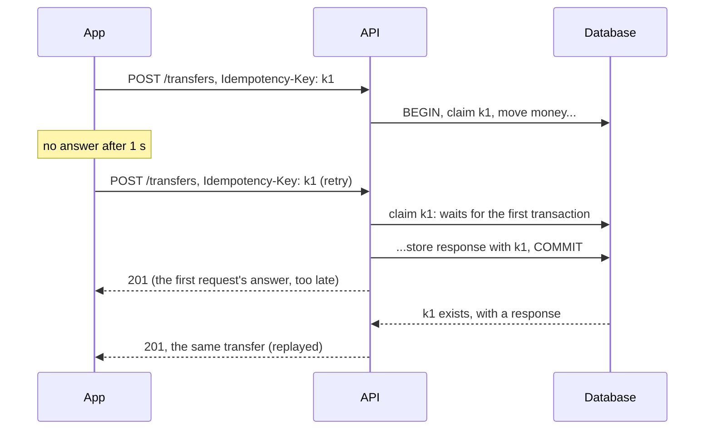

# 3. Paid twice

## Where we are

Stage 2 made transfers correct under concurrency, but on busy accounts some take seconds to answer. The mobile app waits one second, then shows "Something went wrong, try again". The customer taps Pay again, and sometimes taps twice. Both payments go through.

In the lab, 1,000 payments from a busy account, made the way a phone makes them, moved money 1,432 times.

## Stop and think

::: think The app timed out, so the first payment failed. Why did the money move twice?

The app didn't know it failed: it only knew it hadn't heard back. The first request was still running at the server, waiting for the account's lock. When it finished, it committed, but by then the app had given up and sent the same payment again. The server had no way to tell that the second request was a retry of the first, rather than a second coffee.

A caller that doesn't hear back can't tell "it failed" from "it worked, and the reply was lost". So retries are unavoidable, and the server has to recognise them.

:::

::: think The client sends an `Idempotency-Key` with each payment. The server looks the key up; if it's there, it returns the saved response, and if not, it makes the transfer and saves the key. What can still go wrong?

Two things. A retry can arrive while the first request is still running: the lookup finds nothing, because the first hasn't saved its key yet, so both make the transfer. And if the server crashes after the transfer commits but before the key is saved, the retry finds nothing and pays again.

In the lab, this "check first, record afterwards" version still made 274 extra payments out of 1,000, because nearly every retry arrived while the original was still waiting for the lock. It's the check-then-act race of stage 1, in another place.

:::

::: think The same key arrives with a different amount. What should the server do?

Refuse it, with a clear error. A key identifies one intended operation; a different request with the same key is a bug in the client, such as a key reused across payments. Returning the old result would hide the bug, and making the new transfer would defeat the key. Store a hash of the request with the key, and compare.

:::

## The mental model

### Keys identify intentions, not requests

The client generates a key when the customer decides to pay, such as a random UUID created when they tap Pay, and sends it with the payment and with every retry of that payment. A new payment, even an identical one, gets a new key. The server uses the key to recognise a repeat.



### Claim the key in the same transaction as the work

The server inserts the key, with a unique constraint, at the start of the transfer's transaction, and stores the response before committing:

- **A repeat after commit** finds the key and its response, and returns that response unchanged.
- **A repeat during the first request** tries to insert the same key, and the unique index makes it wait until the first transaction ends. Then it finds the key, and returns the stored response.
- **A crash before commit** rolls back the key with the transfer, so a retry starts again cleanly. There's no moment where the money has moved but the key isn't recorded.

<<< @/../samples/src/Bank.Api/Endpoints/Idempotency.cs#claim

<<< @/../samples/src/Bank.Api/Endpoints/TransferEndpoints.cs#claim-in-transaction

The [idempotency reference](/backend/reference/idempotency) has the same rules in general form, alongside the consumer side from B2 stage 3.

### The details that matter

- **Scope.** Keys are unique per payer here, so two customers can't collide by choosing the same key.
- **The request hash.** Stored with the key, to catch a reused key with a different request.
- **What gets stored.** This lab stores successful transfers. A refused transfer rolls back, key and all, so a retry after the customer tops up can succeed. Some APIs store the refusal too, so every retry gets the same answer. Either is defensible; choose one and document it.
- **Expiry.** Keys are kept for longer than any client retries, then deleted by age (the table has an index on its creation time).
- **The header.** `Idempotency-Key` is a common convention, being standardised by the IETF as [the Idempotency-Key HTTP header](https://datatracker.ietf.org/doc/draft-ietf-httpapi-idempotency-key-header/).

## The escalation ladder

### 1. Stop the double tap in the app

Disable the button while a payment is in flight.

**Fixes:** accidental double taps.
**Costs:** almost nothing.
**Breaks:** nothing, but it doesn't help with the real problem: retries after a timeout, from the app, a proxy or an HTTP library.

### 2. A natural unique key

If the operation has a natural identity, enforce it: one payment per invoice number, one salary per employee per pay run, as a unique constraint.

**Fixes:** duplicates, for operations that have such an identity.
**Costs:** a constraint.
**Breaks:** nothing, but a general transfer has no natural identity: two identical coffees are two payments.

### 3. Check first, record afterwards

<<< @/../samples/src/Bank.Api/Endpoints/Idempotency.cs#check-first

**Fixes:** a retry that arrives after the first request has finished.
**Costs:** a key table.
**Breaks:** under the conditions that cause retries: in the lab, 274 extra payments out of 1,000, because the retries arrived while the originals were still running.

### 4. Claim the key in the transaction

**Fixes:** every duplicate. In the lab, 0 extra payments out of 1,000, with 258 retries answered from the stored response.
**Costs:** a key table, an insert per payment, and concurrent retries waiting for the original.
**Breaks:** nothing, as long as the work and the key are in the same database transaction. When the work happens in another system, see stage 6.

### 5. Answer "what happened?"

In the lab, the app gave up on three payments that the server did complete. Make it safe for the app to find out: retrying later with the same key returns the original answer, and a status endpoint, `GET /transfers?key=...`, lets it ask without retrying.

**Fixes:** customers told "something went wrong" about payments that went through.
**Costs:** the app keeps its keys until it gets an answer.
**Breaks:** nothing.

## Trade-offs at a glance

| Approach | Extra payments (lab) | Costs | Watch out for |
|---|---|---|---|
| No keys | 432 of 1,000 | — | Every timeout is a possible duplicate |
| Disable the button | Not measured; only stops double taps | — | Network retries |
| Natural unique key | 0, where one exists | A constraint | Most transfers have no natural key |
| Check first, record afterwards | 274 of 1,000 | A key table | Retries during the first request; crashes |
| Claim in the transaction | 0 of 1,000 | An insert per payment | Work outside the transaction |

## Traps

- **A new key for each retry.** The key must identify the payment, not the attempt.
- **Checking and recording in separate steps.** The duplicate arrives in between.
- **Storing the key somewhere other than where the money moves,** such as a cache. A crash or an eviction separates them.
- **Global keys.** Scope them to the client or customer.
- **Ignoring the request body.** The same key with a different amount must be refused.
- **Treating a timeout as a failure.** Tell the customer you're checking, not that it failed.

::::: trap
This is a simplified version of a payment service from an older design document. It uses an idempotency key, with the result cached for 24 hours. What can make a customer pay twice, or lose money?

```csharp
public interface IAccounts
{
    Task DebitAsync(int accountId, decimal amount);
    Task CreditAsync(int accountId, decimal amount);
}

public sealed record PaymentResult(Guid PaymentId, bool WasReplayed = false);

public sealed class PaymentService(IDistributedCache cache, IAccounts accounts)
{
    public async Task<PaymentResult> PayAsync(string idempotencyKey, int from, int to, decimal amount)
    {
        var cacheKey = $"payment:{idempotencyKey}";
        if (await cache.GetStringAsync(cacheKey) is { } cached)
        {
            return JsonSerializer.Deserialize<PaymentResult>(cached)! with { WasReplayed = true };
        }

        await accounts.DebitAsync(from, amount);
        await accounts.CreditAsync(to, amount);

        var result = new PaymentResult(Guid.NewGuid());
        await cache.SetStringAsync(cacheKey, JsonSerializer.Serialize(result),
            new DistributedCacheEntryOptions { AbsoluteExpirationRelativeToNow = TimeSpan.FromHours(24) });
        return result;
    }
}
```

::: details Answer
- **Check then act.** Two requests with the same key, close together, both miss the cache and both pay. That's the double tap and the retry-during-a-slow-request case.
- **The key lives apart from the money.** A crash after the credit and before the cache write, a cache restart, or an eviction under memory pressure means the retry finds nothing and pays again.
- **No transaction around the debit and the credit.** A crash between them takes money from one account and gives it to no one. A retry then debits again.
- **The key isn't scoped**, so two customers' keys can collide, and **the request isn't compared**, so the same key with a different amount returns the first result.

Claim the key in the same database transaction as the debit and the credit, with a unique constraint, scoped to the customer, with a hash of the request; store the response there too. A cache can sit in front as an optimisation, never as the record.
:::
:::::

## In the interview

::::: interview
**Usually asked as:** "How do you make a payment API idempotent?" Or: "The client times out and retries. How do you avoid charging twice?"

**Short answer:** "The client generates an idempotency key for each payment the customer intends, and sends it with every retry. On the server, I insert the key into a table with a unique constraint, scoped to the customer and with a hash of the request, in the same database transaction as the money movement, and store the response there before committing. A retry after the commit gets the stored response. A retry during the first request waits on the unique index, then gets the stored response. A crash before commit rolls back the key with the payment. The same key with a different request is rejected. Keys expire after longer than any client retries."

::: details Follow-up: who generates the key, and when?
The client, once per intended operation: when the customer taps Pay, not when a request is sent. It keeps the key until it gets a definite answer, so it can retry the same payment safely even after a restart. If the server generated keys, the client would have nothing to send with a retry of a request whose response it never received.
:::

::: details Follow-up: two requests with the same key arrive at the same time. What happens?
With the key claimed by an insert under a unique constraint, inside the payment's transaction, the second insert waits for the first transaction. When the first commits, the second finds the key and returns the stored response; if the first rolls back, the second goes ahead. Without that, a "check, then insert" leaves a window for both to pay.
:::

::: details Follow-up: why not keep the keys in Redis?
Because the key has to be recorded atomically with the payment. In a separate store, a crash between the payment and the key write, or an eviction, loses the key, and the retry pays again. A cache can speed up lookups for completed keys, but the database row is the record.
:::

::: details Follow-up: the payment calls an external provider. Does your key still work?
Only up to the edge of your transaction. The provider's call can't be rolled back with it, so pass the provider your own stable identifier (many payment providers accept one), and record the outcome you're waiting for before calling. Stage 6 covers it.
:::
:::::

## Try it

From the `samples` folder, with the lab running. Apply this stage's migration first, which adds the `idempotency_keys` table:

```sh
dotnet run --project src/Bank.Api -- seed
```

Start the API with a stage 2 approach, so a busy account answers slowly:

```sh
dotnet run --project src/Bank.Api -- --Lab:Transfers=Event --Lab:Funds=Conditional --Lab:LockOrder=AccountId
```

1. **Pay like a phone.** 1,000 payments of 1.00 from one busy account. The client gives up after one second and sends the payment again, up to three attempts, and double-taps every tenth payment:

   ```sh
   dotnet run --project tools/Bank.Load -- --double-pay 1000 --concurrency 32
   ```

2. **Add keys, checked first.** Restart the API with `--Lab:Idempotency=CheckFirst`, and add `--keys` to the load generator.

3. **Claim the key in the transaction.** Restart with `--Lab:Idempotency=Keys`, and run again with `--keys`.

Our results:

| API settings | Requests sent | Extra payments | Responses replayed |
|---|---|---|---|
| No keys | 1,432 | 432 | — |
| `CheckFirst` | 1,276 | 274 | 2 |
| `Keys` | 1,258 | 0 | 258 |

In each run the client gave up on one to three payments that the server completed anyway: the customer was told it failed, and it hadn't.

## What breaks next

Payments are now safe to retry. Product adds a fee: 0.5% of each payment, shared between the bank, a partner and a tax account. At month-end, finance adds up the three shares and compares them with the fees charged. They don't match, and nobody can find the missing cents.

Next: [4. Cents that go missing](./04-cents-that-go-missing).
