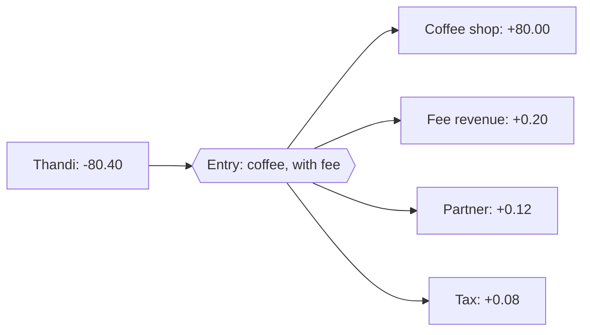

# 5. A ledger you can audit

## Where we are

Fees now add up to the cent. Then a customer complains that a fee was charged in error. A support engineer, trying to help, runs `UPDATE accounts SET balance = balance + 0.40 WHERE id = ...`. The customer is happy.

A month later, an auditor asks why that account's balance is 40 cents more than the sum of its transactions. Nobody remembers. The fee revenue report still counts the 40 cents as earned. And the auditor's next question is worse: "How do you know no other balance has been changed like this?"

## Stop and think

::: think The fix gave the customer the right balance. What's wrong with it?

It changed a total without recording why. The history, the account's transactions, no longer explains the balance, so the balance can't be checked. The money came from nowhere: the fee revenue that was wrongly earned is still on the books, so the bank's records now claim 40 cents more in total than exist. And nobody can tell, from the data, who changed it, when, or whether anything else was changed the same way.

A balance is a conclusion. The history is the evidence. Change the conclusion without adding evidence, and nothing can be trusted.

:::

::: think The playground's `transactions` table adds up to more than 153 million. In a bank's own records, what should all the money add up to?

Zero, if every movement is recorded on both sides. Money moving between accounts doesn't create or destroy anything: what leaves one account arrives in another. The playground's data records only the customer's side of a salary or a card payment, with nothing for where the money came from or went, so 162,633 of its rows have no other side, and money appears from nowhere. That's *single-entry* bookkeeping. *Double-entry* records both sides of every movement, so the sum of everything is always zero, and a mistake shows up as a sum that isn't.

:::

::: think The fee was wrong. If not with an `UPDATE`, how do you fix it?

With a new entry that moves the 40 cents back: out of fee revenue (and the partner's and the tax shares), into the customer's account, with a description, a reference to the entry it corrects, and who approved it. The original stays exactly as it was, because it's what happened. The balance is right again, the books still add up, and the history shows both the mistake and the correction.

:::

## The mental model

### Journal entries and postings

A **journal entry** is one movement of money. It has two or more **postings**, each an amount into (positive) or out of (negative) one account, and they add up to zero. Every account involved is in the ledger, including the bank's own: fee revenue, tax owed, and accounts that stand for the outside world, such as cash paid in at branches or money owed to other banks.



From that, three rules give you something you can audit:

- **Every entry adds up to zero**, so the whole ledger always does.
- **Postings are never changed or deleted.** Mistakes are corrected by new entries: a *reversal* that cancels an entry completely, or an *adjustment* for part of it, each pointing to the entry it corrects, with a reason.
- **A balance is the sum of an account's postings.** A stored balance is a cache of that sum, changed only by posting, in the same transaction, and regularly checked against it.

Accountants write postings as debits and credits, and assets and liabilities sit on opposite sides. Signed amounts, as here, are an equivalent and simpler form for code and queries.

The same rule in C#: an entry can't be built unbalanced, and a reversal is a new entry:

<<< @/../samples/src/Bank.Money/JournalEntry.cs#journal-entry

### The database enforces it too

Application code has bugs, and people run SQL by hand. The database can refuse what the ledger forbids:

- A trigger, run once per insert statement, checks that each entry's postings add up to zero. That means posting an entry in one `INSERT`.
- A trigger rejects every `UPDATE` and `DELETE` on postings. In production, also grant the application `INSERT` only.
- A stored balance changes only from inside the posting trigger, never directly.

The playgrounds below build exactly this.

## The escalation ladder

### 1. Detect drift

Compare every stored balance with the sum of its history, every night or every hour, and alert on any difference.

**Fixes:** not knowing. In the lab, 200 transfers through a code path that didn't update the stored balance left 51 accounts disagreeing with their history, and the differences added up to exactly zero: the history was right and the stored balances were stale.
**Costs:** one query over all the history, which grows. Snapshots (step 5) keep it cheap.
**Breaks:** nothing. It finds problems after the fact; it doesn't prevent them.

### 2. Correct by adding, never by editing

No `UPDATE` or `DELETE` on history, ever. A correction is a new entry that refers to the one it corrects, says why, and records who approved it.

**Fixes:** lost history and unexplained balances.
**Costs:** more rows, and correction tools for support staff instead of SQL access.
**Breaks:** nothing, but someone with database access can still break it, so enforce it (step 4).

### 3. Record both sides of every movement

Double-entry: every movement is an entry whose postings add up to zero, with accounts for the bank's own money and for the world outside.

**Fixes:** money appearing from or vanishing into nowhere; a single query (does everything add up to zero?) checks the whole ledger.
**Costs:** more accounts and postings, and agreeing which account each kind of movement uses.
**Breaks:** nothing, but it's a bigger change to an existing system: migrating single-entry history means deciding what the missing sides were.

### 4. Enforce the rules in the database

Triggers or constraints for balanced entries, permanent postings, and balances that change only through postings, plus permissions that allow only inserts.

**Fixes:** bugs and manual changes that bypass the application.
**Costs:** trigger logic, and posting each entry in one statement.
**Breaks:** emergency fixes by hand, which is the point: those go through the correction tool too.

### 5. Snapshots for fast balances

With billions of postings, summing an account's whole history on every read is too slow. Store a balance as of the end of a closed period, and add only the postings since. Closed periods never change (stage 7's daily close), so their snapshots never go stale.

**Fixes:** read cost and the cost of the drift check.
**Costs:** a closing process, and a rule that postings never land in a closed period: late corrections go in the current one.
**Breaks:** nothing, if periods really are closed.

## Trade-offs at a glance

| Approach | Prevents | Detects | Costs |
|---|---|---|---|
| Drift check | — | Stored balances that disagree with history | A query over history |
| Corrections as new entries | Lost history | — | Correction tools |
| Double-entry | Money from nowhere | Any imbalance, with one sum | More accounts and postings |
| Database enforcement | Bypassing the application | — | Triggers, permissions |
| Period snapshots | Slow balances | — | A closing process |

## Traps

- **Fixing a balance with `UPDATE`.** The balance no longer has evidence behind it.
- **Deleting a wrong entry.** The statement the customer already received no longer matches the books.
- **One-sided entries.** A deposit or a fee with nothing on the other side creates or destroys money.
- **Updating a stored balance outside the posting's transaction.** A crash between the two leaves them disagreeing.
- **Treating entry numbers as proof of completeness.** In the playground, a refused entry still used up an id, so entry 4 doesn't exist. Sequences have gaps; completeness comes from the sums.
- **Several currencies in one entry.** Each entry adds up to zero in one currency; a conversion is two entries through an exchange account.

::::: trap
A support tool for refunding a fee charged in error. It's been used hundreds of times, and customers get their money. What's wrong with it?

```csharp
public static async Task RefundFeeAsync(BankDb db, long transactionId, decimal fee, CancellationToken ct)
{
    var charged = await db.Transactions.SingleAsync(t => t.Id == transactionId, ct);
    charged.Amount += fee; // the fee should never have been taken
    charged.Description += " (fee refunded)";

    await db.Accounts.Where(a => a.Id == charged.AccountId)
        .ExecuteUpdateAsync(set => set.SetProperty(a => a.Balance, a => a.Balance + fee), ct);
    await db.SaveChangesAsync(ct);
}
```

::: details Answer
- **It rewrites history.** The original transaction now shows a different amount from the one on the statement the customer already has, and there's no record of what it used to say, who changed it, or why.
- **It's one-sided.** The customer gets the fee back, but fee revenue, the partner's share and the tax share still include it, so the books now claim money that doesn't exist.
- **It's two transactions.** `ExecuteUpdateAsync` commits the balance change immediately; `SaveChangesAsync` commits the edit separately. If the second fails, the balance and the history disagree.

Post a correcting entry instead, in one transaction: postings out of fee revenue, the partner and tax accounts, and into the customer's account, adding up to zero, with a reference to the original entry and a reason. Change the stored balance only as part of posting it.
:::
:::::

## In the interview

::::: interview
**Usually asked as:** "Design a ledger for a payments system." Or: "How do you store account balances?"

**Short answer:** "As a double-entry ledger: every movement is a journal entry whose postings add up to zero, across customer accounts, the bank's own accounts like fee revenue, and accounts that represent the outside world. Postings are append-only: mistakes are corrected with reversing or adjusting entries that reference the original. A balance is the sum of an account's postings; I'd store it for speed, but only change it in the same transaction as the postings, and check it against the history continuously. For scale, I'd snapshot balances at the end of closed periods. And I'd enforce the rules in the database too: balanced entries, no updates or deletes, insert-only permissions."

::: details Follow-up: why double-entry, rather than just recording each account's transactions?
Because it makes errors detectable. With every movement recorded on both sides, the whole ledger sums to zero, every entry sums to zero, and money can't appear or disappear without breaking those sums. With single-entry records, a missing or duplicated side is invisible. It also answers questions single-entry can't, like "how much fee revenue did we earn?", as a balance like any other.
:::

::: details Follow-up: how do you get an account's balance quickly when it has millions of postings?
Keep a stored balance, changed only in the same transaction as each posting, and verify it regularly. For history and audits, snapshot each account's balance at the end of each closed period, and sum only the postings since. Reads of the current balance use the stored value; anything that must be provable is recomputed from a snapshot.
:::

::: details Follow-up: isn't a ledger just event sourcing?
They share the idea that the history is the source of truth and current state is derived. A ledger is narrower and stricter: its entries all have the same shape, and they must balance. You can build a ledger without event sourcing the rest of the system, and event sourcing doesn't give you double-entry's checks for free.
:::

::: details Follow-up: a payment was sent to the wrong account. How do you fix it?
Post a reversal of the original entry, referencing it, so the money returns to the payer, then post the correct payment as a new entry. Both mistakes and fixes remain in the history. If the wrong recipient has already spent the money, the reversal can't take it back automatically; that becomes a recovery process, recorded with entries of its own.
:::
:::::

## Try it

These playgrounds run in your browser. Run them in order: later ones build on earlier ones.

**Single-entry money comes from nowhere.** If every movement had two sides, this would be zero:

```sql playground
SELECT sum(amount) AS money_in_the_system,
       count(*) FILTER (WHERE counterparty_account_id IS NULL) AS rows_with_no_other_side
FROM transactions;
```

**Do stored balances agree with the history?** The stored `balance` from stage 2, against the sum of each account's transactions:

```sql playground
SELECT count(*) AS accounts_that_disagree
FROM accounts a
LEFT JOIN (SELECT account_id, sum(amount) AS total FROM transactions GROUP BY account_id) t ON t.account_id = a.id
WHERE a.balance <> coalesce(t.total, 0);
```

**The support engineer's fix, and the check that catches it:**

```sql playground
UPDATE accounts SET balance = balance + 0.40 WHERE id = 42;

SELECT a.id, a.balance AS stored, coalesce(t.total, 0) AS from_history
FROM accounts a
LEFT JOIN (SELECT account_id, sum(amount) AS total FROM transactions GROUP BY account_id) t ON t.account_id = a.id
WHERE a.balance <> coalesce(t.total, 0);
```

**A double-entry ledger, with its rules in the database.** Accounts, entries and postings; a trigger that requires every entry to add up to zero; a trigger that forbids changing postings; and stored balances that only postings can change. `attempt` runs a statement and reports whether it was refused:

```sql playground
CREATE TABLE ledger_accounts (
    id text PRIMARY KEY,
    name text NOT NULL,
    balance numeric(18, 2) NOT NULL DEFAULT 0
);
CREATE TABLE journal_entries (
    id bigint GENERATED ALWAYS AS IDENTITY PRIMARY KEY,
    description text NOT NULL,
    corrects bigint REFERENCES journal_entries (id),
    created_at timestamptz NOT NULL DEFAULT now()
);
CREATE TABLE postings (
    id bigint GENERATED ALWAYS AS IDENTITY PRIMARY KEY,
    entry_id bigint NOT NULL REFERENCES journal_entries (id),
    account_id text NOT NULL REFERENCES ledger_accounts (id),
    amount numeric(18, 2) NOT NULL CHECK (amount <> 0)
);

-- Each INSERT into postings must leave every entry it touches adding up to zero.
-- Then, in the same transaction, the stored balances move by the posted amounts.
CREATE FUNCTION post_entries() RETURNS trigger LANGUAGE plpgsql AS $$
BEGIN
    IF EXISTS (SELECT 1 FROM new_postings GROUP BY entry_id HAVING sum(amount) <> 0 OR count(*) < 2) THEN
        RAISE EXCEPTION 'a journal entry needs at least two postings that add up to zero';
    END IF;
    UPDATE ledger_accounts a SET balance = a.balance + p.total
    FROM (SELECT account_id, sum(amount) AS total FROM new_postings GROUP BY account_id) p
    WHERE a.id = p.account_id;
    RETURN NULL;
END $$;
CREATE TRIGGER entries_must_balance AFTER INSERT ON postings
    REFERENCING NEW TABLE AS new_postings
    FOR EACH STATEMENT EXECUTE FUNCTION post_entries();

-- Postings are never changed or removed.
CREATE FUNCTION postings_are_permanent() RETURNS trigger LANGUAGE plpgsql AS $$
BEGIN
    RAISE EXCEPTION 'postings are permanent: record a correcting entry instead';
END $$;
CREATE TRIGGER no_changes_to_postings BEFORE UPDATE OR DELETE ON postings
    FOR EACH ROW EXECUTE FUNCTION postings_are_permanent();

-- A stored balance changes only from inside the posting trigger above.
CREATE FUNCTION balance_only_from_postings() RETURNS trigger LANGUAGE plpgsql AS $$
BEGIN
    IF pg_trigger_depth() < 2 THEN
        RAISE EXCEPTION 'a balance changes only by posting a journal entry';
    END IF;
    RETURN NEW;
END $$;
CREATE TRIGGER balance_follows_postings BEFORE UPDATE OF balance ON ledger_accounts
    FOR EACH ROW EXECUTE FUNCTION balance_only_from_postings();

-- Run a statement; report whether it was refused, instead of failing.
CREATE FUNCTION attempt(statement text) RETURNS text LANGUAGE plpgsql AS $$
BEGIN
    EXECUTE statement;
    RETURN 'it worked';
EXCEPTION WHEN OTHERS THEN
    RETURN 'refused: ' || SQLERRM;
END $$;

INSERT INTO ledger_accounts (id, name) VALUES
    ('world:cash', 'Cash paid in and out at branches'),
    ('customer:thandi', 'Thandi Nkosi'),
    ('customer:johan', 'Johan Botha'),
    ('merchant:coffee', 'Corner Coffee'),
    ('bank:fees', 'Fee revenue'),
    ('partner:fees', 'Owed to the card partner'),
    ('tax:fees', 'Tax owed on fees');

SELECT id, name, balance FROM ledger_accounts;
```

**Post three entries:** a cash deposit, a transfer, and a card payment with stage 4's fee split. Each entry is one `INSERT` of all its postings:

```sql playground
WITH entry AS (INSERT INTO journal_entries (description) VALUES ('Cash deposit at a branch') RETURNING id)
INSERT INTO postings (entry_id, account_id, amount)
SELECT id, account, amount FROM entry, (VALUES ('world:cash', -1000.00), ('customer:thandi', 1000.00)) AS p(account, amount);

WITH entry AS (INSERT INTO journal_entries (description) VALUES ('Transfer: rent share') RETURNING id)
INSERT INTO postings (entry_id, account_id, amount)
SELECT id, account, amount FROM entry, (VALUES ('customer:thandi', -250.00), ('customer:johan', 250.00)) AS p(account, amount);

WITH entry AS (INSERT INTO journal_entries (description) VALUES ('Card payment: coffee, with fee') RETURNING id)
INSERT INTO postings (entry_id, account_id, amount)
SELECT id, account, amount FROM entry, (VALUES
    ('customer:thandi', -80.40), ('merchant:coffee', 80.00),
    ('bank:fees', 0.20), ('partner:fees', 0.12), ('tax:fees', 0.08)) AS p(account, amount);

SELECT e.id AS entry, e.description, p.account_id, p.amount
FROM journal_entries e JOIN postings p ON p.entry_id = e.id
ORDER BY e.id, p.id;
```

**Try the shortcuts.** Fixing the balance directly, editing the posting, and a one-sided "goodwill" entry:

```sql playground
SELECT attempt($$UPDATE ledger_accounts SET balance = balance + 0.40 WHERE id = 'customer:thandi'$$) AS fix_the_balance,
       attempt($$UPDATE postings SET amount = -80.00 WHERE account_id = 'customer:thandi' AND amount = -80.40$$) AS edit_the_posting,
       attempt($$WITH entry AS (INSERT INTO journal_entries (description) VALUES ('Goodwill') RETURNING id)
                 INSERT INTO postings (entry_id, account_id, amount) SELECT id, 'customer:thandi', 0.40 FROM entry$$) AS one_sided_entry;
```

**Correct it properly**, with an entry that refers to the one it corrects, then read Thandi's history:

```sql playground
WITH entry AS (
    INSERT INTO journal_entries (description, corrects)
    SELECT 'Refund of the fee charged in error', id FROM journal_entries WHERE description = 'Card payment: coffee, with fee'
    RETURNING id
)
INSERT INTO postings (entry_id, account_id, amount)
SELECT id, account, amount FROM entry, (VALUES
    ('bank:fees', -0.20), ('partner:fees', -0.12), ('tax:fees', -0.08), ('customer:thandi', 0.40)) AS p(account, amount);

SELECT e.id AS entry, e.description, e.corrects, p.amount,
       sum(p.amount) OVER (ORDER BY e.id) AS balance_after
FROM postings p JOIN journal_entries e ON e.id = p.entry_id
WHERE p.account_id = 'customer:thandi'
ORDER BY e.id;
```

Entry 4 is missing: the refused one-sided entry used up that number before it was rolled back.

**Audit it.** Everything adds up to zero, every entry balances, and every stored balance agrees with its postings:

```sql playground
SELECT (SELECT sum(amount) FROM postings) AS sum_of_every_posting,
       (SELECT count(*) FROM (SELECT entry_id FROM postings GROUP BY entry_id HAVING sum(amount) <> 0) x) AS unbalanced_entries,
       (SELECT count(*) FROM ledger_accounts a
        WHERE a.balance <> (SELECT coalesce(sum(p.amount), 0) FROM postings p WHERE p.account_id = a.id)) AS stored_balances_that_disagree;
```

**On the lab database.** Run the drift check against the full lab data, from the `samples` folder:

```sh
docker compose exec postgres psql -U bank -d bank -c "SELECT count(*) AS accounts_that_disagree, sum(a.balance - coalesce(t.total, 0)) AS net_difference FROM accounts a LEFT JOIN (SELECT account_id, sum(amount) AS total FROM transactions GROUP BY account_id) t ON t.account_id = a.id WHERE a.balance <> coalesce(t.total, 0)"
```

Then send 200 transfers through a code path that doesn't maintain the stored balance, the stage 1 API with no balance check (`--Lab:Transfers=Event`), using `dotnet run --project tools/Bank.Load -- --payroll 200 --employer --concurrency 8`, and run the check again. Ours found 51 accounts that disagreed, with a net difference of exactly zero: every transfer was recorded correctly in the history, and only the stored balances were stale. Two code paths that write money, and only one of them maintaining the stored balance, is how drift usually starts.

The journal entry type and its tests are in `samples/src/Bank.Money/JournalEntry.cs` and `samples/tests/Bank.Api.Tests/JournalEntryTests.cs`.

## What breaks next

Customers now want to pay people at other banks. The money leaves through a payment network, and the network's API is called after the debit is recorded. One afternoon it's slow, and the call times out. The customer's account has been debited. Did the money arrive at the other bank? The ledger has no way to say.

Next: [6. When money leaves your database](./06-when-money-leaves).
