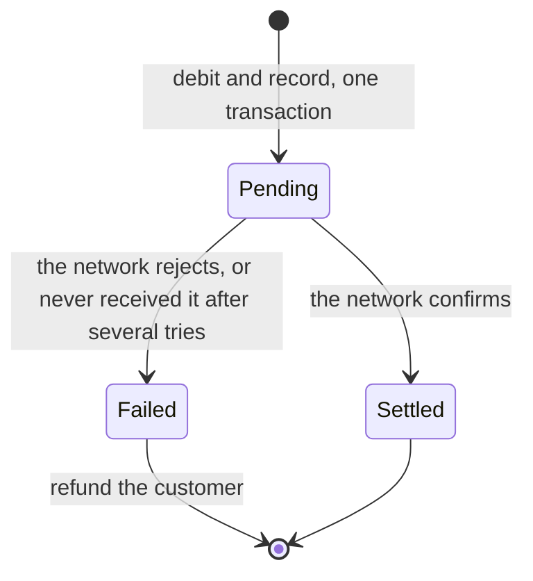

# 6. When money leaves your database

## Where we are

Inside the bank, every movement is now a balanced, permanent entry. But customers also pay people at other banks, and that money leaves through a payment network with its own API. The first version debits the customer, calls the network, and if the call fails, gives the money back.

One afternoon the network is slow. Calls time out, and customers are refunded and told their payments failed. A week later, the network's records show it paid many of those "failed" payments. The bank has paid out money it gave back to its customers.

## Stop and think

::: think The call to the network timed out. Did the payment happen?

You don't know. A timeout means you stopped waiting, not that nothing happened. The network may never have received the request, may have rejected it, or may have paid it and lost the reply on the way back. From your side, all three look the same.

In the lab, with a network that lost one reply in ten and failed one payment in twenty, the naive version refunded 77 "failed" payments out of 500. The network had paid 52 of them: R520 paid out that the customers got back.

:::

::: think Why not call the network inside the database transaction, so a failure rolls everything back?

Because the network isn't part of your transaction. Rolling back your database doesn't un-pay a payment the network made. And holding a transaction open while waiting on another company's API keeps the customer's account locked for as long as that API takes (stage 2). A database transaction can only make your own changes atomic.

:::

::: think You'll retry payments whose outcome you don't know. What has to be true for that to be safe?

Each payment needs one identity that the network recognises, and that you send with every attempt: your own payment id as the network's reference. Then either the network refuses to pay the same reference twice, or you ask the network about the reference before sending again. In the lab, resending without asking, to a network that doesn't deduplicate, paid 63 payments twice.

:::

## The mental model

### Three outcomes, not two

A call to another system ends in success, failure or *unknown*. Unknown includes timeouts, dropped connections and most 5xx responses. Only an explicit answer, such as a rejection, means "it didn't happen". Treating unknown as failure loses money; treating it as success risks never paying.

### Make the uncertainty a state



1. **Record before you call.** In one database transaction, take the money from the customer's account and record the payment as `Pending`, with an id you'll use as the network's reference.
2. **Call with that reference.** A clear answer settles or fails the payment. Anything else leaves it `Pending`, and the customer is told it's being processed, which is true.
3. **Resolve what's unknown.** A background process takes payments still pending after a while, asks the network about each reference, and settles it, or, if the network has no record of it, sends it again with the same reference. After several attempts the network still hasn't got, it fails the payment and refunds the customer.
4. **Change state once.** Every transition happens only if the payment is still `Pending`, so the request and the background process can't both settle it, or both refund it.

<<< @/../samples/src/Bank.Api/Endpoints/OutgoingPayments.cs#pending

<<< @/../samples/src/Bank.Api/Endpoints/OutgoingPayments.cs#resolve

<<< @/../samples/src/Bank.Api/Endpoints/OutgoingPayments.cs#resolver

### Holds: available and ledger balances

Taking the money at `Pending` works like a hold. Card payments make it explicit: an authorisation reduces the customer's *available* balance straight away, and the *ledger* balance changes only when the payment settles, sometimes days later. Either way, the rule is the same: the money is set aside before you promise it to anyone, and released only when you know.

### Where this sits in the bigger picture

One payment across two systems is the simplest case. Coordinating several services, each with its own database, step by step with compensations, is a *saga*: journey B5. Timeouts, retries with backoff and what to do when the network is down altogether are B4's subject. And knowing that your records and the network's still agree, across thousands of payments, is stage 7.

## The escalation ladder

### 1. Debit, call, refund on error

<<< @/../samples/src/Bank.Api/Endpoints/OutgoingPayments.cs#naive

**Fixes:** nothing about uncertainty: it's the starting point.
**Costs:** none.
**Breaks:** every lost reply becomes a refunded payment that was actually made. In the lab: R520 lost in 500 payments.

### 2. A pending state, resolved by asking

Record `Pending` with the debit, call with your own reference, and resolve anything unclear by asking the network.

**Fixes:** lost replies. In the lab: R5,000 taken, R5,000 paid, every time, including a payment that failed three times and was correctly refunded.
**Costs:** a payments table, a background resolver, and a "processing" answer for the customer.
**Breaks:** nothing, if the network can be asked. Some can't: then you rely on step 3, and on stage 7.

### 3. Resend with the same reference

When the network has no record of a payment, send it again with the same reference.

**Fixes:** payments that never reached the network, without involving the customer.
**Costs:** nothing more, if the network deduplicates on your reference.
**Breaks:** if you resend without asking and the network doesn't deduplicate: 63 payments paid twice in the lab. Even when it does deduplicate, giving up after failed resends without asking can refund a payment that went through.

### 4. Reconcile

Every day, compare your records with the network's: every payment you think was made, and every one the network says it made. Stage 7.

**Fixes:** whatever the steps above didn't catch, including the network's own mistakes.
**Costs:** a daily process, and people to investigate.
**Breaks:** nothing. It's the safety net under everything else.

## Trade-offs at a glance

| Approach | Customer charged vs network paid (lab) | Costs | Watch out for |
|---|---|---|---|
| Debit, call, refund on error | R4,230 vs R4,750 | — | Timeouts treated as failures |
| Pending, resolved by asking | R4,990 vs R4,990 | A state table, a resolver | Networks you can't ask |
| Resend without asking, network deduplicates | R5,000 vs R5,000 | — | Giving up without asking |
| Resend without asking, no deduplication | R5,000 vs R5,630 | — | Paying twice |
| Reconcile | Catches what's left | A daily process | Leaving breaks uninvestigated |

## Traps

- **Treating a timeout as a failure.** It's unknown.
- **A new reference for each attempt.** The network can't tell it's the same payment.
- **Calling another system inside a database transaction.** It can't be rolled back, and it holds your locks while it waits.
- **Telling the customer "failed" when you don't know.** Tell them it's processing, and when.
- **Two processes resolving the same payment.** Make each transition conditional on the current state.
- **Retrying a rejection.** A 4xx is an answer, not an accident.

::::: trap
A helper for paying other banks, with retries. The caller refunds the customer when it returns `false`. What can go wrong?

```csharp
public sealed class OtherBanks(HttpClient http)
{
    // Returns true if the payment went through; on false, the caller refunds the customer.
    public async Task<bool> PayAsync(OutgoingPaymentRequest request, CancellationToken ct)
    {
        for (var attempt = 1; attempt <= 3; attempt++)
        {
            try
            {
                using var response = await http.PostAsJsonAsync("/network/payments", new
                {
                    reference = Guid.NewGuid().ToString(), request.Amount, request.ToBank, request.ToAccount,
                }, ct);
                if (response.IsSuccessStatusCode)
                {
                    return true;
                }
            }
            catch (TaskCanceledException)
            {
                // Timed out: try again.
            }
        }
        return false;
    }
}
```

::: details Answer
- **A new reference on every attempt.** If the first attempt was paid but its reply was lost, the second is a different payment to the network, which pays it again.
- **Unknown becomes failure.** After three timeouts it returns `false`, and the customer is refunded, though any of the three attempts may have been paid.
- **Rejections are retried.** A 400 is a definite answer; trying again changes nothing, and wastes the time the customer is waiting.
- **Nothing is recorded first.** If the process crashes mid-loop, there's no record that a payment was in progress, so nothing will ever check what happened.

Create the payment's id once, record it as pending with the debit, send that id as the reference every time, treat timeouts as unknown, and resolve unknowns by asking the network.
:::
:::::

## In the interview

::::: interview
**Usually asked as:** "How do you handle a payment to an external provider that times out?" Or: "How do you make a transfer to another bank reliable?"

**Short answer:** "A timeout is an unknown outcome, not a failure. I'd record the payment as pending, with the debit, in one database transaction, using our own payment id as the reference we send to the network. Then call. A clear success or rejection settles or fails it; anything else stays pending, and the customer is told it's processing. A background process asks the network about pending references, settles the ones it knows about, and resends the ones it doesn't, with the same reference, so a network that deduplicates can't pay twice. After a few attempts it fails and refunds. Every state change is conditional on the payment still being pending, so it happens once. And a daily reconciliation against the network's records catches whatever's left."

::: details Follow-up: why not a distributed transaction across your database and the network?
The network won't take part in one: external APIs don't support two-phase commit with your database. Even where it's possible, a coordinator holding locks across organisations while waiting on the slowest participant isn't something anyone wants. Local transactions plus idempotent references, explicit states and reconciliation are how payments actually work.
:::

::: details Follow-up: the network can't be asked about a payment. What now?
Then a timed-out payment stays pending until something tells you its fate: the network's settlement file, a later notification, or a reply that eventually arrives. Don't resend unless the network guarantees it deduplicates on your reference. Show the customer it's processing, and reconcile daily. This is why reconciliation exists.
:::

::: details Follow-up: when do you take the money from the customer: before or after the network confirms?
Before you call: as a hold or a debit, recorded with the pending payment. If you call first and debit afterwards, a crash in between pays someone with money you never took, and a balance check after the fact can fail. Releasing a hold is easy; recovering money you paid without taking it isn't.
:::

::: details Follow-up: how is this different from a saga?
It's the smallest saga: one local step (debit and record), one remote step (the network), and one compensation (refund). A saga generalises it to several services, each step with its own compensation, coordinated by an orchestrator or by events. Journey B5 builds one.
:::
:::::

## Try it

From the `samples` folder, with the lab running. Apply this stage's migration first, which adds the `outgoing_payments` table:

```sh
dotnet run --project src/Bank.Api -- seed
```

Start the fake services, which include the payment network, and make the network unreliable: it loses one reply in ten (it pays, then answers after the API has given up), and fails one payment in twenty before doing anything:

```sh
dotnet run --project tools/Bank.FakeServices
curl -X POST localhost:5090/network/settings -H "Content-Type: application/json" -d '{"lostReplyRate": 0.1, "failureRate": 0.05, "deduplicates": true}'
```

1. **The naive version.** Start the API with `--Lab:Outgoing=Naive`, and send 500 payments of 10.00 to another bank. The tool then compares what left the customer's account with what the network paid:

   ```sh
   dotnet run --project tools/Bank.Load -- --outgoing 500 --concurrency 8
   ```

2. **A pending state.** Restart the API with `--Lab:Outgoing=Pending`, and run it again. Some payments are answered "202 Accepted": watch them settle over the next few seconds.

3. **Resend without asking.** Add `--Lab:Resolve=ResendBlindly`, then try it with the network's deduplication turned off (`"deduplicates": false`).

Our results, for 500 payments:

| API settings | Network deduplicates | Taken from the customer | Paid by the network | Difference |
|---|---|---|---|---|
| `Naive` | Yes | 4,230 | 4,750 | 520 paid but refunded |
| `Pending` | Yes | 4,990 | 4,990 | 0 (one payment failed three times, correctly refunded) |
| `Pending`, resend without asking | Yes | 5,000 | 5,000 | 0 here; in another run, one payment refunded after it was paid |
| `Pending`, resend without asking | No | 5,000 | 5,630 | 63 payments paid twice |
| `Pending` | No | 5,000 | 5,000 | 0 |

## What breaks next

Payments to other banks now resolve correctly, as far as the bank's own records can tell. Every morning, the network sends a settlement file: every payment it made the day before, and the total it will collect from the bank. One morning, its total is higher than the bank's.

Next: [7. Reconciliation](./07-reconciliation).
