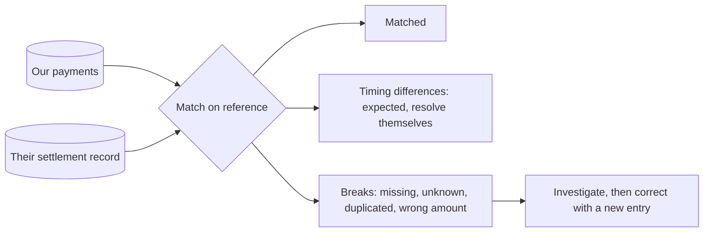

# 7. Reconciliation

## Where we are

Payments to other banks now resolve correctly, as far as the bank's own records can tell. Every morning, the payment network sends its settlement record: every payment it made, and the total it will collect from the bank. One morning its total is R57 less than the bank's records say was paid. The next day it's R433 more.

Nothing in the bank's systems reported an error. Each side believes it's right.

## Stop and think

::: think The two totals differ by R57. Is that one problem worth R57?

You can't tell from totals. It might be one payment, or a dozen differences that partly cancel out: R60 the network didn't record and R3 it overpaid. A matching total can hide differences too, if they happen to cancel exactly. The only way to know is to match payment by payment.

In the lab, that R57 was nine separate differences: six payments the network's records didn't include, and three it paid with the wrong amount.

:::

::: think You match each of your payments to a line in their file, by your reference. What kinds of difference can there be?

At least six, and they need different responses:

- **Timing**: settled there, still pending here, or the reverse. It resolves itself within hours.
- **In flight**: pending here and not yet there. Also expected.
- **Missing there**: settled here, absent from their record.
- **Unknown here**: in their record, with a reference you never issued.
- **Paid more than once**: one reference, several settlements.
- **Amounts differ**: one reference, a different amount.

Timing differences are noise to be expected and explained. The rest are *breaks*: someone has to investigate each one.

:::

::: think Why match on your reference, rather than on amount, date and account?

Because the reference is the one thing both sides share that identifies a payment uniquely: you created it, and the network recorded it (stage 6). Amounts, dates and accounts repeat: two coffees of R10 from the same account on the same day are indistinguishable without it. Matching on them is possible, and sometimes necessary when the other side doesn't keep your reference, but it's guesswork, and it needs people to confirm the guesses.

:::

## The mental model

### Two records, one truth

Reconciliation proves that two independently kept records describe the same events. The bank's records and the network's are kept by different systems, with different bugs. When they agree, both are probably right; when they don't, at least one is wrong, and nothing else will tell you which.

### Match, classify, explain



1. **Match** every record on each side to its partner on the other, by a shared reference: a full outer join, so records with no partner appear too.
2. **Classify** every difference: a timing difference that's expected, or a break.
3. **Explain every rand.** The difference between the two totals must equal the sum of the classified differences. If it doesn't, the reconciliation itself is wrong.

<<< @/../samples/src/Bank.Api/Endpoints/Reconciliation.cs#reconcile

### Breaks have owners

A break isn't fixed by the reconciliation. Someone investigates it: was it our bug, theirs, or a payment that's genuinely still on its way? Then it's resolved with a correcting entry in the ledger (stage 5), never by editing either record, and closed. Unresolved breaks are tracked by age, because the older one gets, the harder it is to recover the money.

### Closing the day

When a day's reconciliation has no unexplained differences, the day is *closed*: no more postings are made to it, and late corrections go into the current day. Closed periods never change, which is what makes stage 5's balance snapshots safe.

## The escalation ladder

### 1. Compare totals

Each side's total, every day.

**Fixes:** not knowing that something's wrong.
**Costs:** one number from each side.
**Breaks:** nothing, but it can't tell you what's wrong, and offsetting errors hide each other.

### 2. Match line by line

A full outer join on the shared reference, comparing amounts.

**Fixes:** finding each difference, including ones that cancel out.
**Costs:** both records, every day, and a shared reference: without one, matching on amount and date is guesswork.
**Breaks:** nothing, but every pending payment and every late settlement shows up as a difference, and people stop reading a report that's mostly noise.

### 3. Separate timing from breaks

Use each side's state and cut-off times: a payment pending here and settled there is timing; one pending here and absent there is in flight.

**Fixes:** noise. In the lab, mid-run, 35 of 41 differences were timing or in flight; only 6 were breaks.
**Costs:** knowing the other side's cut-off and the states each record can be in.
**Breaks:** nothing, if the timing rules are right. Watch for "timing" differences that never resolve: after a set time, they become breaks.

### 4. Explain every rand

Check that the difference between the totals equals the sum of the classified differences.

**Fixes:** a reconciliation that silently drops records, which is a bug as serious as the ones it's meant to find.
**Costs:** one more sum.
**Breaks:** nothing.

### 5. A break process and a daily close

Each break gets an owner, an age and a resolution that's posted as a ledger entry. The day closes when everything is explained.

**Fixes:** breaks that are found and then forgotten.
**Costs:** people, and the discipline of closing.
**Breaks:** nothing, though it does mean someone is on the hook every morning.

## Trade-offs at a glance

| Approach | Finds | Costs | Misses |
|---|---|---|---|
| Compare totals | That something's wrong | Two numbers | What, and offsetting errors |
| Match line by line | Each difference | Both records, a shared reference | Nothing, but noisy |
| Classify timing | The real breaks | Cut-off rules | Timing that never resolves, unless aged |
| Explain every rand | Bugs in the reconciliation | One sum | — |
| Break process, daily close | Breaks forgotten after detection | People | — |

## Traps

- **Comparing totals only.** Differences can cancel out.
- **An inner join.** Records with no partner, the most important breaks, vanish from the result.
- **Matching on amount and date** when a shared reference was available.
- **Fixing a break by editing either record.** Post a correcting entry.
- **Treating every difference as a break.** People stop reading the report.
- **Treating every difference as timing.** Some never resolve.

::::: trap
A team's daily reconciliation. It usually returns a handful of rows, and the team investigates each one. What does it miss?

```sql
SELECT o.reference, o.amount AS ours, f.amount AS theirs
FROM our_payments o
JOIN settlement_file f ON f.reference = o.reference
WHERE o.amount <> f.amount;
```

::: details Answer
Almost everything. It's an inner join, so it only compares payments present on both sides:

- **Missing there:** settled by us, absent from their file. No partner row, so not in the result.
- **Unknown here:** paid by them with a reference we don't have. Also no partner row.
- **Paid more than once:** two file lines with the same reference and the right amount each match the payment, and neither differs in amount, so neither appears.
- **Pending payments**, which may be timing differences or breaks, aren't distinguished at all.

Use a full outer join on the reference, aggregate the file by reference first so duplicates show up as a count, classify every row, and check that the classified differences add up to the difference between the totals.
:::
:::::

## In the interview

::::: interview
**Usually asked as:** "How do you make sure your payments agree with the payment provider's records?" Or: "Design a reconciliation process."

**Short answer:** "Every day, I'd match our records against the provider's settlement record, line by line, on a reference we create and send with each payment, using a full outer join so records with no partner show up. Then classify each difference: timing, like a payment pending on our side but settled on theirs, or a break, like a payment missing on one side, paid twice, or with a different amount. The classified differences must add up exactly to the difference between the two totals, which proves the reconciliation itself didn't drop anything. Breaks go to an owner, are resolved with correcting ledger entries, and are tracked by age. When everything's explained, the day closes."

::: details Follow-up: what if the other side doesn't keep your reference?
Then match on whatever combination identifies a payment best, such as amount, date, destination account and their own reference, accepting that some matches are ambiguous. Auto-match only the unambiguous ones, and queue the rest for a person. And push for a shared reference: most payment networks support one, and it turns guesswork into a join.
:::

::: details Follow-up: millions of payments a day. How does it scale?
Partition by day, or by hour, and reconcile partitions independently, in parallel. Matching is a join or a sort-merge on the reference, which databases and batch tools do well. Keep the full detail only for differences; matched records just need counting. And reconcile continuously during the day, not only overnight, so breaks surface while they're still easy to fix.
:::

::: details Follow-up: the totals match. Can you skip the line-by-line match?
No. A matching total can hide differences that cancel out: a payment missing on one side and an unknown one on the other, of the same amount, look like agreement. Totals are a quick first check, not a proof.
:::

::: details Follow-up: a break turns out to be the provider's mistake. What do you record?
A correcting entry in your own ledger, if money needs to move: for example, money owed by the provider, in an account set aside for amounts to recover. Plus the break's resolution, and a claim with the provider. Your records should show what really happened, including that the provider owes you, not pretend the mistake didn't occur.
:::
:::::

## Try it

**In the browser.** A payments table and a settlement file built from the playground's transfers, with differences planted in the file. Run these in order:

```sql playground
CREATE TABLE our_payments AS
SELECT 'PAY-' || id AS reference, -amount AS amount,
       CASE WHEN row_number() OVER (ORDER BY id DESC) <= 6 THEN 'Pending' ELSE 'Settled' END AS status
FROM transactions
WHERE description = 'Transfer' AND id <= 10000;

-- Their file: two wrong amounts, three payments missing, half the pending ones already
-- settled there, two paid twice, and two references we never issued.
CREATE TABLE settlement_file AS
WITH numbered AS (SELECT *, row_number() OVER (ORDER BY reference) AS n FROM our_payments)
SELECT reference,
       CASE WHEN n IN (10, 20) THEN amount + 1.00 ELSE amount END AS amount
FROM numbered
WHERE n NOT IN (30, 40, 50)
  AND NOT (status = 'Pending' AND n % 2 = 0)
UNION ALL
SELECT reference, amount FROM numbered WHERE n IN (60, 70)
UNION ALL
VALUES ('PAY-X1', 250.00), ('PAY-X2', 75.50);

SELECT (SELECT count(*) FROM our_payments) AS our_payments,
       (SELECT count(*) FROM settlement_file) AS lines_in_their_file;
```

**Match and classify.** A full outer join on the reference, with the file grouped first so duplicates show up:

```sql playground
WITH theirs AS (
    SELECT reference, count(*) AS lines, sum(amount) AS amount
    FROM settlement_file GROUP BY reference
)
SELECT CASE
           WHEN o.reference IS NULL THEN 'Paid there, unknown here'
           WHEN t.reference IS NULL AND o.status = 'Pending' THEN 'In flight: not in their file yet'
           WHEN t.reference IS NULL THEN 'Settled here, missing from their file'
           WHEN o.status = 'Pending' THEN 'Timing: settled there, pending here'
           WHEN t.lines > 1 THEN 'Paid more than once there'
           WHEN t.amount <> o.amount THEN 'Amounts differ'
           ELSE 'Matched'
       END AS category,
       count(*) AS payments,
       sum(CASE WHEN o.status = 'Settled' THEN o.amount ELSE 0 END) AS ours,
       sum(coalesce(t.amount, 0)) AS theirs,
       sum(coalesce(t.amount, 0)) - sum(CASE WHEN o.status = 'Settled' THEN o.amount ELSE 0 END) AS difference
FROM our_payments o
FULL OUTER JOIN theirs t ON t.reference = o.reference
GROUP BY 1
ORDER BY payments DESC;
```

**Explain every rand.** The difference between the totals; compare it with the sum of the `difference` column above:

```sql playground
SELECT (SELECT sum(amount) FROM our_payments WHERE status = 'Settled') AS our_settled_total,
       (SELECT sum(amount) FROM settlement_file) AS their_total,
       (SELECT sum(amount) FROM settlement_file)
         - (SELECT sum(amount) FROM our_payments WHERE status = 'Settled') AS difference;
```

**Against the lab.** From the `samples` folder, with the fake services running, give the network some mistakes of its own: one payment in a hundred paid with the wrong amount, and one in a hundred missing from its records. Then start the API with stage 6's pending payments:

```sh
curl -X POST localhost:5090/network/settings -H "Content-Type: application/json" \
  -d '{"lostReplyRate": 0.1, "failureRate": 0.05, "amountErrorRate": 0.01, "missingFromRecordsRate": 0.01, "deduplicates": true}'
dotnet run --project src/Bank.Api -- --Lab:Outgoing=Pending
```

Send 500 payments, note the account they're paid from, and reconcile: once while the run is still going, and again afterwards:

```sh
dotnet run --project tools/Bank.Load -- --outgoing 500 --concurrency 8
curl -X POST "localhost:5080/reconciliations?fromAccountId=<the payer's account id>"
```

Then repeat with stage 6's blind resends (`--Lab:Resolve=ResendBlindly`) and the network's deduplication off.

Our results:

| Run | Matched | Timing and in flight | Breaks | Gap between totals | Explained |
|---|---|---|---|---|---|
| Mid-run | 272 | 24 settled there, pending here; 11 in flight | 4 missing there; 2 wrong amounts | R202 | R202 |
| After it resolved | 491 | — | 6 missing there; 3 wrong amounts | -R57 | -R57 |
| Blind resends, no deduplication | 449 | — | 42 paid more than once; 5 missing there; 3 wrong amounts; 1 refunded here but paid there | R433 | R433 |

## What breaks next

This is the end of the journey. You started with a transfer endpoint that didn't check for funds, and made the money correct one problem at a time: under concurrency, under retries, through rounding, in an auditable ledger, across another company's system, and against that company's records.

Now put it all together: [the capstone](./capstone).
