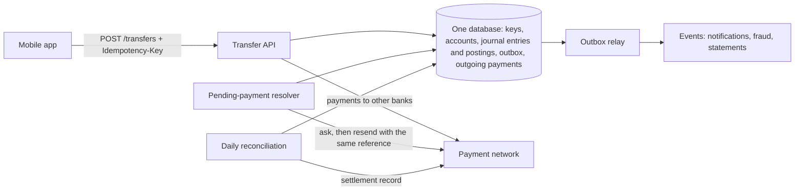

# Capstone: a transfer between accounts

> "Design the system that moves money from one customer's account to another."

Try answering out loud before reading on, in the time you'd have in a real interview. Then compare.

The trap in this question is that the happy path is trivial: subtract here, add there, in one transaction. Interviewers aren't asking about the happy path. They're waiting to see whether you bring up, unprompted, what this journey covered: two transfers at once, a retried request, a rounded fee, a mistake that needs correcting, a call to another bank that times out, and how you'd know if any of it went wrong.

## 1. Clarify

The right design depends on what kinds of transfer there are, and what "correct" means for each. Commit to your own questions first.

::: think What would you ask before proposing anything?

- **Where can the money go?** Between our own customers only, or to other banks too? Inside one bank, one database transaction can do it; to another bank, it can't.
- **How fast?** Instant, or batched? Instant transfers to other banks mean dealing with unknown outcomes in real time.
- **Currencies?** One, or several, with conversion?
- **Can accounts go below zero?** If there are overdrafts, what's the limit, and is it ever allowed to be exceeded?
- **Fees and limits?** Fees mean splitting amounts; daily limits mean checking more than the balance.
- **Who calls the API, and how do they retry?** Mobile apps time out and retry, so the API has to recognise repeats.
- **Volumes, and the busiest accounts?** Average volume is rarely the problem; one very busy account can be.
- **Audit and regulation?** How long is history kept, who can correct it, and how is it proven correct?

:::

::: think The interviewer says: "Our customers, in rand, instant, about five million customers. Also payments to other banks through a national payment network. Some business customers pay thousands of salaries at month-end." What does that tell you?

Three things that shape the design:

- Internal transfers can be one database transaction, but must be correct under concurrency and retries: two taps on Pay, two transfers from one account at once.
- Payments to other banks can't be in that transaction, so they need explicit states, a reference the network recognises, and reconciliation against the network's records.
- Payroll means hot accounts: thousands of transfers from one account in minutes. Locking strategy and how long locks are held will matter more than average throughput.

:::

## 2. Estimate

Round hard, and say your assumptions out loud.

**Transfers.** Five million customers, two transfers a day on average:

> 5,000,000 × 2 = 10 million a day
> 10,000,000 ÷ 86,400 ≈ 115 a second on average
> Peak, at roughly 10× average ≈ 1,200 a second

**Hot accounts.** A business paying 50,000 salaries in half an hour is about 28 a second from one account. That's easy in aggregate, but every one of those transfers needs that account's balance. In stage 2's lab, transfers from one account ran at 70 to 117 a second, depending on how long each held the lock. So this fits, but only with short lock holds, and a payroll that's ten times bigger wouldn't.

**Storage.** A double-entry ledger records each transfer as one journal entry with two postings, more with fees. At about 150 bytes a row:

> 10 million transfers × 3 rows × 150 bytes ≈ 4.5 GB a day ≈ 1.6 TB a year

That's a table to partition by time, with balances snapshotted at each closed day (stage 5), so reading a balance never means summing years of history.

**Idempotency keys.** One per transfer, kept for a week: about 70 million rows, deleted by age.

The numbers that decide the design: a well-provisioned relational database can handle the average and the peak, but measure it rather than assuming. The constraints that actually bite are hot accounts and the boundary with the payment network.

## 3. Design

1. **Recognise retries** ([stage 3](./03-paid-twice)). The app generates an idempotency key when the customer taps Pay. The API claims it, with a unique constraint and a hash of the request, in the same transaction as the transfer, and stores the response with it, so a retry gets the original answer.
2. **Represent money exactly** ([stage 4](./04-cents-that-go-missing)). Amounts are exact decimals with their currency; fees are calculated with an explicit rounding rule, and split by largest remainder so the parts add up to the fee.
3. **Check and move the money atomically** ([stages 1](./01-check-then-act) and [2](./02-locks-or-versions)). In one transaction: a conditional update that debits the payer only if the balance covers it, the credit, and the journal entry. Accounts are locked in id order, so transfers in opposite directions can't deadlock, and the balance changes come last, so locks are held as briefly as possible. Serializable isolation with retries is the fallback for rules that don't fit one statement.
4. **Record a ledger you can audit** ([stage 5](./05-a-ledger-you-can-audit)). Every transfer is a journal entry whose postings, including fee revenue, partner and tax accounts, add up to zero. Postings are never updated or deleted: corrections are new entries. The database enforces it, and stored balances are checked against the postings continuously.
5. **Publish what happened** ([B2 stage 4](/backend/journeys/work-outside-the-request/04-dual-write-and-outbox)). The "transfer completed" event is written to an outbox in the same transaction, for notifications, fraud scoring and statements.
6. **Pay other banks through explicit states** ([stage 6](./06-when-money-leaves)). The debit and a `Pending` payment record are written together, with our id as the network's reference. Clear answers settle or fail the payment; anything else stays pending, and a resolver asks the network before resending with the same reference.
7. **Reconcile every day** ([stage 7](./07-reconciliation)). Match our outgoing payments against the network's settlement record on the reference, classify timing differences and breaks, explain every rand of difference, give each break an owner, and close the day.

For the hot accounts, start with short lock holds. If payrolls grow, record each payroll as one entry, a single debit for the total from the employer, rather than thousands of separate debits.

## 4. Deep dive

Interviewers push wherever your answer was thinnest. Practise these.

::: details "Two transfers from the same account arrive at the same moment. What happens?"
With a check-then-insert at the default isolation level, both can read the same balance and both succeed: stage 1 overdrew the account in 50 rounds out of 50, and repeatable read didn't help, because the two transactions wrote different rows. I use a conditional update, `UPDATE ... SET balance = balance - @amount WHERE id = @id AND balance >= @amount`, which locks the row: the second transfer waits, re-checks against the new balance, and is refused. Serializable isolation with a retry loop also works, at the cost of aborted transactions under contention.
:::

::: details "The app timed out and the customer tapped Pay again."
The retry carries the same idempotency key. If the first request has committed, the key is there with its response, which is returned as is. If it's still running, the retry's insert of the key waits on the unique index until the first commits, then returns the stored response. In stage 3's lab, that took 432 duplicate payments in 1,000 down to zero, where checking for the key in a separate step still let 274 through.
:::

::: details "A support engineer needs to refund a fee. How?"
With a correcting journal entry: out of fee revenue, the partner and tax accounts, into the customer's account, referencing the original entry, with a reason and an approver. Never with an `UPDATE`: that leaves a balance that the history can't explain, and money from nowhere. The database refuses updates to postings, and stored balances only change through postings.
:::

::: details "How do you know every balance is right?"
Three checks, all automatic. Every journal entry's postings add up to zero, so the whole ledger does too. Every stored balance equals the sum of its postings since the last snapshot. And the bank's records agree with the payment network's, by daily reconciliation. Any failure is an alert, not a log line.
:::

::: details "The payment network timed out. Did the money go?"
Unknown, and we say so. The payment is pending: the money is reserved from the customer, and they see "processing". The resolver asks the network about our reference: if it's settled, we settle; if the network has no record, we resend with the same reference, and after a few attempts fail and refund. In stage 6's lab, refunding on timeout instead lost R520 in 500 payments; the pending state lost nothing.
:::

::: details "One account receives or sends thousands of transfers a second."
First, shorten the lock: take it last and commit straight away, which took stage 2's busy account from 77 to 117 transfers a second. Then reduce how many transactions need it: batch a payroll into one entry, or split the hot account into several sub-balances. Optimistic concurrency is the wrong tool here: on a hot row, most attempts conflict and are thrown away.
:::

::: details "The accounts live in different databases, sharded by customer. Now what?"
Then a transfer between shards can't be one transaction. Treat it like a payment to another bank: debit the payer and record the transfer as pending on one shard, credit the payee on the other, idempotently, using the transfer's id, then mark it complete, with an in-transit account so both shards' ledgers still balance in the meantime. Reconcile the shards against each other. It's a small saga, and much more complex than one database, so I'd avoid sharding the ledger for as long as one database can handle the load.
:::

## The answer in two minutes

> "The happy path is one transaction, so I'd focus on what makes money wrong.
>
> The client sends an idempotency key with each transfer, and I claim it in the same transaction as the transfer, with a unique constraint, storing the response, so retries and double taps return the original answer. Inside that transaction, a conditional update debits the payer only if the balance covers it, so concurrent transfers can't overdraw; accounts are locked in id order to avoid deadlocks, and the balance changes come last to keep locks short. The transfer is recorded as a double-entry journal entry, with any fee split by largest remainder so the cents add up. Postings are append-only, enforced by the database, and corrections are new entries. An outbox in the same transaction publishes the event.
>
> Payments to other banks can't be in that transaction, so they get a pending state, with the debit, and our own reference sent to the network. A timeout means unknown, not failed: a resolver asks the network, and resends with the same reference only if it has no record. Finally, every day I reconcile against the network's records on that reference, classify every difference, explain every rand, and close the day. Hot accounts are where I'd expect trouble first: short lock holds, then batching."

## What to review

If any part of your answer felt shaky, go back to its stage:

| If you were unsure about | Review |
|---|---|
| Why a check in a transaction can still overdraw, isolation levels | [1. Check, then act](./01-check-then-act) |
| Conditional updates, row locks, optimistic concurrency, deadlocks, hot accounts | [2. Locks or versions](./02-locks-or-versions) |
| Idempotency keys, retries, double taps | [3. Paid twice](./03-paid-twice) |
| Money types, rounding, splitting amounts | [4. Cents that go missing](./04-cents-that-go-missing) |
| Double-entry, corrections, stored vs derived balances | [5. A ledger you can audit](./05-a-ledger-you-can-audit) |
| Calls to other systems, unknown outcomes, pending states | [6. When money leaves your database](./06-when-money-leaves) |
| Matching records, timing vs breaks, closing the day | [7. Reconciliation](./07-reconciliation) |
