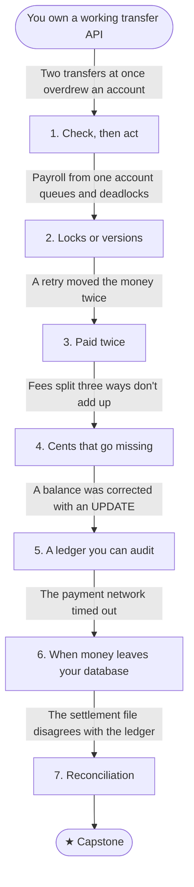

# B3: The money must add up

You own a working REST API for a banking product (accounts and transactions) backed by a relational database. After B2, its transfer endpoint is fast, its events are never lost, and its consumers shrug off duplicates. But nothing yet checks that an account has the money it's sending.

A transfer writes a debit and a credit, and a balance is the sum of an account's history. This journey makes the money correct: under concurrent requests, retried requests, rounding, audits, and transfers that leave for another bank.

## Stage map

Each stage's fix creates the problem that triggers the next one.

| # | Stage | Triggered by |
|---|---|---|
| 1 | [Check, then act](./01-check-then-act): Isolation levels and the anomalies each allows | Two transfers at the same moment overdrew an account that only had money for one |
| 2 | [Locks or versions](./02-locks-or-versions): Conditional updates, row locks, optimistic concurrency, deadlocks | Payroll from one employer's account now queues, and deadlocks appear in the logs |
| 3 | [Paid twice](./03-paid-twice): Idempotency keys on the API | The app timed out, the customer tapped Pay again, and the money moved twice |
| 4 | [Cents that go missing](./04-cents-that-go-missing): Money types, rounding, allocation | Fees split three ways don't add up to the fee charged |
| 5 | [A ledger you can audit](./05-a-ledger-you-can-audit): Double-entry, immutable entries, reversals | Someone corrected a balance with an `UPDATE`, and now the balance and the history disagree |
| 6 | [When money leaves your database](./06-when-money-leaves): Pending states, holds, unknown outcomes | The payment network timed out. Did the money go? |
| 7 | [Reconciliation](./07-reconciliation): Matching the ledger against the other side | The network's settlement file says we sent more than our ledger does |
| ★ | [Capstone: a transfer between accounts](./capstone) | — |

## Before you start

This journey assumes HTTP and REST, SQL basics including transactions, and async/await: check yourself against the [backend core self-check](../../core-self-check). It builds on [B2](../work-outside-the-request/), especially idempotent consumers and the outbox, and its labs extend the same transfer API.

## By the end you'll be able to

- Explain why a check inside a transaction can still be wrong, and which isolation level prevents which anomaly.
- Choose between conditional updates, row locks, optimistic concurrency and serializable transactions, and handle deadlocks.
- Make a payment API safe to retry with idempotency keys.
- Represent and round money so that every cent is accounted for.
- Design a double-entry ledger, and correct mistakes without editing history.
- Handle a call to another system whose outcome you don't know.
- Reconcile your records against someone else's, and tell a timing difference from a real problem.
