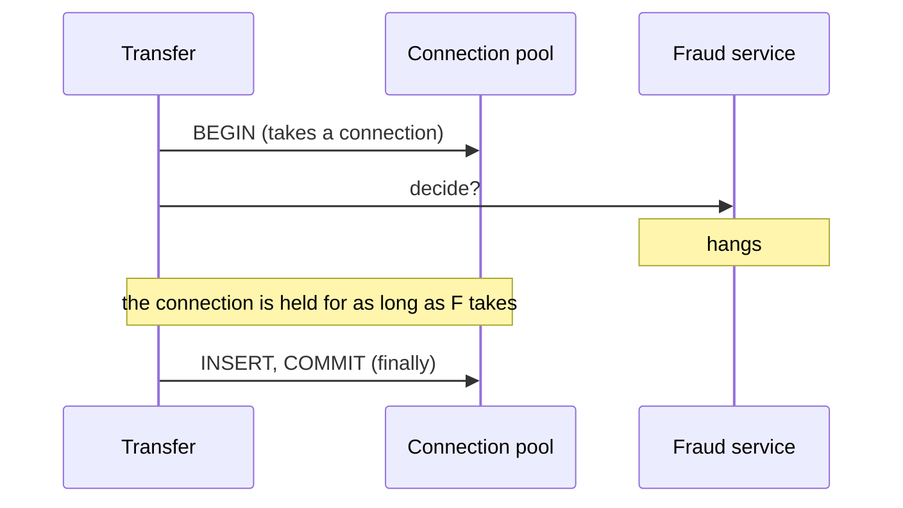

# 1. Waiting forever

## Where we are

Every transfer now asks the fraud service for a decision before any money moves (B2 stage 1 kept that check in the request, because it can stop a payment). The call sits inside the transfer's database transaction: check, then record, together.

One afternoon the fraud service doesn't fail. It just stops answering. Transfers hang. Then customers report that they can't even see their balances, and balances have nothing to do with fraud checks.

## Stop and think

::: think The fraud service is hanging. Why would reading a balance, which never calls it, stop working too?

Because both need a database connection, and the transfers are holding them. Each hanging transfer opened a transaction, which took a connection from the pool, then waited for the fraud service while holding it. With 150 transfers waiting, the pool's 100 connections are all held, and everything else queues for one. After 15 seconds of waiting (Npgsql's default), a request gives up with an error.

In the lab, with the fraud service hanging and 150 clients sending transfers, not one transfer succeeded, the fraud service saw only 100 calls (one per pooled connection), and a request reading a balance waited up to 15 seconds and failed. A dependency that hangs is worse than one that fails: a failure frees its resources at once; a hang holds them.

:::

::: think How long does a .NET `HttpClient` wait for an answer if you don't say?

100 seconds, its default `Timeout`. Most libraries and protocols have a default like this, usually far longer than any user will wait. A customer gives up after a few seconds, so for the rest of the 100 the server is holding resources for an answer nobody will see.

:::

::: think You add a one-second timeout to the fraud call. Is the API now safe from a hanging fraud service?

Safer, not safe. Each transfer now gives up within a second, so the pool recovers: in the lab, transfers failed quickly, and reads kept working. But inside the transaction, every transfer still holds a connection for that second, so at high enough load the pool can still run out. And a timeout on one call doesn't limit the whole request: three calls with one-second timeouts can take three seconds, plus retries. Move the call out of the transaction, and give the whole request a deadline.

:::

## The mental model

### Every wait needs a limit

Anything that waits on something outside your process needs a timeout: HTTP calls, database queries, connection pools, locks, queues. Two limits matter for a network call:

- **Connect timeout**: how long to wait to establish a connection. Short, because a healthy service accepts connections in milliseconds.
- **Request timeout**: how long to wait for the whole answer once connected. Set from how long the service normally takes, with a margin.

### Timeouts must cancel, not just stop waiting

In .NET, a timeout usually works by cancelling a `CancellationToken`. Only code that receives the token, and passes it on, actually stops. A timeout around a call that ignores the token returns control to you, while the work carries on underneath, still holding its connection.

<<< @/../samples/src/Bank.Api/Endpoints/FraudGate.cs#timeout

### Don't wait while holding something



A wait inside a transaction holds a connection, and possibly locks (B3 stage 2). Make calls to other systems before the transaction starts, or after it commits, never during.

### Deadlines shrink as you go inward

A request has a time budget, from the customer's patience inward: the app waits 10 seconds, so the API must answer within, say, 5, so the fraud call must take less than what remains. Each layer's limit should be shorter than the one outside it, or the outer one gives up while the inner one keeps working on an answer nobody will receive.

## The escalation ladder

### 1. A timeout on every call

Set a timeout on the fraud call that reflects how long it should take: if it normally answers in 50 ms, a second is generous.

**Fixes:** transfers stuck for 100 seconds. In the lab, with the call still inside the transaction and a one-second timeout, 1,750 transfers failed quickly in 20 seconds, and balance reads kept working (the slowest took 3.4 seconds).
**Costs:** choosing a number. Too short, and slow-but-healthy calls fail; too long, and the protection is weak. Choose from measured latency, such as the slowest 0.1% plus a margin.
**Breaks:** nothing, as long as the token reaches the call. See the trap below.

### 2. Never wait while holding a resource

Move the fraud call before the transaction.

**Fixes:** a slow dependency exhausting the connection pool. In the lab, with the call before the transaction and no timeout at all, transfers waited until the clients gave up, but balance reads were unaffected: no failures, the slowest 2.1 seconds. With a one-second timeout as well, 2,700 transfers were refused quickly in 20 seconds.
**Costs:** reordering code, and accepting that the check and the transfer aren't atomic. That's fine for a fraud decision, which is advice from a moment ago.
**Breaks:** nothing.

### 3. A deadline for the whole request

Give each request an overall limit, and pass its cancellation token to everything it calls. ASP.NET Core's request timeouts cancel the request's token when the limit passes:

<<< @/../samples/src/Bank.Api/Program.cs#request-timeouts

**Fixes:** requests whose individual timeouts add up to more than the caller will wait. In the lab, with a two-second deadline and no fraud timeout, transfers were answered with 504 after two seconds.
**Costs:** passing the token everywhere, and choosing what to answer when it fires.
**Breaks:** work that must not be interrupted halfway. Inside a database transaction that's fine, as it rolls back. A call to another system that may have taken effect is an unknown outcome (B3 stage 6).

### 4. Pass the deadline on

Tell the services you call how much time is left, so they stop working on answers you'll no longer wait for. Within one HTTP call, closing the connection already tells the server; across queues, proxies and further calls, it doesn't. Some protocols carry it for you: [gRPC deadlines](https://grpc.io/docs/guides/deadlines/) travel with each call. For HTTP, send the remaining time in a header that both sides agree on.

**Fixes:** downstream services wasting capacity on abandoned work, which matters most when they're already overloaded.
**Costs:** agreement on a header, and code on both sides.
**Breaks:** nothing.

## Trade-offs at a glance

| Approach (fraud service hanging, 150 clients) | Transfers | Balance reads |
|---|---|---|
| Call inside the transaction, no timeout | None succeeded; 100 held connections | Waited up to 15 s, some failed |
| Inside, one-second timeout | Refused quickly (1,750 in 20 s) | Worked; slowest 3.4 s |
| Before the transaction, no timeout | Waited until clients gave up | Worked; slowest 2.1 s |
| Before, one-second timeout | Refused quickly (2,700 in 20 s) | Worked; slowest 2.2 s |
| Two-second request deadline | 504 after two seconds | Worked; slowest 2.6 s |

## Traps

- **Relying on defaults.** `HttpClient` waits 100 seconds; other libraries wait for ever.
- **A timeout whose token never reaches the call.** It stops you waiting, not the work.
- **Calling out while holding a transaction, a lock or a pooled connection.**
- **Inner timeouts longer than outer ones.** The caller gives up; the work carries on.
- **Timeouts chosen by guessing.** Base them on measured latency.

::::: trap
"Give the fraud service one second, then fail." Under a fraud-service hang, transfers still take 100 seconds. Why?

```csharp
public sealed class FraudCheck(HttpClient http)
{
    // Give the fraud service one second, then fail.
    public async Task<bool> IsAllowedAsync(TransferRequest transfer, CancellationToken ct)
    {
        using var timeout = CancellationTokenSource.CreateLinkedTokenSource(ct);
        timeout.CancelAfter(TimeSpan.FromSeconds(1));

        using var response = await http.PostAsJsonAsync("/fraud/decision", transfer);
        return response.IsSuccessStatusCode;
    }
}
```

::: details Answer
The timeout's token is created and set to cancel after a second, but never passed to `PostAsJsonAsync`, so nothing listens to it. The call runs with no token at all, under `HttpClient`'s default 100-second timeout. The request's own `ct` isn't passed either, so even the caller giving up doesn't stop it.

Pass `timeout.Token` to the call. Better, configure the timeout once on the `HttpClient`'s resilience pipeline, so every call gets it. A code analyzer rule, CA2016 in .NET, flags methods that don't forward a cancellation token they could.
:::
:::::

## In the interview

::::: interview
**Usually asked as:** "A downstream service is hanging. What happens to your service, and how do you protect it?" Or: "How do you choose timeouts?"

**Short answer:** "A hang is worse than a failure, because every waiting request holds something: a thread, a connection, a lock. If the call is inside a database transaction, the connection pool runs out and the whole service stops, including endpoints that never call the dependency. So: a timeout on every outbound call, based on measured latency, with cancellation that actually reaches the call; no waiting while holding a transaction or lock; and a deadline for the whole request, passed down so each layer has less time than the one above it."

::: details Follow-up: connect timeout or request timeout?
Both. A connect timeout catches a host that's down or unreachable, and should be short, since connections normally open in milliseconds. A request timeout catches a service that's up but slow, and depends on how long the operation normally takes. A single overall timeout hides which happened.
:::

::: details Follow-up: how do you pick the number?
From measurements: take the dependency's latency at a high percentile, such as p99.9, under normal load, and add a margin. Check it fits inside your own deadline, with room for any retries. Revisit it when the dependency changes. A timeout that's never been compared with real latency is a guess.
:::

::: details Follow-up: the call timed out. Did the operation happen?
You don't know. A timeout means you stopped waiting. For a read, it doesn't matter. For something with an effect, like a payment, treat it as an unknown outcome: retry only if the operation is idempotent, or check its status (B3 stage 6).
:::

::: details Follow-up: what's deadline propagation?
Passing the remaining time budget along with each call, so downstream services know when the caller will stop waiting and can stop work early. gRPC does it with deadlines on every call; with HTTP you send the remaining time in a header. It stops overloaded services wasting capacity on answers nobody will receive.
:::
:::::

## Try it

From the `samples` folder, with the lab running (`docker compose up -d`, seeded). Start the fake services, which include the fraud service, and make it hang:

```sh
dotnet run --project tools/Bank.FakeServices
curl -X POST localhost:5090/fraud/settings -H "Content-Type: application/json" -d '{"mode": "hang"}'
```

1. **The starting point: the fraud call inside the transaction, no timeout.**

   ```sh
   dotnet run --project src/Bank.Api -- --Lab:Transfers=Event --Lab:FraudGate=InTransaction
   ```

   Then, in another terminal, send transfers from 150 clients for 40 seconds, while a bystander reads balances. The tool prints a timeline, second by second:

   ```sh
   dotnet run --project tools/Bank.Load -- --outage --seconds 40 --concurrency 150
   ```

2. **Add a one-second timeout:** restart the API with `--Fraud:TimeoutMs=1000`.
3. **Move the call before the transaction:** `--Lab:FraudGate=BeforeTransaction`, with and without the timeout.
4. **A request deadline instead:** `--Lab:FraudGate=BeforeTransaction --Lab:RequestTimeoutMs=2000`.

`GET localhost:5080/resilience/fraud` shows what the fraud gate did. Set the fraud service back to normal with `-d '{"mode": "up"}'`.

Our results are in the table above. With the fraud service working normally, the same 32 clients completed about 78 transfers a second.

## What breaks next

Timeouts turned the hang into quick failures. Then, one afternoon, the fraud service has a two-second blip. Every transfer in those two seconds fails, and support hears about it. Someone adds the obvious fix: if the fraud call fails, try it again, three times, straight away.

The next blip doesn't last two seconds. It lasts minutes.

Next: [2. Retries that make it worse](./02-retries-that-make-it-worse).
