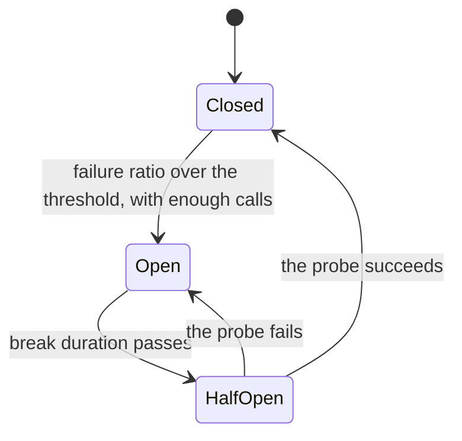

# 3. Stop calling what's down

## Where we are

Retries are now budgeted, so they can't start a storm. Then the fraud service goes down properly, for minutes, and not cleanly: calls to it just hang. Every transfer still makes the call, waits half a second for the timeout, and fails. Customers wait for an answer that can't come. And the fraud team, trying to bring their service back, sees it hit by 80 calls a second the moment it starts.

## Stop and think

::: think The fraud service has failed every call for the last ten seconds. Why call it again?

There's no good reason. Each call costs the customer half a second, ties up a connection, and adds load to a service that's trying to recover, for an answer you already know. What's needed is memory: having seen it fail repeatedly, stop calling it for a while, fail at once, and check now and then whether it's back.

That's a *circuit breaker*. In the lab, during a 30-second outage, timeouts alone made every transfer wait 505 ms and sent the fraud service 2,400 calls that couldn't succeed. With a breaker, after the first five seconds transfers failed in 4 ms, and the fraud service received a test call every five seconds.

:::

::: think While the breaker is open, how does it find out the service is back?

After a set *break duration*, it lets one call through, a probe. If the probe succeeds, it closes and normal traffic resumes; if not, it opens again for another break. The break duration is a trade-off: short, and the recovering service gets more probes; long, and you keep failing for a while after it's back. In the lab, with a five-second break, transfers resumed two seconds after the fraud service recovered; with a 30-second break, five seconds after.

:::

::: think The breaker took five seconds to open. Why not open on the first failure?

Because single failures happen all the time and mean nothing: one dropped connection, one slow response. Opening on one would turn every blip into a break duration of failed transfers. A breaker waits for evidence: a failure *ratio* over a recent window, with a minimum number of calls, so it's sure the dependency is failing rather than unlucky. In the lab: half of the calls in the last 10 seconds, with at least 20 calls. The window still held many successes from before the outage, so it took about five seconds of failures to cross half.

:::

## The mental model

### Three states



- **Closed**: calls go through; outcomes are counted over a sampling window.
- **Open**: calls fail at once, without touching the dependency.
- **Half-open**: one probe goes through, to test whether it's back.

<<< @/../samples/src/Bank.Api/Endpoints/FraudGate.cs#breaker

### What counts as a failure

Count what says the dependency is unhealthy: timeouts, connection failures, 5xx and 429 responses. Don't count 4xx responses like 400 or 404: they're your request's fault, and the dependency is working fine. The HTTP breaker options in `Microsoft.Extensions.Http.Resilience` count the right things by default; a general-purpose breaker counts only exceptions unless you tell it otherwise.

### One breaker per dependency, shared by every call

A breaker is memory, so it must outlive any single call: one instance per dependency, shared across requests. Each API server has its own, and each learns separately. That's usually fine: every server sees the same failures, and the dependency gets one probe per server per break.

### Where it sits with retries

Retries go outside the breaker. When the breaker is open, the retry sees an immediate "circuit open" failure, which isn't worth retrying, and stops. Retries outside, breaker inside, timeout per attempt innermost: the order in the lab's pipeline.

## The escalation ladder

### 1. Timeouts and a retry budget only

**Fixes:** hangs and retry storms (stages 1 and 2).
**Costs:** nothing new.
**Breaks:** during a long outage, every transfer waits for the timeout, and the dependency gets full traffic while it tries to recover. In the lab: 505 ms per transfer, and 80 calls a second to the fraud service, for 30 seconds.

### 2. A circuit breaker

**Fixes:** waiting for answers that won't come, and load on a recovering dependency. In the lab, once it opened, transfers failed in about 4 ms, and the fraud service received only probes.
**Costs:** a few seconds of failures before it opens, and up to one break duration of failures after the dependency recovers.
**Breaks:** nothing, but an open breaker means every transfer fails, fast. That's stage 5's problem.

### 3. Tune it from measurements

Choose the window, ratio and minimum calls from normal traffic: the window long enough to hold a meaningful number of calls, the minimum high enough that a handful of errors at quiet times can't open it. Choose the break duration from how fast the dependency usually recovers, and how many probes it can take.

**Fixes:** breakers that open on noise, or never open at all. Stage 7 shows a breaker that never opened.
**Costs:** measuring traffic, per dependency.
**Breaks:** nothing.

### 4. Make its state visible

Record every state change, alert when a breaker opens, and graph the time spent open. An open breaker is an outage of that dependency, whatever else looks healthy.

**Fixes:** outages that hide behind fast, quiet failures.
**Costs:** metrics and alerts.
**Breaks:** nothing.

## Trade-offs at a glance

| During a 30-second outage (calls hang) | Transfer latency | Calls to the fraud service | Resumed after it recovered |
|---|---|---|---|
| Timeout only | 505 ms each | 80 a second | At once |
| Breaker, 5-second break | 4 ms once open | A probe every 5 s | 2 s later |
| Breaker, 30-second break | 4 ms once open | One probe | 5 s later |

## Traps

- **A breaker created per call.** It has no memory, so it never opens.
- **Counting the wrong failures.** 4xx responses aren't the dependency's fault; 5xx responses that don't throw are.
- **A threshold that can't be reached** at quiet times, or one so low that noise opens it.
- **A break duration far longer than recovery,** which keeps failing after the dependency is back.
- **No visibility.** An open breaker looks like a fast API.

::::: trap
A developer adds a circuit breaker to the fraud check. During the next outage, it never opens. Why?

```csharp
public sealed class Fraud(HttpClient http)
{
    public async Task<bool> IsAllowedAsync(TransferRequest transfer, CancellationToken ct)
    {
        var breaker = new ResiliencePipelineBuilder<HttpResponseMessage>()
            .AddCircuitBreaker(new CircuitBreakerStrategyOptions<HttpResponseMessage>
            {
                FailureRatio = 0.5,
                MinimumThroughput = 10,
                BreakDuration = TimeSpan.FromSeconds(30),
            })
            .Build();

        using var response = await breaker.ExecuteAsync(
            async token => await http.PostAsJsonAsync("/fraud/decision", transfer, token), ct);
        return response.IsSuccessStatusCode;
    }
}
```

::: details Answer
- **A new breaker for every call.** The pipeline is built inside the method, so each call gets a fresh breaker that has seen exactly one call. It can never reach ten calls, let alone a failure ratio. Build it once, per dependency, and share it, for example by registering it with the `HttpClient`'s resilience handler.
- **It only counts exceptions.** The general-purpose options' default `ShouldHandle` treats only exceptions as failures. A fraud service returning 503 doesn't throw, so even a shared breaker would count those as successes. Use the HTTP breaker options, which count 5xx, 408 and 429 responses, or set `ShouldHandle` yourself.
:::
:::::

## In the interview

::::: interview
**Usually asked as:** "What's a circuit breaker, and when would you use one?" Or: "A dependency is down. How do you stop it taking your service down with it?"

**Short answer:** "A circuit breaker wraps calls to a dependency and remembers how they've been going. When the failure ratio over a recent window crosses a threshold, with enough calls to be sure, it opens: calls fail immediately without touching the dependency. After a break duration it lets a probe through: success closes it, failure opens it again. It saves callers from waiting on timeouts that will fail anyway, and takes load off the dependency while it recovers. I'd have one per dependency, shared across requests, count only failures that mean the dependency is unhealthy, sit it inside the retries, alert when it opens, and decide what the API does while it's open, because failing fast is still failing."

::: details Follow-up: what's the difference between a timeout, a retry and a circuit breaker?
A timeout limits one call. A retry makes another attempt after a failure, betting it was isolated. A circuit breaker stops attempts altogether after evidence that failures aren't isolated. They're layers: timeouts per attempt, retries for isolated failures, a breaker for widespread ones.
:::

::: details Follow-up: how do you choose the thresholds?
From normal traffic. The sampling window must hold enough calls to be meaningful at your quietest busy time; the minimum throughput stops a couple of errors at night from opening it; the ratio is usually around half. The break duration comes from how quickly the dependency typically recovers. Then test it: inject a failure and watch it open (stage 7).
:::

::: details Follow-up: you have 20 instances of your API. Does each have its own breaker?
Usually, yes, and that's fine: each sees the same failures and opens at about the same time, and the dependency gets about 20 probes per break duration. A shared breaker, in Redis say, adds a dependency to protect yourself from dependencies. It's worth considering only if probes from many instances would themselves be a problem.
:::

::: details Follow-up: the breaker is open. What does the API return?
Not "error" by default: that's a business decision. Fail fast with a clear "try again shortly" (503 with `Retry-After`), or fall back: a cached answer, a second provider, or a reduced service, such as allowing small transfers. Stage 5 covers it.
:::
:::::

## Try it

From the `samples` folder, with the lab and the fake services running. Make each fraud decision take 20 ms normally, and 90 seconds during a slow spell, so that calls hang:

```sh
curl -X POST localhost:5090/fraud/settings -H "Content-Type: application/json" -d '{"delayMs": 20, "slowMs": 90000}'
```

1. **Timeouts only.** Start the API with the fraud call before the transaction and a 500 ms timeout, then send 80 transfers a second for 60 seconds, with the fraud service hanging from 15 seconds to 45:

   ```sh
   dotnet run --project src/Bank.Api -- --Lab:Transfers=Event --Lab:FraudGate=BeforeTransaction --Fraud:TimeoutMs=500
   dotnet run --project tools/Bank.Load -- --outage --seconds 60 --rate 80 --blip-at 15 --blip-seconds 30 --blip-kind slow
   ```

2. **Add a breaker:** restart the API with `--Fraud:Breaker=true --Fraud:BreakerBreakSeconds=5`, and run it again.
3. **A longer break:** `--Fraud:BreakerBreakSeconds=30`.

Watch the timeline's latency column fall from 505 ms to a few once the breaker opens, the fraud service's calls drop to nearly none, and `GET localhost:5080/resilience/fraud` report the breaker's state and how often it opened.

Our results, second by second:

| Seconds | Timeout only | Breaker, 5 s break | Breaker, 30 s break |
|---|---|---|---|
| 15 to 19 | Transfers fail after 505 ms; 80 calls a second to the fraud service | The same, while the breaker collects evidence | The same |
| 20 to 44 | The same | Transfers fail in about 4 ms; a probe every 5 s | Transfers fail in about 4 ms; no calls |
| From 45, the service back | Succeeding at once | Succeeding from 47 s | Succeeding from 50 s |
| Totals | 2,400 succeeded; 4,800 calls to the fraud service | 2,229 succeeded; 2,637 calls | 1,983 succeeded; 2,399 calls |

## What breaks next

The breaker handles a fraud outage. Then, on a different afternoon, the email provider slows down: two seconds per email. No transfer waits for an email, because they go out in the background (B2). Yet transfers start failing with "fraud checks are unavailable", while the fraud team's dashboards show their service perfectly healthy.

Next: [4. One slow dependency sinks everything](./04-bulkheads).
