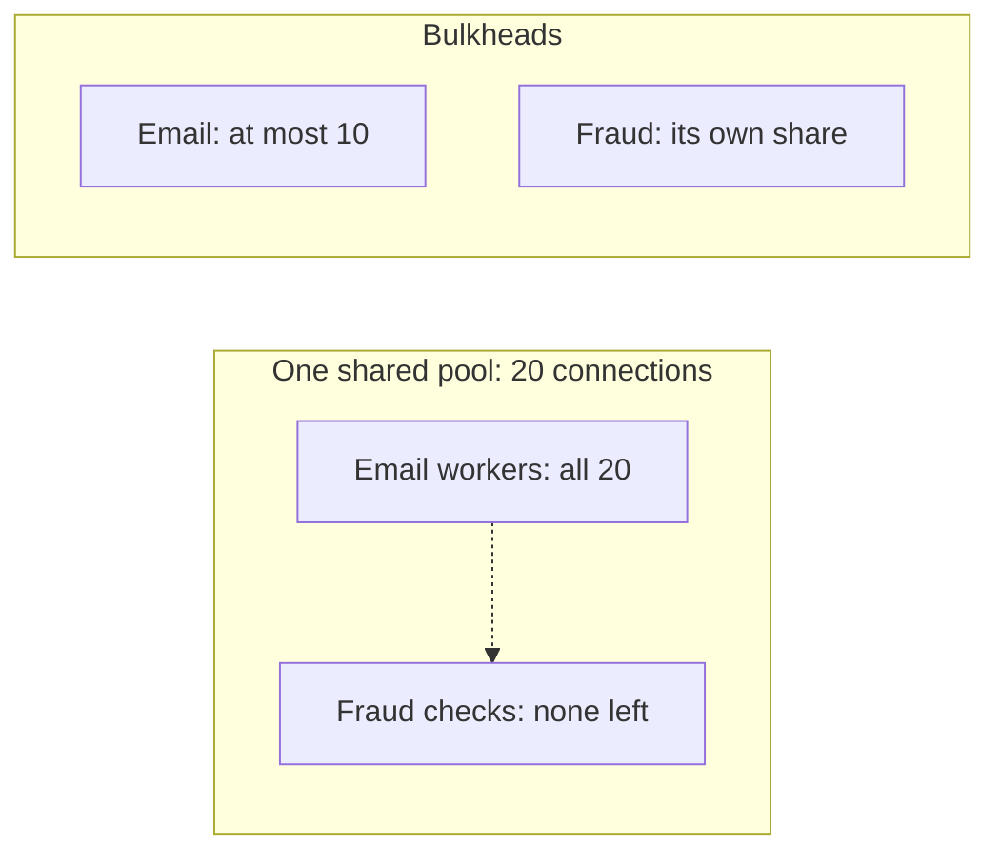

# 4. One slow dependency sinks everything

## Where we are

The fraud check has a timeout, a retry budget and a breaker. Then the email provider slows down to two seconds per email. No transfer waits for an email: B2 moved them to background workers. Yet transfers start failing with "fraud checks are unavailable", while the fraud team's dashboards show their service healthy and quiet.

In the lab, with emails slowed to two seconds, only 315 of 2,400 transfers succeeded. The fraud service received 336 calls in those 30 seconds. The rest never reached it.

## Stop and think

::: think The fraud service is healthy and barely busy. Why are fraud checks timing out?

Because they never got to it. The API's calls to the email provider and to the fraud service go through the same outbound connection pool: in the lab, one client limited to 20 connections, as an egress gateway or a shared client would be. With emails taking two seconds, 50 background email workers keep all 20 connections busy. A fraud check has to wait for a free connection, and its 500 ms timeout runs out while it waits.

Nothing about the fraud service changed. A dependency that has nothing to do with transfers took them down by using up a resource they share.

:::

::: think You give the fraud calls their own connection pool. What else could two dependencies share?

More than it seems: threads (if anything blocks), the database connection pool, a rate limit on an egress gateway, memory, a message queue's consumers, even the same host's CPU. Each shared resource is a path for one dependency's trouble to reach the others. The question for each is: if this dependency became slow, how much of what does it use could it take?

:::

::: think Limiting the email work to 10 calls at once fixed the transfers. What did it cost?

Emails go out more slowly: in the lab, 157 in 30 seconds instead of 738 with a separate pool, so a backlog builds up. That's the point of the trade: emails can wait, and transfers can't. A bulkhead decides in advance which work gets squeezed when something is slow.

:::

## The mental model

### Bulkheads

A ship's hull is divided into compartments, so one breach floods one compartment, not the ship. A *bulkhead* in software gives each dependency, or each kind of work, its own share of a limited resource, so one slow dependency can exhaust only its own share.



Two ways to build one:

- **Separate resources**: a connection pool per dependency, a thread pool per kind of work, a database pool per workload.
- **A concurrency limit per dependency** on a shared resource: no more than N calls in flight to it, with the rest waiting in a bounded queue, or refused.

<<< @/../samples/src/Bank.Api/Program.cs#shared-pool

<<< @/../samples/src/Bank.Api/Program.cs#follow-up-bulkhead

The fraud gate has the same option, so a slow fraud service can't take more than its share either:

<<< @/../samples/src/Bank.Api/Endpoints/FraudGate.cs#bulkhead

### Size them from how the work is shared

A bulkhead's size is how much of the shared resource that work may use when it's at its worst. Give the work that matters most a guaranteed share, and cap the work that can wait. And set what happens when it's full: wait in a queue (fine for background email), or fail at once (better for a request someone is waiting on).

### Load shedding: a bulkhead at the front door

The same idea applies to your own capacity. If requests arrive faster than you can serve them, letting them all in makes everyone slow; refusing some quickly keeps the rest fast. B1 stage 4 introduced a concurrency limit on incoming requests; stage 6 adds limits per caller.

## The escalation ladder

### 1. Find what's shared

List every limited resource each dependency uses: connection pools, threads, database connections, egress limits. Most trouble comes from sharing nobody chose deliberately.

**Fixes:** surprises.
**Costs:** an afternoon with the code and the configuration.
**Breaks:** nothing.

### 2. Separate the resources

Give each dependency its own connection pool: in .NET, its own typed `HttpClient`, as the lab does when `Lab:SharedOutboundPool` is off.

**Fixes:** contention between dependencies. In the lab, with slow emails and separate pools, all 2,400 transfers succeeded, and 738 emails were sent.
**Costs:** more connections in total, and per-dependency configuration.
**Breaks:** nothing, unless the resource genuinely can't be separated, such as a gateway with a single connection limit.

### 3. Limit each dependency's share

Where the resource is shared, cap each dependency's concurrency.

**Fixes:** one dependency taking everything. In the lab, with the shared 20-connection pool and the email work capped at 10, all 2,400 transfers succeeded.
**Costs:** the capped work slows down when its dependency does: 157 emails in 30 seconds, and a growing backlog.
**Breaks:** nothing, if the capped work can wait, or fail.

### 4. Shed load before it sinks you

At the edge of your own service, admit only as much work as you can do well, and refuse the rest quickly with 503 or 429.

**Fixes:** overload turning into slowness for everyone.
**Costs:** refused requests, and choosing which work to refuse first.
**Breaks:** nothing, but refuse in the right order: health checks and payments before reports. Stage 6 covers limits per caller.

## Trade-offs at a glance

| Setup (80 transfers a second, 30 seconds) | Transfers succeeded | Fraud calls reaching the service | Emails sent |
|---|---|---|---|
| Shared pool of 20, emails normal (300 ms) | 2,367 of 2,400 | 2,397 | 1,614 |
| Shared pool of 20, emails slow (2 s) | 315 of 2,400 | 336 | 328 |
| Separate pools, emails slow | 2,400 of 2,400 | 2,400 | 738 |
| Shared pool, email work capped at 10 | 2,400 of 2,400 | 2,400 | 157 |

## Traps

- **One limit for everything outbound.** It protects you from total load, not from one slow dependency.
- **Shared pools nobody chose**: one `HttpClient` for every partner, one database pool for transactions and reports.
- **Bulkheads without a plan for when they're full.** An unbounded queue just moves the pile-up.
- **Blocking calls in async code.** The thread pool becomes a shared resource, and one slow dependency can starve it (B1 stage 4).

::::: trap
"Protect ourselves: never more than 20 calls to other services at once." It's used for every outbound call: fraud, email, the payment network. What goes wrong when the email provider slows down?

```csharp
public sealed class Outbound(HttpClient http)
{
    // Protect ourselves: never more than 20 calls to other services at once.
    private static readonly SemaphoreSlim Limit = new(20);

    public async Task<HttpResponseMessage> SendAsync(HttpRequestMessage request, CancellationToken ct)
    {
        await Limit.WaitAsync(ct);
        try
        {
            return await http.SendAsync(request, ct);
        }
        finally
        {
            Limit.Release();
        }
    }
}
```

::: details Answer
It's a limit, not a bulkhead. All 20 permits are shared by every dependency, so slow email calls can hold all of them, and every fraud check and payment then waits behind emails: exactly the lab's failure, built on purpose. And `WaitAsync(ct)` waits for as long as the caller lets it, so a transfer's whole budget can go on waiting for a permit.

Give each dependency its own limit, sized to what it may use, and decide for each whether to queue (with a bound and a timeout) or refuse at once. For the fraud check, refusing quickly is better than waiting.

There's a smaller bug too: the permit is released when the response headers arrive, but the caller reads the body afterwards, outside the limit.
:::
:::::

## In the interview

::::: interview
**Usually asked as:** "What's the bulkhead pattern?" Or: "One of your dependencies is slow. How do you stop it affecting requests that don't use it?"

**Short answer:** "Find what the dependencies share, such as connection pools, threads, database connections or a gateway's limits, because that's how a slow dependency reaches requests that never call it. Then partition it: separate pools per dependency where possible, otherwise a concurrency limit per dependency on the shared resource, sized so the important work keeps a guaranteed share and the work that can wait is capped. Decide what happens when a bulkhead is full: queue for background work, fail fast for requests someone is waiting on. And at the front door, shed load you can't serve well rather than serving everyone badly."

::: details Follow-up: bulkhead or circuit breaker?
Different problems. A circuit breaker stops calls to a dependency that's failing. A bulkhead limits how much of your capacity a dependency can use when it's slow but still working, which is exactly when a breaker doesn't open, because calls are succeeding, just slowly. Use both.
:::

::: details Follow-up: how do you size a bulkhead?
From the dependency's normal concurrency (arrival rate times latency, by Little's law) with room for bursts, and from the total you can afford to give it at its worst. Then decide the queue: how many may wait, and for how long, before being refused.
:::

::: details Follow-up: isn't a separate pool per dependency wasteful?
Somewhat: more idle connections. The cost is usually small next to an outage caused by sharing. Where resources are scarce, a shared pool with per-dependency limits gives most of the protection with less waste.
:::
:::::

## Try it

From the `samples` folder, with the lab running. This stage uses B2's background mode for emails, with 50 workers sending them. Start the fake services, and slow the email provider down:

```sh
dotnet run --project tools/Bank.FakeServices
curl -X POST localhost:5090/settings -H "Content-Type: application/json" -d '{"emailDelayMs": 2000, "fraudDelayMs": 50, "failureRate": 0}'
```

1. **One shared pool of 20 connections:**

   ```sh
   dotnet run --project src/Bank.Api -- --Lab:Transfers=Background --Lab:FollowUpConcurrency=50 \
     --Lab:FraudGate=BeforeTransaction --Fraud:TimeoutMs=500 --Lab:SharedOutboundPool=20
   dotnet run --project tools/Bank.Load -- --outage --seconds 30 --rate 80
   ```

2. **Separate pools:** restart without `--Lab:SharedOutboundPool`.
3. **A bulkhead on the email work:** restart with `--Lab:SharedOutboundPool=20 --Lab:FollowUpMaxConcurrent=10`.

`curl localhost:5090/stats` shows how many emails were sent. Set `emailDelayMs` back to 300 to compare with a healthy email provider. Our results are in the table above.

## What breaks next

Bulkheads keep one dependency's trouble from spreading. But when the fraud service itself is down, the breaker is open, and every transfer fails, fast but completely. Support is flooded with customers who can't pay their rent, and the fraud team's outage has become the bank's outage.

Next: [5. Degrade, don't fail](./05-degrade-dont-fail).
