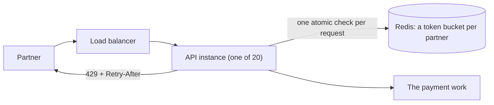

# Capstone: a rate limiter

> "Design a rate limiter for our public API."

Try answering out loud before reading on, in the time you'd have in a real interview. Then compare.

The trap in this question is to treat it as a choice of algorithm: draw a token bucket, explain it, done. The algorithm is the easy part. The interesting parts are what this journey covered: who the limit applies to, what happens when the limiter's own store is slow or down, how it behaves across many servers, and how you'd know it works. A rate limiter is a dependency of every request, so everything in B4 applies to it too.

## 1. Clarify

The right design depends on what's being protected, and from whom. Commit to your own questions first.

::: think What would you ask before proposing anything?

- **What are we protecting, and from what?** Our own capacity, a costly downstream service, fairness between clients, or abuse such as password guessing? Each suggests different limits.
- **Who is limited?** Authenticated clients, users, accounts, IP addresses? Can one client have many keys?
- **What limits?** Requests per second or minute, with bursts or not? Different limits per endpoint, per client tier, per cost of request?
- **How many servers enforce it?** One instance, a fleet, several regions? This decides whether the count must be shared.
- **How exact must it be?** Is 5% over the limit for a few seconds acceptable, or is it a hard contract?
- **What happens when the limiter can't decide?** Fail open or fail closed?
- **What do refused clients get?** A 429, a `Retry-After`, headers telling them their remaining allowance?

:::

::: think The interviewer says: "Partners call our payment API with API keys. Each partner has a contracted limit, typically 50 requests a second with bursts. We run 20 instances behind a load balancer, in one region." What does that tell you?

The key is the API key, not the IP address. Limits differ per partner, so they come from configuration keyed by partner. Bursts are allowed, which points to a token bucket. With 20 instances, in-memory limits would let each partner have 20 times its contract (stage 6 measured 2 times with 2 instances), so the count must be shared, in a fast store. And because it's a contract, accuracy matters more than if it were only protecting capacity.

:::

## 2. Estimate

Round hard, and say your assumptions out loud.

**Requests to check.** Suppose 2,000 partners and 20,000 requests a second across the API at peak. Every request is one rate-limit check:

> 20,000 checks a second against the shared store

That's well within what a single in-memory store such as Redis can typically do, but measure it on your hardware: Redis publishes [benchmarking guidance](https://redis.io/docs/latest/operate/oss_and_stack/management/optimization/benchmarks/). Plan for growth and a hot spare.

**State.** A token bucket needs two numbers per client: tokens and the time they were last updated. With a key and some overhead, call it 100 bytes:

> 2,000 partners × 100 bytes ≈ 200 KB

Tiny. Even per user, a million users would be about 100 MB. Memory isn't the constraint.

**Latency.** A check is one round trip to the store, around half a millisecond inside a data centre (B1's capstone has the rough numbers). On a request that takes 30 ms, that's acceptable; on one that takes 1 ms, it's half the cost, which is a reason to consider local batching.

The numbers that decide the design: a shared store is affordable, and its availability matters more than its capacity, because every request depends on it.

## 3. Design



1. **Key by authenticated client** ([stage 6](./06-rate-limiting)). The API key identifies the partner; the limit and burst come from their contract, in configuration. Never key by IP address alone.
2. **Use a token bucket** ([stage 6](./06-rate-limiting)). Two numbers per partner allow bursts up to the bucket size and a steady contracted rate, without the fixed window's double burst at a boundary.
3. **Share the count, atomically** ([stage 6](./06-rate-limiting)). Keep each bucket in Redis and update it with a single [Lua script](https://redis.io/docs/latest/develop/interact/programmability/eval-intro/), which Redis runs atomically, using Redis's clock rather than each server's. In the lab, this held a partner to its limit across two instances, where in-memory limits let it have double.
4. **Refuse cheaply and helpfully** ([stage 6](./06-rate-limiting)). Check before any real work. Answer `429` with `Retry-After`, and tell clients their remaining allowance in headers, using the conventions being standardised as [RateLimit header fields](https://datatracker.ietf.org/doc/draft-ietf-httpapi-ratelimit-headers/).
5. **Bound the check** ([stage 1](./01-waiting-forever)). A short timeout on the call to Redis, a few milliseconds, so a slow store can't slow every request.
6. **Don't retry it** ([stage 2](./02-retries-that-make-it-worse)). A failed check isn't worth retrying in the request path; retries would multiply load on the store exactly when it's struggling.
7. **Stop asking a store that's down** ([stage 3](./03-stop-calling-whats-down)). A circuit breaker around the store, so an outage costs microseconds per request, not a timeout each.
8. **Keep it in its own lane** ([stage 4](./04-bulkheads)). A dedicated connection and limits for the limiter's store, so it can't be starved by, or starve, other uses of Redis.
9. **Fail open, deliberately** ([stage 5](./05-degrade-dont-fail)). If the store is unavailable, allow requests, fall back to a conservative local limit per instance, and alert. A limiter that fails closed turns its own outage into the API's.
10. **Prove it** ([stage 7](./07-prove-it-works)). Test the buckets on a simulated clock, test the request path with a store that's slow or down, and watch refusals per partner on a dashboard.

## 4. Deep dive

Interviewers push wherever your answer was thinnest. Practise these.

::: details "Compare the algorithms."
A fixed window counts per whole second or minute: cheap, but a client can use its whole allowance at the end of one window and again at the start of the next. A sliding window counts over the last second at any moment: exact, but needs a log of recent requests, or an approximation from segment counts. A token bucket refills at a steady rate up to a maximum: bursts up to the bucket size, then the steady rate, with two numbers of state. A leaky bucket outputs at a constant rate, queuing or refusing the rest. A concurrency limit caps work in progress rather than rate. For an API, the token bucket is the usual choice.
:::

::: details "This script is described as a token bucket. Is it?"
A design document shows this in Redis:

```lua
local current = redis.call('INCR', KEYS[1])
if current == 1 then
    redis.call('EXPIRE', KEYS[1], window)
end
if current > limit then
    return 0
end
return 1
```

It's a fixed-window counter, not a token bucket: it counts requests since the key was created and resets when it expires. So it has the fixed window's boundary problem: twice the limit across the end of one window and the start of the next. It's simple and often good enough; just call it what it is, and choose it knowingly.
:::

::: details "Why a Lua script? Why not read the count, then write it?"
Read-then-write from the application is check-then-act across servers (B3 stage 1): two instances can both read nine tokens and both take one. Redis runs a script atomically, so each check sees the result of the one before. Using Redis's `TIME` inside the script also avoids servers with drifting clocks disagreeing about how many tokens have refilled.
:::

::: details "Redis is down. What happens?"
Fail open, by design: allow requests and alert, perhaps with each instance enforcing a conservative local limit (the contract divided by the number of instances) in the meantime. Protect the request path with a short timeout and a breaker, so the outage costs almost nothing per request. Fail closed only where the limit is a hard guard, such as a costly downstream call with a strict budget.
:::

::: details "One partner sends a hundred thousand requests a second. Is Redis now the bottleneck?"
It could become one: every refused request is still a script call, and all of that partner's calls hit one key on one Redis node. Reduce the load first: refuse at the edge, in the load balancer or gateway, before requests reach the API; and let instances take tokens in small batches from Redis, refusing locally once a batch is used. For scale beyond one node, shard keys across a Redis cluster; a single hot key still lands on one shard, which is one more reason to refuse floods early.
:::

::: details "Where should rate limiting live: gateway or service?"
Both, for different jobs. A gateway or load balancer is the cheapest place to stop floods and abuse, before they cost anything. The service knows things the gateway doesn't, such as the cost of a request or a partner's contract, and can enforce limits that depend on them. Many teams use coarse limits at the edge and precise ones in the service.
:::

::: details "How do you limit by cost rather than count?"
Give each request a weight, so an export might take 50 tokens and a balance check 1, and take that many from the bucket. The bucket's refill rate is then a budget of work rather than of requests. Tell clients the weights, or they'll be surprised by refusals.
:::

## The answer in two minutes

> "First, who's limited and what for: here, partners by API key, each with a contracted rate and burst, across 20 instances.
>
> I'd use a token bucket per partner, two numbers of state, allowing bursts and a steady rate. Because there are 20 instances, in-memory limits would give each partner 20 times its contract, so the buckets live in Redis, updated by a Lua script that runs atomically and uses Redis's clock, which avoids check-then-act races across servers. The check happens before any real work; refusals get 429 with Retry-After and remaining-allowance headers.
>
> The limiter is a dependency of every request, so it gets the same treatment as any other: a few milliseconds' timeout, no retries, a circuit breaker, its own connection, and it fails open with an alert, possibly falling back to a conservative local limit. Floods are best stopped at the gateway before they reach Redis at all. And I'd test the buckets on a simulated clock, and the request path with Redis slow and down."

## What to review

If any part of your answer felt shaky, go back to its stage:

| If you were unsure about | Review |
|---|---|
| Timeouts, deadlines | [1. Waiting forever](./01-waiting-forever) |
| Retries, backoff, retry budgets | [2. Retries that make it worse](./02-retries-that-make-it-worse) |
| Circuit breakers | [3. Stop calling what's down](./03-stop-calling-whats-down) |
| Bulkheads, load shedding | [4. One slow dependency sinks everything](./04-bulkheads) |
| Fail open or closed, fallbacks | [5. Degrade, don't fail](./05-degrade-dont-fail) |
| Algorithms, per-client limits, limits across instances | [6. Protect yourself from your callers](./06-rate-limiting) |
| Testing resilience, fault injection | [7. Prove it works before you need it](./07-prove-it-works) |
