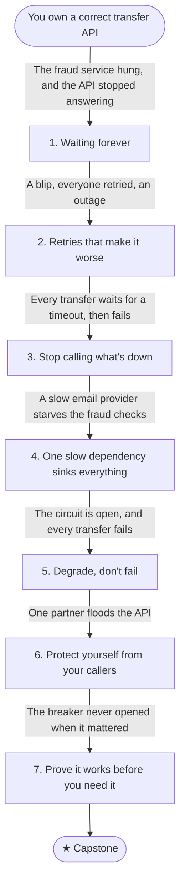

# B4: Things fail

You own a working REST API for a banking product (accounts and transactions) backed by a relational database. After B3, its transfers are correct under concurrency, retries and audit. But the API doesn't work alone: every transfer asks a fraud service for a decision, emails go through a provider, and payments to other banks go through a network. Each of them will be slow, wrong or down at some point.

This journey is about staying up when the things you depend on don't, and about protecting yourself from the things that depend on you.

## Stage map

Each stage's fix creates the problem that triggers the next one.

| # | Stage | Triggered by |
|---|---|---|
| 1 | [Waiting forever](./01-waiting-forever): Timeouts, deadlines, cancellation | The fraud service hung for 90 seconds, and the transfer API stopped answering anyone |
| 2 | [Retries that make it worse](./02-retries-that-make-it-worse): Backoff, jitter, retry budgets | The fraud service blipped, every caller retried at once, and the blip became an outage |
| 3 | [Stop calling what's down](./03-stop-calling-whats-down): Circuit breakers | The fraud service is down for ten minutes, and every transfer waits for a timeout before failing |
| 4 | [One slow dependency sinks everything](./04-bulkheads): Bulkheads, load shedding | The email provider slowed down, and fraud checks queued behind it |
| 5 | [Degrade, don't fail](./05-degrade-dont-fail): Fallbacks as business decisions | With the circuit open, every transfer fails, and support is flooded |
| 6 | [Protect yourself from your callers](./06-rate-limiting): Rate limiting | One partner's broken integration sends thousands of requests a second |
| 7 | [Prove it works before you need it](./07-prove-it-works): Fault injection, game days | The breaker was configured, but it had never opened |
| ★ | [Capstone: a rate limiter](./capstone) | — |

## Before you start

This journey assumes HTTP and REST (status codes especially), and async/await with cancellation tokens: check yourself against the [backend core self-check](../../core-self-check). It builds on [B1](../your-api-gets-popular/) (connection pools and timeouts, stage 4), [B2](../work-outside-the-request/) (retries and backoff for messages, stage 6) and [B3](../the-money-must-add-up/) (unknown outcomes, stage 6), and its labs extend the same transfer API.

## By the end you'll be able to

- Put a timeout on every call, and pass a request's remaining time down to the calls it makes.
- Retry the right failures, with backoff and jitter, without amplifying an outage.
- Explain circuit breakers, and configure one that actually opens.
- Isolate dependencies from each other with bulkheads, and shed load before it sinks you.
- Turn "the dependency is down" into a business decision about what still works.
- Rate-limit callers fairly, on one server and across many.
- Test your failure handling before a real outage does.
