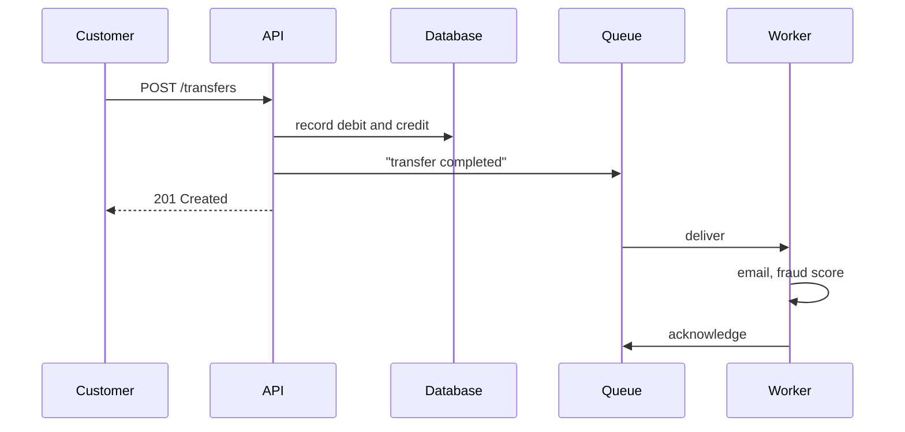

# 1. Get it out of the request

## Where we are

Journey B1 made reads fast. Now look at a write. The transfer endpoint records the debit and the credit, then emails the customer a confirmation and asks the fraud service to score the transfer, and only then responds. In the lab, the email provider takes about 300 ms and the fraud service about 500 ms, so every transfer takes almost a second. And on a day when the email provider is struggling, customers start seeing errors.

<<< @/../samples/src/Bank.Api/Endpoints/TransferEndpoints.cs#inline

## Stop and think

::: think The email provider fails one call in five for ten minutes. What do customers see, and what happens to their money?

With the work inside the request, about one transfer in five fails with an error, but the money has already moved. In the lab, 18 of 50 transfers returned a 500 error, and all 50 had been recorded. A customer who sees "transfer failed" will try again, and pay twice.

What should happen: the transfer succeeds, because it did, and the email goes out when the provider recovers.

:::

::: think Which of these must finish before you tell the customer "done": recording the transfer, a fraud check that can block it, sending the confirmation email, updating the analytics dashboard?

Only work that changes the answer. Recording the transfer, obviously. A fraud check that can stop the payment has to happen before you say it went through, so it stays in the request, with a timeout and a decision about what to do when the fraud service is down (journey B4).

The email and the analytics don't change the answer, so they can follow. The lab's fraud call only scores the transfer for later investigation; it can't block it, so it can follow too. Ask what the customer is actually waiting for.

:::

::: think You move the email and the fraud score onto a background thread inside the API, and respond straight away. What can go wrong?

The work now lives only in the API process's memory. A deployment, a crash or a scale-in loses whatever hasn't run yet. In the lab, killing the API one second after 100 transfers meant only 5 emails were ever sent. There's nowhere to retry failed work from, the background work competes with requests for the same CPU, and nothing outside the process can see what's pending.

:::

## The mental model

### What the customer waits for



The request should contain only the work that decides the response. Everything else is follow-up work, and the question becomes where it runs and what happens if it doesn't.

### Where follow-up work can run

- **Inside the request**: simple, but the customer waits for it, and its failures become their failures.
- **Fire and forget** (`Task.Run`, with nobody awaiting the result): fast, and the worst option. Its exceptions vanish, it can't use services scoped to the request after the request ends, and shutdown kills it.
- **An in-process queue** (a `Channel` drained by a hosted service): fast and tidy, but held in memory, so it's lost with the process.
- **A durable queue**: a message broker such as RabbitMQ, or a job table in your database. The work survives restarts, separate workers can process it, and failed work can be retried.

### What a broker gives you

- **Durability.** A durable queue holding persistent messages survives a broker restart. Publisher confirms tell the API the broker has the message before it responds.
- **Acknowledgements.** A worker acknowledges a message only after doing the work. If the worker dies first, the broker delivers the message again.
- **Load levelling.** A spike of transfers becomes a queue the workers drain at their own pace, instead of a spike of calls to the email provider.
- **Independent scaling.** Workers run, scale and deploy separately from the API.

It also moves problems rather than removing them. The email arrives seconds later, not before the response. A message can be delivered twice (stage 3). A crash between the commit and the publish loses the message (stage 4). And if workers fall behind, the queue grows (stage 7).

## The escalation ladder

### 1. Do the slow calls at the same time

If the work must stay in the request, at least don't do it in sequence. `Task.WhenAll` makes the request wait for the slower call instead of both.

**Fixes:** some latency. Here, the request would wait for about 500 ms instead of 800 ms.
**Costs:** almost nothing.
**Breaks:** nothing, but the customer still waits, and dependency failures still fail the request.
**Don't stop here when:** the work doesn't need to finish before the response.

### 2. Respond first, work in the background, in-process

<<< @/../samples/src/Bank.Api/Endpoints/TransferEndpoints.cs#background

**Fixes:** latency. In the lab, throughput went from 9 to 292 transfers a second, and p50 from 818 ms to 23 ms.
**Costs:** very little code.
**Breaks:** reliability. The work exists only in memory: killing the API lost 95 of 100 transfers' follow-up work. Failed work can't be retried, and the queue grows without limit when the dependencies are slow.
**Don't use it when:** losing the work matters. Use it for genuinely disposable work, such as warming a cache.

### 3. A durable queue and a worker

<<< @/../samples/src/Bank.Api/Endpoints/TransferEndpoints.cs#queue

**Fixes:** latency and reliability. In the lab: 165 transfers a second at a p50 of 43 ms. Killing the API right after 100 transfers lost nothing: a worker started later sent all 100 emails.
**Costs:** a broker to run and monitor, a worker to deploy, and a slower publish than in-process, because each one waits for the broker to confirm it has the message.
**Breaks:** the illusion that the work is done when the API responds. It also brings the problems in the rest of this journey: duplicates, lost publishes, ordering, poison messages and backlogs.
**Alternative:** if all you have is a database, a durable job table (libraries such as Hangfire or Quartz.NET store jobs there) gives similar guarantees without a broker. It can also commit the job with the transfer, which avoids stage 4's problem, at the cost of polling the database.

## Trade-offs at a glance

| Option | Customer waits for the work? | Survives a crash? | Retries? | Costs |
|---|---|---|---|---|
| Inline | Yes | It's done, or the request failed | The customer retries the whole request | Latency; failures become the customer's |
| Inline, in parallel | For the slowest call | As inline | As inline | Nothing |
| In-process queue | No | No | Not without more work | Memory; lost work |
| Durable job table | No | Yes | Yes | Database polling |
| Message broker + worker | No | Yes | Yes | Another system; duplicates and lost publishes to handle |

## Traps

- **Returning an error after the money has moved.** The customer can't tell "failed" from "worked, but the email didn't", and will retry.
- **Moving work out that must block the response,** such as a fraud decision that can stop the payment.
- **Saying "email sent" when it's only queued.** Say what's true: "you'll get a confirmation shortly".
- **An unbounded in-memory queue.** When the dependency slows down, memory grows until the process falls over.

::::: trap
A developer wants transfers to respond without waiting for the follow-up work. It passes the tests, and transfers are fast. What goes wrong?

```csharp
db.Transactions.AddRange(debit, credit);
await db.SaveChangesAsync(ct);

// Don't make the customer wait for the email and fraud score.
_ = Task.Run(() => followUp.RunAsync(transfer, ct));

return Results.Created($"/transfers/{transfer.TransferId}", transfer);
```

::: details Answer
Several things:

- `ct` is the request's cancellation token. When the response is sent, the request ends and the token is cancelled, so the follow-up is cancelled part-way, often before the email is sent.
- `followUp` came from the request's dependency-injection scope. After the request ends, scoped services can be disposed while the background task is still using them.
- Nothing awaits the task, so its exceptions disappear, and nobody knows the work failed.
- On shutdown or a crash, the work is lost.

Hand the work to something that outlives the request: at minimum a hosted background queue with its own scope and the application's stopping token; for work that mustn't be lost, a durable queue.
:::
:::::

## In the interview

::::: interview
**Usually asked as:** "An endpoint sends an email and calls a slow service. How would you make it faster?" Or: "When would you introduce a message queue?"

**Short answer:** "First I'd separate what the response depends on from what can happen afterwards. Recording the transfer, and any fraud decision that can block it, stay in the request. The email and after-the-fact scoring can follow. For work that mustn't be lost, I'd publish a message to a durable queue after the commit and have a worker do it, acknowledging only once it's done, so a crash means a redelivery, not a lost email. I wouldn't use fire-and-forget threads, and I'd only use an in-process queue for work that's fine to lose. Then I'd deal with what queues bring: duplicates, a crash between commit and publish, and backlogs."

::: details Follow-up: why not just use Task.Run?
Its failures go unobserved, it can be cut short by the request's cancellation token or by shutdown, it may use services from a request scope that's already disposed, and it's lost on a crash. It moves the work without making it reliable.
:::

::: details Follow-up: what guarantees does a broker give?
With durable queues, persistent messages and publisher confirms: once the publish is confirmed, the message survives a broker restart. With manual acknowledgements, a message isn't removed until a consumer acknowledges it, so work interrupted by a crash is redelivered. That's at-least-once delivery, so duplicates are possible. Ordering is only guaranteed within a queue, and only with a single consumer.
:::

::: details Follow-up: the worker is down for an hour. What happens?
Messages accumulate in the queue; transfers keep succeeding. When the worker returns, it works through the backlog, and customers get their emails late but get them. Watch queue depth and the age of the oldest message, so you notice, and make sure the queue can hold an hour's worth.
:::

::: details Follow-up: how does the client know when the follow-up work is done?
Often it doesn't need to. When it does, return 202 Accepted with a status resource the client can poll, or notify it when the work completes, by webhook, push notification or WebSocket. Don't make the response pretend the work is finished.
:::
:::::

## Try it

The lab needs the database, RabbitMQ, the fake email and fraud services, and a worker. From the `samples` folder, each long-running command in its own terminal:

```sh
docker compose up -d
dotnet run --project tools/Bank.FakeServices
dotnet run --project src/Bank.Worker
dotnet run --project src/Bank.Api -- --Lab:Transfers=Inline
```

1. **Time a transfer, then load-test transfers**, in each version. Restart the API with `--Lab:Transfers=Background`, then `--Lab:Transfers=Queue`:

   ```sh
   curl -s -o /dev/null -w "%{http_code} %{time_total}s\n" -H "Content-Type: application/json" \
     -d '{"fromAccountId": 1, "toAccountId": 2, "amount": 50.00, "reference": "Rent"}' http://localhost:5080/transfers
   dotnet run --project tools/Bank.Load -- --transfers --seconds 15
   ```

2. **Make the email provider unreliable**, and count errors against transfers recorded, with the inline version:

   ```sh
   curl -X POST localhost:5090/settings -H "Content-Type: application/json" \
     -d '{"emailDelayMs": 100, "fraudDelayMs": 100, "failureRate": 0.2}'
   ```

3. **Crash the API.** With the fake services fast again (`failureRate` 0), reset their counts, send 100 transfers, kill the API a second later, and see how many emails are ever sent. Do it once with `Background` and once with `Queue`:

   ```sh
   curl -X POST localhost:5090/reset
   for i in $(seq 1 100); do
     curl -s -o /dev/null -H "Content-Type: application/json" \
       -d '{"fromAccountId": 3, "toAccountId": 4, "amount": 1.00, "reference": "Crash test"}' http://localhost:5080/transfers &
   done; wait; sleep 1; pkill -9 -f Bank.Api
   curl localhost:5090/stats
   ```

   For `Queue`, stop the worker before sending, and start it again after killing the API: the messages wait in RabbitMQ. Watch them at http://localhost:15672 (user `bank`, password `bank`).

Our results:

| | Transfers per second | p50 | After killing the API, emails sent for 100 transfers |
|---|---|---|---|
| Inline | 9 | 818 ms | n/a |
| In-process background | 292 | 23 ms | 5 |
| RabbitMQ + worker | 165 | 43 ms | 100 |

## What breaks next

The follow-up message says "do the follow-up work for transfer X", and one worker does all of it. Now more teams care about transfers: fraud monitoring is becoming its own service, rewards wants to award points, and analytics wants a feed. And when the fraud service slowed down to 2 seconds a call in the lab, customers waited 20 seconds for their emails at the median, and 41 at worst, because each email sat behind fraud checks in the same queue.

Next: [2. Queues, topics or streams](./02-queues-topics-or-streams).
