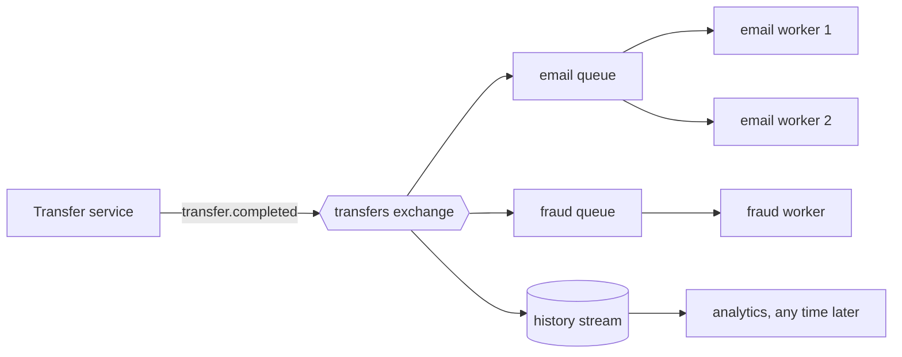

# 2. Queues, topics or streams

## Where we are

Stage 1 moved the follow-up work onto a durable queue. Each message says "do the follow-up for transfer X", and one worker sends the email and scores the transfer. Now more teams care about transfers: fraud monitoring is becoming its own service, rewards wants to award points, and analytics wants a feed. Meanwhile, when the fraud service slowed to 2 seconds a call in the lab, customers waited a median of 20 seconds for their confirmation email, and 41 at worst, because every email sat behind fraud checks in the same queue.

## Stop and think

::: think Fraud, rewards and analytics all need to hear about each transfer. Should the transfer service send each of them a message?

No. Then the transfer service has to know every consumer, and change every time a team adds or drops one. Publish one *event* instead, "transfer completed", and let each service that cares subscribe to it.

That's the difference between a *command* ("send the confirmation email": one receiver, who must do it) and an *event* ("transfer completed": a fact, which any number of services can react to, or ignore).

:::

::: think Two email workers read one queue, to keep up. Then the fraud service starts reading the same queue. Who gets each message?

On a queue, each message goes to exactly one consumer. The two email workers sharing it is what you want: *competing consumers*, splitting the work. But the fraud service is now competing with them too, so it gets some transfers and the email workers miss those.

Each service needs its own queue, with its own copy of every event. Workers within one service share that service's queue.

:::

::: think Six months from now, a new analytics service wants every transfer since January. Where does it get them?

Not from a queue: a message is deleted once it's acknowledged. It needs a *log* that keeps events for a retention period and lets each reader start from any point, such as a RabbitMQ stream or Kafka. Or it reads the history from a database. Decide which, before the team asks.

:::

## The mental model

### Three shapes

- **Queue (point to point).** Each message is handled by one consumer, then deleted. Several consumers on one queue share the work. Use it to distribute work.
- **Publish/subscribe.** A publisher sends to a topic, and every subscription gets its own copy. In RabbitMQ, the topic is an *exchange*, and each subscription is a queue *bound* to it. Cloud brokers call them topics and subscriptions. Use it to tell several services about one fact.
- **Stream (log).** An append-only sequence kept for a retention period. Readers track their own position (an *offset*) and can start from the beginning, the end, or anywhere in between. Reading doesn't remove anything. Use it for replay and history, and for many readers of high-volume events.



### What goes in an event

An event records a fact in the past tense, with what consumers need to act on it: here, the transfer id, both accounts, the amount, the reference and the time. Two failure modes:

- **Too thin**, just an id: every consumer calls the transfer service back for the details, and the transfer service takes the load anyway.
- **Too fat**, the whole database row: every consumer depends on your internal schema, so you can't change a column without breaking them.

Treat the event as a public contract. Add fields freely; never remove or repurpose one without a new version.

## The escalation ladder

### 1. A queue per job

Publish two commands: "send the email" to an email queue, "score the transfer" to a fraud queue.

**Fixes:** one job's slowness delaying another.
**Costs:** an extra publish per consumer.
**Breaks:** the transfer service now knows every consumer and must change for each new one.

### 2. One event, a queue per subscribing service

Publish "transfer completed" once, to an exchange. Each service binds its own queue and gets its own copy; the transfer service doesn't know who they are.

<<< @/../samples/src/Bank.Messaging/Rabbit.cs#topology

<<< @/../samples/src/Bank.Api/Endpoints/TransferEndpoints.cs#event

**Fixes:** interference and coupling. In the lab, with fraud scoring at 2 seconds a call, email lag fell from a median of 20 s to 2.1 s, and from 41 s to 2.7 s at worst, while the fraud queue worked through its own backlog. Two email workers on the email queue split 100 transfers exactly 50 and 50, with no duplicates.
**Costs:** topology to manage, and an event contract shared between teams.
**Breaks:** nothing, but the event's shape is now hard to change.

### 3. Route and filter

Use routing keys and patterns so each subscriber receives only what it needs: `transfer.completed` here, or `transfer.*` for every kind of transfer event. Header-based filters work too.

**Fixes:** consumers discarding most of what they receive.
**Costs:** routing rules that live in the broker's configuration, not in code.
**Breaks:** nothing, unless the rules drift away from what the consumers expect.

### 4. A stream for history and replay

Bind a stream to the same exchange, and keep events for a retention period.

**Fixes:** new consumers needing history, and reprocessing after a bug. In the lab, a brand-new reader started at the beginning of the stream and read all 362 events; run again, it read all 362 again. The email queue, by then, was empty.
**Costs:** storage for the retention period, and readers must manage their offsets.
**Breaks:** work sharing. Every reader of a plain stream sees every event, so it's for history, not for splitting work. Partitioned streams, such as Kafka's or RabbitMQ's super streams, bring consumer groups back, with ordering per partition (stage 5).

### 5. An event streaming platform

When many services consume high volumes of events, need long retention and replay, and need ordering per key, a platform built around partitioned logs, such as Kafka or a cloud event-streaming service, fits better than queues.

**Fixes:** scale, replay and per-key ordering, as the default.
**Costs:** significant operational complexity: partitions, consumer groups, offsets, retention and schema management.
**Breaks:** simple per-message work semantics. Traditionally, a consumer moves its offset forward instead of acknowledging each message, so one slow or failing message holds up its partition. (Newer Kafka versions add queue-like share groups; check what your platform and version support.)

## Trade-offs at a glance

| Shape | Who gets a message | After it's handled | Good for | Watch out for |
|---|---|---|---|---|
| Queue | One consumer | Deleted | Sharing work among workers | Two services on one queue steal each other's messages |
| Pub/sub (queue per subscriber) | Every subscribing service, then one worker in each | Deleted from that subscriber's queue | Telling several services about one fact | The event becomes a contract |
| Stream | Every reader, from its own offset | Kept until retention expires | History, replay, many readers | Not for sharing work, unless partitioned |

## Traps

- **Two services on one queue.** They split the messages between them, so each misses some.
- **Commands disguised as events.** "SendWelcomeEmail" published to everyone still assumes one particular receiver.
- **Leaking the database schema into events.** Every consumer breaks when a column changes.
- **Treating a stream like a queue.** Messages don't disappear when read, and every reader gets every message.
- **Retention without a decision.** Keep history as long as someone needs it, and no longer: it costs storage, and it may be personal data.

::::: trap
The fraud team writes its own consumer for transfer events. It works in testing and in production. Then, after a deployment, some transfers never reach fraud scoring. Why?

```csharp
// Fraud service: receive every completed transfer.
var queue = await channel.QueueDeclareAsync();
await channel.QueueBindAsync(queue.QueueName, "transfers", "transfer.completed");
await channel.BasicConsumeAsync(queue.QueueName, autoAck: false, consumer);
```

::: details Answer
`QueueDeclareAsync()` with no arguments declares a temporary queue: server-named, not durable, exclusive to this connection, and deleted automatically when the connection closes. That suits a short-lived listener, not a service that mustn't miss events.

While the fraud service is stopped for a deployment, its queue doesn't exist. Events published in that window go to every other bound queue, and fraud never sees them. Messages it held but hadn't acknowledged when it stopped are deleted with the queue too.

Declare a named, durable, non-exclusive queue, the same one each time, so events wait for the service while it's down.
:::
:::::

## In the interview

::::: interview
**Usually asked as:** "When would you use a queue, pub/sub, or event streaming?" Or: "Kafka or RabbitMQ?"

**Short answer:** "A queue when I want work done once, shared among workers. Pub/sub when several services need to react to the same fact: publish one event, and each service gets its own subscription, so they don't interfere and the publisher doesn't know them. A stream when consumers need history or replay, or there are many readers of high-volume events, often with ordering per key. RabbitMQ is strong at routing and per-message work with acknowledgements and redelivery; Kafka at durable, partitioned, replayable logs at scale. I'd pick on those needs and on what the team can operate."

::: details Follow-up: what's the difference between an event and a command?
A command asks one receiver to do something, and the sender usually cares that it happens: "send this email". An event states a fact that has already happened, "transfer completed", and the publisher doesn't know or care who reacts. Events reduce coupling; commands make responsibility explicit. Both have their place.
:::

::: details Follow-up: how does a new service get historical events?
From a stream or log that retains them, starting at the earliest offset, or from a database or an export of history. Queues can't help: they delete messages once handled. Plan retention before a new consumer appears, and make consumers idempotent, because replay means handling events again.
:::

::: details Follow-up: what's a competing consumer?
Several workers reading the same queue, so each message goes to one of them. It's how one service scales its message handling. It gives up strict ordering across messages, which stage 5 deals with.
:::

::: details Follow-up: what should an event contain?
The fact, and what consumers typically need to act on it without calling back: ids, amounts, times. Not internal database structure. Give it a type and a version, and evolve it by adding optional fields. Breaking changes need a new event version, published alongside the old one until consumers move.
:::
:::::

## Try it

With the lab running from stage 1, from the `samples` folder. The API's `--Lab:Transfers=Event` publishes to the `transfers` exchange, and `--Worker:Role` chooses what a worker does: `email`, `fraud` or `history`.

1. **Recreate the problem.** Make fraud scoring slow, then run stage 1's single worker and send 20 transfers at once:

   ```sh
   curl -X POST localhost:5090/settings -H "Content-Type: application/json" \
     -d '{"emailDelayMs": 100, "fraudDelayMs": 2000, "failureRate": 0}'
   dotnet run --project src/Bank.Worker -- --Worker:Role=follow-up
   dotnet run --project src/Bank.Api -- --Lab:Transfers=Queue
   ```

   ```sh
   curl -X POST localhost:5090/reset
   for i in $(seq 1 20); do
     curl -s -o /dev/null -H "Content-Type: application/json" \
       -d '{"fromAccountId": 8, "toAccountId": 9, "amount": 5.00, "reference": "Fan-out test"}' http://localhost:5080/transfers &
   done; wait
   ```

   When the emails are all sent, `curl localhost:5090/stats` shows `emailLagMs`: how long after each transfer its email went out.

2. **Publish an event instead.** Stop the single worker, and run one email worker and one fraud worker. Restart the API with `--Lab:Transfers=Event`, reset the stats, and send the 20 transfers again:

   ```sh
   dotnet run --project src/Bank.Worker -- --Worker:Role=email
   dotnet run --project src/Bank.Worker -- --Worker:Role=fraud
   ```

   Look at the `transfers` exchange's bindings in the management UI at http://localhost:15672.

3. **Share the work.** Start a second email worker, send 100 transfers, and compare the two workers' logs.

4. **Replay history.** Read the stream from the start, stop it, and run it again:

   ```sh
   dotnet run --project src/Bank.Worker -- --Worker:Role=history --Worker:StreamOffset=first
   ```

   Try `--Worker:StreamOffset=next` to read only new events.

Our results:

| Fraud scoring at 2 s a call, 20 transfers at once | Email lag, p50 | Email lag, max |
|---|---|---|
| One queue, one worker for both jobs | 20 s | 41 s |
| One event, separate email and fraud queues | 2.1 s | 2.7 s |

## What breaks next

Every service now gets every transfer, and each runs at its own pace. Then a customer complains: they received two confirmation emails for one transfer. Nobody published it twice.

Next: [3. Delivered twice](./03-delivered-twice).
