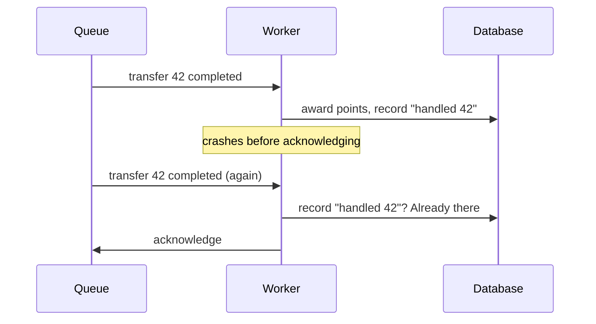

# 3. Delivered twice

## Where we are

Stage 2 gave every service its own queue, fed by one "transfer completed" event. Then a customer complains: they received two confirmation emails for one transfer. The rewards team finds a few transfers with double points. Nobody published anything twice.

## Stop and think

::: think The worker sends the email, then acknowledges the message. It's killed by a deployment between those two steps. What happens next?

RabbitMQ never got the acknowledgement, so when the worker's connection drops, it puts the message back on the queue and delivers it again. The next worker sends the email again.

That's *at-least-once delivery*: in exchange for never losing a message, you sometimes get one twice. In the lab, a worker made to crash at that point 18 times sent 218 emails for 200 transfers.

:::

::: think So acknowledge first, then send the email. Problem solved?

Now a crash after the acknowledgement and before the email loses it: the broker has forgotten the message, and the work never happens. That's *at-most-once*. You've swapped duplicates for losses.

There's no ordering of "do the work" and "acknowledge" that avoids both, because the broker and your side effect can't commit together. What you can do is make handling the same message twice harmless.

:::

::: think To ignore duplicates, the rewards worker records each message id it has handled. Should it record the id before awarding the points, or after?

Neither, if they're separate steps. Record first, then crash before awarding: the redelivery sees the id, skips the message, and the points are never awarded. Award first, then crash before recording: the redelivery doesn't see the id, and awards them again.

Record the id and award the points in the same database transaction. Then a crash before the commit means neither happened, and a crash after it means both did. In the lab: 27 crashes, exactly 200 awards for 200 transfers.

:::

## The mental model

### Delivery guarantees

- **At most once**: acknowledge before doing the work (or don't acknowledge at all). Nothing is repeated; some work is lost.
- **At least once**: acknowledge after doing the work. Nothing is lost; some work is repeated.
- **Exactly once**: what everyone wants. As *delivery* over an unreliable network, you can't have it: a crash between the side effect and the acknowledgement is always possible. You can have an exactly-once *effect*: at-least-once delivery, plus a consumer that makes repeats harmless.



Duplicates don't only come from crashes. A publisher that retries after losing a confirmation can publish twice. A consumer that takes too long can have its message handed to someone else. And replaying a stream (stage 2) delivers everything again on purpose.

### Ways to make a consumer idempotent

- **Naturally idempotent operations.** "Set the status to sent" can repeat harmlessly; "add 2 points" can't.
- **Deduplicate in the same transaction as the side effect.** Keep a table of handled message ids (an *inbox*). Insert the id and make the change in one transaction; if the insert finds the id already there, skip the change.
- **A unique constraint on the effect itself.** For example, one reward row per transfer: the second insert fails, and the consumer treats that as "already done".
- **Idempotency keys for side effects outside your database.** An email or a payment API can't join your transaction, so pass it a key that's the same on every retry, and let it deduplicate. Many real providers support an `Idempotency-Key` header; check whether yours does, and for how long it remembers keys.

Every one of these needs a stable id that's the same on every delivery: here, the message id, set to the transfer's id.

The [idempotency reference](/backend/reference/idempotency) collects these techniques in one place, alongside their HTTP equivalent, idempotency keys, which [B3 stage 3](/backend/journeys/the-money-must-add-up/03-paid-twice) builds.

## The escalation ladder

### 1. Accept duplicates, where they're harmless

Some work is fine to repeat: refreshing a cache entry, recomputing a report, setting a value rather than adding to it.

**Fixes:** nothing needs fixing.
**Costs:** nothing.
**Breaks:** nothing, as long as it really is harmless. Two confirmation emails aren't harmless to a customer who thinks they've paid twice.

### 2. Deduplicate in the same transaction as the side effect

<<< @/../samples/src/Bank.Messaging/Rewards.cs#rewards-idempotent

**Fixes:** duplicate effects in your own database. In the lab, with the worker crashing between the work and the acknowledgement: the naive version awarded points 224 times for 200 transfers after 24 crashes; this version awarded exactly 200 after 27.
**Costs:** a table of handled ids that grows with every message, so delete old entries once redelivery is no longer possible, and an extra insert per message.
**Breaks:** nothing, but only side effects inside that one database are covered.

### 3. Idempotency keys for side effects elsewhere

<<< @/../samples/src/Bank.Messaging/FollowUp.cs#idempotency-key

**Fixes:** duplicates in systems you can't share a transaction with. In the lab, the naive email worker sent 218 emails for 200 transfers after 18 crashes. With an idempotency key, 14 crashes led to 14 repeated requests, which the provider recognised and ignored: 200 emails for 200 transfers.
**Costs:** the provider has to support it, and only remembers keys for some period.
**Breaks:** nothing, as long as the key is stable. A key generated fresh on each attempt deduplicates nothing.

### 4. Push the guarantee into the platform, where it exists

Some brokers and streaming platforms offer deduplication windows, or transactions spanning a read and a write within the platform. They help, but only within their own boundary. The moment your consumer writes to a database or calls an API, you're back to rungs 2 and 3.

**Fixes:** duplicates inside the platform.
**Costs:** platform-specific configuration, often with throughput costs.
**Breaks:** the assumption that you're covered end to end. You aren't.

## Trade-offs at a glance

| Approach | Effect happens | Costs | Watch out for |
|---|---|---|---|
| Acknowledge first (at most once) | Zero or one times | Nothing | Lost work |
| Acknowledge after (at least once), no dedup | One or more times | Nothing | Duplicates |
| Record id, then act (separately) | Zero or one times | An insert | Lost work, disguised as handled |
| Act, then record id (separately) | One or more times, less often | An insert | Fewer duplicates, not none |
| Act and record in one transaction | Exactly once | An insert; a growing table | Only covers that one database |
| Idempotency key on an external call | Exactly once, if the provider honours it | Provider support | Keys that change per attempt; key expiry |

## Traps

- **Believing the broker's "exactly once".** Check exactly what it covers. It won't cover your database or your email provider.
- **Generating the idempotency key on each attempt.** `Guid.NewGuid()` inside the handler makes every retry look new.
- **Deduplicating in memory.** A restarted or different worker has an empty memory.
- **Keeping the inbox table forever.** Prune entries older than your longest possible redelivery or replay window.
- **Treating a unique-constraint violation as an error.** For a duplicate delivery, it means "already done": acknowledge and move on.

::::: trap
To stop duplicate rewards, a developer adds a check. Under a crash test, rewards are still sometimes awarded twice, and sometimes not at all. Why?

```csharp
if (await AlreadyProcessedAsync(messageId))
{
    return; // seen this one before
}

await MarkProcessedAsync(messageId);   // INSERT INTO processed_messages ...
await AwardPointsAsync(transfer);      // INSERT INTO reward_points ...
```

::: details Answer
Two separate commits, and a check that isn't atomic with either.

- If the worker crashes after `MarkProcessedAsync` and before `AwardPointsAsync`, the redelivery finds the id and skips the message: the points are never awarded.
- Two workers can both run `AlreadyProcessedAsync` for the same message before either marks it, and both award the points. That can happen after a redelivery to a second worker while the first is still running.

Do the insert into `processed_messages` and the award in one transaction, and use the insert itself as the check: `ON CONFLICT DO NOTHING`, then skip the award if no row was inserted. That's what the lab's `AwardOnceAsync` does.
:::
:::::

## In the interview

::::: interview
**Usually asked as:** "How do you guarantee a message is processed exactly once?" Or: "Customers are getting duplicate notifications. Why, and how do you fix it?"

**Short answer:** "You can't guarantee exactly-once delivery: a consumer can always crash between doing the work and acknowledging it, so the broker redelivers. So I'd use at-least-once delivery and make the consumer idempotent. For changes in my own database, I'd record the message id and make the change in the same transaction, so a redelivery finds the id and does nothing. For external side effects like email, I'd pass a stable idempotency key, such as the event id, so the provider deduplicates. The result is an exactly-once effect."

::: details Follow-up: what are the delivery guarantees, and what do they cost?
At most once: acknowledge before processing; fast, but loses work on a crash. At least once: acknowledge after processing; nothing lost, but duplicates possible. Exactly once isn't achievable as delivery across independent systems; you build an exactly-once effect from at-least-once delivery plus idempotent handling.
:::

::: details Follow-up: where should the message id come from?
From the producer, and it must be the same on every delivery and every republish of that message. Using a domain id, such as the transfer id, is even better, because it stays the same if the event is regenerated, for example by an outbox relay retrying (stage 4).
:::

::: details Follow-up: how long do you keep processed message ids?
At least as long as a duplicate could still arrive: the broker's redelivery behaviour, publisher retries, and any replay window, plus a margin. Then prune them, in batches, by age. If you replay a stream from further back than that, the consumer has to cope another way, such as a unique constraint on the effect.
:::

::: details Follow-up: how do you make an email idempotent?
Give the provider an idempotency key that's stable for that email, such as the transfer id plus the email type, if it supports one. If it doesn't, record "email sent" in your database before calling, and accept that a crash in between could lose an email or send one twice; pick which is worse. Or send through a component of your own that deduplicates before calling the provider.
:::
:::::

## Try it

### The simulator

The same random crashes drive every strategy. Move the crash chance, and compare the rows: only one strategy keeps every side effect at exactly once.

<DeliverySimulator />

### Against the lab

With the lab running from stage 2, from the `samples` folder. Apply this stage's new tables first: the seed command applies pending migrations, then stops when it sees existing data.

```sh
dotnet run --project src/Bank.Api -- seed
dotnet run --project src/Bank.Api -- --Lab:Transfers=Event
```

`--Worker:Role=rewards` awards points; `--Worker:Idempotent=true` switches the email and rewards workers to their idempotent versions; and `--Worker:CrashChance=0.1` makes a worker kill itself after one message in ten, after the work and before the acknowledgement.

1. **Run crashing workers that restart themselves**, one loop per terminal:

   ```sh
   while true; do dotnet run --project src/Bank.Worker -- --Worker:Role=email --Worker:CrashChance=0.1; done
   while true; do dotnet run --project src/Bank.Worker -- --Worker:Role=rewards --Worker:CrashChance=0.1; done
   ```

2. **Send 200 transfers**, and when the queues are empty, count:

   ```sh
   curl -X POST localhost:5090/reset
   for i in $(seq 1 200); do
     curl -s -o /dev/null -H "Content-Type: application/json" \
       -d '{"fromAccountId": 12, "toAccountId": 13, "amount": 250.00, "reference": "Duplicate test"}' http://localhost:5080/transfers
   done
   ```

   ```sh
   curl localhost:5090/stats
   docker compose exec postgres psql -U bank -d bank -c "
     SELECT count(*) AS awards, count(DISTINCT transfer_id) AS transfers, sum(points) AS points FROM reward_points"
   ```

3. **Make them idempotent.** Stop the loops, clear the rewards (`TRUNCATE reward_points, processed_messages`), add `--Worker:Idempotent=true` to both loops, and repeat.

Our results, for 200 transfers:

| | Simulated crashes | Effects | Duplicates |
|---|---|---|---|
| Email, naive | 18 | 218 emails | 18 |
| Email, idempotency key | 14 | 200 emails | 0 (14 suppressed by the provider) |
| Rewards, naive | 24 | 224 awards | 24 |
| Rewards, recorded in the same transaction | 27 | 200 awards | 0 |

## What breaks next

Consumers now cope with any message arriving twice. But there's a failure they can't cope with: a message that never arrives. Look at the transfer endpoint again. It commits the transfer, then publishes the event. If the API crashes between those two lines, the money has moved, and no service will ever hear about it.

Next: [4. The event that never got sent](./04-dual-write-and-outbox).
