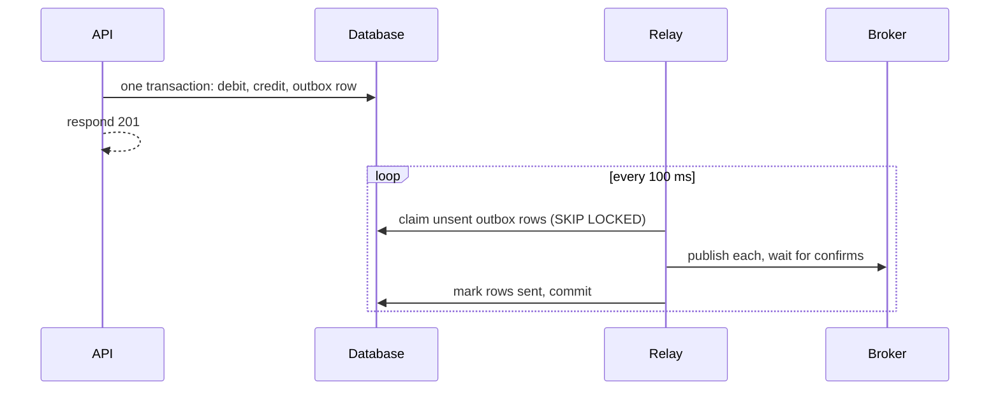

# 4. The event that never got sent

## Where we are

Stage 3 made every consumer safe against duplicates. One failure is left that no consumer can handle: an event that never arrives. The transfer endpoint commits the transfer, then publishes "transfer completed". If the API dies between those two lines, in a crash, a deployment or an out-of-memory kill, the money has moved and nothing downstream will ever know. No email, no fraud score, no reward.

## Stop and think

::: think The API crashes right after committing a transfer, before publishing. What does the customer see, and what does every other service see?

The customer's request fails: their connection drops with no response. But the transfer was committed, so their money has moved. Every other service sees nothing: no event was published, so there's no email, no fraud check and no reward, ever.

In the lab, with the API crashing after one commit in ten, 27 of 200 transfers were committed without an event. Those same 27 customers saw their transfer "fail".

:::

::: think So publish the event first, then commit. Better?

Worse, differently. If the API crashes after publishing and before committing, consumers act on a transfer that never happened: an email for money that didn't move, a reward for nothing. These are ghost events. And if the commit fails for an ordinary reason, such as a constraint, the event has already gone.

This is the *dual-write problem*: writing to two systems, a database and a broker, that can't commit together. Whichever order you choose, a crash in between leaves them disagreeing.

:::

::: think Could you wrap the database write and the publish in one distributed transaction?

In principle, with two-phase commit, if the database and the broker both support it, and RabbitMQ doesn't. In practice it's rarely worth it: every write waits for both systems and a coordinator, and while the coordinator waits, both systems hold locks, so one slow or unavailable participant blocks everything.

The usual answer is to stop writing to two systems: write only to the database, including the event, and publish from there.

:::

## The mental model

### The transactional outbox



The event becomes a row in an *outbox* table, written in the same transaction as the change it describes. Now there's only one write: both commit, or neither does. A separate *relay* reads unsent rows, publishes them, and marks them sent.

The relay can still crash after publishing and before marking. Then the next run publishes those events again. So the outbox gives you at-least-once publishing, never at-most-once: no event is lost, and some are published twice. That's fine, because stage 3's consumers are idempotent. The message id must be the same on every attempt; here, it's the outbox row's id, which is the transfer's id.

### The inbox

On the receiving side, stage 3's table of handled message ids is the matching *inbox*: the consumer records the event's id in the same transaction as its own changes. Outbox and inbox together give an exactly-once effect across two services, with no distributed transaction.

## The escalation ladder

### 1. Publish after commit, and reconcile

Keep the dual write, and run a periodic job that finds transfers without a published event and publishes them.

**Fixes:** lost events, eventually.
**Costs:** a reconciliation job, and a way to tell which transfers have been announced, which is most of an outbox anyway.
**Breaks:** nothing more than now, but downstream services can be late by a whole reconciliation interval.

### 2. A transactional outbox with a polling relay

Write the event in the same transaction:

<<< @/../samples/src/Bank.Api/Endpoints/TransferEndpoints.cs#outbox-write

Then publish from the table:

<<< @/../samples/src/Bank.Api/Endpoints/OutboxRelay.cs#relay

**Fixes:** lost and ghost events. In the lab, with the API crashing after one commit in ten, all 200 committed transfers reached the rewards service, against 173 of 200 without the outbox. With the relay also crashing between publishing and marking (23 times), every committed transfer arrived, along with 44 duplicate deliveries, all ignored by the idempotent consumer.
**Costs:** an outbox table, which needs a cleanup job for published rows, and some delay. In the lab, the time from transfer to email went from 22 ms to 65 ms at the median, because the relay polls every 100 ms.
**Breaks:** nothing, provided every consumer is idempotent. It also raises ordering questions if several relays run (stage 5).

### 3. Change data capture instead of polling

Instead of polling the outbox, stream the database's own change log: logical replication in Postgres, read by a tool such as Debezium, which publishes each new outbox row.

**Fixes:** polling delay and polling load.
**Costs:** more infrastructure (connectors, replication slots), and operational knowledge to keep it healthy. A stuck replication slot makes the database retain its log, until the disk fills.
**Breaks:** nothing functionally; it's still at-least-once.

### 4. Make the event the record

Turn it around: the service records only the event, and its own database is updated by consuming it (sometimes called "listen to yourself"), or the event log is the system of record (event sourcing).

**Fixes:** the dual write, by having only one write.
**Costs:** the service's own state lags behind its writes, so reads straight after a write need care, and event sourcing is a large design commitment.
**Breaks:** simple read-after-write within the service.

## Trade-offs at a glance

| Approach | Lost events | Ghost events | Duplicates | Delay | Costs |
|---|---|---|---|---|---|
| Commit, then publish | On a crash in between | No | No | Lowest | None |
| Publish, then commit | No | On a crash in between, or a failed commit | No | Lowest | None |
| Distributed transaction | No | No | No | High | Coordinator, locks, availability |
| Outbox + polling relay | No | No | Yes: needs idempotent consumers | Polling interval | Outbox table and cleanup |
| Outbox + change data capture | No | No | Yes | Low | Connector infrastructure |
| Listen to yourself | No | No | Yes | Own state lags | Read-after-write care |

## Traps

- **Publishing inside the database transaction, before the commit.** It looks atomic, and isn't: the publish can't be rolled back.
- **A relay that isn't safe to run twice.** Without `FOR UPDATE SKIP LOCKED`, or another way to claim rows, two relay instances publish the same events.
- **An outbox that grows forever.** Delete or archive published rows on a schedule.
- **A new message id on every relay attempt.** Consumers can't recognise the republished event.
- **Assuming the outbox means exactly once.** It means at least once. Consumers still need stage 3.

::::: trap
This service, from an older design document, completes a transaction and tells other services about it. It has worked for months. What can go wrong?

```csharp
public class TransactionService(ITransactionRepository repository, IEventPublisher publisher)
{
    public async Task<Transaction> CompleteTransactionAsync(Transaction transaction)
    {
        transaction.Complete();
        await repository.UpdateAsync(transaction);

        // Publish to all interested subscribers
        await publisher.PublishAsync(new TransactionCompletedEvent
        {
            TransactionId = transaction.Id,
            AccountId = transaction.AccountId,
            Amount = transaction.Amount,
            CompletedAt = DateTime.UtcNow,
        });

        return transaction;
    }
}
```

::: details Answer
A dual write. The update commits, then the event is published as a separate step. If the process dies in between, or the broker is unavailable at that moment, the transaction is complete and no subscriber ever hears about it. If the publish throws, the caller sees an error for a transaction that did complete, and may retry it.

Swapping the two lines trades lost events for ghost events. Instead, write the event to an outbox table in the same database transaction as the update, and let a relay publish it, with subscribers that tolerate duplicates.

It's worked for months because the window is small. At scale, through enough deployments and crashes, small windows are hit.
:::
:::::

## In the interview

::::: interview
**Usually asked as:** "How do you reliably publish an event when you update the database?" Or, describing the bug: "We save the order, then publish an event. Sometimes the event is missing. Why?"

**Short answer:** "That's the dual-write problem: the database and the broker can't commit together, so a crash between them loses the event, or with the order reversed, publishes one for a change that never happened. I'd use a transactional outbox: write the event to an outbox table in the same transaction as the change, and have a relay publish unsent rows and mark them sent. That's at-least-once, because the relay can crash after publishing and before marking, so consumers must be idempotent, recording handled message ids in the same transaction as their own changes. For lower latency, the relay can use change data capture instead of polling."

::: details Follow-up: why not a distributed transaction?
Many brokers don't support one, and where they do, it couples the availability and latency of both systems: every commit waits for a coordinator and both participants, holding locks the whole time. One unavailable participant blocks the others. The outbox gets the same outcome with local transactions only.
:::

::: details Follow-up: how do you keep events in order with an outbox?
Publish in the order the rows were created, from one relay at a time per ordering key, and route each key to one partition or queue with a single active consumer (stage 5). Several relays with `SKIP LOCKED` give throughput but not global order. Usually you only need order per entity, such as per account, not across everything.
:::

::: details Follow-up: what's the inbox pattern?
The consumer side of the same idea: before acting on a message, the consumer records its id in its own database, in the same transaction as its changes. A duplicate finds the id already there and does nothing. Outbox plus inbox gives an exactly-once effect between services without distributed transactions.
:::

::: details Follow-up: polling relay or change data capture?
Polling is simple, needs nothing beyond the database, and adds up to one polling interval of delay plus a little load. Change data capture reads the database's change log, with lower latency and no polling queries, but needs connectors and care with replication slots. Start with polling, and move when the delay or load matters.
:::
:::::

## Try it

### The simulator

The same random crashes drive every strategy. Only one row stays correct at every crash rate: notice what it needs on both sides.

<OutboxSimulator />

### Against the lab

With the lab running from stage 3, from the `samples` folder. `--Lab:CrashAfterCommit=0.1` kills the API after one transfer in ten has committed and before anything is published. `--Lab:Transfers=Outbox` saves events in the outbox and starts the relay, and `--Lab:RelayCrashChance` kills the relay between publishing and marking.

1. **Count events with an idempotent rewards worker**, and clear old rewards first:

   ```sh
   docker compose exec postgres psql -U bank -d bank -c "TRUNCATE reward_points, processed_messages, outbox_messages"
   dotnet run --project src/Bank.Worker -- --Worker:Role=rewards --Worker:Idempotent=true
   ```

2. **Run the crashing API in a loop**, publishing after commit:

   ```sh
   while true; do dotnet run --project src/Bank.Api -- --Lab:Transfers=Event --Lab:CrashAfterCommit=0.1; done
   ```

3. **Send 200 transfers**, waiting for the API to be back between them, and compare transfers committed with transfers rewarded:

   ```sh
   for i in $(seq 1 200); do
     until curl -sf localhost:5080/health > /dev/null; do sleep 0.3; done
     curl -s -o /dev/null -H "Content-Type: application/json" \
       -d '{"fromAccountId": 14, "toAccountId": 15, "amount": 300.00, "reference": "Outbox test"}' http://localhost:5080/transfers
   done
   ```

   ```sh
   docker compose exec postgres psql -U bank -d bank -c "
     SELECT (SELECT count(*) FROM transactions WHERE account_id = 14 AND description = 'Transfer'
             AND created_at > now() - interval '10 minutes') AS committed,
            (SELECT count(DISTINCT transfer_id) FROM reward_points) AS rewarded"
   ```

4. **Switch to the outbox** (`--Lab:Transfers=Outbox`), clear the tables, and repeat. Then add `--Lab:RelayCrashChance=0.2`, and count the worker's "handled" log lines against the transfers rewarded.

Our results, for 200 transfers with the API crashing after one commit in ten:

| | Transfers committed | Events delivered | Lost | Duplicate deliveries (ignored) |
|---|---|---|---|---|
| Commit, then publish | 200 | 173 | 27 | 0 |
| Outbox | 200 | 200 | 0 | 6 |
| Outbox, relay crashing too | 190 | 190 | 0 | 44 |

In the last run, 10 transfers never committed: the relay's crashes took the API down while those requests were mid-flight. Their customers saw errors, correctly, and no events were sent for them.

## What breaks next

Every committed transfer now produces exactly one effect in every service. A new statements service subscribes too, building each account's history from events: "account opened", then debits and credits. Within days it's raising errors: a debit for an account it has never heard of. The "account opened" event arrived after the account's first transfer.

Next: [5. Order matters, sometimes](./05-ordering).
