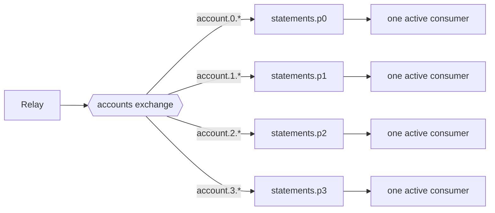

# 5. Order matters, sometimes

## Where we are

Stage 4's outbox means every committed change produces its events. A new statements service builds each account's running balance from them: "account opened", then every debit and credit. To keep up, it runs four handlers on its queue. Within days it's logging problems: a debit for an account it has never heard of, the "account opened" event arriving after the account's first transfer. And some customers' statement balances don't match their accounts.

## Stop and think

::: think The relay publishes every event in the order it was written. How can the statements service see them out of order?

The queue keeps them in order, but four handlers take messages from it at once. If "account opened" and the account's first credit sit next to each other in the queue, two handlers pick them up together, and either can finish first.

Other things reorder messages too: a failed message that's retried later, while the ones behind it succeed (stage 6); several consumers on different machines; several relays publishing in parallel.

:::

::: think To ignore duplicates, the statements service skips any event whose sequence number it has already passed. What happens when event 4 arrives before event 3?

Event 4 is applied, and the account's last sequence becomes 4. When event 3 arrives, it looks like a duplicate, so it's skipped, and its money never reaches the statement. In the lab, that's exactly what happened: with four concurrent handlers, 9 of 150 accounts ended up with wrong balances.

Sequence-based deduplication is only safe when events arrive in order.

:::

::: think Does every event need to be processed in order?

No, and demanding global order is expensive: one consumer for everything, with no parallelism. Usually only events about the same thing need ordering: one account's events, not events across all accounts. Ask what the unit of ordering is, then guarantee order within it and process everything else in parallel.

:::

## The mental model

### Where ordering comes from, and where it's lost

Order is a chain, and every link has to keep it:

1. **Producer:** events are created in a definite order. Here, a per-account sequence number assigned in the same transaction as the change.
2. **Publishing:** they're published in that order. Here, one relay, reading the outbox by position.
3. **Broker:** the queue or partition keeps them in order.
4. **Consumer:** exactly one consumer handles them, one at a time.

Competing consumers break link 4 by design: that's the price of sharing work. Retries break it too, by putting a failed message back behind ones that then succeed.

### Partitioning by key



Hash the ordering key, the account id, into a fixed number of partitions, and give each partition one active consumer. Every event for an account lands in the same partition, in order, and is handled in order. Different accounts sit in different partitions and are processed in parallel.

<<< @/../samples/src/Bank.Messaging/Rabbit.cs#partition-key

This is how Kafka partitions, Azure Service Bus sessions and SQS FIFO message groups work too, each with its own limits; check their documentation. In RabbitMQ, a queue declared with `x-single-active-consumer` delivers to one consumer at a time, and fails over to another if it disconnects:

<<< @/../samples/src/Bank.Messaging/Rabbit.cs#account-topology

### Sequence numbers detect what partitions prevent

Per-entity sequence numbers let a consumer *know* whether an event is the next one, a duplicate, or early. The lab assigns them by incrementing the account's version in the same transaction as the change. That locks the account's row until the commit, so two concurrent transfers can't take the same number:

<<< @/../samples/src/Bank.Api/Endpoints/TransferEndpoints.cs#account-sequence

## The escalation ladder

### 1. Make order not matter

Design the consumer so the order of arrival doesn't change the result: commutative updates, such as adding to a balance; last-writer-wins on a version or timestamp; or storing every event and computing the view when it's read.

**Fixes:** ordering problems, by removing them.
**Costs:** design effort; not every domain allows it.
**Breaks:** nothing. Where it works, it's the best option.

### 2. Detect disorder, and wait or retry

With sequence numbers, a consumer can see that event 3 hasn't arrived when event 4 does. It can put event 4 back to retry shortly, or park it until event 3 arrives.

**Fixes:** disorder, at the consumer.
**Costs:** delay for out-of-order events, and logic to give up if the missing event never comes.
**Breaks:** throughput, if waiting holds up a queue, and correctness, if "older" events are treated as duplicates while events can still arrive out of order. That's the bug that cost the lab 9 statements.

### 3. A single consumer

One consumer, one message at a time, on one queue.

**Fixes:** all ordering, if publishing is ordered too.
**Costs:** all parallelism: throughput is one handler's.
**Breaks:** scaling. Use it when volumes are small.

### 4. Partition by key, one active consumer per partition

**Fixes:** order where it matters, with parallelism everywhere else. In the lab, draining the same 1,044 events: one shared queue with four concurrent handlers produced 13 ordering problems and 9 wrong balances out of 150 accounts. Four partitions, served by two worker processes, produced none.
**Costs:** a fixed partition count chosen up front, uneven partitions (the lab's four held 191, 220, 174 and 315 events), and a hot account can slow its whole partition.
**Breaks:** total order across partitions. And changing the partition count moves keys between partitions, which reorders them during the change (see B1 stage 7).

## Trade-offs at a glance

| Approach | Order guaranteed | Parallelism | Costs | Watch out for |
|---|---|---|---|---|
| Order-independent design | Not needed | Full | Design effort | Not always possible |
| Detect and retry or park | Per entity, eventually | Full | Delay; parking logic | Treating early as duplicate |
| Single consumer | Total | None | Throughput | Scaling |
| Partition by key | Per key | Across partitions | Fixed partitions; skew | Hot keys; repartitioning |

## Traps

- **Assuming a queue means order.** With competing consumers, prefetch and retries, it doesn't.
- **Ordering everything when you need ordering per entity.** It costs all your parallelism.
- **Deduplicating by "sequence ≤ last seen" while events can arrive out of order.** Late events are silently dropped.
- **Several relays reading the outbox in parallel.** `SKIP LOCKED` spreads the rows across relays, and their events interleave out of order.
- **Changing the partition count casually.** Keys move between partitions, and their events can be reordered while they do.

::::: trap
A developer makes the statements service idempotent by skipping any event it has already passed. Under load, some statements end up short of money, with no errors logged. Why?

```csharp
var last = await LastAppliedSequenceAsync(entry.AccountId);
if (entry.Sequence <= last)
{
    return; // already applied: a duplicate
}

await ApplyAsync(entry);
await SetLastAppliedSequenceAsync(entry.AccountId, entry.Sequence);
```

::: details Answer
It assumes events arrive in order. With several handlers, an account's event 4 can be applied before event 3. Then `last` is 4, and event 3, which has never been applied, is skipped as a "duplicate". Its money never reaches the statement, and nothing is logged.

Either guarantee order per account first (partition by account, one active consumer each), and then "sequence ≤ last" really does mean a duplicate; or track exactly which sequences have been applied, not just the highest, and treat a gap as "wait", not "skip".

There's also a race, if two handlers do this for the same account at once: both read the same `last`. The lab's version locks the account's row with `FOR UPDATE` in one transaction.
:::
:::::

## In the interview

::::: interview
**Usually asked as:** "How do you guarantee message ordering?" Or: "Events for one account are processed out of order. How do you fix it?"

**Short answer:** "First I'd ask what really needs ordering. Usually it's events for one entity, such as one account, not everything. Then I'd keep order through the whole chain: assign per-entity sequence numbers when the events are created, publish them in order, route each entity's events to the same partition by hashing its id, and have exactly one active consumer per partition. That keeps each account's events in order while different accounts are processed in parallel. Consumers use the sequence numbers to spot duplicates and gaps. Where I can, I'd make the handling order-independent, so none of this is needed."

::: details Follow-up: why doesn't a queue alone guarantee order?
A queue delivers in order, but several consumers process in parallel and finish in any order. Prefetch lets one consumer hold several messages at once. A failed message that's retried lands behind newer ones. Order holds only with one consumer, handling one message at a time, with no reordering retries.
:::

::: details Follow-up: what's the cost of partitioning?
Parallelism is capped at the number of partitions; partitions are uneven, and a hot key slows its whole partition; and changing the partition count moves keys, risking reordering during the change. Choose a partition count with headroom, based on expected throughput per partition.
:::

::: details Follow-up: Kafka guarantees order within a partition. Is that enough?
Only if the producer writes each key's events in order (with retries that don't reorder them, which Kafka's idempotent producer handles), and only one consumer in the group reads each partition, processing serially. Hand messages to a thread pool inside the consumer and you've lost order again.
:::

::: details Follow-up: an event arrives before the event it depends on. What do you do?
If you can, make the handler tolerate it: for example, create the account record from the first event that mentions it. Otherwise, detect the gap with sequence numbers and retry the early event after a short delay, or park it until the missing one arrives, with a time limit after which a person is alerted.
:::
:::::

## Try it

With the lab running from stage 4, from the `samples` folder. Apply this stage's migration first (the seed command applies it, then stops).

```sh
dotnet run --project src/Bank.Api -- seed
dotnet run --project src/Bank.Api -- --Lab:Transfers=Outbox
```

The API's `POST /accounts` opens an account and publishes `AccountOpened`. In Outbox mode, every transfer also publishes an `AccountEntryPosted` for each account, with that account's next sequence number. The `accounts` exchange routes each event both to a shared queue, `statements.all`, and to one of four partition queues.

1. **Stop all workers, and create a backlog** of tightly packed events. This opens 150 accounts, and right after opening each one sends three transfers involving it, in parallel:

   ```sh
   dotnet run --project tools/Bank.Load -- --ordering-burst 150
   ```

2. **Drain the shared queue with four concurrent handlers**, then count problems and wrong balances:

   ```sh
   dotnet run --project src/Bank.Worker -- --Worker:Role=statements --Worker:Topology=Shared --Worker:Concurrency=4
   ```

   ```sh
   docker compose exec postgres psql -U bank -d bank -c "SELECT problem, count(*) FROM statement_problems GROUP BY 1"
   ```

3. **Clear the statements and drain the partitions**, with two workers. In the management UI, each partition queue shows one active consumer and one waiting:

   ```sh
   docker compose exec postgres psql -U bank -d bank -c "TRUNCATE statement_accounts, statement_problems"
   dotnet run --project src/Bank.Worker -- --Worker:Role=statements --Worker:Topology=Partitioned
   ```

To check balances, compare `statement_accounts.balance` with the sum of each account's rows in `transactions`.

Our results, for the same 1,044 events:

| | Ordering problems | Wrong statement balances |
|---|---|---|
| Shared queue, 4 concurrent handlers | 13 (11 out of order, 2 before the account was opened) | 9 of 150 accounts |
| 4 partitions, one active consumer each | 0 | 0 |

When we first ran this with all the accounts opened up front and the transfers later, the shared queue showed no problems at all: each account's events were too far apart in the queue to be handled at the same time. Disorder needs events for the same entity close together, which is exactly what real traffic produces.

## What breaks next

Ordering holds now, but it makes one failure much worse. A malformed message arrives: an event from an old producer, with a field missing. The consumer fails on it, puts it back, gets it again, fails again. On a partition with one active consumer, nothing behind it can move.

Next: [6. Poison messages](./06-poison-messages).
