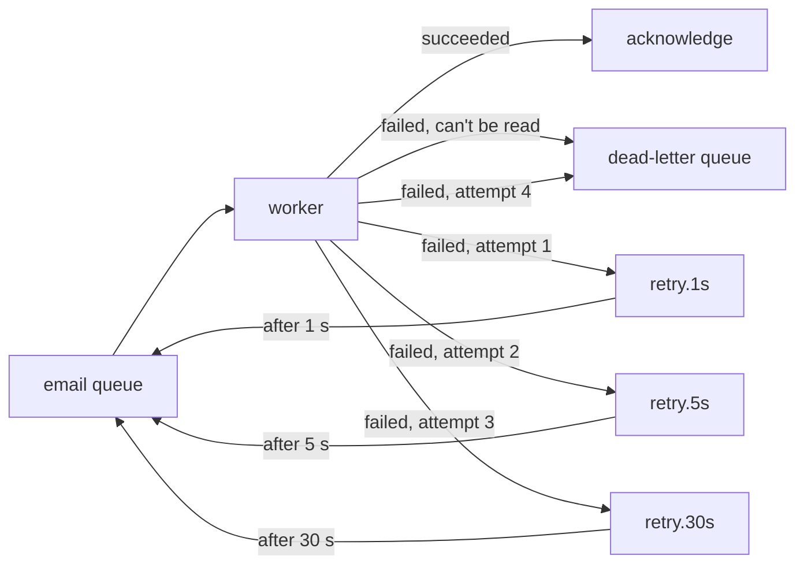

# 6. Poison messages

## Where we are

Stage 5 keeps each account's events in order, with one consumer handling one message at a time per partition. Then a malformed event arrives, from an old producer, with a transfer id that isn't a valid id. The consumer fails on it, puts it back on the queue, receives it again straight away, and fails again. In the lab, with one message in flight at a time, the worker attempted that one message 11,200 times in 20 seconds, and sent none of the 50 good emails queued behind it.

## Stop and think

::: think The email provider is down for a minute. The worker puts every failed message straight back on the queue. What does the provider see?

A flood. Every message is retried as fast as the worker can go, so a struggling service gets far more traffic than usual, just when it can least handle it. In the lab, a 20-second outage meant 861 failed calls from one worker handling 50 messages. Immediate retries can turn a dependency's blip into a longer outage.

:::

::: think Some failures will pass, and some never will. How do you tell them apart, and what should happen to each?

A message that can't be read, or fails validation, will fail every time: retrying it only wastes effort and blocks others. Park it straight away somewhere a person will look.

A timeout, a 503 or a dropped connection is probably transient: retry it, but after a delay that grows, and only a limited number of times. Past that, park it too.

When unsure, treat a failure as transient, with a retry limit, so nothing loops forever.

:::

::: think A message has been parked after its retries ran out. The provider's bug is fixed. Now what?

Replay it: move it back onto its queue, so it's processed normally. That needs tooling, and it needs consumers that are safe to run twice (stage 3), because some of those messages may have partly succeeded before they failed.

Someone also has to notice it was parked. A dead-letter queue nobody watches is a bin.

:::

## The mental model

### Poison messages, and why they block

A *poison message* is one that makes its consumer fail every time. If the consumer's only response to failure is "put it back", the message is redelivered at once, fails again, and goes round in a tight loop.

How much that hurts depends on how many messages the consumer holds at once. With a prefetch of 10, the lab's worker kept sending good emails in between attempts on the poison, while burning effort on 11,434 pointless retries in 20 seconds. With a prefetch of 1, as ordered processing needs, the poison went straight back to the front of the queue every time, and nothing behind it moved.

### Retries with backoff, without a scheduler



Each retry queue holds messages for a fixed time, then RabbitMQ *dead-letters* them back to the main queue. The worker publishes a failed message to the right retry queue, with its attempt count in a header, and acknowledges the original. Every message in one retry queue has the same delay, so none waits behind a longer one.

<<< @/../samples/src/Bank.Messaging/Retries.cs#retry-topology

<<< @/../samples/src/Bank.Messaging/Retries.cs#handle-failure

### Retries and ordering pull in opposite directions

Moving a failed message to a retry queue lets the messages behind it carry on, which is good for throughput, but it means they're now processed before it. For stage 5's ordered partitions, a retried event comes back behind newer events for the same account. Where order matters, either retry in place, holding up that partition, with a short backoff, or park everything for that key until the failed message succeeds.

## The escalation ladder

### 1. Catch every failure, and decide

The starting point. A consumer that lets an exception escape its handler leaves the message neither acknowledged nor rejected (see [Traps](#traps)). Catch everything, and choose explicitly: acknowledge, retry, or park.

**Fixes:** messages stuck in limbo.
**Costs:** nothing.
**Breaks:** nothing, but "put it back straight away" is a choice too, and it's the one that loops.

### 2. Park what can never succeed

Send unreadable or invalid messages straight to a dead-letter queue.

**Fixes:** poison loops. In the lab, the malformed event was attempted once and parked, and all 50 good emails went out normally, even with a prefetch of 1.
**Costs:** a dead-letter queue per consuming queue, and someone to look at it.
**Breaks:** nothing.

### 3. Retry transient failures with backoff, a limited number of times

Delays that grow (here 1, 5 and 30 seconds), then park. Adding random jitter to each delay stops many messages retrying in lockstep.

**Fixes:** hammering a struggling dependency. In the lab's 20-second email outage, immediate requeueing made 861 failed calls; backoff made 150.
**Costs:** slower recovery. Immediate requeueing sent every email within a second of the provider recovering; with backoff, the last ones waited for their 30-second retry, 19 seconds after recovery.
**Breaks:** ordering (see above), and an outage longer than the total retry window parks everything. In a 60-second outage, all 50 messages ran out of retries.

### 4. Alert on the dead-letter queue, and replay it

Alert when a dead-letter queue isn't empty, look at why, fix the cause, and move the messages back.

<<< @/../samples/src/Bank.Worker/Consumer.cs#replay

**Fixes:** parked work, once the cause is fixed. In the lab, after the 60-second outage, replaying the 50 parked messages sent all 50 emails.
**Costs:** replay tooling, and a runbook for when to use it.
**Breaks:** nothing, as long as consumers are idempotent, because replay can repeat partial work.

### 5. Let the broker count deliveries

Many brokers can count deliveries and dead-letter a message after a limit, without your code tracking attempts. RabbitMQ's quorum queues [do this](https://www.rabbitmq.com/docs/quorum-queues#poison-message-handling), and cloud brokers have a "maximum delivery count". Check each one's documentation for its defaults and limits.

**Fixes:** poison loops, even for consumers that crash before deciding.
**Costs:** changing queue type, which in RabbitMQ means creating a new queue and moving over.
**Breaks:** nothing, but you still need backoff: a delivery limit alone retries immediately.

## Trade-offs at a glance

| Approach | Poison message | Struggling dependency | Recovery | Costs |
|---|---|---|---|---|
| Requeue straight away | Loops forever; blocks ordered queues | Hammered | Fastest | Nothing |
| Park permanent failures | Parked at once | n/a | n/a | A dead-letter queue to watch |
| Backoff, limited retries | Parked after the limit | Gently retried | Slower | Retry queues |
| Broker delivery limit | Parked after the limit | Hammered, without backoff | Fast | Queue type change |
| Dead-letter alerts and replay | Fixed, then replayed | Parked work recovered | When a person acts | Tooling and a runbook |

## Traps

- **Catching an exception and acknowledging anyway.** The message is silently lost.
- **A dead-letter queue nobody watches.** Alert on its depth.
- **Unlimited retries.** One permanently bad message runs forever.
- **Retrying a non-idempotent side effect.** Retries are redeliveries; stage 3 applies.
- **Retrying everything immediately after an outage.** The recovering service gets the whole backlog at once. Spread retries out.

::::: trap
This is the consumer as first written in stage 1. A malformed message arrives. The logs show one exception, and then, gradually, the worker stops processing anything. Why?

```csharp
consumer.ReceivedAsync += async (_, delivery) =>
{
    var transfer = Rabbit.Deserialize<TransferCompleted>(delivery.Body);
    try
    {
        await followUp.RunAsync(transfer, stoppingToken);
        await channel.BasicAckAsync(delivery.DeliveryTag, multiple: false, stoppingToken);
    }
    catch (Exception e) when (e is not OperationCanceledException)
    {
        await channel.BasicNackAsync(delivery.DeliveryTag, multiple: false, requeue: true, stoppingToken);
    }
};
```

::: details Answer
`Deserialize` throws outside the `try`, so the handler fails without acknowledging or rejecting the message. RabbitMQ still considers it delivered to this consumer and waiting for an answer. It stays unacknowledged until the connection closes, holding one of the consumer's prefetch slots. Each malformed message takes another slot. When all the slots are taken, the broker sends this consumer nothing more, and processing stops, with one log line per bad message and no other clue.

Put everything inside the `try`, and treat a message that can't be read as permanent: dead-letter it.
:::
:::::

## In the interview

::::: interview
**Usually asked as:** "How do you handle a message that keeps failing?" Or: "What's a dead-letter queue for?"

**Short answer:** "I'd separate permanent from transient failures. A message that can't be read or fails validation goes straight to a dead-letter queue, because retrying it can only fail. Transient failures, like timeouts or 503s, get a limited number of retries with growing delays and jitter, so a struggling dependency isn't hammered, and then go to the dead-letter queue too. I'd alert on the dead-letter queue, fix the cause, and replay the messages, which is safe because consumers are idempotent. Where ordering matters, I'd retry in place, or park the whole key, instead of letting later messages overtake."

::: details Follow-up: how many retries, and how far apart?
Enough to ride out the transient failures you actually see. Base the total retry window on how long the dependency's blips really last, from its history. Use growing delays with jitter. More retries aren't free: each one is load on a dependency that's already struggling, and delay for the customer.
:::

::: details Follow-up: what do you do with messages in the dead-letter queue?
Alert when it isn't empty. Inspect the messages and the recorded error: fix the code, the data or the dependency. Then replay them onto the original queue, or discard them deliberately, with a record of the decision. Replay requires idempotent consumers.
:::

::: details Follow-up: how do retries interact with ordering?
Retrying a message out of band lets later messages for the same key overtake it. For ordered streams, either retry in place with a short backoff, which pauses that partition, or park all later messages for the key until the failed one succeeds. Or design the consumer so the order doesn't matter.
:::

::: details Follow-up: what's the risk with immediate retries?
They multiply load on a failing dependency, prolonging its outage, and with ordered or single-consumer processing, one bad message can block everything behind it. In the lab, an immediate-retry loop attempted one poison message over 11,000 times in 20 seconds and processed nothing else.
:::
:::::

## Try it

With the lab running, the API in `--Lab:Transfers=Event` mode, and the fake services fast and healthy. From the `samples` folder. `--Worker:Retries=Backoff` turns on retries with backoff and dead-lettering; the default is `Requeue`.

1. **Inject a poison message** through RabbitMQ's management API, while an email worker with a prefetch of 1 runs, and send 50 good transfers:

   ```sh
   dotnet run --project src/Bank.Worker -- --Worker:Role=email --Worker:Prefetch=1
   ```

   ```sh
   curl -u bank:bank -X POST localhost:15672/api/exchanges/%2F/transfers/publish -H "Content-Type: application/json" \
     -d '{"properties": {"message_id": "poison-1", "type": "TransferCompleted"}, "routing_key": "transfer.completed",
          "payload": "{\"transferId\": \"not-a-guid\", \"amount\": 10}", "payload_encoding": "string"}'
   ```

   Watch the worker's log, and `curl localhost:5090/stats`. Then purge the queue in the management UI, and repeat with `--Worker:Retries=Backoff`: the poison lands in `email.transfer-completed.dead`.

2. **Simulate an outage.** Make every email call fail, send 50 transfers, wait 20 seconds, then restore the provider. Compare `failedCalls` in the stats for the two policies:

   ```sh
   curl -X POST localhost:5090/settings -H "Content-Type: application/json" -d '{"emailDelayMs": 20, "fraudDelayMs": 20, "failureRate": 1}'
   curl -X POST localhost:5090/settings -H "Content-Type: application/json" -d '{"emailDelayMs": 20, "fraudDelayMs": 20, "failureRate": 0}'
   ```

3. **Exhaust the retries, then replay.** Repeat with a 60-second outage under `Backoff`, so the messages end up dead-lettered. After restoring the provider, move them back and let the worker process them:

   ```sh
   dotnet run --project src/Bank.Worker -- --Worker:Role=replay --Worker:Queue=email.transfer-completed
   ```

Our results:

| Scenario | Requeue straight away | Backoff and dead-lettering |
|---|---|---|
| Poison message, prefetch 10 | 11,434 attempts in 20 s; good emails still sent | 1 attempt, then parked |
| Poison message, prefetch 1 | 11,200 attempts; **0 of 50** good emails sent | 1 attempt; 50 of 50 sent |
| 20 s email outage | 861 failed calls; all sent 1 s after recovery | 150 failed calls; all sent 19 s after recovery |
| 60 s email outage | n/a | All 50 parked; all 50 sent after replay |

## What breaks next

Failures are now handled. Then comes the last working day of the month: payroll runs, and tens of thousands of salaries arrive within minutes, each with an email, a fraud score and a reward. The workers handle their usual pace, but the queues grow faster than they drain, and customers start receiving "salary received" emails long after the money has arrived.

Next: [7. The queue keeps growing](./07-backpressure).
