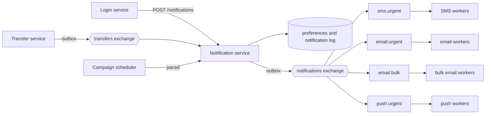

# Capstone: a multi-channel notification system

> "Design a system that sends our customers notifications by push, SMS and email."

Try answering out loud before reading on, in the time you'd have in a real interview. Then compare.

The trap in this question is that it looks like a plumbing exercise: draw a queue, draw three workers, done. The interesting part is what happens around those boxes: a notification sent twice, one that's lost, one that arrives an hour late, or a marketing campaign that holds up a one-time passcode. Every stage of this journey is one of those problems.

## 1. Clarify

The right design depends on what's being sent and what each kind of message can tolerate. Commit to your own questions first.

::: think What would you ask before proposing anything?

- **What kinds of notification?** Transaction confirmations, one-time passcodes, security alerts, statements, marketing. They have very different needs.
- **How fast must each arrive?** A passcode is useless after a few minutes; a monthly statement can wait hours.
- **What's worse for each: a duplicate or a loss?** A lost fraud alert is serious. A duplicate SMS costs money and confuses people. A duplicate marketing email barely matters.
- **What triggers them?** Events from other services, such as a transfer completing; direct requests, such as a passcode from the login service; and scheduled campaigns.
- **Can customers opt out, and of what?** Marketing, certainly. Security alerts, usually not.
- **Volumes and peaks?** How many customers, how many notifications each, and when the spikes come: month-end, payroll, a campaign.
- **Do we need to know whether it arrived?** Tracking sent, delivered and failed changes what you store and for how long.

:::

::: think The interviewer says: "Five million customers. Transaction alerts, one-time passcodes and marketing. Passcodes must arrive within seconds. A customer must never miss a transaction alert." What does that tell you about the design?

There are at least two classes of message with opposite needs: urgent and small (passcodes, alerts) and bulk and patient (marketing). They mustn't share a queue, or a campaign will delay every passcode (stage 7).

"Never miss" means at-least-once delivery all the way from the transfer's commit to the provider: an outbox, durable queues, acknowledgements after sending, and retries (stages 1, 3, 4 and 6). At-least-once means duplicates, so sending has to be idempotent (stage 3).

Passcodes going stale means they need a short time to live: an old passcode should be dropped, not delivered.

:::

## 2. Estimate

Round hard, and say your assumptions out loud.

**Transaction alerts.** Five million customers, each making two transfers a day, with one alert to each side:

> 5,000,000 × 2 × 2 = 20 million alerts a day
> 20,000,000 ÷ 86,400 ≈ 230 a second on average
> Peak, at roughly 10× average ≈ 2,300 a second

**Payroll.** Suppose a million salaries land within an hour at month-end: about 280 a second on top of the normal peak, in a burst. Stage 7 showed what a burst does to a queue whose consumers are sized for the average.

**Passcodes.** Say a million a day: about 12 a second on average, a few hundred a second at peak. Small in volume, critical in latency.

**Marketing.** A campaign to all five million customers. If the email provider's contract allows, say, 500 sends a second (check the real figure in your provider's documentation and your contract):

> 5,000,000 ÷ 500 ≈ 10,000 seconds ≈ 3 hours

So a campaign takes hours by design, and must be paced. If it shares capacity with alerts, it delays them for those hours.

**Storage.** If you keep a record of every notification, about 500 bytes each with its status history:

> 22 million a day × 500 bytes ≈ 11 GB a day ≈ 4 TB a year

That's a table to partition by time and expire, as in B1 stage 7, not one to keep forever.

The numbers that decide the design: the queues and workers handle a few thousand messages a second, which one broker cluster manages comfortably. The real limits are the providers' rates, and keeping urgent messages away from bulk ones.

## 3. Design

Start simple, and add each piece because a specific problem demands it.

1. **Take sending out of the request** ([stage 1](./01-get-it-out-of-the-request)). The transfer service doesn't call email or SMS providers. It records the transfer and moves on; a durable queue carries the work, so a crash doesn't lose it.
2. **Publish events, and let the notification service subscribe** ([stage 2](./02-queues-topics-or-streams)). The transfer service publishes "transfer completed" to a topic; the notification service is one subscriber among several (fraud, rewards, statements). It doesn't need to know who else is listening. The login service, which needs an answer quickly, calls the notification service directly instead.
3. **Publish with an outbox** ([stage 4](./04-dual-write-and-outbox)). The transfer service writes its event in the same transaction as the transfer, and a relay publishes it. Without that, a crash between the commit and the publish loses the alert, and the requirement was that customers never miss one. The notification service does the same: it records the notifications it decided to send and their outgoing messages in one transaction.
4. **Decide once, then fan out per channel.** For each event, the notification service checks preferences, picks channels and templates, and creates one notification per channel with a deterministic id, such as a hash of the event id and the channel. Each channel gets its own queues and workers, so a slow SMS provider doesn't hold up email.
5. **Make every consumer idempotent** ([stage 3](./03-delivered-twice)). At-least-once delivery means the same event or notification will arrive twice. The notification service records processed event ids in the same transaction as its work. Channel workers send the notification id to the provider as an idempotency key, where the provider supports one, and record what they've sent.
6. **Don't promise order you don't need** ([stage 5](./05-ordering)). Alerts are independent: a customer won't notice two arriving in the opposite order. Where order matters, such as "card frozen" then "card unfrozen", include a version and drop anything older than what was already sent, or partition by customer.
7. **Retry with backoff, and dead-letter what can't be sent** ([stage 6](./06-poison-messages)). Provider errors and timeouts go to retry queues with growing delays; a malformed message or an invalid phone number goes straight to a dead-letter queue, with an alert and a way to replay it. Never requeue at once, in a loop.
8. **Separate urgent from bulk, and respect provider limits** ([stage 7](./07-backpressure)). Passcodes and alerts go to urgent queues with their own workers and reserved provider capacity. Campaigns go to bulk queues, paced by the scheduler. Cap each channel's concurrency at the provider's limit, treat a 429 as "slow down" rather than as a failure, and give passcodes a short time to live so stale ones are dropped.
9. **Track status.** Providers report delivery and bounces through webhooks. Record them against the notification id, and use them for a fallback (an alert whose push wasn't delivered goes by SMS) and for cleaning up bad addresses.

## 4. Deep dive

Interviewers push wherever your answer was thinnest. Practise these.

::: details "How do you make sure a transaction alert is never lost?"
Follow it through every hop. The event is written in the transfer's transaction (an outbox), so it exists if the transfer does. The relay publishes it with publisher confirms, and only marks it published once the broker has accepted it. Queues are durable, and every consumer acknowledges only after its work is committed or sent. Failures are retried, and what can't be sent lands in a dead-letter queue that someone watches, with a way to replay it. What you can't guarantee is that the customer reads it: delivery tracking and a fallback channel cover the last step.
:::

::: details "How do you avoid sending the same SMS twice?"
You can't make delivery exactly once, but you can make the effect close to it. Give each notification a deterministic id, record it in the same transaction as the work that created it, and send it to the provider as an idempotency key where supported. The remaining gap is a worker that crashes after the provider accepted the message but before recording that: if the provider can't deduplicate, a rare duplicate is possible. Say which you'd accept for each message type: a duplicate alert is far better than a missing one.
:::

::: details "A marketing campaign delays passcodes. Why, and what do you do?"
They share a queue or provider capacity, and the campaign's millions of messages sit in front. Give urgent messages their own queues and workers, reserve part of the provider's limit for them, or use a separate provider account. Pace the campaign at a rate that leaves headroom. And give passcodes a time to live, so ones that are already too late are dropped rather than sent.
:::

::: details "The SMS provider is down for 20 minutes. What happens?"
Sends fail and go to the retry queues with backoff, so you don't hammer a struggling provider (stage 6 measured 861 failed calls with naive requeueing against 150 with backoff). Passcodes expire and are dropped; the login service can offer another channel. If outages are frequent, add a circuit breaker and a second provider to fail over to; journey B4 covers both. Afterwards, check the dead-letter queue and replay what's still worth sending.
:::

::: details "A customer opts out of marketing while a campaign is queued. What happens?"
If preferences are checked only when the campaign is planned, they still get it. Check again just before sending, at least for bulk messages, which can sit in a queue for hours. Some messages, such as security alerts, ignore marketing preferences, so preferences need to be per type of message, not one switch.
:::

::: details "Kafka or RabbitMQ?"
Either can work, and the choice matters less than the design around it (stage 2). This workload is mostly work queues: per-message acknowledgements, retries with delays, dead-lettering, time to live and separate priority queues, which RabbitMQ and similar brokers give you directly. A log such as Kafka is stronger if you need to keep and replay the event history, and many companies already run one for events between services. A common answer is both: events between services on the log, and a work queue for sending.
:::

## The answer in two minutes

> "I'd start by separating the kinds of notification, because they need different things: passcodes must arrive within seconds, transaction alerts must never be lost, and marketing is bulk and patient.
>
> Sending never happens inside the request. The transfer service writes a 'transfer completed' event to an outbox in the same transaction as the transfer, and a relay publishes it, so an alert can't be lost between the commit and the publish. The notification service subscribes, checks preferences, creates one notification per channel with a deterministic id, and publishes those through its own outbox to per-channel queues.
>
> Delivery is at least once, so every consumer is idempotent: processed event ids are recorded in the same transaction as the work, and the notification id goes to the provider as an idempotency key. Failures are retried with backoff and then dead-lettered, with alerts and replay. Urgent messages get their own queues, workers and reserved provider capacity, campaigns are paced, and each channel's concurrency is capped at what its provider accepts. Passcodes get a short time to live. Finally, provider webhooks give us delivery status, which drives fallbacks to another channel."

## What to review

If any part of your answer felt shaky, go back to its stage:

| If you were unsure about | Review |
|---|---|
| Why sending can't happen in the request | [1. Get it out of the request](./01-get-it-out-of-the-request) |
| Queues vs topics vs streams, fan-out | [2. Queues, topics or streams](./02-queues-topics-or-streams) |
| Duplicates, idempotent consumers, idempotency keys | [3. Delivered twice](./03-delivered-twice) |
| Losing events between the database and the broker | [4. The event that never got sent](./04-dual-write-and-outbox) |
| When order matters, and partitioning by key | [5. Order matters, sometimes](./05-ordering) |
| Retries, backoff, dead-letter queues | [6. Poison messages](./06-poison-messages) |
| Backlogs, provider limits, priorities | [7. The queue keeps growing](./07-backpressure) |
