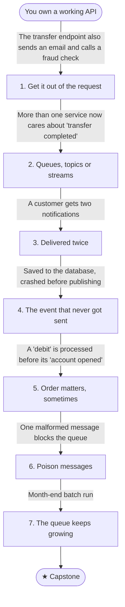

# B2: Work that shouldn't happen in the request

You own a working REST API for a banking product (accounts and transactions) backed by a relational database. It works in development. Then real life happens.

The transfer endpoint has started doing more than transferring: it sends an email and calls a fraud check before it responds. This journey moves that work out of the request and deals with what asynchronous messaging breaks along the way.

## Stage map

Each stage's fix creates the problem that triggers the next one.

| # | Stage | Triggered by |
|---|---|---|
| 1 | [Get it out of the request](./01-get-it-out-of-the-request): In-process background work vs a queue | The transfer endpoint also sends an email and calls a fraud check |
| 2 | [Queues, topics or streams](./02-queues-topics-or-streams): Picking the shape | More than one service now cares about "transfer completed" |
| 3 | [Delivered twice](./03-delivered-twice): At-least-once delivery and idempotent consumers | A customer gets two notifications |
| 4 | [The event that never got sent](./04-dual-write-and-outbox): The dual-write problem, outbox and inbox | Saved to the database, crashed before publishing |
| 5 | [Order matters, sometimes](./05-ordering): Partition keys, sessions, per-entity ordering | A "debit" is processed before its "account opened" |
| 6 | [Poison messages](./06-poison-messages): Retries, backoff, dead-letter queues, replay | One malformed message blocks the queue |
| 7 | [The queue keeps growing](./07-backpressure): Backpressure, consumer scaling, lag monitoring | Month-end batch run |
| ★ | [Capstone: a multi-channel notification system](./capstone) | — |

## Before you start

This journey assumes HTTP and REST, SQL basics and transactions, and async/await. Check yourself against the [backend core self-check](../../core-self-check) first.

## By the end you'll be able to

- Decide when work belongs in a background process, and when it needs a queue.
- Choose between queues, topics and streams.
- Build consumers that are safe when a message is delivered twice.
- Explain the dual-write problem and fix it with an outbox.
- Keep per-entity ordering where it matters, and only there.
- Handle poison messages with retries, backoff and dead-letter queues.
- Recognise a growing backlog and respond with backpressure and scaling.
