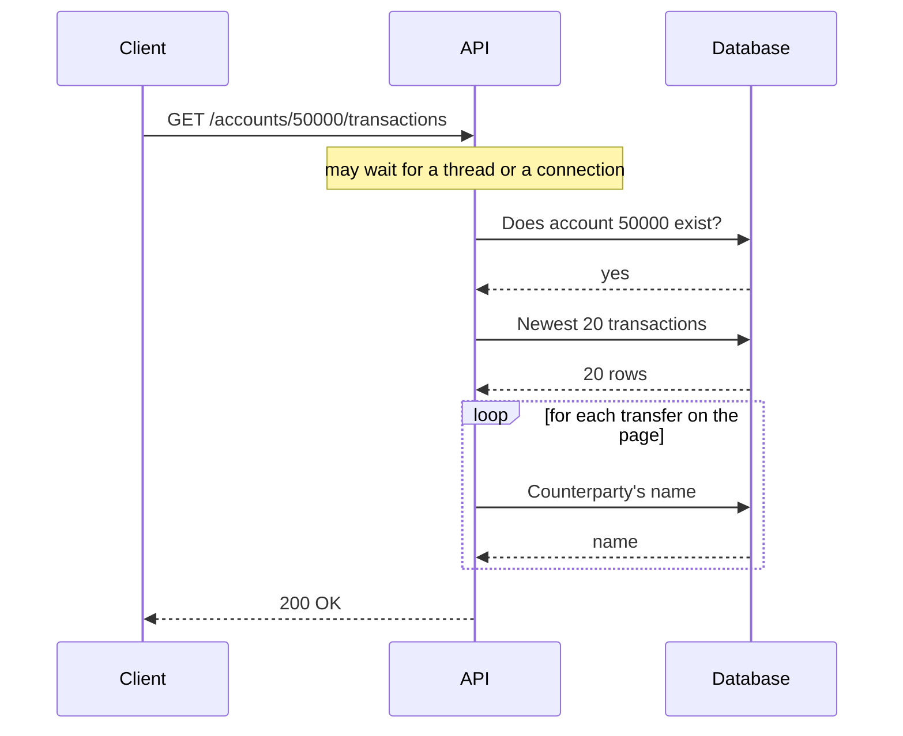

# 1. Measure first

## Where we are

The banking API went live a few months ago, and usage has grown steadily. On the last working day of the month, when salaries land and everyone checks their account, support tickets start arriving: the transactions page is slow, and sometimes it times out.

One colleague wants to add Redis. Another wants a bigger database server. Nobody has measured anything yet.

## Stop and think

::: think Before choosing between "add a cache" and "buy a bigger database", what would you want to know?

Which requests are slow, and how slow: for this endpoint, at p50, p95 and p99, not just the average. Whether they're slow when the site is quiet, or only under load. Where the time goes inside a slow request: application code, the database, the network, or waiting. And which query, if any, accounts for most of it.

Without that, both suggestions are guesses. A cache can hide the problem for a while and brings its own (stage 5). A bigger server costs money every month, and won't help much if each request is doing far more work than it needs to.

:::

::: think A request takes 350 ms when the site is quiet, but 1.5 seconds at peak. What does the difference tell you?

The 350 ms is the cost of the work itself. The extra second is waiting: at peak, requests compete for CPU, disk and database connections, so they queue behind each other.

That points to a useful order. Make each request cheaper first, because cheaper requests also spend less time queuing. If requests were fast when quiet and slow only at peak, you'd look at contention and capacity first instead, which is where stage 4 goes.

:::

::: think A request runs nine SQL queries. One takes 370 ms; the other eight take under a millisecond each. Which do you fix first?

The one that takes 370 ms. It's over 95% of the request's database time. Removing all eight small queries would save a few milliseconds at most.

Rank by total time (calls × average time), not by which code looks worst. And re-rank after each fix: once the big query is fast, those eight small queries become the largest share. That's stage 3.

:::

## The mental model

### Latency is a distribution, not a number

Requests to the same endpoint don't all take the same time, so describe them with percentiles:

- **p50** (the median): half of requests are faster than this.
- **p95**: 1 request in 20 is slower than this.
- **p99**: 1 request in 100 is slower than this.

An average hides the slow requests. If 99 requests take 20 ms and one takes 3 seconds, the average is about 50 ms. That's a response time no request actually had, and it says nothing about the customer who waited 3 seconds.

The tail matters more than it looks:

- **Pages make several calls.** A page that makes 10 API calls is only as fast as the slowest one. The chance that at least one of them is slower than your p99 is 1 − 0.99¹⁰, about 10%.
- **The slow requests are often your most important customers.** In our data, the busiest accounts have hundreds of thousands of transactions. Those are often business customers, and they're the ones who hit the slowest code paths.
- **You can't average percentiles.** The average of two servers' p99s isn't the p99 of both. Compute percentiles from the raw timings, or from histograms.

### Where the time goes in a request



A request's time is the sum of: waiting to be served, running application code, and, for every query, a network round trip plus the database's own execution time. That gives two very different kinds of database problem:

- **One expensive query.** The database does a lot of work for one statement. You fix the query or the indexes (stage 2).
- **Many cheap queries.** Each one is fast, but the round trips add up. You fix how the code talks to the database (stage 3).

Measuring tells you which one you have.

### Reading a query plan

`EXPLAIN` shows the plan the database has chosen for a query, with its estimates. `EXPLAIN ANALYZE` also runs the query and reports what actually happened. Adding `BUFFERS` shows how many 8 kB pages it touched: `shared hit` pages came from memory, and `read` pages had to come from disk or the operating system's cache.

Here's the plan for the transactions query in the lab, trimmed:

```txt
Limit  (actual time=338.6..347.0 rows=20)
  Buffers: shared hit=15851 read=70478
  ->  Gather Merge  (actual rows=20)
        Workers Launched: 2
        ->  Sort  (actual rows=13.33 loops=3)
              Sort Key: created_at DESC
              ->  Parallel Seq Scan on transactions t  (actual rows=17.33 loops=3)
                    Filter: (account_id = 50000)
                    Rows Removed by Filter: 3333316
Execution Time: 370.068 ms
```

Read it from the innermost node outwards:

- **`Parallel Seq Scan`**: three processes (the main one plus two workers) each read a third of the table, checking every row against the filter.
- **`Rows Removed by Filter: 3333316`** per process (`loops=3`): about 10 million rows read and thrown away. Each process kept 17.33 rows on average, so 52 in all.
- **`Buffers`**: about 86,000 pages, nearly 700 MB, touched for one request.
- **`Sort`, then `Limit`**: the 52 matching rows are sorted by date, and the top 20 kept.

A sequential scan isn't wrong in itself. For a small table, or a query that needs a large share of the rows, reading everything in order is cheaper than jumping around through an index. It's wrong here because the query keeps 52 rows out of 10 million.

## The escalation ladder

These are ways to measure, from cheapest to most effort. Climb until you know which query or code path to fix, then stop.

### 1. Time one request

```sh
curl -s -o /dev/null -w "%{time_total}s\n" "http://localhost:5080/accounts/50000/transactions"
```

**Tells you:** whether the endpoint is slow even when nothing else is happening.
**Costs:** nothing.
**Misses:** anything that only appears under load. The first request after a start also pays one-off costs, such as compiling code and opening connections, so run it a few times.

### 2. Measure percentiles under load

Send many concurrent requests with a realistic mix, and record every timing. The labs use a small [load generator](#try-it) whose code you can read in a few minutes; for real work, use a dedicated tool such as [k6](https://grafana.com/docs/k6/latest/), or your production metrics.

**Tells you:** the shape of the distribution, and how it changes as load increases.
**Costs:** setup, and a realistic dataset. A load test against an empty development database tells you nothing.
**Breaks:** a load test against a shared or production system can cause the very incident you're investigating. Don't point one at production without agreement.

### 3. Split a slow request's time

Log every query with its duration, then compare the database's share with the whole request, and count the queries. In EF Core, turn on command logging. In production, distributed tracing gives you the same split for every request; journey B8 covers it.

**Tells you:** whether it's one expensive query, many cheap ones, or not the database at all.
**Costs:** log volume.
**Breaks:** verbose SQL logging is expensive to leave on, and query parameters can contain personal data. EF Core hides parameter values by default; keep it that way in production.

### 4. Ask the database which queries cost the most

Postgres's [`pg_stat_statements`](https://www.postgresql.org/docs/current/pgstatstatements.html) (or Query Store in SQL Server) records every query shape with its call count and total time. Sort by total time to see where the database actually spends its effort.

**Tells you:** the biggest consumers across all traffic, not only the request you happened to catch.
**Costs:** it must be enabled when the server starts, and adds a small overhead.
**Misses:** parameter values. Queries are recorded with placeholders, so you still need a real example to run `EXPLAIN` on.

### 5. Read the plan

Run [`EXPLAIN (ANALYZE, BUFFERS)`](https://www.postgresql.org/docs/current/using-explain.html) on the top query, with realistic parameter values and production-sized data.

**Tells you:** why the query is slow: which scans, sorts and joins it does, and how much data they touch.
**Breaks:** `EXPLAIN ANALYZE` really runs the statement. For `INSERT`, `UPDATE` or `DELETE`, wrap it in `BEGIN; … ROLLBACK;`.
**Watch out:** plans depend on the parameters and the data. The best plan for an account with 50 transactions can differ from the best plan for one with 200,000, as stage 2 shows.

## Trade-offs at a glance

| Technique | Tells you | Costs | Watch out for |
|---|---|---|---|
| Time one request | Slow even when quiet? | Nothing | Warm-up costs; misses load effects |
| Load test with percentiles | The distribution, and how it degrades | Setup; realistic data | Never against production uninvited |
| Per-query logging or tracing | Time split; queries per request | Log volume | Personal data in parameters |
| `pg_stat_statements` | The biggest queries overall | Restart to enable; small overhead | Placeholders instead of values |
| `EXPLAIN (ANALYZE, BUFFERS)` | Why one query is slow | Runs the query | Plans change with parameters and data |

## Traps

- **Trusting the average.** It hides exactly the requests customers complain about.
- **Measuring against an empty database.** Every query is fast against 100 rows. Plans, and timings, only mean something on realistic data.
- **Fixing the slowest query instead of the most expensive one.** A 2-second report that runs twice a day matters less than a 50 ms query that runs a thousand times a minute.
- **Timing only the first request.** It includes one-off warm-up costs, so it's slower than normal.
- **Running `EXPLAIN ANALYZE` on a `DELETE`.** It deletes the rows.
- **Trusting a simple load generator when the server is overloaded.** Tools like the one in the labs wait for each response before sending the next request. When the server slows down, they send less, which hides how bad it would be for real users, who don't slow down. This is called coordinated omission. It doesn't matter for comparing two versions under the same load, but use a tool with a fixed arrival rate (k6 has one) to find out how much load you can actually take.

::::: trap
A colleague adds latency reporting to a test harness. What's wrong with this percentile function?

```csharp
// Returns the p-th percentile (0 < p <= 1) of response times, in milliseconds.
static double Percentile(List<double> timings, double p) =>
    timings[(int)(timings.Count * p)];
```

::: details Answer
Two bugs. The list isn't sorted, so it returns whichever timing happens to sit at that position: a random sample, not a percentile. And for `p = 1.0` the index equals `Count`, which throws `ArgumentOutOfRangeException`.

Sort first, then use a defined method. The lab's load generator uses the nearest-rank method, clamped so it can't go out of range:

<<< @/../samples/tools/Bank.Load/Program.cs#percentile
:::
:::::

## In the interview

::::: interview
**Usually asked as:** "Users say the API is slow. How do you investigate?" Or, more pointedly: "An endpoint got slow at peak. Walk me through it."

**Short answer:** "I'd measure before changing anything. First, latency percentiles for that endpoint, to see how bad the tail is and whether it's slow when quiet or only under load. Then I'd split a slow request's time between application, database and network, and ask the database which queries cost the most in total. For the top query, I'd read `EXPLAIN ANALYZE` to see why. Only then would I pick a fix, starting with the cheapest."

::: details Follow-up: why percentiles rather than the average?
The average hides the slow requests, and can sit where no request actually is. Percentiles show the experience of the slowest 5% or 1% of requests, which is who complains. Pages that make several calls are as slow as their slowest call, so the tail affects far more users than its name suggests.
:::

::: details Follow-up: p50 is fine, but p99 is terrible. Where do you look?
At what's different about the slow requests. Group them by customer, endpoint, parameters and time. Common causes: a few customers with far more data than average, cold caches, lock waits, garbage-collection pauses, or one slow downstream call. In this journey's data, the busiest accounts have thousands of times more transactions than the median.
:::

::: details Follow-up: how do you find the expensive queries in production without adding logging?
The database already knows. In Postgres, `pg_stat_statements`; in SQL Server, Query Store. Sort by total time, not average. Application performance monitoring or tracing also shows query time per request, if it's in place. A slow-query log (`log_min_duration_statement` in Postgres) catches individual slow statements.
:::

::: details Follow-up: what's the difference between EXPLAIN and EXPLAIN ANALYZE?
`EXPLAIN` shows the chosen plan and the planner's estimates, without running the query. `EXPLAIN ANALYZE` runs it and adds actual row counts and timings, so you can compare estimates with reality. A big gap between estimated and actual rows usually means the planner's statistics are stale or insufficient. Because `ANALYZE` runs the statement, wrap writes in a transaction you roll back.
:::

::: details Follow-up: the plan shows a sequential scan. Is that always bad?
No. For small tables, or queries that need a large share of the rows, reading everything in order is cheaper than using an index. It's a problem when the scan reads far more rows than the query keeps, which `Rows Removed by Filter` shows.
:::
:::::

## Try it

The lab runs against the sample banking API on your machine. From the `samples` folder of the repository (see its README for prerequisites):

1. **Start and seed it.** Seeding generates 10 million transactions and takes one to three minutes.

   ```sh
   docker compose up -d
   dotnet run --project src/Bank.Api -- seed
   dotnet run --project src/Bank.Api
   ```

2. **Time a few single requests** from another terminal. Run each a few times, so warm-up doesn't skew the result.

   ```sh
   curl -s -o /dev/null -w "%{time_total}s\n" "http://localhost:5080/accounts/50000/transactions"
   curl -s -o /dev/null -w "%{time_total}s\n" "http://localhost:5080/accounts/1/transactions"
   ```

3. **Turn on query statistics**, then reset them so they only cover your test:

   ```sh
   docker compose exec postgres psql -U bank -d bank -c "CREATE EXTENSION IF NOT EXISTS pg_stat_statements" -c "SELECT pg_stat_statements_reset()"
   ```

4. **Measure under load.** Eight workers request random accounts for 20 seconds:

   ```sh
   dotnet run --project tools/Bank.Load -- --seconds 20
   ```

   Write down p50, p95 and p99: stage 2 compares against them. On our test machine (8 cores, Postgres in Docker Desktop) this managed 4.4 requests a second, with p50 at 1.4 s and p99 at 3.6 s. Your numbers will differ; the shape won't.

5. **Ask Postgres where the time went:**

   ```sh
   docker compose exec postgres psql -U bank -d bank -c "
     SELECT calls, round(total_exec_time) AS total_ms, round(mean_exec_time::numeric, 1) AS mean_ms,
            left(regexp_replace(query, '\s+', ' ', 'g'), 80) AS query
     FROM pg_stat_statements ORDER BY total_exec_time DESC LIMIT 5"
   ```

   In our run, the transactions query was 99.7% of the database's time. The counterparty lookups ran about seven times per request, at 0.6 ms each.

6. **Count the queries in one request.** Stop the API, restart it with SQL logging, and request one page:

   ```sh
   dotnet run --project src/Bank.Api -- --Logging:LogLevel:Microsoft.EntityFrameworkCore.Database.Command=Information
   ```

   Each `Executed DbCommand` line is one round trip, with its duration.

7. **Read the plan** for the expensive query:

   ```sh
   docker compose exec postgres psql -U bank -d bank -c "
     EXPLAIN (ANALYZE, BUFFERS)
     SELECT id, account_id, amount, counterparty_account_id, created_at, description
     FROM transactions WHERE account_id = 50000
     ORDER BY created_at DESC LIMIT 20"
   ```

No Docker to hand? The playground below runs the same query against a smaller copy of the data (250,000 transactions), right in your browser. The plan has the same shape: a sequential scan, with almost every row removed by the filter.

```sql playground
EXPLAIN (ANALYZE, BUFFERS)
SELECT id, account_id, amount, counterparty_account_id, created_at, description
FROM transactions
WHERE account_id = 2500
ORDER BY created_at DESC
LIMIT 20;
```

## What breaks next

Nothing is fixed yet, but now there's evidence instead of opinions. One query is nearly all of the database's time, and its plan reads all 10 million rows to return 20. The table has no index the query can use.

Next: [2. Indexes and query shape](./02-indexes-and-query-shape).
