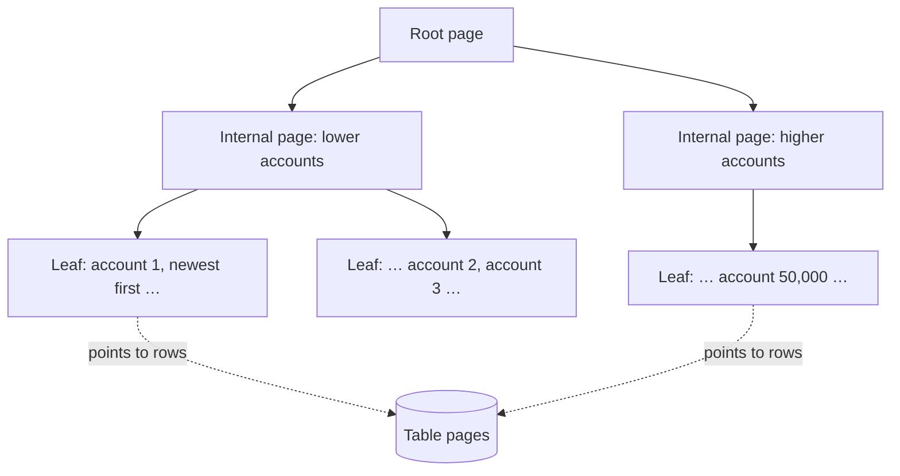

# 2. Indexes and query shape

## Where we are

Stage 1 replaced opinions with evidence. One query, "the newest 20 transactions for an account", accounts for nearly all of the database's time. Its plan reads all 10 million rows to return 20, because the `transactions` table has no index except its primary key.

## Stop and think

::: think You add an index on account_id. Typical accounts get much faster. What happens for account 1, which has 216,000 transactions?

It barely improves. The index finds account 1's rows quickly, but the query wants the newest 20, and an index on `account_id` alone says nothing about dates. So the database still fetches all 216,000 rows and sorts them to find the top 20.

In the lab, a typical account went from 370 ms to 2.5 ms. Account 1 stayed at about 400 ms.

:::

::: think A composite index on (account_id, created_at) or on (created_at, account_id): does the order matter?

Yes, a lot. A composite index is sorted by the first column, then by the second within each value of the first, like a phone book sorted by surname, then first name.

With `(account_id, created_at DESC)`, one account's entries sit together, already newest first. Postgres jumps to the account, reads 20 entries and stops. With `(created_at, account_id)`, entries are sorted by date across all accounts, so one account's rows are scattered through the whole index.

Rule of thumb: columns you compare with `=` first, then the column you filter by range or sort on.

:::

::: think If indexes make reads so much faster, why not index every column?

Because every index has to be updated on every write to its columns, takes disk space, and competes for memory. In the lab, inserting a million rows took 3.5 s with only the primary key, 6.2 s with one composite index, and 10.3 s with three extra indexes.

An index nobody queries is pure cost. Index the queries you actually run, and check `pg_stat_user_indexes` for indexes that are never used.

:::

## The mental model

### What an index is

A B-tree index is a sorted copy of one or more columns, where each entry points to its row in the table. The sorted entries sit in leaf pages, linked in order, with a few levels of pages above them to find the right leaf quickly. Simplified, for an index on `(account_id, created_at DESC)`:



The tree stays shallow. The primary key on the lab's 10-million-row table is three levels deep, so finding one row by id reads three pages instead of 86,000.

### How the database uses an index

- **Index Scan**: walk down the tree to the first matching entry, read entries in order, and fetch each row from the table. Ideal when few rows match, or when the index order is the order you need.
- **Bitmap Heap Scan**: when many rows match, first collect their locations from the index, then read the table pages in physical order. Fewer random reads than fetching rows one by one.
- **Index Only Scan**: when every column the query needs is in the index, skip the table altogether. Postgres can only do this for rows it knows every transaction can see. It tracks that in a *visibility map*, which `VACUUM` keeps up to date.
- **Seq Scan**: when a large share of the rows match, reading the whole table in order is cheaper than any of the above.

### Selectivity and the planner

The planner estimates how many rows each condition will match using statistics about the data, gathered by `ANALYZE` (Postgres's autovacuum refreshes them automatically). It then costs each possible plan and picks the cheapest.

So an index on a column that matches most rows, such as `currency = 'ZAR'` in our data, won't be used, and shouldn't be. When `EXPLAIN ANALYZE` shows estimated rows far from actual rows, the statistics are stale or too coarse, and the planner is choosing on bad information.

### Query shape: keep the indexed column bare

An index on `created_at` stores `created_at` values in order. It doesn't store `date_part('year', created_at)`, or `lower(description)`, or `created_at + interval '1 day'`. Wrap the column in a function or expression, and the database has to compute it for every candidate row instead of jumping to the right range.

Conditions that can use an index are called *SARGable* (from "search argument"). Write them as comparisons on the bare column:

| Not SARGable | SARGable |
|---|---|
| `date_part('year', created_at) = 2025` | `created_at >= '2025-01-01' AND created_at < '2026-01-01'` |
| `lower(description) = 'salary'` | `description = 'Salary'`, or an index on `lower(description)` |
| `description LIKE '%fee'` | `description LIKE 'Bank%'` (prefix only, with a suitable index) |

## The escalation ladder

### 1. Index the column you filter on

```sql
CREATE INDEX CONCURRENTLY ix_transactions_account_id ON transactions (account_id);
```

**Fixes:** most requests. In the lab, a typical account's query went from 370 ms to 2.5 ms. Under load, throughput went from 4.4 to 270 requests a second, and p99 from 3.6 s to 67 ms.
**Costs:** 68 MB of disk (the table is 674 MB), 7 seconds to build here, and extra work on every insert.
**Breaks:** nothing visible, but the busiest accounts are still slow. Account 1 still took about 400 ms, because it fetches and sorts 216,000 rows. Under load, that showed up as a 399 ms maximum.
**Don't stop here when:** the query also sorts or ranges over another column.

### 2. A composite index that matches the filter and the order

```sql
CREATE INDEX CONCURRENTLY ix_transactions_account_id_created_at
    ON transactions (account_id, created_at DESC);
DROP INDEX CONCURRENTLY ix_transactions_account_id;  -- now redundant
```

**Fixes:** the busy accounts too. Account 1 went from about 400 ms to 0.18 ms: Postgres reads 20 index entries and stops, with no sort. Under load: 350 requests a second, p99 45 ms, maximum 116 ms.
**Costs:** 301 MB, more than four times the single-column index. Postgres compresses repeated values in a single-column index, but every entry here has a distinct timestamp. It took 11 seconds to build.
**Breaks:** nothing, if you drop the single-column index it replaces. The composite index also serves queries that filter on `account_id` alone, because that's its leading column.

### 3. A covering index, for hot queries that read many rows

```sql
CREATE INDEX CONCURRENTLY ix_transactions_account_created_covering
    ON transactions (account_id, created_at DESC) INCLUDE (amount);
```

`INCLUDE` stores extra columns in the index without sorting by them, so a query that needs only those columns can skip the table: an *index-only scan*.

**Fixes:** queries that touch many rows. In the lab we included `amount`, `description` and `counterparty_account_id`, so the transactions page could use the index too. Summing account 1's last year (108,000 transactions) went from 145 ms to 36 ms, reading 835 pages instead of 40,139.
**Costs:** size. That index was 600 MB, almost as big as the table, and every write to an included column now updates it as well. Include only the columns the query needs.
**Breaks:** nothing, but it often doesn't pay. For the 20-row page it saved 0.05 ms, because the composite index already reads just 20 rows.
**Don't use it when:** the query reads only a handful of rows, or the included columns change often.

### 4. Change the query to fit the index

Sometimes the index is fine and the query defeats it. A statement filtered with `date_part('year', created_at) = 2025` took 210 ms for account 1 in the lab; the same filter written as a date range took 0.2 ms. The index on `(account_id, created_at)` could narrow the first query to account 1, but then had to check every one of its rows.

**Fixes:** queries that can't use an index because of their shape.
**Costs:** a code change.
**Watch out:** the same applies to queries an ORM writes for you; check the SQL it generates (see [Traps](#traps)).

### 5. Partial and expression indexes, for specific shapes

A *partial index* covers only the rows a query cares about, such as `CREATE INDEX … ON transactions (account_id) WHERE description = 'Salary'` for a job that finds salary payments. An *expression index* stores a computed value, such as `lower(email)`, so a query on that exact expression can use it.

**Fixes:** a specific, important query, with a smaller index than a full one.
**Breaks:** nothing else, but it only helps queries whose conditions match the index's predicate or expression exactly.
**Don't use it when:** a plain composite index would serve the query well enough.

### Adding an index to a live table

A plain `CREATE INDEX` blocks every write to the table until it finishes. On a busy production table, that's an outage. `CREATE INDEX CONCURRENTLY` lets writes continue, at a price:

- it takes longer, because it scans the table twice and waits for running transactions to finish;
- it can't run inside a transaction;
- if it fails part-way, it leaves an `INVALID` index behind that you must drop and try again.

In EF Core with the Npgsql provider, mark the index as concurrent and the migration does the rest. It generates `CREATE INDEX CONCURRENTLY` and runs it outside a transaction:

```csharp
transaction.HasIndex(t => new { t.AccountId, t.CreatedAt })
    .IsDescending(false, true)
    .IsCreatedConcurrently();
```

Other databases have their own equivalents and limits; check their documentation before relying on them.

## Trade-offs at a glance

| Option | Fixes | Costs | Watch out for | Reach for it when |
|---|---|---|---|---|
| Single-column index | Most lookups by that column | Small index; write cost | Sorts and ranges on other columns stay slow | One column does the filtering |
| Composite index | Filter plus sort or range in one pass | Bigger index | Column order; drop indexes it makes redundant | The query filters on one column and sorts or ranges on another |
| Covering index (`INCLUDE`) | Skips the table for many-row reads | Index can approach table size | Needs a vacuumed table; little gain for small reads | A hot query reads many rows and few columns |
| SARGable rewrite | Lets an existing index work | A code change | ORMs can generate non-SARGable SQL | A function or expression wraps an indexed column |
| Partial or expression index | One specific query shape | Another index to maintain | Only matching queries can use it | One important query has a predictable shape |

## Traps

- **Wrong column order.** `(created_at, account_id)` can't find one account's rows quickly. Equality columns first.
- **Overlapping indexes.** An index on `(account_id)` alongside `(account_id, created_at)` costs writes and space, and adds nothing.
- **Indexing a column that matches most rows.** The planner rightly ignores it, so all you get is the write cost.
- **Stale statistics after a bulk load.** The planner may still think the table is small. Run `ANALYZE` after loading data.
- **Testing a plan with one parameter value.** The plan for an account with 50 transactions can differ from the plan for one with 200,000. Test both.
- **Plain `CREATE INDEX` on a busy table.** It blocks writes until it finishes.

::::: trap
A colleague adds an annual statement endpoint. The table has an index on `(account_id, created_at DESC)`, yet the endpoint is slow for busy accounts. Why?

```csharp
// All of an account's transactions in one calendar year, newest first.
public static Task<List<Transaction>> StatementAsync(BankDb db, int accountId, int year, CancellationToken ct) =>
    db.Transactions
        .Where(t => t.AccountId == accountId && t.CreatedAt.Year == year)
        .OrderByDescending(t => t.CreatedAt)
        .ToListAsync(ct);
```

::: details Answer
EF Core translates `t.CreatedAt.Year == year` into `date_part('year', t.created_at AT TIME ZONE 'UTC')::int = @year`. That's a function wrapped around the indexed column, so the index can narrow the search to the account, but then every one of the account's transactions has to be checked. For account 1, that's 216,000 rows.

Filter on a half-open range of the bare column instead:

```csharp
var start = new DateTimeOffset(year, 1, 1, 0, 0, 0, TimeSpan.Zero);
var end = start.AddYears(1);

return db.Transactions
    .Where(t => t.AccountId == accountId && t.CreatedAt >= start && t.CreatedAt < end)
    .OrderByDescending(t => t.CreatedAt)
    .ToListAsync(ct);
```

Use `< end`, not `<= 31 December 23:59:59`, so nothing in the last second is missed. And decide which time zone a "year" means. The original code silently used UTC; for South African customers, the year actually starts two hours earlier.
:::
:::::

## In the interview

::::: interview
**Usually asked as:** "This query is slow on a large table. How would you index it?" You're often shown something like `SELECT … WHERE account_id = ? ORDER BY created_at DESC LIMIT 20`.

**Short answer:** "I'd check the plan first, then index for the whole query, not just the filter: a composite index on `(account_id, created_at DESC)`. That lets the database jump to the account and read the first 20 entries already in order, with no sort. I'd build it concurrently so writes aren't blocked, drop any index it makes redundant, and confirm with `EXPLAIN ANALYZE` on both a typical account and a very busy one."

::: details Follow-up: why does the column order matter?
The index is sorted by its first column, then by the second within each value of the first. Equality columns first keeps each account's entries together; the sort or range column second keeps them in the order the query needs. Reversed, the account's entries are scattered across the index.
:::

::: details Follow-up: you added an index, but the planner doesn't use it. Why?
Common reasons: the condition wraps the column in a function or cast, so it isn't SARGable; the condition matches a large share of rows, so a sequential scan really is cheaper; the statistics are stale; the table is small; or the index's leading column isn't in the condition. `EXPLAIN ANALYZE` and the estimated-versus-actual row counts usually show which.
:::

::: details Follow-up: when is a covering index worth it?
When a hot query reads many rows but few columns, so skipping the table saves a lot of random reads. It costs index size and write work, and in Postgres it needs the table well vacuumed. For a query that reads 20 rows, it rarely pays.
:::

::: details Follow-up: how do you add an index to a 500 GB table that's taking writes?
`CREATE INDEX CONCURRENTLY`, ideally at a quiet time. Check there's disk space for the new index, watch the build's progress (`pg_stat_progress_create_index`) and any replica lag, and check afterwards that it isn't left `INVALID`. Through a migration tool, make sure it runs outside a transaction.
:::

::: details Follow-up: what does an index cost?
Write amplification (every insert, and every update to indexed columns, also updates the index), disk space, memory competing with the data itself, more vacuum work, and more plans for the planner to consider. Unused indexes are all cost and no benefit.
:::
:::::

## Try it

### In your browser

These playgrounds share one database, a smaller copy of the lab data. In it, account 1 has 14,612 transactions and account 2500 has 30. Run them in order.

**Before:** no index, so every query scans the whole table.

```sql playground
EXPLAIN ANALYZE
SELECT id, amount, description, created_at
FROM transactions
WHERE account_id = 1
ORDER BY created_at DESC
LIMIT 20;
```

**Rung 1:** a single-column index. Compare the typical account with the busy one: account 1 still fetches all its rows, then sorts them.

```sql playground
CREATE INDEX IF NOT EXISTS ix_account ON transactions (account_id);

EXPLAIN ANALYZE
SELECT id, amount, description, created_at FROM transactions
WHERE account_id = 2500 ORDER BY created_at DESC LIMIT 20;

EXPLAIN ANALYZE
SELECT id, amount, description, created_at FROM transactions
WHERE account_id = 1 ORDER BY created_at DESC LIMIT 20;
```

**Rung 2:** a composite index. The sort disappears, and so does most of the work.

```sql playground
DROP INDEX IF EXISTS ix_account;
CREATE INDEX IF NOT EXISTS ix_account_created ON transactions (account_id, created_at DESC);

EXPLAIN ANALYZE
SELECT id, amount, description, created_at FROM transactions
WHERE account_id = 1 ORDER BY created_at DESC LIMIT 20;
```

**Rung 3:** a covering index, for a query that reads thousands of rows. Run this, and notice the planner doesn't use the new index yet.

```sql playground
CREATE INDEX IF NOT EXISTS ix_account_created_amount
    ON transactions (account_id, created_at DESC) INCLUDE (amount);

EXPLAIN ANALYZE
SELECT count(*), sum(amount) FROM transactions
WHERE account_id = 1 AND created_at >= now() - interval '1 year';
```

It doesn't know which rows every transaction can see, so an index-only scan would still have to visit the table. `VACUUM` records that in the visibility map. It has to run on its own, outside any transaction:

```sql playground
VACUUM transactions;
```

Now run the covering-index playground above again. You should see an `Index Only Scan` with `Heap Fetches: 0`.

**Rung 4:** the same question, asked two ways. Look for `Rows Removed by Filter` in the first plan.

```sql playground
EXPLAIN ANALYZE
SELECT id, amount, created_at FROM transactions
WHERE account_id = 1 AND date_part('year', created_at AT TIME ZONE 'UTC') = 2025
ORDER BY created_at DESC LIMIT 20;

EXPLAIN ANALYZE
SELECT id, amount, created_at FROM transactions
WHERE account_id = 1 AND created_at >= '2025-01-01' AND created_at < '2026-01-01'
ORDER BY created_at DESC LIMIT 20;
```

### Against the lab database

With the lab running from stage 1, in the `samples` folder:

1. **Rung 1.** Build the single-column index, then repeat stage 1's single requests and load test:

   ```sh
   docker compose exec postgres psql -U bank -d bank -c "CREATE INDEX CONCURRENTLY ix_transactions_account_id ON transactions (account_id)"
   curl -s -o /dev/null -w "%{time_total}s\n" "http://localhost:5080/accounts/50000/transactions"
   curl -s -o /dev/null -w "%{time_total}s\n" "http://localhost:5080/accounts/1/transactions"
   dotnet run --project tools/Bank.Load -- --seconds 20
   ```

2. **Rung 2.** Swap it for the composite index, and measure again:

   ```sh
   docker compose exec postgres psql -U bank -d bank \
     -c "CREATE INDEX CONCURRENTLY ix_transactions_account_id_created_at ON transactions (account_id, created_at DESC)" \
     -c "DROP INDEX CONCURRENTLY ix_transactions_account_id"
   dotnet run --project tools/Bank.Load -- --seconds 20
   ```

   Keep this index: stage 3 builds on it.

3. **Compare sizes:**

   ```sh
   docker compose exec postgres psql -U bank -d bank -c "
     SELECT indexrelname, pg_size_pretty(pg_relation_size(indexrelid)) AS size, idx_scan AS times_used
     FROM pg_stat_user_indexes WHERE relname = 'transactions'"
   ```

On our test machine, the results looked like this. Yours will differ in scale, but not in shape:

| | Requests per second | p50 | p99 | Maximum |
|---|---|---|---|---|
| No index (stage 1) | 4.4 | 1,444 ms | 3,622 ms | 3,622 ms |
| Index on `account_id` | 270 | 28 ms | 67 ms | 399 ms |
| Index on `(account_id, created_at DESC)` | 350 | 22 ms | 45 ms | 116 ms |

## What breaks next

The query that dominated stage 1 now takes a fraction of a millisecond, yet the endpoint's median is still over 20 ms. Turn the SQL logging from stage 1 back on and request one page: there are nine queries. One checks that the account exists, one fetches the page, and then there's one more for every transfer on the page, to look up the counterparty's name.

Next: [3. What is the ORM doing?](./03-what-is-the-orm-doing)
