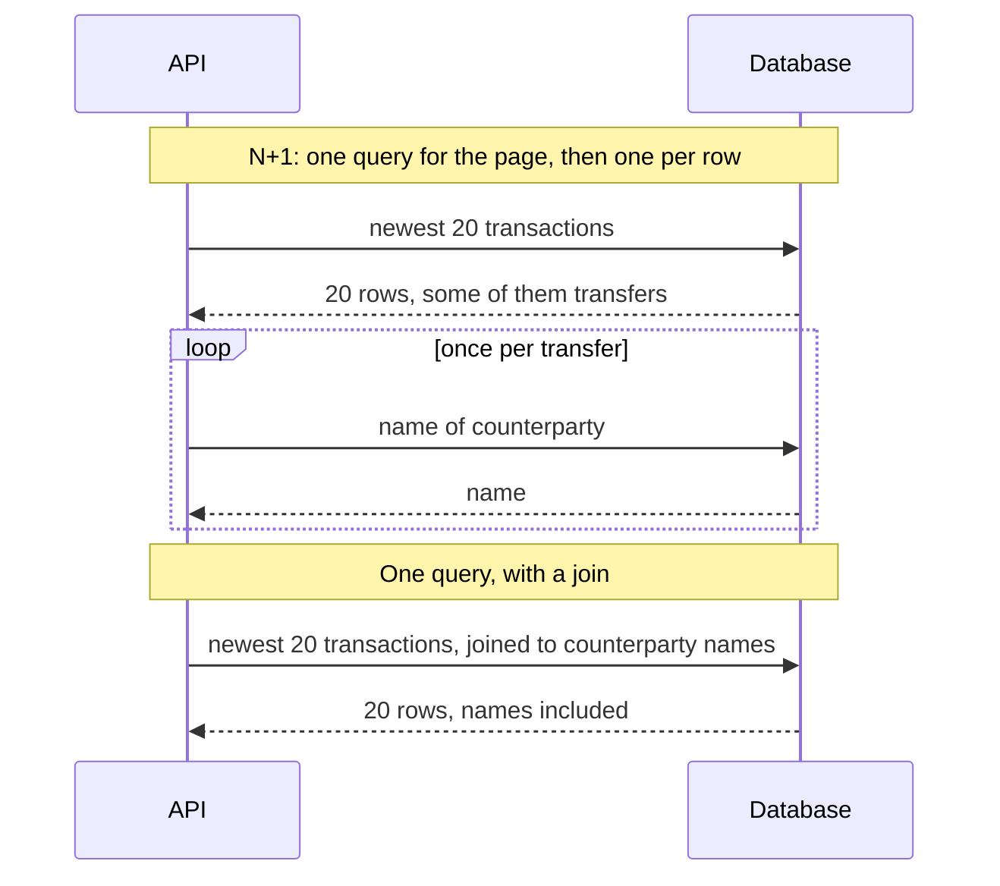

# 3. What is the ORM doing?

## Where we are

Stage 2's composite index took the expensive query from 400 ms to a fraction of a millisecond. Yet the endpoint's median is still over 20 ms. The SQL log shows why: every request runs nine queries. One checks the account exists, one fetches the page, and then there's one more for every transfer on the page, to look up the counterparty's name.

## Stop and think

::: think Each of the nine queries takes well under a millisecond. Why does the request still take over 20 ms?

Because the cost isn't only in the database's execution time. Every query is a round trip: the request goes over the network, the database parses and plans it, the result comes back, and the driver reads it. Nine round trips per request also means nine statements for the database to handle per request, so under load it handles nine times the traffic it needs to.

On one machine the round trips are cheap. With the database on another server, as it usually is in production, each one costs more, so the difference grows.

:::

::: think The code loads full Transaction entities, then copies three or four fields into the response. What does that cost?

The database reads and sends every column, whether the response uses it or not. Here that's only six columns, but real tables often carry dozens, including large text or JSON. More bytes cross the network, more memory is allocated, and the database can't answer from an index alone. With change tracking on, EF Core also keeps a snapshot of every entity it loads, in case you change it.

:::

::: think A customer's app pages back through two years of history, or an export job reads every page. Page 5,000 is a hundred times slower than page 1. Why?

`OFFSET` doesn't jump. To return rows 100,001 to 100,020, the database produces the first 100,020 rows in order and throws 100,000 away. Each page costs more than the one before. In the lab, page 1 took 4 ms and page 5,000 took 400 ms.

There's a correctness problem too. If a new transaction arrives while someone is paging, every row shifts down by one, so the next page repeats the last row they saw.

:::

## The mental model

### The N+1 query problem



The database still looks up each counterparty in the second version, but inside one query, without a round trip for each one. In the browser playground's plan you can see it: an index lookup on `accounts` that runs once per transfer, all within a single statement.

ORMs make N+1 easy to write by accident. A loop that queries inside it is easy to spot. Lazy loading is not: with it enabled, simply touching `transaction.CounterpartyAccount.HolderName` runs a query. The same thing can hide in a mapping layer or a serializer. Count the queries per request, not just their durations.

### Ask for exactly what you need

A projection, a `Select` into the shape the response needs, changes what EF Core sends to the database:

- only the listed columns are selected;
- a navigation property used inside the projection becomes a `JOIN`;
- nothing is tracked, because the results aren't entities.

<<< @/../samples/src/Bank.Api/Endpoints/AccountEndpoints.cs#projected

EF Core turns that into one statement:

```sql
SELECT t0.id, t0.amount, t0.description, t0.created_at, a.holder_name
FROM (
    SELECT t.id, t.amount, t.counterparty_account_id, t.created_at, t.description
    FROM transactions AS t
    WHERE t.account_id = @id
    ORDER BY t.created_at DESC
    LIMIT @p2 OFFSET @p
) AS t0
LEFT JOIN accounts AS a ON t0.counterparty_account_id = a.id
ORDER BY t0.created_at DESC
```

### Offset paging and keyset paging

**Offset paging** (`OFFSET n LIMIT 20`) asks for "page 5,000". The database counts its way there, so the cost grows with the page number.

**Keyset paging**, also called cursor or seek paging, asks for "the 20 rows after the last one I saw". The client sends back the position of that last row, and the query starts from it:

```sql
SELECT … FROM transactions
WHERE account_id = @id
  AND (created_at, id) < (@lastCreatedAt, @lastId)
ORDER BY created_at DESC, id DESC
LIMIT 20;
```

With an index on `(account_id, created_at DESC, id DESC)`, that's a jump to one spot in the index followed by reading 20 entries, at any depth. In the lab, keyset pages cost 3 to 6 ms whether they were page 1 or page 10,000.

Two details make it correct:

- **A tie-breaker.** Two transactions can share a timestamp, for example when a batch of debit orders lands at once. Ordering by `(created_at, id)` gives every row a unique position, so none is skipped or repeated at a page boundary.
- **An opaque cursor.** Encode the position as a token the client passes back unchanged, not as fields it should build itself. That leaves you free to change what's inside it later.

## The escalation ladder

### 1. Count the queries

Turn on SQL logging and request one page, or assert on the query count in an integration test. In EF Core, the `Microsoft.EntityFrameworkCore.Database.Command` log category logs every statement with its duration.

**Fixes:** nothing yet, but it shows the problem. Here: nine queries per request.
**Costs:** nothing.
**Watch out:** turn verbose logging back off afterwards.

### 2. Fetch related data in the same query

Join to the related table, through a projection (as above) or with `Include` when you need full entities. If a join isn't possible, for example because the names come from another service, batch the lookups instead: collect the ids and fetch them all with one `WHERE id IN (…)` query. That's two round trips however many rows the page has.

**Fixes:** the N+1. In the lab, nine queries became one; p50 went from 26 ms to 6.5 ms, and throughput from 295 to 1,133 requests a second, with the same index and data.
**Costs:** a slightly more complex query.
**Breaks:** `Include` on a collection, or several of them, can multiply rows, because each parent row is repeated for every child. That's the "cartesian explosion". EF Core's `AsSplitQuery` trades it for one query per collection.

### 3. Select only the columns you need

Project into the response shape rather than loading entities.

**Fixes:** wasted reads, network transfer and memory. It also makes index-only scans possible.
**Costs:** a DTO per shape.
**Breaks:** you can't modify a projection and call `SaveChanges`. For writes, load the entity, tracked. For read-only queries of whole entities, use `AsNoTracking`.

### 4. Cap how deep offset paging can go

If the product needs page numbers, limit them: the first 50 pages, say, with filters or search to reach older items.

**Fixes:** the worst deep-page costs, without changing the API's shape.
**Costs:** a product decision.
**Breaks:** nothing, for people. Exports and integrations that page through everything need another route, such as rung 5.

### 5. Keyset paging

Replace `page` with a cursor. The lab API has both, so you can compare them: `/transactions?page=…` uses offsets, and `/transactions/feed?cursor=…` uses keyset paging:

<<< @/../samples/src/Bank.Api/Endpoints/AccountEndpoints.cs#keyset

**Fixes:** deep pages (offset page 5,000: 400 ms; keyset at any depth: 3 to 6 ms) and rows repeating when new data arrives.
**Costs:** an API change, and an index that matches the sort order including the tie-breaker. In the lab, `(account_id, created_at DESC, id DESC)` is 387 MB; it replaces stage 2's 301 MB index.
**Breaks:** "jump to page 50", and a cheap total count. Clients can only go forwards (or backwards, with a second cursor). Changing the sort order needs a matching index.
**Don't use it when:** users really need numbered pages over a small, slow-changing list.

## Trade-offs at a glance

| Option | Fixes | Costs | Watch out for |
|---|---|---|---|
| Count queries | Shows N+1 | Nothing | Leaving verbose logging on |
| Join or projection | N+1 round trips | A more complex query | Row explosion with collection `Include`s |
| Batched lookups (`IN`) | N+1 where you can't join | Two round trips | Very long `IN` lists |
| Select only needed columns | Over-fetching | A DTO per shape | Can't save changes through a projection |
| Cap offset depth | Worst deep-page cost | A product decision | Exports still need another route |
| Keyset paging | Deep-page cost; shifting rows | API change; matching index | No page numbers; needs a tie-breaker |

## Traps

- **Lazy loading in a loop or a serializer.** Each property access can be a query. It never shows up in the code as one.
- **Tracking queries on read-only paths.** EF Core snapshots every tracked entity. Use projections or `AsNoTracking` for reads.
- **Several collection `Include`s in one query.** Rows multiply. Measure, and consider split queries.
- **Offset paging for feeds and exports.** Cost grows with depth, and rows shift as data arrives.
- **Asking for a total count on every page.** `COUNT(*)` over 216,000 rows isn't free. Show "more" instead of "page 1 of 10,800", or cache the count.

::::: trap
This is the transactions endpoint as it was first written. It's correct, and it was fast in development. Find the problem.

<<< @/../samples/src/Bank.Api/Endpoints/AccountEndpoints.cs#naive

::: details Answer
The loop runs one query per transfer on the page, an N+1: with a 20-row page, about seven extra round trips; at the maximum page size of 100, about 35. It also checks the account exists with a separate query on every request, and loads whole entities to use four of their fields.

The fix is the projected version above: one query with a join, and the existence check only when the page comes back empty.
:::
:::::

::::: trap
A teammate writes keyset paging ordered by timestamp alone. It passes every test. In production, customers sometimes see transactions missing from their history. Why?

```csharp
var page = await db.Transactions
    .Where(t => t.AccountId == accountId && t.CreatedAt < lastSeenCreatedAt)
    .OrderByDescending(t => t.CreatedAt)
    .Take(pageSize)
    .ToListAsync(ct);
```

::: details Answer
Timestamps aren't unique. When several transactions share a `created_at`, for example a batch of debit orders processed together, and a page boundary falls among them, `<` skips the rest of that batch on the next page. Switching to `<=` repeats rows instead.

The test data had unique timestamps, so the tests couldn't catch it. Add a unique tie-breaker to the ordering and to the condition, `(created_at, id) < (@lastCreatedAt, @lastId)`, and to the index.
:::
:::::

## In the interview

::::: interview
**Usually asked as:** "What's the N+1 query problem, and how do you fix it?" Or as a design question: "How would you paginate a transaction history API?"

**Short answer:** "N+1 is one query for a list and then one more per item, usually from an ORM loop or lazy loading. Each query is fast, but the round trips add up, and the database handles many times the statements it needs to. I'd count queries per request to find it, and fix it with a join or projection, or a batched `IN` lookup when the data lives elsewhere. For transaction history, I'd use keyset paging with an opaque cursor on `(created_at, id)`, backed by an index in that order, so every page costs the same and new transactions don't shift what the client has already seen."

::: details Follow-up: how do you find N+1 problems in an existing codebase?
Log queries per request in development, or assert on query counts in integration tests for important endpoints. In production, tracing shows many near-identical database calls under one request. `pg_stat_statements` shows a cheap query with a huge call count.
:::

::: details Follow-up: when would you use Include, a projection, or a split query?
A projection for read endpoints: it fetches only what the response needs. `Include` when you need full entities, typically to modify them. A split query when including one or more collections would multiply rows; it trades that for one round trip per collection.
:::

::: details Follow-up: what does keyset paging give up?
Jumping to an arbitrary page, and an easy total count. Clients move forwards, or backwards with a second cursor. The sort order is fixed by the index, and each new sort order needs its own index. For most feeds, histories and exports, that's the right trade.
:::

::: details Follow-up: why does the cursor need the id as well as the timestamp?
To give every row a unique position. Without it, rows that share a timestamp at a page boundary are either skipped or repeated, depending on whether the condition uses `<` or `<=`.
:::

::: details Follow-up: offset paging returned the same transaction on two pages. How?
A new transaction arrived between the two requests. It took the first position, shifted every row down by one, and pushed the last row of page 1 onto page 2. Keyset paging avoids this, because each page starts from a fixed position rather than a count.
:::
:::::

## Try it

### In your browser

The playgrounds below share a database. Run the first to build the index the rest rely on.

```sql playground
CREATE INDEX IF NOT EXISTS ix_account_created_id
    ON transactions (account_id, created_at DESC, id DESC);

-- One query instead of N+1: the join looks up each counterparty inside the database.
EXPLAIN ANALYZE
SELECT t.id, t.amount, t.description, t.created_at, a.holder_name AS counterparty
FROM transactions t
LEFT JOIN accounts a ON a.id = t.counterparty_account_id
WHERE t.account_id = 1
ORDER BY t.created_at DESC, t.id DESC
LIMIT 20;
```

Account 1 has 14,612 transactions in this smaller dataset. Here's page 701 by offset: watch the database sort almost all of them to throw 14,000 away.

```sql playground
EXPLAIN ANALYZE
SELECT id, amount, created_at FROM transactions
WHERE account_id = 1
ORDER BY created_at DESC, id DESC
LIMIT 20 OFFSET 14000;
```

Now the same page by keyset. First, pretend the client has sent us its cursor: the last row of page 700.

```sql playground
DROP TABLE IF EXISTS last_seen;
CREATE TEMP TABLE last_seen AS
SELECT created_at, id FROM transactions
WHERE account_id = 1
ORDER BY created_at DESC, id DESC
OFFSET 13999 LIMIT 1;
```

Then fetch the next page from that position. Look at the `Index Cond`: the database starts at the cursor.

```sql playground
EXPLAIN ANALYZE
SELECT id, amount, created_at FROM transactions
WHERE account_id = 1
  AND (created_at, id) < (SELECT created_at, id FROM last_seen)
ORDER BY created_at DESC, id DESC
LIMIT 20;
```

### Against the lab database

With the lab running and stage 2's composite index in place, from the `samples` folder:

1. **Count the queries.** Restart the API with SQL logging (`Ctrl+C` stops it), and request one page. Count the `Executed DbCommand` lines:

   ```sh
   dotnet run --project src/Bank.Api -- --Logging:LogLevel:Microsoft.EntityFrameworkCore.Database.Command=Information
   curl -s -o /dev/null "http://localhost:5080/accounts/1/transactions"
   ```

2. **Measure the naive version**, with logging off:

   ```sh
   dotnet run --project src/Bank.Api
   dotnet run --project tools/Bank.Load -- --seconds 20
   ```

3. **Switch to the projected version** and measure again. It's the same endpoint and the same data; only the query code differs:

   ```sh
   dotnet run --project src/Bank.Api -- --Lab:Transactions=Projected
   dotnet run --project tools/Bank.Load -- --seconds 20
   ```

4. **Go deep with offsets.** Time pages 1, 1,000 and 5,000 for the busiest account:

   ```sh
   for page in 1 1000 5000; do
     curl -s -o /dev/null -w "page $page: %{time_total}s\n" "http://localhost:5080/accounts/1/transactions?page=$page"
   done
   ```

5. **Switch to keyset paging.** Swap the index for one with the tie-breaker, then read the feed and follow its `nextCursor`:

   ```sh
   docker compose exec postgres psql -U bank -d bank \
     -c "CREATE INDEX CONCURRENTLY ix_transactions_account_id_created_at_id ON transactions (account_id, created_at DESC, id DESC)" \
     -c "DROP INDEX CONCURRENTLY ix_transactions_account_id_created_at"
   curl -s "http://localhost:5080/accounts/1/transactions/feed?pageSize=3"
   dotnet run --project tools/Bank.Load -- --seconds 20 --path "/accounts/{id}/transactions/feed"
   ```

Our results, for comparison:

| | Queries per request | Requests per second | p50 | p99 |
|---|---|---|---|---|
| Naive (stage 2's index) | 9 | 295 | 26 ms | 56 ms |
| Projected | 1 | 1,133 | 6.5 ms | 17 ms |
| Keyset feed | 1 | 1,655 | 4.3 ms | 12 ms |

| Offset page for account 1 | 1 | 1,000 | 5,000 | 10,000 |
|---|---|---|---|---|
| Offset paging | 4 ms | 13 ms | 400 ms | 500 ms |
| Keyset paging | 3 to 6 ms at every depth | | | |

## What breaks next

Each request is now one fast query, and the API handled over 1,600 requests a second in the lab. So we turned the concurrency up, to see how it copes at peak. At 64 concurrent workers, throughput stopped growing at about 1,800 requests a second, and p99 rose to 166 ms. At 256 workers, p99 was almost 400 ms, and the slowest request took 1.4 seconds. Meanwhile, each query still took a fraction of a millisecond. The requests aren't slow; they're waiting for something.

Next: [4. Too many connections](./04-too-many-connections).
