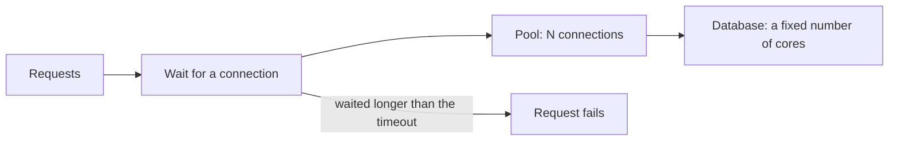

# 4. Too many connections

## Where we are

After stage 3, each request is one fast query, and the API handled over 1,600 requests a second in the lab. Then we turned up the concurrency. Throughput stopped growing at about 1,800 requests a second, and latency climbed: p99 was 166 ms with 64 concurrent workers, and almost 400 ms with 256, with the slowest request taking 1.4 seconds. Each query still took a fraction of a millisecond. The requests weren't slow; they were waiting.

## Stop and think

::: think The default pool allows 100 connections. You sample Postgres while 64 workers hammer the API. How many connections do you expect to be running a query at any moment?

Far fewer than you'd think. In the lab, the pool had opened about 65 connections, but on average only 8 were running a query (32 at the busiest moment). The rest sat idle between queries.

That's Little's Law at work: connections in use = queries per second × how long each query holds its connection. At about 1,000 requests a second, with each request holding a connection for around 8 ms, that's about 8 busy connections.

:::

::: think Requests are queuing for connections. A colleague suggests raising the pool size from 100 to 300. What happens?

In the lab, Postgres started refusing connections: "sorry, too many clients already". The database's own limit, `max_connections`, was 100, so the pool asked for more than it could have. Throughput fell to a third, and p99 rose to five seconds.

Even within the limit, more connections isn't more capacity. The database has a fixed number of CPU cores, and queries beyond that number share them, so each runs slower. In the lab, a pool of 100 had a slightly better median than a pool of 50, but roughly double the p99.

:::

::: think One endpoint calls an async database method and blocks on `.Result` instead of awaiting it. It works in testing. What happens at peak?

The thread handling the request sits blocked while the database works, instead of returning to the thread pool to serve other requests. Under load, every thread ends up blocked, and the database's replies can't be processed, because that also needs free threads. .NET adds threads to the pool only gradually, so a sudden spike can starve it.

In the lab, a sudden burst of 256 concurrent requests made every request time out after 30 seconds, and the API's health check stopped responding too. The async version handled the same burst at 700 to 900 requests a second, without errors.

:::

## The mental model

### Little's Law

For any stable system, the average number of things inside it equals the rate they arrive times the average time each one spends there:

> **L = λ × W**: items in the system = arrival rate × time in the system

Apply it to a connection pool: busy connections = queries per second × how long each one holds a connection. That's why making queries faster (stages 2 and 3) is the biggest lever on connection use. It's also why holding a connection while doing something slow, like calling another service mid-transaction, multiplies the connections you need.

### What happens near capacity

A pool, a CPU, a checkout queue: any resource that serves requests at a fixed rate behaves the same way. At low utilisation there's almost no waiting. As utilisation approaches 100%, waiting grows sharply, not gradually, because random bursts no longer have spare capacity to drain into. Above 100%, the queue grows for as long as the overload lasts.

That's why latency can be fine at 60% load and terrible at 95%, with nothing broken.



### What a pool is for

Opening a Postgres connection is expensive: the server starts a new process, authenticates and allocates memory for it. A pool keeps connections open and lends them out, one query or transaction at a time. It also caps how many queries one application instance can run at once. When every connection is lent out, the next request waits, up to a timeout.

Two limits sit above the pool:

- **The database's `max_connections`.** Every application instance has its own pool. Four instances with a pool of 100 each need 400 connections from a server that may allow 100.
- **The database's cores.** Queries beyond the core count share CPU, so each one slows down. Past a point, more connections only means more waiting inside the database.

### Threads, async and blocking

In ASP.NET Core, a request runs on a thread pool thread. When the code `await`s a database call, the thread goes back to the pool to serve other requests until the reply arrives. When the code blocks on the call instead, with `.Result`, `.Wait()` or `GetAwaiter().GetResult()`, the thread stays occupied the whole time.

Older advice warns that blocking causes deadlocks. That's true where there's a synchronisation context, as in classic ASP.NET or UI apps. ASP.NET Core has none, so blocking doesn't deadlock there. It starves the thread pool instead, and the effect is the same at peak: requests stop being served.

## The escalation ladder

### 1. Hold connections for less time

Faster queries (stages 2 and 3) free connections sooner. So does releasing them promptly: don't keep a transaction, and with it a connection, open while calling another service or doing slow work in the application.

**Fixes:** connection demand at its source, through Little's Law.
**Costs:** the work of stages 2 and 3, and some care with transaction scope.
**Breaks:** nothing.

### 2. Async all the way

`await` every I/O call, from the endpoint down to the database driver. Pass the request's `CancellationToken` through, so a query is cancelled when the client gives up.

**Fixes:** thread-pool starvation. In the lab: with the blocking version, a sudden burst timed out every request and the API used about 200 threads. With the async version, the same burst completed 700 to 900 requests a second on about 45 threads.
**Costs:** async signatures all the way up the call chain.
**Breaks:** nothing.

### 3. Size the pool from measurements

Measure how many connections are actually busy (`pg_stat_activity`, or the driver's metrics) at peak, and use Little's Law to see where that's heading. A small multiple of the database's core count is a common starting point; the PostgreSQL wiki's page on [the number of database connections](https://wiki.postgresql.org/wiki/Number_Of_Database_Connections) explains why. Then check the total across every application instance against `max_connections`, leaving room for administration and replication.

**Fixes:** both queuing for a pool that's too small, and contention from one that's too big.
**Costs:** measurement, and revisiting as traffic changes.
**Breaks:** too small caps throughput (a pool of 5 managed about 700 requests a second in the lab, versus about 1,000 with 20). Too large worsens the tail (a pool of 100 had about double the p99 of a pool of 50) and can exceed `max_connections` outright.

### 4. Set timeouts on purpose

Decide how long a request should wait for a connection, how long a query may run, and how long the whole request may take, and make them consistent with each other. In Npgsql, the connection string's `Timeout` covers waiting for a pooled connection (default 15 seconds), and `Command Timeout` covers each query.

**Fixes:** overload turning into very slow failures. In the lab, with a pool of 5 and slow queries, the default 15-second wait gave a median response of 15 seconds, many of them errors anyway. With a 1-second wait, requests failed in 1 second instead.
**Costs:** more visible errors under overload, which is the point: fail fast, and let clients retry later.
**Breaks:** a timeout shorter than legitimate work. Base it on measured query times.
**Watch out:** no timeout creates capacity. It only decides how long people wait for an answer you can't give.

### 5. Limit concurrency at the front door

Rather than letting every request in to queue for a connection, cap how many the API works on at once, and reject the rest quickly with a 503 or 429. ASP.NET Core's [rate limiting middleware](https://learn.microsoft.com/aspnet/core/performance/rate-limit) includes a concurrency limiter. Journey B4 covers rate limiting and load shedding properly.

**Fixes:** queues that grow without bound under overload; protects the database.
**Costs:** some requests rejected at peak.
**Breaks:** clients that don't handle 429 or 503 well, especially ones that retry immediately.

### 6. A connection pooler in front of the database

When many application instances, or many short-lived processes such as serverless functions, each want their own pool, a pooler such as [PgBouncer](https://www.pgbouncer.org/) can multiplex thousands of client connections onto a small number of server connections. Managed database services often offer one built in; check your provider's documentation.

**Fixes:** `max_connections` exhaustion across many instances.
**Costs:** another component to run and monitor, and another network hop.
**Breaks:** in transaction pooling mode, anything that relies on one session across transactions: session-level `SET`, advisory locks, `LISTEN`, and, depending on the version, prepared statements. Check what your driver and code rely on.

## Trade-offs at a glance

| Option | Fixes | Costs | Watch out for |
|---|---|---|---|
| Hold connections less | Connection demand at its source | Query and transaction work | Slow calls inside transactions |
| Async all the way | Thread-pool starvation | Async signatures everywhere | Hidden `.Result` in libraries or startup code |
| Measured pool size | Queuing and contention | Measurement | Total across instances vs `max_connections` |
| Deliberate timeouts | Slow failures under overload | Visible errors | Timeouts shorter than real work |
| Concurrency limit | Unbounded queues | Rejected requests at peak | Clients that retry immediately |
| Connection pooler | Too many connections from many instances | Another component | Session features in transaction mode |

## Traps

- **Raising the pool size to fix slowness.** If the database is the bottleneck, more connections make every query slower.
- **Forgetting other instances.** Pool size × instances must stay under `max_connections`, with room to spare.
- **Long waits for a connection.** They turn overload into slow errors and growing queues.
- **Holding a connection during an HTTP call.** Little's Law multiplies the connections you need by however long the call takes.
- **Not passing the `CancellationToken`.** When a client gives up, its query keeps running and keeps its connection.

::::: trap
A developer needed the transactions page inside a synchronous helper, so they called the async version and took `.Result`. It passed every test, and it works when you click through the site. What happens at peak?

<<< @/../samples/src/Bank.Api/Endpoints/AccountEndpoints.cs#blocking

::: details Answer
`.Result` blocks the request's thread until the query finishes, so the thread can't serve anything else meanwhile. Under load, every thread pool thread ends up blocked, and the database's replies can't be processed either, because that needs free threads too. .NET adds threads only gradually, so a sudden burst starves the pool.

In the lab, a burst of 256 concurrent requests against this version timed out every request after 30 seconds, and even the health check stopped responding. Make the method async and `await` the call, all the way up.
:::
:::::

## In the interview

::::: interview
**Usually asked as:** "Your API slows down under load, even though every query is fast. What's going on?" Or: "How would you size a connection pool?"

**Short answer:** "Requests are probably queuing for something: database connections, threads, or CPU. I'd check how many connections are actually busy and how long requests wait for one. Little's Law says busy connections equal queries per second times how long each holds a connection, so I'd first make queries hold them for less time and make sure nothing blocks on async code. Then I'd size the pool from measurements, near a small multiple of the database's cores, keeping the total across instances under `max_connections`, and set a short wait timeout so overload fails fast instead of queuing."

::: details Follow-up: why not just set the pool to 1,000?
The database can't use them. Beyond its core count, concurrent queries share CPU and each one slows down. Postgres runs a process per connection, so memory grows too, and `max_connections` is usually far lower than 1,000 anyway. You'd convert a queue in the application into contention in the database, or into outright connection errors.
:::

::: details Follow-up: what's wrong with calling .Result in ASP.NET Core?
It blocks a thread pool thread for the duration of the I/O. There's no synchronisation context in ASP.NET Core, so it doesn't deadlock the classic way, but under load it starves the thread pool, and the pool adds threads only gradually. The symptom is everything getting slow at once, including endpoints that don't touch the database.
:::

::: details Follow-up: how should the timeouts relate to each other?
From the inside out, each should be shorter than the one wrapping it: a query timeout shorter than the request timeout, and the request timeout shorter than the client's or load balancer's. The connection wait should be short, because waiting doesn't create capacity. Pass cancellation through, so abandoned requests stop using the database.
:::

::: details Follow-up: what does PgBouncer do, and what does it break?
It multiplexes many client connections onto a few server connections. In transaction mode, a client only holds a server connection for the duration of a transaction, which lets many application instances share a small `max_connections`. It breaks anything that assumes one session across transactions, such as session `SET` commands, advisory locks and `LISTEN`, and in some versions, prepared statements.
:::

::: details Follow-up: four API instances each have a pool of 50, and Postgres allows 100 connections. What happens at peak?
Up to 200 connection attempts against a limit of 100. Once the limit is reached, new connections are refused with "too many clients", so some requests fail. Either size the pools to fit (about 20 each, leaving headroom for administration), or put a pooler in front of the database.
:::
:::::

## Try it

### The simulator

Requests arrive at random, wait for a pooled connection, then run a query that needs a share of the database's CPU. Try the scenarios in order, giving each about 20 seconds:

- **Comfortable** to **Near capacity**: the load goes from 63% to 94%. The median rises a little; p99 rises much more.
- **Overloaded**: once demand exceeds capacity, the queue grows for as long as the overload lasts, and latency climbs towards the timeout.
- **Overloaded, short timeout**: requests fail after a second instead of waiting 15 seconds. The same number complete either way.
- **Overloaded, pool of 50**: the database has 8 cores, so 50 connections complete no more queries than 10. They just wait inside the database instead of in the pool.

<PoolSimulator />

### Against the lab database

With the lab running from stage 3, from the `samples` folder. Several steps restart the API with different settings: stop the running one with `Ctrl+C` first.

1. **Count busy connections under load.** Start a load test, and while it runs, sample Postgres from another terminal:

   ```sh
   dotnet run --project src/Bank.Api -- --Lab:Transactions=Projected
   dotnet run --project tools/Bank.Load -- --seconds 30 --concurrency 64 --path "/accounts/{id}/transactions/feed"
   ```

   ```sh
   docker compose exec postgres psql -U bank -d bank -c "
     SELECT state, count(*) FROM pg_stat_activity
     WHERE datname = 'bank' AND backend_type = 'client backend' GROUP BY state"
   ```

2. **Try different pool sizes.** Pass a whole connection string to override the pool size, then repeat the load test with 128 workers. Try 10, 50 and 100:

   ```sh
   dotnet run --project src/Bank.Api -- --Lab:Transactions=Projected \
     "--ConnectionStrings:Bank=Host=localhost;Port=5433;Database=bank;Username=bank;Password=bank;Maximum Pool Size=10"
   dotnet run --project tools/Bank.Load -- --seconds 15 --concurrency 128 --path "/accounts/{id}/transactions/feed"
   ```

   Run each a few times: on a laptop, results vary by a factor of two from run to run. In ours, pool 10 gave a p50 of 118 to 193 ms and a p99 of 175 to 574 ms; pool 50, about 95 ms and 220 to 280 ms; pool 100, about 80 ms and 460 ms.

3. **Exceed `max_connections`.** Use `Maximum Pool Size=300` with 256 workers, and watch the API's log for "too many clients".

4. **Block on async code.** Restart the API with `--Lab:Transactions=Blocking`, and send a sudden burst to the offset endpoint. While it runs, try the health check from another terminal:

   ```sh
   dotnet run --project tools/Bank.Load -- --seconds 10 --concurrency 256
   curl -m 5 http://localhost:5080/health
   ```

   Then repeat with `--Lab:Transactions=Projected`.

5. **Fail fast.** With a pool of 5 and deep, slow pages, compare the default 15-second wait with `Timeout=1` in the connection string:

   ```sh
   dotnet run --project tools/Bank.Load -- --seconds 20 --concurrency 64 --path "/accounts/1/transactions?page=5000"
   ```

## What breaks next

Each request is now cheap, the pool fits the database, and overload fails fast instead of piling up. But look at what the requests actually ask for. At peak, most are for the first page of the same accounts, and the answer only changes when a new transaction arrives. The database computes the same result over and over, and its CPU, not the pool, is now the limit.

Next: [5. Cache it, then invalidate it](./05-cache-then-invalidate).
