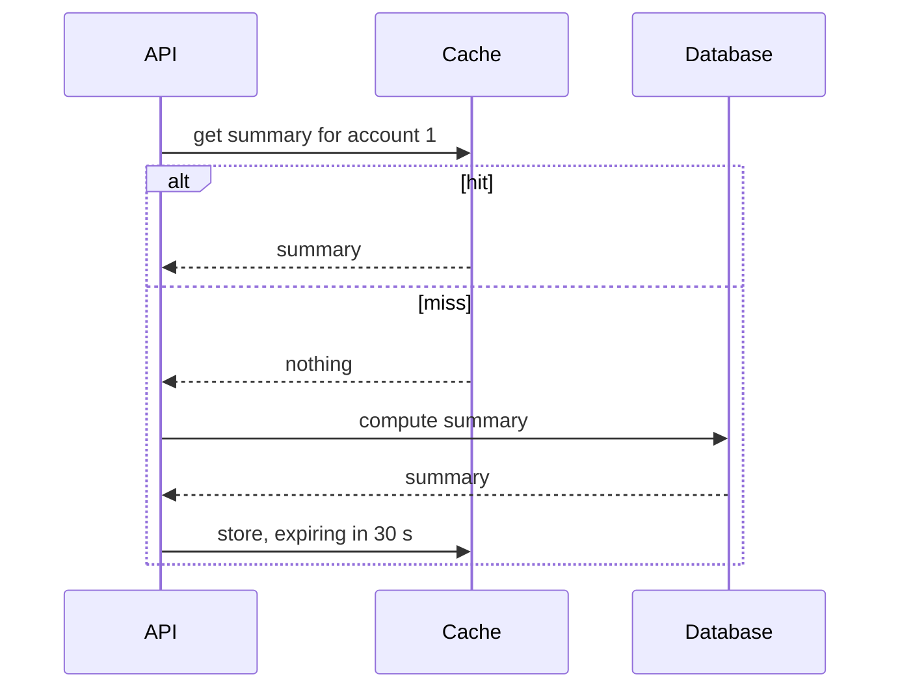

# 5. Cache it, then invalidate it

## Where we are

Stage 4 left the API efficient and well behaved under load. But the traffic has a shape: at peak, most requests are for a few busy accounts, and for the same answers again and again. The account summary is the worst offender. It computes the balance, transaction count and last activity from the account's whole history. For account 1, that's 216,000 rows and about 700 ms, every time anyone asks. The answer only changes when a new transaction arrives.

## Stop and think

::: think A cache will clearly help the summary. Before adding one, what do you need to decide?

How stale an answer may be, and who is affected if it is. What triggers a change, and whether you can detect every change. Where the cache lives: inside each API instance, or shared between them. What happens when a popular entry expires, or when the cache itself is unavailable. And whether the read could simply be made cheaper, or precomputed, instead.

A cache is a second copy of the data, and copies can be wrong. Most of caching is managing that.

:::

::: think The summary is cached for 30 seconds. A customer pays for something and immediately reopens the app. What do they see?

It depends on where the request lands. If it hits an instance that invalidated its cache when the payment was written, they see the new balance. If it hits another instance, they see the old balance for up to 30 seconds. In the lab, a second API instance served the stale summary for exactly the remaining TTL.

For a balance a customer is looking at, that might be acceptable with an "as of" time. For a balance used to approve a payment, it isn't: that check must read the source of truth.

:::

::: think 300 requests a second read one cached entry. Its TTL expires, and recomputing it takes 700 ms. What happens in that 700 ms?

With plain cache-aside, every request that arrives in that window misses and starts its own recompute: about 200 copies of the same 700 ms query, all at once. They compete for connections and CPU, so each takes far longer, and more requests miss in the meantime. That's a cache stampede.

In the lab, 64 workers hammering one account made concurrent copies of the query jump from 1 to 69 at every expiry, and the unlucky requests took up to 18 seconds. With request coalescing, one caller recomputed while the others waited for its result: one query per expiry.

:::

## The mental model

### What's worth caching

A cache pays off when a read is frequent, expensive, and changes far less often than it's read, and when a slightly stale answer is acceptable. The arithmetic is simple. If 90% of requests hit the cache, the database does a tenth of the work; at 99%, a hundredth.

The account summary qualifies on all counts for most uses. Some reads never do: anything that must be exact at the moment of a decision, such as the balance that decides whether a payment goes through. Journey B3 deals with those.

### Cache-aside



The application owns the logic: look in the cache, and on a miss, compute the value and store it. The time to live (TTL) bounds how stale an entry can get. Invalidating the entry when the data changes keeps it fresher than the TTL alone, but only for the writes that invalidate it.

### Where the cache lives

- **In-process** (`IMemoryCache`): no network hop, and nothing else to run. But every API instance has its own copy, so an invalidation on one instance doesn't reach the others, and each instance starts cold after a restart.
- **Distributed** (Redis, for example): one copy shared by every instance, which survives application restarts. Each lookup costs a network round trip and serialisation, and the cache becomes another component to run, which can fail.
- **Both**: a small in-process cache in front of a shared one. .NET's [HybridCache](https://learn.microsoft.com/aspnet/core/performance/caching/hybrid) works this way when you configure a distributed cache behind it. It also coalesces concurrent misses for the same key.

### Stampedes

A popular entry expiring is the dangerous moment. Ways to stop the stampede:

- **Request coalescing**, or single flight: one caller recomputes and the others wait for its result.
- **Serve stale while refreshing**: answer immediately with the expired value, and refresh it in the background. Fast, but older answers.
- **Jittered TTLs**: entries filled at the same moment, such as after a deployment, shouldn't all expire at the same moment.

## The escalation ladder

### 1. Make the read cheaper, or keep the answer up to date

Before caching, ask whether the read can be cheaper (stages 2 and 3), or whether the answer can be maintained as the data changes. For a balance, real systems store the current balance and update it in the same transaction as each new transaction; B3 covers how to do that safely.

**Fixes:** the cost at its source, with no second copy to go stale.
**Costs:** schema and write-path changes, and maintaining the value correctly under concurrency.
**Breaks:** nothing, if done transactionally.

### 2. Cache-aside in each instance, with a TTL

<<< @/../samples/src/Bank.Api/Endpoints/SummaryEndpoints.cs#cache-aside

**Fixes:** repeated work on hot reads. In the lab, with 80% of requests going to the 100 busiest accounts, throughput went from 43 to 1,247 requests a second, and p50 from 1.05 s to 7.8 ms.
**Costs:** memory in each instance, and answers up to one TTL old.
**Breaks:** freshness, and every popular entry is a stampede waiting to happen. p99 was still 870 ms: the requests that missed, plus the stampedes when hot entries expired.

### 3. Invalidate on write, after the commit

<<< @/../samples/src/Bank.Api/Endpoints/SummaryEndpoints.cs#invalidate

**Fixes:** staleness after writes that go through this code, on this instance.
**Costs:** every write path has to remember to invalidate.
**Breaks:** other instances keep their copies until the TTL expires. Writes that bypass the code, such as a batch job or a data fix, invalidate nothing. Keep the TTL as a safety net, never infinite.

### 4. Stop stampedes

Use a cache that coalesces misses, as HybridCache does, or serve stale entries while refreshing:

<<< @/../samples/src/Bank.Api/Endpoints/SummaryEndpoints.cs#hybrid

**Fixes:** the expiry spike. In the lab, with every request for account 1 and a 2-second TTL, cache-aside ran 82 to 129 copies of the query in 20 seconds, with requests taking up to 18 seconds. HybridCache ran 8, at most one per expiry, and served 10,000 to 12,600 requests a second with a p99 of 13 to 21 ms. Under the mixed hot load from rung 2, p99 fell from 870 ms to 258 ms.
**Costs:** requests that arrive during a recompute wait for it; with serve-stale, they get older data instead.
**Breaks:** nothing.

### 5. A shared cache, in front of or behind the local one

Add a distributed cache, such as Redis, so every instance shares one copy and invalidations reach them all. With HybridCache, that's configuration: register an `IDistributedCache` and it becomes the second level.

**Fixes:** per-instance staleness and cold starts, and lets you run many instances without each hitting the database for the same keys.
**Costs:** a network hop per lookup, serialisation, and another component to run, secure and monitor.
**Breaks:** availability, if you're not careful. When the shared cache is down, every request goes to the database at once. Decide in advance whether the API degrades, sheds load, or fails, and test it.

### 6. Push changes instead of waiting for TTLs

When freshness really matters across many instances or services, publish an event when the data changes and let every holder of a copy invalidate or update it. That's a messaging problem; journey [B2](/backend/journeys/work-outside-the-request/) covers it.

**Fixes:** staleness across instances and services, within the time it takes to deliver the event.
**Costs:** a message broker, and handling lost, duplicated and out-of-order events.
**Breaks:** simplicity. Keep TTLs as a backstop anyway.

## Trade-offs at a glance

| Option | Fixes | Costs | Watch out for |
|---|---|---|---|
| Cheaper or maintained value | Cost at its source | Write-path changes | Correctness under concurrency (B3) |
| In-process cache-aside + TTL | Repeated hot reads | Memory; staleness up to the TTL | Stampedes; per-instance copies |
| Invalidate after commit | Staleness after local writes | Discipline on every write path | Other instances; writes that bypass the code |
| Coalescing or serve-stale | Expiry stampedes | Waiting, or older data | Nothing much: use it |
| Shared cache (Redis) | Cross-instance staleness; cold starts | Network hop; another component | Cache outage sends everything to the database |
| Push invalidation events | Staleness across services | A broker; event handling | Lost or reordered events |

## Traps

- **Caching what must be exact.** A cached balance is fine to display, with care, but never to authorise a payment.
- **A cache key that leaves out who it's for.** A summary cached under a key without the account id serves one customer's data to another.
- **No TTL, with invalidation only.** Miss one write path, and the entry is wrong forever.
- **Everything expiring together.** Entries filled at the same moment expire at the same moment. Add jitter.
- **Treating the cache as a dependency that can't fail.** Code paths that throw when the cache is unavailable turn a cache outage into an API outage.

::::: trap
A developer adds invalidation to the endpoint that records a transaction. Customers still sometimes see their old balance for the full 30 seconds after paying. Why?

```csharp
// Clear the cached summary, then record the transaction.
memory.Remove(CacheKey(id));
db.Transactions.Add(transaction);
await db.SaveChangesAsync(ct);
```

::: details Answer
The cache is cleared before the new transaction is committed. If another request for the same summary arrives in between, it misses, reads the database, which doesn't contain the new transaction yet, and caches the old summary for another full TTL.

Invalidate after the commit, as the lab API does. Even then a narrower race remains: a request that read the database just before the commit can store its result just after the invalidation. That's why the TTL stays as a safety net.
:::
:::::

## In the interview

::::: interview
**Usually asked as:** "How would you reduce database load for a hot read, like an account summary?" Often followed by: "How do you keep the cache consistent?"

**Short answer:** "First I'd check whether the read can be made cheaper, or the value maintained as data changes. If caching is right, I'd use cache-aside with a TTL that matches how stale the data may be, invalidate after each write commits, and use request coalescing or stale-while-revalidate so a popular entry expiring doesn't cause a stampede. With several instances, I'd either accept staleness up to the TTL or add a shared cache, and I'd decide up front what happens when the cache is down. And I wouldn't cache anything that has to be exact at the moment of a decision."

::: details Follow-up: cache-aside, write-through or write-behind?
Cache-aside: the application fills the cache on reads. Simple and common, but the first read after a change pays the cost. Write-through: writes update the cache and the database together, so reads stay warm, but every write pays for the cache too, and the two can still diverge on failures. Write-behind: writes go to the cache and reach the database later. Fast, but data can be lost if the cache fails before writing back. It's rarely appropriate for money.
:::

::: details Follow-up: how do you invalidate across several instances?
With in-process caches, you mostly can't, so you bound staleness with the TTL. A shared cache gives one copy for everyone to invalidate. If each instance also keeps a local copy, publish invalidation messages (Redis pub/sub, or events through a broker) that every instance listens for, and keep TTLs as a backstop for messages that are lost.
:::

::: details Follow-up: what's a cache stampede, and how do you prevent it?
A popular entry expires, and every concurrent request misses and recomputes it at once, which can overload the database. Prevent it with request coalescing (one recompute, others wait), stale-while-revalidate (serve the old value while one refresh runs), early refresh before expiry, and jittered TTLs so entries don't expire together.
:::

::: details Follow-up: Redis goes down at peak. What happens?
Every request falls through to the database at once, and it probably can't take the full load, because the cache was hiding most of it. Plan for it: fall back to the in-process cache, shed or rate-limit load, and test the failure on purpose. Treat cache errors as misses, not as failed requests.
:::

::: details Follow-up: what wouldn't you cache in a banking system?
Anything that must be exact at decision time: available balance for authorising payments, limits, fraud flags. Anything where serving the wrong customer's entry would be a breach, unless the keys are scoped correctly and tested. Cache what's read a lot and safe to be slightly stale: reference data, product information, rendered statements.
:::
:::::

## Try it

### The simulator

One popular entry, read 300 times a second, takes 700 ms to recompute and lives for 5 seconds. Try each scenario for about 20 seconds:

- **Every miss recomputes**: each expiry starts hundreds of identical queries. They swamp the connection pool and the database, and requests wait many seconds.
- **One recompute, others wait**: one query per expiry. Requests that arrive during the recompute wait up to 700 ms.
- **Serve stale while refreshing**: nobody waits, but some answers are older than the TTL.
- **One recompute, 30 s TTL**: almost no database load, and answers up to 30 seconds old. That's the trade a TTL makes.

<CacheSimulator />

### Against the lab database

With the lab running, from the `samples` folder. The summary endpoint's version is chosen with `--Lab:Summary` (`None`, `CacheAside` or `Hybrid`) and its TTL with `--Lab:CacheSeconds`.

1. **See what a summary costs** for a busy, a medium and a quiet account:

   ```sh
   for a in 1 50 50000; do
     curl -s -o /dev/null -w "account $a: %{time_total}s\n" "http://localhost:5080/accounts/$a/summary"
   done
   ```

2. **Measure hot traffic without a cache, then with each kind.** `--hot 0.8` sends 80% of requests to the 100 busiest accounts:

   ```sh
   dotnet run --project src/Bank.Api -- --Lab:Summary=None
   dotnet run --project tools/Bank.Load -- --seconds 20 --concurrency 64 --hot 0.8 --hot-accounts 100 --path "/accounts/{id}/summary"
   ```

   Repeat with `--Lab:Summary=CacheAside` and `--Lab:Summary=Hybrid`.

3. **Cause a stampede.** Send every request to account 1, with a 2-second TTL, and count the summary queries Postgres runs:

   ```sh
   dotnet run --project src/Bank.Api -- --Lab:Summary=CacheAside --Lab:CacheSeconds=2
   docker compose exec postgres psql -U bank -d bank -c "SELECT pg_stat_statements_reset()"
   dotnet run --project tools/Bank.Load -- --seconds 20 --concurrency 64 --hot 1 --hot-accounts 1 --path "/accounts/{id}/summary"
   docker compose exec postgres psql -U bank -d bank -c "
     SELECT calls, round(mean_exec_time::numeric) AS mean_ms FROM pg_stat_statements WHERE query LIKE '%sum(t.amount)%'"
   ```

   Then repeat with `--Lab:Summary=Hybrid`. While the cache-aside run is going, you can watch the duplicate queries pile up in `pg_stat_activity`.

4. **See per-instance staleness.** Run two instances, prime both caches, record a transaction through one, and read both:

   ```sh
   dotnet run --project src/Bank.Api --no-launch-profile -- --urls http://localhost:5080 --Lab:Summary=CacheAside
   dotnet run --project src/Bank.Api --no-launch-profile -- --urls http://localhost:5081 --Lab:Summary=CacheAside
   ```

   ```sh
   curl -s localhost:5080/accounts/42/summary; curl -s localhost:5081/accounts/42/summary
   curl -s -H "Content-Type: application/json" -d '{"amount": -100.00, "description": "Card payment"}' localhost:5080/accounts/42/transactions
   curl -s localhost:5080/accounts/42/summary; curl -s localhost:5081/accounts/42/summary
   ```

   Compare `transactionCount` and `computedAt`. In our run, the second instance served the old summary for exactly the rest of its 30-second TTL.

Our results:

| Hot traffic (64 workers, 80% to the busiest 100 accounts) | Requests per second | p50 | p99 |
|---|---|---|---|
| No cache | 43 | 1.05 s | 7.7 s |
| Cache-aside, 30 s TTL | 1,247 | 7.8 ms | 870 ms |
| HybridCache, 30 s TTL | 2,007 | 10.9 ms | 258 ms |

| Stampede (every request for account 1, 2 s TTL, 20 s) | Summary queries | Slowest request |
|---|---|---|
| Cache-aside | 82 to 129 | 14 to 18 s |
| HybridCache | 8 | under 1 s |

On our first attempt, the cache-aside stampede also caused database errors: 64 copies of a large parallel query exhausted the shared memory Docker gives the container by default. The lab's `docker-compose.yml` now allows more, so the stampede shows up as latency rather than errors. A real database server has far more shared memory, but a big enough stampede can still find a limit.

## What breaks next

The cache took the hot reads off the database. But plenty of reads can't be cached usefully: the long tail of accounts that are each read rarely, every customer's own searches and filters, and every first read after a write. In the HybridCache run above, the database still computed 7,818 summaries in 20 seconds, about 390 a second, almost all of them cache misses for less popular accounts. Add the writes, and one primary database is still doing everything.

Next: [6. Reads outgrow one box](./06-read-replicas).
