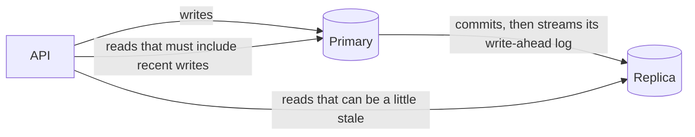

# 6. Reads outgrow one box

## Where we are

Indexes, efficient queries, a right-sized pool and a cache have taken the API a long way. But the cache only helps hot data. The long tail of accounts, every customer's own searches, and every first read after a write still go to the database. In stage 5's cached run, it still computed about 390 summaries a second. Meanwhile the same primary handles every write. It's running out of CPU, and the next step up in machine size is expensive.

## Stop and think

::: think You add a read replica and send all reads to it. A customer pays for something, and their app immediately refreshes their transactions. What can they see?

Possibly not their payment. Replicas usually apply changes asynchronously: the primary confirms the write, then streams it to the replica, which applies it a little later. A read that lands on the replica in between sees the old data.

In the lab, with the replica 2 seconds behind, a summary read straight after a write came back from the replica without the new transaction. To the customer it looks like the payment failed, so they try again.

:::

::: think How would you make sure a customer always sees their own writes, without sending every read to the primary?

Only the reads that follow a customer's own recent write need protecting. Two common approaches:

- **A sticky window.** Send that customer's reads to the primary for a few seconds after they write. Simple, but it guesses how long lag can last.
- **A consistency token.** After the write, return the primary's position in its write-ahead log. A later read that carries the token uses the replica only once the replica has applied at least that much; until then, it goes to the primary. This doesn't guess.

Everyone else's reads can still go to replicas.

:::

::: think You run three replicas behind a load balancer. A customer refreshes twice. The first time they see a new transaction; the second time it's gone. How?

The two reads went to different replicas, and the second was further behind than the first. This breaks *monotonic reads*: once you've seen something, you shouldn't see an older state afterwards. Fix it by keeping a session on one replica, or by using the consistency token from the newest data they've seen.

:::

## The mental model

### How a replica keeps up



Every change Postgres makes is first recorded in its *write-ahead log* (WAL). Streaming replication sends that log to the replica, which replays it to keep an identical copy. The replica accepts read-only queries while it replays. Each point in the log has a position, the *log sequence number* (LSN), which is what the consistency token carries.

### Synchronous or asynchronous

- **Asynchronous** (the default): the primary confirms a commit without waiting for any replica. Writes stay fast and don't depend on the replica being up, but replicas lag, and if the primary fails, the last few commits may never have reached a replica.
- **Synchronous**: the primary waits for a replica before confirming each commit. In Postgres, `synchronous_commit = on` waits until a replica has stored the change, which protects against losing it, but doesn't mean the replica's queries can see it yet. Only `remote_apply` waits until it's visible there. Either way, every write now pays a network round trip, and writes stall if no synchronous replica is available, unless you configure several to choose from.

### What lag looks like

Lag isn't constant. In the lab, the replica stayed within about 0.15 s of the primary when idle. During a burst of three million inserts, it fell 0.3 to 0.6 s behind and caught up within a second afterwards. Across a real network, with a busy replica, or while a long query on the replica holds up replay, lag can reach seconds or minutes. Design for the worst lag you're willing to tolerate, and measure it.

### Read capacity

A replica adds read capacity only if it has its own CPU, memory and disk. In the lab, both databases share one laptop, so moving reads to the replica changed little (900 requests a second on the primary, 1,077 on the replica). The lab shows the mechanics; the capacity comes from separate machines.

## The escalation ladder

### 1. Scale the primary up

A bigger machine: more cores and more memory, so more of the data and indexes stay cached.

**Fixes:** read and write capacity together, with no change to the application.
**Costs:** money, roughly doubling at each step; usually a brief restart or failover to resize.
**Breaks:** nothing, but there's a ceiling, and one machine is still one failure.
**Don't stop here when:** the next size up costs more than a replica, or you're close to the largest size available.

### 2. One replica for reads that can be stale

Route reads that tolerate lag to a replica: reports, exports, search, analytics, other customers' data. Keep everything else on the primary. Make the routing explicit in code, per query or per endpoint, not hidden in a proxy.

**Fixes:** offloads a large share of reads from the primary.
**Costs:** a second database to run, and a second connection pool in every API instance.
**Breaks:** anything that reads its own writes from the replica. Long queries on the replica can also hold up replay or be cancelled ("canceling statement due to conflict with recovery"). Postgres's `max_standby_streaming_delay` and `hot_standby_feedback` [trade those off](https://www.postgresql.org/docs/current/hot-standby.html#HOT-STANDBY-CONFLICT) against lag and table bloat on the primary.

### 3. Read-your-writes for user-facing reads

Send a customer's reads to the replica only when it has caught up with their own last write:

<<< @/../samples/src/Bank.Api/Data/ReadRouting.cs#read-your-writes

**Fixes:** customers not seeing their own changes. In the lab, with the replica 2 seconds behind, a read carrying the token went to the primary and included the new transaction. Once the replica caught up, the same token was served by the replica.
**Costs:** the token has to travel with the client, in a header or cookie, plus one cheap query to the replica to check its position.
**Breaks:** nothing, for the writer. Other customers can still see slightly old data, which is usually fine. The cheaper alternative, a sticky window, breaks whenever lag outlasts the window.

### 4. More replicas, with lag-aware routing

Spread reads across several replicas, and take any that falls too far behind out of rotation (check `pg_last_xact_replay_timestamp()` or `pg_stat_replication`). Keep each session on one replica, or use tokens, to preserve monotonic reads.

**Fixes:** more read capacity, and isolation from one slow replica.
**Costs:** more databases to run and pay for; monitoring and routing logic.
**Breaks:** monotonic reads, if sessions hop between replicas at different positions.

### 5. Synchronous replication for reads that must be current

With `synchronous_commit = remote_apply`, the primary confirms a commit only after a replica has applied it, so a read on that replica is never behind.

**Fixes:** lag, for that replica.
**Costs:** every write waits for a network round trip and the replica's apply, which adds latency to the write path.
**Breaks:** write availability, if the synchronous replica is slow or down. Usually reserved for durability across sites, not for scaling reads.

## Trade-offs at a glance

| Option | Fixes | Costs | Watch out for |
|---|---|---|---|
| Scale the primary up | Read and write capacity | Money; a ceiling | Still one machine |
| Replica for stale-tolerant reads | Read load on the primary | A second database and pool | Code that reads its own writes |
| Read-your-writes (token) | Customers missing their own changes | Token plumbing; a check query | Tokens lost between client and server |
| Sticky window | The same, more simply | Guessing a window | Lag longer than the window |
| Several replicas | More read capacity | More databases | Monotonic reads; lagging replicas |
| Synchronous replication | Lag on that replica | Slower writes | Write availability |

## Traps

- **Treating replicas as if they had no lag.** It's small most of the time, and then it isn't. Measure it, alert on it, and decide what happens when it's high.
- **Round-robin across replicas without session affinity.** Customers see data go backwards.
- **Long-running reports on a replica that also serves customers.** They can hold up replay, raising lag for everyone, or be cancelled part-way.
- **Reading a balance for a decision from a replica.** Decisions need the source of truth.
- **Assuming a replica is a backup.** It replicates mistakes, such as a bad `DELETE`, immediately. You still need backups.
- **Promoting an asynchronous replica after a failure and assuming nothing was lost.** Commits that hadn't reached it are gone.

::::: trap
After recording a transaction, this endpoint returns the account's new summary so the app can show the updated balance. In production, customers often see their old balance right after paying. Why?

```csharp
db.Transactions.Add(transaction);
await db.SaveChangesAsync(ct);

// Return the updated summary. Reads go to the replica to spare the primary.
var summary = await ComputeSummaryAsync(replicaDb, id, ct);
return Results.Ok(summary);
```

::: details Answer
The write committed on the primary, but the replica applies it a moment later. Reading the summary from the replica immediately afterwards usually runs before that, so it returns the balance from before the payment.

In the write path, read from the primary, ideally with the same connection that made the write. Use replicas for reads that can tolerate lag, and protect the writer's next reads with a consistency token or a sticky window.
:::
:::::

## In the interview

::::: interview
**Usually asked as:** "Reads are saturating the primary database. What do you do?" Often followed by: "What problems do read replicas introduce?"

**Short answer:** "First I'd confirm it's really read load, and that indexes, query efficiency and caching are done. Then I'd consider scaling the primary up, since it changes nothing else. If that's not enough, I'd add read replicas and route reads that tolerate a little staleness to them, explicitly per query. The main problem is replication lag: a user can write and then not see their own change. I'd protect those reads with read-your-writes, ideally a token with the primary's log position, so they use a replica only once it has caught up. I'd monitor lag, take lagging replicas out of rotation, and keep sessions on one replica so data doesn't appear to go backwards."

::: details Follow-up: what's the difference between read-your-writes and monotonic reads?
Read-your-writes: after you write, your reads include that write. Monotonic reads: once you've seen some data, you never see an older version afterwards. Replicas at different positions can break either. Tokens or session affinity fix both.
:::

::: details Follow-up: synchronous or asynchronous replication?
Asynchronous keeps writes fast and independent of replica health, at the cost of lag and possible loss of the latest commits if the primary fails. Synchronous protects those commits, and with `remote_apply` removes lag on that replica, but adds latency to every write and can stall writes if the replica is unavailable. Most systems use asynchronous replicas for reads, and synchronous replication, if at all, for durability.
:::

::: details Follow-up: a replica falls five minutes behind. What happens, and what do you do?
Reads routed to it serve five-minute-old data, and tokens from recent writes push those customers' reads back to the primary, adding load just when things are strained. Take it out of rotation once lag passes a threshold, find out why (a long query, a burst of writes, the network, an undersized replica), and alert on lag before customers notice.
:::

::: details Follow-up: replica or cache?
A cache is cheaper per read, and can hold computed results, but only helps repeated reads, and you manage its staleness yourself. A replica serves any query at full freshness minus lag, including the long tail, but costs a whole database. They complement each other: the cache for hot, repeated reads; replicas for the breadth of reads.
:::

::: details Follow-up: does adding replicas help with writes?
No. Every replica has to apply every write, and the primary still does all of them. Replicas add read capacity and availability. Write capacity needs a bigger primary, less write work, or splitting the data, which is the next stage.
:::
:::::

## Try it

### The simulator

Customers record transactions, and half of them read their account back shortly afterwards. Try each scenario for about 30 seconds, and watch the read-backs that miss the customer's own write, and the share of reads on the primary:

- **Replica for everything**: no load on the primary, but many customers don't see the payment they just made.
- **Primary for everything**: always correct, and the replica does nothing.
- **Sticky for 5 s**: correct, with only a few percent of reads on the primary.
- **Sticky for 5 s, with lag spikes**: when lag outlasts the window, some customers miss their own writes again.
- **Token, with lag spikes**: correct even during spikes, with the fewest reads on the primary.

<ReplicaSimulator />

### Against the lab database

The replica runs only when you ask for it, with the `replica` profile. From the `samples` folder:

1. **Start the replica.** On first start it clones the primary; ours took under 10 seconds for the full 10-million-row database. Then check it's streaming:

   ```sh
   docker compose --profile replica up -d
   docker compose exec postgres psql -U bank -d bank -c "SELECT client_addr, state, sync_state, replay_lag FROM pg_stat_replication"
   ```

2. **Route reads to it.** The summary and feed endpoints follow `--Lab:Reads` (`Primary`, `Replica` or `ReadYourWrites`), and say who served each read in an `X-Served-By` header:

   ```sh
   dotnet run --project src/Bank.Api -- --Lab:Reads=Replica
   curl -s -i "http://localhost:5080/accounts/43/summary" | grep -i x-served-by
   ```

3. **Make the lag visible.** Restart the replica with a 2-second delay, record a transaction, and read the summary straight away. Then do the same with `--Lab:Reads=ReadYourWrites`, passing the token the write returned:

   ```sh
   REPLICA_DELAY=2000 docker compose --profile replica up -d
   TOKEN=$(curl -s -D - -o /dev/null -H "Content-Type: application/json" \
     -d '{"amount": -10.00, "description": "Card payment"}' \
     http://localhost:5080/accounts/43/transactions | grep -i x-consistency-token | tr -d '\r' | cut -d' ' -f2)
   curl -s -i "http://localhost:5080/accounts/43/summary" -H "X-Consistency-Token: $TOKEN"
   ```

   Compare `transactionCount` and `X-Served-By`. In our run, with `Replica`, the read missed the new transaction for 2 seconds. With `ReadYourWrites`, the read with the token came from the primary and included it, and a second read 2.5 seconds later was served by the caught-up replica.

4. **Watch natural lag under a write burst.** Set `REPLICA_DELAY=0` again, then copy three million rows on the primary while sampling the lag:

   ```sh
   docker compose exec postgres psql -U bank -d bank -c "CREATE TABLE lag_test (LIKE transactions)" \
     -c "INSERT INTO lag_test SELECT * FROM transactions WHERE id <= 3000000"
   ```

   ```sh
   docker compose exec postgres psql -U bank -d bank -c "
     SELECT replay_lag, pg_size_pretty(pg_wal_lsn_diff(pg_current_wal_lsn(), replay_lsn)) AS behind
     FROM pg_stat_replication"
   ```

   Ours reached 0.6 s and 8 MB behind, and caught up within a second. Drop the table afterwards with `DROP TABLE lag_test`.

## What breaks next

Replicas spread the reads, but every write still goes to one primary, and every replica has to repeat all of them. And writes are growing: the transactions table only gets bigger, every insert maintains every index (in stage 2's test, three extra indexes nearly tripled insert time), and month-end brings bursts of salaries and debit orders all at once. The primary is now write-bound, and no number of replicas will help.

Next: [7. Writes outgrow one box](./07-partitioning-and-sharding).
