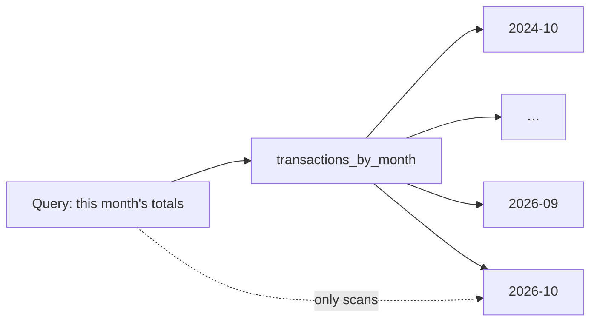
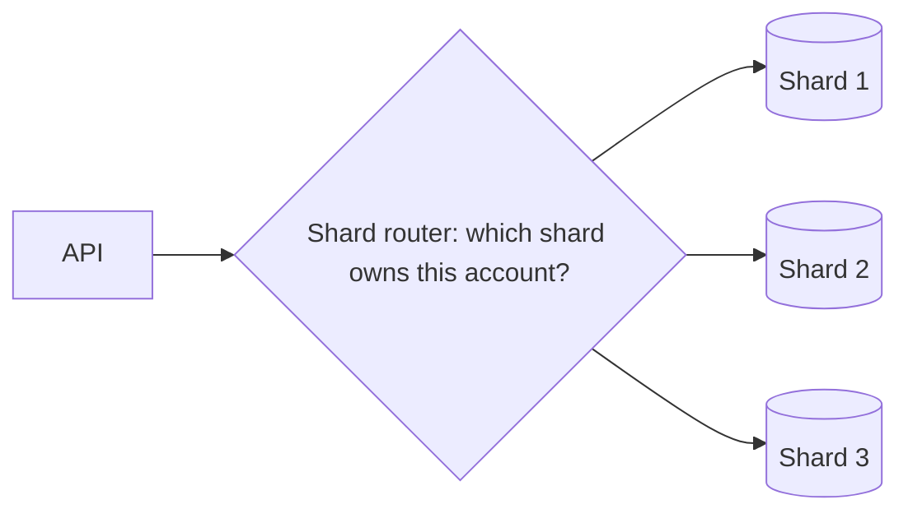

# 7. Writes outgrow one box

## Where we are

Replicas spread the reads, but every write still goes to one primary, and every replica repeats it. The transactions table only grows. Every insert maintains every index: in stage 2's test, three extra indexes nearly tripled insert time. And month-end brings salaries and debit orders in bursts. The primary is now write-bound, and the next size of machine is either too expensive or doesn't exist.

## Stop and think

::: think Partitioning and sharding both split a table. What's the difference, and which one adds write capacity?

**Partitioning** splits a table into pieces inside one database, for example one partition per month. Queries that filter on the partition key read only the partitions they need, and old data can be removed by dropping a whole partition. But it's still one server, with one CPU, one disk and one write-ahead log.

**Sharding** spreads the data across several database servers, each holding a subset of the rows. That's the one that adds write capacity, and it's far more expensive to run, as the next question shows.

:::

::: think You shard the transactions table by account across eight databases. What stops working, or gets harder?

Anything that touches more than one shard:

- **Queries across accounts**, such as "all transactions over R10,000 today": the application has to ask every shard and merge the answers.
- **Joins** between data on different shards.
- **Transactions across shards.** A transfer between two accounts on different shards can no longer be one database transaction. Journey B3 covers this.
- **Unique constraints and ids** across all shards.

And everything operational multiplies: backups, migrations, monitoring and failover, eight times over. Adding a ninth shard means moving data while the system is live.

:::

::: think You shard by account id. Account 1 has 2% of all transactions. With 50 shards, what happens to account 1's shard?

A fair share of 50 shards is 2% each, so account 1 alone fills a whole shard's share, on top of every other account that hashes there. An account can't be split by a key that's the account. In the lab data with 32 shards, the busiest shard carried 1.54 times a fair share, and account 1's rows were 45% of it. More shards make one hot account matter more, not less.

:::

## The mental model

### Make writes cheaper first

Before splitting anything, look at what each write costs:

- **Indexes.** Every insert updates every index on the table. In the lab, inserting a million rows took 3.5 s with only the primary key, 6.2 s with one more index, and 10.3 s with three more.
- **Work that doesn't need to happen now.** Notifications, fraud checks and audit records can often move out of the request. That's journey B2.
- **Data that's never read.** Old transactions still cost index maintenance, vacuum time and backup size.

### Partitioning, inside one database



Postgres routes each row to the partition for its key, and *prunes* partitions a query can't need. In the lab, a monthly-partitioned copy of the table answered "this month's totals" in 96 ms instead of 1,316 ms, because it read one partition instead of the whole table. Removing the oldest month took 95 ms by detaching and dropping its partition, against 10.3 s for a `DELETE` of the same 273,914 rows, which also leaves dead rows behind for vacuum.

The cost: queries that don't filter on the partition key have to look in every partition. One account's newest transactions took 0.43 ms across 25 partitions, against 0.11 ms in the single table. Still fast, but four times the work, and it grows with the number of partitions.

### Sharding, across databases



Every request needs to know which shard owns its data. Common ways to decide:

- **By range of the key**, for example accounts 1 to 100,000 on shard 1. Range queries stay on one shard, but new keys all land on the last shard, and ranges need rebalancing by hand.
- **By hash of the key**: an even spread, but no range queries on the key.
- **By directory**: a lookup table records which shard owns each key. That's the most flexible, since you can move one account on its own, but every request needs a lookup.

### Hash routing: modulo or a ring

The obvious hash router is `hash(key) mod N`. It spreads keys evenly, until you change N. Going from 4 to 5 shards, a key stays put only if both remainders agree, so about 80% of keys move. In the lab's tool, 80.0% of 100,000 accounts moved; from 10 to 11 shards, 90.9% did.

*Consistent hashing* places shards at many points on a ring of hash values. A key belongs to the next shard point after its own hash. Adding a shard takes over only the slices just before its new points, so only about 1/N of the keys move, and all of them move to the new shard. In the tool, going from 4 to 5 shards moved 20.4% of accounts, against a minimum possible of 20%; from 10 to 11, it moved 8.3%.

Each shard needs many points on the ring (*virtual nodes*), or the slices are very uneven. In the simulator below, with one point per shard, the busiest shard carries 2.46 times a fair share and the quietest 0.04 times.

<<< @/../samples/src/Bank.Sharding/ConsistentHashRing.cs#ring

### Choosing a shard key

The shard key decides which queries stay on one shard. For transactions, `account_id` keeps an account's history together, so its statement and summary are single-shard queries. The price: transfers between accounts often span shards, and hot accounts can't be split. Sharding by customer has the same shape. Sharding by time would put all of today's writes on one shard, which defeats the purpose.

## The escalation ladder

### 1. Make each write cheaper

Drop indexes nothing uses (`pg_stat_user_indexes`), batch inserts where you can, move work out of the request (journey B2), and give the primary faster storage or a larger machine.

**Fixes:** write throughput, often by a large factor, without new architecture.
**Costs:** analysis, and a bigger bill if you scale up.
**Breaks:** nothing, if you check that dropped indexes really are unused.

### 2. Partition large tables

Partition by time when queries and retention work by time, as statements and transaction history do.

**Fixes:** queries that filter on the partition key (14 times faster in the lab), and retention: dropping a month takes milliseconds.
**Costs:** creating future partitions on a schedule; primary keys and unique constraints must include the partition key, so the lab's copy needed `(id, created_at)`.
**Breaks:** queries that don't use the key touch every partition. And a write for a month with no partition fails outright: `no partition of relation "transactions_by_month" found for row`.
**Doesn't:** add write capacity. It's still one server.

### 3. Move cold data out

Keep recent data hot and small. Move old partitions to cheaper storage, an archive database, or files that analytics tools can read.

**Fixes:** the size of everything: indexes, vacuum, backups, restore time.
**Costs:** a second place to look for old data, and rules about what lives where.
**Breaks:** queries that expect all history in one table.

### 4. Split by function before splitting by key

Move whole tables or features with different load to their own databases: audit logs, notifications or analytics off the core transactional database. That's often the cheapest form of horizontal scaling, because each database still holds complete, joinable data for its own domain. Journey B5 covers the boundaries.

**Fixes:** write load from the parts that aren't the core.
**Costs:** more databases, and no joins or transactions across them.
**Breaks:** code that joins across the new boundary.

### 5. Shard by key

Spread one dataset across databases by a key, with a stable hash and a consistent-hash ring, or a directory.

**Fixes:** write capacity, storage and memory, in roughly proportional steps.
**Costs:** a routing layer; a resharding process for adding shards while live; globally unique ids instead of per-database sequences; multiplied operations.
**Breaks:** cross-shard queries, joins and transactions; it amplifies hot keys.
**Don't use it when:** rungs 1 to 4 would do. For most systems, they do.

### 6. A distributed SQL database

Systems such as Citus, CockroachDB, YugabyteDB or Spanner do the sharding and routing for you, often with distributed transactions.

**Fixes:** most of the routing and resharding work.
**Costs:** a different database to learn, operate and pay for, and distributed transactions are slower than local ones.
**Breaks:** assumptions from a single database: query performance, isolation behaviour, and extensions. Test with your own workload, and check each product's documentation for its limits.

## Trade-offs at a glance

| Option | Adds write capacity? | Fixes | Costs | Watch out for |
|---|---|---|---|---|
| Cheaper writes, bigger box | Some | Write throughput | Analysis; a bigger bill | A ceiling |
| Partitioning | No | Key-filtered queries; retention | Partition management | Queries without the key; missing partitions |
| Archiving cold data | No | Size, vacuum, backups | A second place for old data | Queries over all history |
| Split by function | Yes | Load from non-core domains | More databases | Cross-database joins |
| Shard by key | Yes | Write capacity, storage | Routing; resharding; operations | Cross-shard work; hot keys |
| Distributed SQL | Yes | Routing and resharding | A new database | Performance and behaviour differences |

## Traps

- **Partitioning to add write capacity.** It's still one server.
- **Forgetting next month's partition.** Inserts fail at midnight on the first.
- **A shard key that doesn't match the queries.** Every common query becomes scatter-gather.
- **Per-database sequences as ids.** Two shards will issue the same id. Use globally unique ids, such as time-ordered UUIDs.
- **Assuming a transfer is still one transaction.** Across shards, it isn't (journey B3).
- **Modulo routing.** Adding a shard moves most of your data.

::::: trap
This shard router comes from an older design document. It passed its unit tests. What goes wrong in production?

```csharp
public class ShardRouter
{
    private readonly List<string> _shardConnections;

    public ShardRouter(List<string> connections)
    {
        _shardConnections = connections;
    }

    public string GetConnectionString(string accountId)
    {
        // Simple hash-based sharding
        int shardIndex = Math.Abs(accountId.GetHashCode()) % _shardConnections.Count;
        return _shardConnections[shardIndex];
    }
}
```

::: details Answer
Three problems, from worst to least:

1. **`string.GetHashCode()` is randomised per process** in modern .NET, so every restart, and every server running the API, routes the same account to a different shard. Data written before a deployment seems to vanish after it. The unit tests passed because they ran in one process. Run the lab's `Bank.Shards hashes` command twice to see the values change.
2. **`Math.Abs(int.MinValue)` throws `OverflowException`.** For the rare key whose hash is `int.MinValue`, routing fails every time in that process.
3. **Modulo routing moves about 80% of keys** when you go from four shards to five.

Use a stable hash, one guaranteed to give the same answer in every process, machine and version, and consistent hashing (or a directory) to place keys:

<<< @/../samples/src/Bank.Sharding/StableHash.cs#stable-hash
:::
:::::

## In the interview

::::: interview
**Usually asked as:** "Your database is write-bound. How do you scale writes?" Or: "How would you shard the transactions table?"

**Short answer:** "Sharding is the last resort, so first I'd make writes cheaper: remove unused indexes, batch, move non-essential work out of the request, and scale the primary up. I'd partition large tables by time for faster time-filtered queries and cheap retention, though that doesn't add write capacity. Next I'd split off separate domains into their own databases. If I still need to shard, I'd choose a key that keeps the common queries on one shard, probably the account or customer id, route with a stable hash and consistent hashing so adding shards moves only a fair share of data, and plan for cross-shard queries, transfers spanning shards, and hot accounts."

::: details Follow-up: what's the difference between partitioning and sharding?
Partitioning splits a table into pieces within one database, which helps pruning, maintenance and retention. Sharding spreads data across several databases, which adds write capacity and storage, but makes cross-shard queries, joins and transactions hard.
:::

::: details Follow-up: what is consistent hashing, and why use it?
Shards are placed at many points on a ring of hash values, and each key belongs to the next shard point after its hash. Adding or removing a shard moves only the keys in the affected slices, about 1/N of them, instead of most keys as with modulo. Virtual nodes, many points per shard, keep the slices even.
:::

::: details Follow-up: how do you handle a hot key, like a very busy account?
It depends whether reads or writes are hot. Reads: cache them, or serve them from replicas. Writes: give the account a dedicated shard (easiest with directory-based routing), batch its writes, or split its data with a compound key such as account plus month, accepting that its queries span shards. Monitor per-key load so you find hot keys before they find you.
:::

::: details Follow-up: how do you add a shard to a live system?
With consistent hashing, only the keys that move to the new shard need copying. Copy them in the background, keep the copy in sync with ongoing writes, then switch routing for those keys and clean up afterwards. It's a migration with a cut-over, like any other; the same patterns appear in journey B5.
:::

::: details Follow-up: how do you transfer money between accounts on different shards?
Not in one database transaction any more. Use a saga with compensating steps, or an outbox to record intent and complete the steps reliably, with idempotency so retries are safe. Journeys B2 and B3 cover these. Or choose a shard key that keeps most transfers on one shard, if the domain allows it.
:::
:::::

## Try it

### The simulator

2,000 accounts, spread across shards. Try:

- **Add a shard, with `hash(key) mod N`**: most accounts move.
- **Switch to the ring, and add a shard**: about a fair share moves, all of them to the new shard.
- **Drop virtual nodes to 1**: the load becomes very uneven. Raise them again.
- **Tick "realistic"**: busy accounts make some shards hotter than others, however good the hashing. Add shards, and watch the busiest one stay busy.

<HashRingSimulator />

### In your browser: partitioning

Build a monthly-partitioned copy of the transactions table, then compare a time-filtered query against both versions. The first playground takes a few seconds.

```sql playground
DROP TABLE IF EXISTS transactions_by_month;
CREATE TABLE transactions_by_month (LIKE transactions INCLUDING DEFAULTS)
    PARTITION BY RANGE (created_at);

DO $$
DECLARE month date;
BEGIN
    FOR month IN
        SELECT generate_series(date_trunc('month', min(created_at)), date_trunc('month', max(created_at)), interval '1 month')::date
        FROM transactions
    LOOP
        EXECUTE format('CREATE TABLE %I PARTITION OF transactions_by_month FOR VALUES FROM (%L) TO (%L)',
            'transactions_' || to_char(month, 'YYYY_MM'), month, month + interval '1 month');
    END LOOP;
END $$;

INSERT INTO transactions_by_month SELECT * FROM transactions;
ANALYZE transactions_by_month;
SELECT count(*) AS partitions FROM pg_inherits WHERE inhparent = 'transactions_by_month'::regclass;
```

```sql playground
EXPLAIN ANALYZE
SELECT count(*), sum(amount) FROM transactions
WHERE created_at >= date_trunc('month', now());

EXPLAIN ANALYZE
SELECT count(*), sum(amount) FROM transactions_by_month
WHERE created_at >= date_trunc('month', now());
```

The second plan scans only the current month's partition.

### Against the lab database

From the `samples` folder:

1. **See `GetHashCode` change.** Run this twice. The first column changes between runs; the stable hash doesn't:

   ```sh
   dotnet run --project tools/Bank.Shards -- hashes
   ```

2. **Count the accounts that move** when you add a shard:

   ```sh
   dotnet run --project tools/Bank.Shards -- move --from 4 --to 5
   dotnet run --project tools/Bank.Shards -- move --from 10 --to 11
   ```

3. **See hot accounts skew real shards.** This reads per-account row counts from the lab database and places accounts on a ring:

   ```sh
   dotnet run --project tools/Bank.Shards -- balance --shards 8
   dotnet run --project tools/Bank.Shards -- balance --shards 32
   ```

   In ours, the busiest of 8 shards carried 1.28 times a fair share; the busiest of 32, 1.54 times.

4. **Partition the real table.** The script builds a monthly-partitioned copy alongside the original. It took us about two and a half minutes:

   ```sh
   docker compose exec -T postgres psql -U bank -d bank < labs/b1-partition-by-month.sql
   ```

   Then compare queries and retention against the original table:

   ```sh
   docker compose exec postgres psql -U bank -d bank -c "
     EXPLAIN ANALYZE SELECT count(*), sum(amount) FROM transactions_by_month
     WHERE created_at >= date_trunc('month', now())"
   docker compose exec postgres psql -U bank -d bank -c '\timing on' -c "BEGIN" \
     -c "DELETE FROM transactions WHERE created_at < date_trunc('month', (SELECT min(created_at) FROM transactions)) + interval '1 month'" \
     -c "ROLLBACK"
   ```

   Drop the copy afterwards with `DROP TABLE transactions_by_month`.

Our results:

| | Single table | Partitioned by month (25 partitions) |
|---|---|---|
| This month's totals, all accounts | 1,316 ms | 96 ms |
| Account 1's newest 20 transactions | 0.11 ms | 0.43 ms |
| Remove the oldest month (273,914 rows) | 10.3 s (`DELETE`) | 95 ms (detach and drop) |

## What breaks next

This is the top of the ladder for one journey. You started with an endpoint that was slow at peak, and climbed from measuring to indexes, queries, connections, caching, replicas and finally splitting the data, each time using the cheapest fix that worked. Sharding also opened problems this journey doesn't solve: money moving between shards (journey B3), and services that each own their own data (journey B5).

Now put it all together: [the capstone](./capstone).
