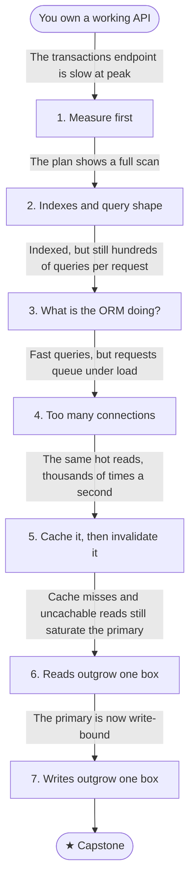

# B1: Your API gets popular

You own a working REST API for a banking product (accounts and transactions) backed by a relational database. It works in development. Then real life happens.

Traffic grows, and the endpoints that were fast in development slow down at peak. This journey starts with measuring, then works up the escalation ladder from query shape to sharding, one bottleneck at a time.

## Stage map

Each stage's fix creates the problem that triggers the next one.

| # | Stage | Triggered by |
|---|---|---|
| 1 | [Measure first](./01-measure-first): Latency percentiles, where time goes (app, database or network), reading a query plan | The transactions endpoint is slow at peak |
| 2 | [Indexes and query shape](./02-indexes-and-query-shape): Composite, covering, selectivity, SARGable queries | The plan shows a full scan |
| 3 | [What is the ORM doing?](./03-what-is-the-orm-doing): N+1, over-fetching, offset vs keyset pagination | Indexed, but still hundreds of queries per request |
| 4 | [Too many connections](./04-too-many-connections): Pool exhaustion, async all the way, timeouts | Fast queries, but requests queue under load |
| 5 | [Cache it, then invalidate it](./05-cache-then-invalidate): Cache-aside, TTLs, stampedes | The same hot reads, thousands of times a second |
| 6 | [Reads outgrow one box](./06-read-replicas): Read replicas, replication lag, read-your-writes | Cache misses and uncachable reads still saturate the primary |
| 7 | [Writes outgrow one box](./07-partitioning-and-sharding): Partitioning vs sharding, hot keys, stable hashing | The primary is now write-bound |
| ★ | [Capstone: slow reads on a 10M-row table](./capstone) | — |

## Before you start

This journey assumes HTTP and REST, SQL basics (joins, filtering, grouping) and async/await. Check yourself against the [backend core self-check](../../core-self-check) first.

## By the end you'll be able to

- Find where request time actually goes (app, database or network) before changing anything.
- Read a query plan and choose an index that fixes it.
- Spot N+1 queries and over-fetching, and choose a pagination strategy.
- Explain connection-pool exhaustion and how to avoid it.
- Add a cache and keep it correct under invalidation and stampedes.
- Scale reads with replicas without breaking read-your-writes.
- Choose between partitioning and sharding, and route keys stably.
