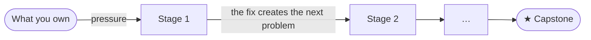

## How it works

Knowing how to build something is different from knowing how it behaves under pressure. Senior work, and senior interviews, live in that gap.

So the handbook is organised as **journeys**. Each one starts from something you already own, such as a working REST API or a working page. Then it applies pressure: more traffic, slow work, failures, more teams, attackers. Each stage fixes the problem in front of you, and that fix creates the problem that triggers the next stage. The journey ends with a capstone: a realistic interview question.

## The T model

A T-shaped engineer has depth in one area and working knowledge of the areas around it. The vertical stroke of the T is your **core**: the skills your role expects you to own. The horizontal bar is your **breadth**: the systems your work depends on, which you need to reason about even if you don't build them every day.

A journey runs down your core and out along the bar. Pick the track closest to your current role: [backend](/backend/) or [frontend](/frontend/). Shared interview preparation lives under [Interviews](/interviews/).
