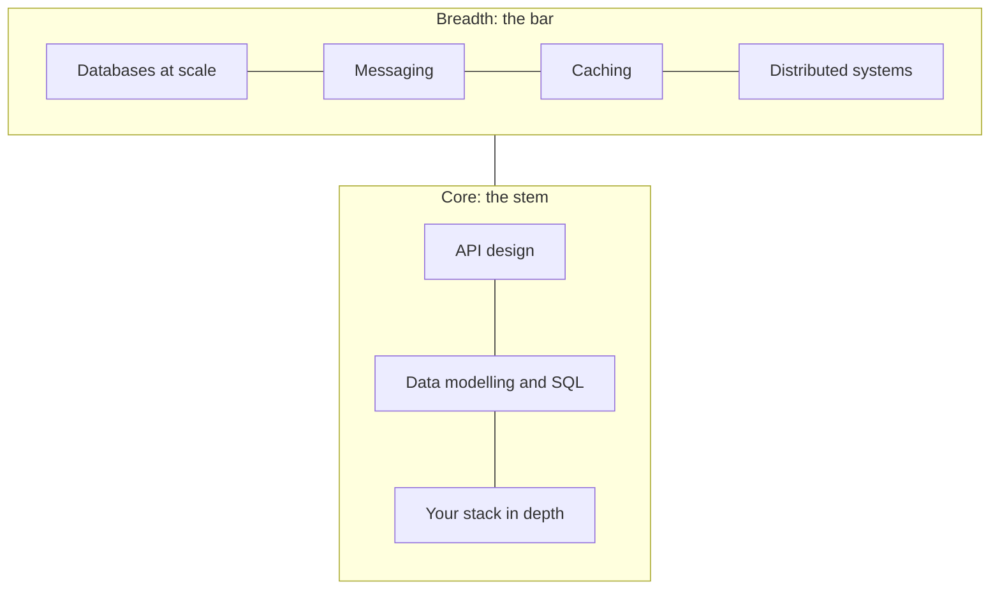

## Choose your orientation

A T-shaped engineer has depth in one area and working knowledge of the areas around it. The vertical stroke of the T is your **core**: the skills your role expects you to own. The horizontal bar is your **breadth**: the systems your work depends on, which you need to reason about even if you don't build them every day.

Each track is organised the same way. Pick the one closest to your current role: the [backend track](/backend/) or the [frontend track](/frontend/). Shared interview preparation lives under [Interviews](/interviews/).
